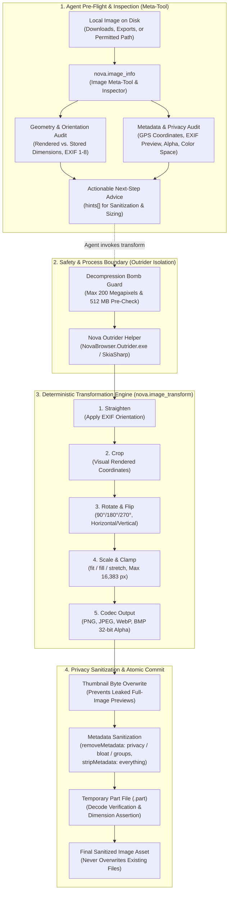
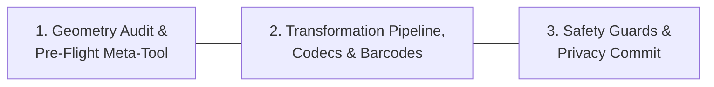

# Local Image Intelligence & Transformation Architecture

> [!NOTE]
> Nova provides a native, 100% local image intelligence and transformation engine. It empowers autonomous AI agents to inspect, audit, crop, resize, rotate, convert, and sanitize local image files without third-party cloud vision APIs, Python scripts, or image editing software.

All image decoding and encoding operations execute locally on the operator's workstation within an isolated native helper process, strictly preserving privacy and protecting the host browser from malformed image exploits.

---

## The 3 Pillars of Local Image Intelligence

Nova's image processing architecture is organized into three specialized domains:

| Sub-System | Scope & Responsibilities | Deep Dive Specification |
| :--- | :--- | :--- |
| **Geometry Audit & Meta-Tool** | Pre-flight image inspection via `nova.image_info`, visual vs. stored dimension reconciliation, EXIF orientation tags ($1$–$8$), alpha channel detection, and actionable operational hints (`hints[]`). | [Geometry Audit & Meta-Tool](geometry-audit-and-meta-tool/README.md) |
| **Transformation Pipeline & Codecs** | Deterministic 6-stage pipeline (Straighten $\to$ Crop $\to$ Rotate $\to$ Flip $\to$ Resize $\to$ Encode), visual coordinate cropping, scaling modes (`fit`, `fill`, `stretch`), native WebP without Store extensions, contact sheets, and barcode generation/decoding. | [Transformation Pipeline & Codecs](transformation-pipeline-and-codecs/README.md) |
| **Safety Guards & Privacy Commit** | Outrider process isolation (fault containment for SkiaSharp), decompression bomb defense (200 Megapixels / 512 MB pre-check), EXIF thumbnail overwrite to prevent uncropped scene leaks, metadata sanitization, and atomic part-file verification. | [Safety Guards & Privacy Commit](safety-guards-and-privacy-commit/README.md) |

---

## Comprehensive Documentation Index

Explore the dedicated deep-dive guides for technical specifications, coordinate systems, and security invariants:

### 1. [Image Geometry Audit & Pre-Flight Meta-Tool](geometry-audit-and-meta-tool/README.md)
* **Visual vs. Stored Geometry:** Understanding how EXIF orientation tags invert dimensions and avoiding the tool crop trap.
* **Metadata & Channel Analysis:** Inspecting color profiles, DPI, transparency, and multi-frame animation states.
* **Actionable Next-Step Advice:** How Nova's hint engine guides agents toward token-efficient downscaling and privacy stripping.

### 2. [Transformation Pipeline, Codecs & Barcodes](transformation-pipeline-and-codecs/README.md)
* **The 6-Stage Pipeline:** Immutable operational sequencing ensuring reproducible outputs.
* **Visual Pixel Coordinate Cropping:** Defining crop boxes against upright rendered dimensions without mental trigonometry.
* **Scaling Modes & Upscaling Protection:** Preserving aspect ratios with `fit` and `fill`, and enforcing `allowUpscale: false`.
* **Native WebP Support:** High-efficiency lossy and lossless WebP compression built directly into Nova.
* **Contact Sheets & Barcode Operations:** Grid generation via `nova.image_contact_sheet`, and pixel-perfect QR/barcode operations.

### 3. [Safety Guards & Privacy Commit](safety-guards-and-privacy-commit/README.md)
* **Outrider Process Boundary:** Containing native codec memory corruption exploits outside the browser host process.
* **Decompression Bomb Protection:** Pre-allocation pixel bounds checks eliminating memory exhaustion denial-of-service.
* **EXIF Thumbnail Overwrite:** Neutralizing hidden camera preview thumbnails that leak uncropped visual scenes.
* **Two-Phase Commit:** Verifying part-file dimensions before atomic renaming and enforcing no-overwrite guarantees.

---

## Tool Reference Matrix

| Tool | Capability Bundle | Primary Role | Key Parameters |
| :--- | :--- | :--- | :--- |
| [`nova.image_info`](../../../mcp-reference/tools/files-and-documents/nova-image-info.md) | `page_read_debug` | Pre-flight metadata, orientation, geometry and security inspection | `path` |
| [`nova.image_transform`](../../../mcp-reference/tools/files-and-documents/nova-image-transform.md) | `page_read_debug` | Deterministic cropping, resizing, conversion, and metadata sanitization | `path`, `outputPath?`, `format?`, `crop?`, `rotate?`, `flip?`, `resize?`, `quality?`, `stripMetadata?`, `removeMetadata?` |
| [`nova.image_contact_sheet`](../../../mcp-reference/tools/files-and-documents/nova-image-contact-sheet.md) | `page_read_debug` | A folder of images as one grid of named thumbnails (PNG, JPEG or A4 PDF pages) | `folder`, `format?`, `columns?`, `thumbSize?`, `labels?`, `title?` |
| [`nova.barcode_generate`](../../../mcp-reference/tools/files-and-documents/nova-barcode-generate.md) | `page_read_debug` | QR code or barcode as a verified PNG/SVG file | `content`, `type?`, `format?`, `width?`, `height?`, `errorCorrection?`, `includeText?`, `outputPath?` |
| [`nova.barcode_decode`](../../../mcp-reference/tools/files-and-documents/nova-barcode-decode.md) | `page_read_debug` | Reads QR codes and barcodes from an image | `path`, `multiple?`, `formats?` |

---

## Related Documentation

* [Media Intelligence Overview](../README.md)
* [WinUI 3 Image Viewer](../image-viewer/README.md)
* [Offline Optical Character Recognition (OCR)](../ocr/README.md)
* [Document Conversion & Office Generation](../document-conversion/README.md)
* [Outrider Component Reference](../../../components/outrider/README.md)
* [All core features](../../README.md)
