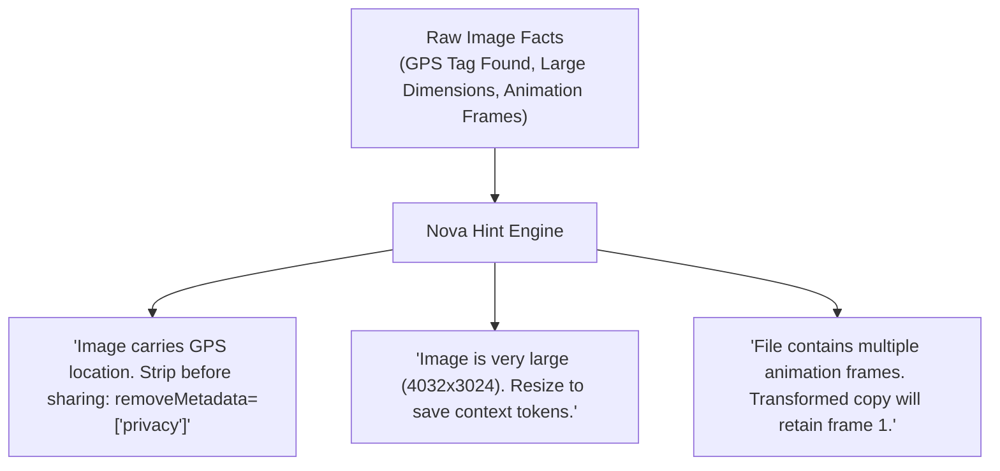

# Image Geometry Audit & Pre-Flight Meta-Tool

> [!NOTE]
> Autonomous AI agents frequently make spatial errors when manipulating images because raw filesystem attributes reveal almost nothing about an image's visual structure. **Nova AI Workspace** provides `nova.image_info` as a dedicated **pre-flight image meta-tool** that reconciles visual geometry, audits embedded metadata, and provides actionable next-step advice.

---

## 1. The Orientation & Geometry Challenge

A smartphone or digital camera photo might report physical pixel storage of $3024 \times 4032$ in file headers, yet render as a $4032 \times 3024$ landscape image on display screens because of an EXIF orientation flag ($1$ through $8$).

```
Raw Physical Bytes on Disk:        Visual Rendered Image on Screen:
+---------------------------+       +------------------------------------+
|                           |       |                                    |
| 3024 px wide              |  -->  | 4032 px wide                       |
| 4032 px high              |       | 3024 px high                       |
| (EXIF Orientation: 6)     |       | (Rotated 90° CW by viewer)         |
+---------------------------+       +------------------------------------+
```

### The Tool Crop Trap

If an autonomous agent blindly calculates crop coordinates based on raw file dimensions, it slices the wrong region of the image. `nova.image_info` eliminates this trap by reporting both geometries explicitly:

* **`width` & `height`:** The effective dimensions of the image **as displayed to human operators and vision models**.
* **`storedWidth` & `storedHeight`:** The physical pixel dimensions in the file stream before orientation compensation.
* **`orientation`:** The raw EXIF tag ($1$ to $8$), explaining how the image was captured.

---

## 2. Comprehensive Pre-Flight Inspection (`nova.image_info`)

```json
{
  "name": "nova_image_info",
  "arguments": {
    "path": "C:\\Users\\Operator\\Downloads\\SiteAudit_Photo.jpg"
  }
}
```

### Diagnostic Facts Returned

1. **Format & Container:** Detects image containers (`jpeg`, `png`, `webp`, `gif`, `bmp`, `ico`, `tiff`).
2. **Animation & Frame Count:** Detects animated files ($> 1$ frames for animated GIFs and animated WebP), warning agents before single-frame conversions.
3. **Alpha Transparency Channel:** Reports whether the image contains a transparency channel (`true` / `false`), preventing accidental black background artifacts when converting PNGs to JPEG.
4. **Color Space & Profiles:** Reports embedded ICC color profiles (e.g. `sRGB`, `Display P3`) and color depths.
5. **DPI Resolution:** Horizontal and vertical DPI (`dpiX`, `dpiY`) for print layout fidelity.

---

## 3. Actionable Agent Hints (`hints[]`)

Rather than expecting agents to parse complex EXIF flags, `nova.image_info` translates raw metadata facts into explicit operational recommendations:



### Example Structured Response

```json
{
  "width": 4032,
  "height": 3024,
  "storedWidth": 3024,
  "storedHeight": 4032,
  "orientation": 6,
  "format": "jpeg",
  "alphaChannel": false,
  "metadata": {
    "gps": true,
    "exif": true,
    "exifThumbnail": true
  },
  "hints": [
    "The image carries a GPS position (where it was taken). Before sharing or uploading it, write a copy without them: nova.image_transform with removeMetadata=['privacy'] (keeps camera, exposure and date; stripMetadata=true removes everything).",
    "The image is very large (4032x3024). Resizing it with nova.image_transform saves context tokens."
  ]
}
```

---

## 4. Related Documentation

* [Local Image Intelligence & Processing Overview](../README.md)
* [Transformation Pipeline, Codecs & Barcodes](../transformation-pipeline-and-codecs/README.md)
* [Safety Guards & Privacy Commit](../safety-guards-and-privacy-commit/README.md)
* [Image Info Tool Reference](../../../../mcp-reference/tools/files-and-documents/nova-image-info.md)
* [Offline OCR Architecture](../../ocr/README.md)
