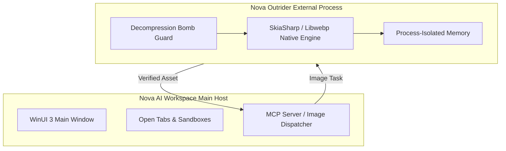
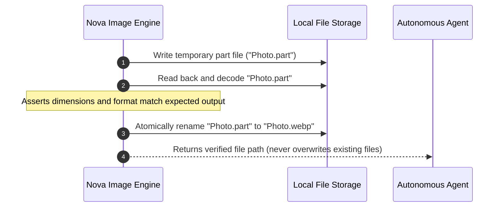

# Safety Guards & Privacy Commit

> [!NOTE]
> Image parsing libraries are historically among the most vulnerable components in computing, susceptible to buffer overflows, heap corruptions, and memory exhaustion attacks. Furthermore, un-sanitized camera metadata frequently leaks GPS locations and uncropped full-scene thumbnails. **Nova AI Workspace** enforces strict defense-in-depth security and privacy boundaries.

---

## 1. Outrider Process Boundary (Fault Containment)

All native image decoding, matrix transforms, and codec compression execute inside Nova's external helper process: **Nova Outrider** (`NovaBrowser.Outrider.exe`).



### Safety Guarantees

* **Crash Isolation:** If an agent encounters a malformed PNG decompressor exploit or a corrupted TIFF stream triggering an uncatchable access violation, only the Outrider child process crashes.
* **Host Preservation:** Nova's main browser window, active web sessions, sandbox profiles, and MCP connections remain completely unaffected.

---

## 2. Decompression Bomb Protection

Malicious actors can craft tiny compressed images ($< 1$ MB on disk) that expand into tens of gigabytes in RAM when decoded (pixel bombs), causing system freezes or out-of-memory crashes:

$$\text{Target Megapixels} = \frac{\text{width} \times \text{height}}{1{,}000{,}000} \le 200 \text{ MP}$$

### Enforcement Gates

1. **Header Pre-Check:** Nova inspects container headers to evaluate dimensions *before* allocating bitmap buffers.
2. **200 Megapixel Limit:** Any image exceeding $200$ megapixels or a source filesize $> 512$ MB is rejected immediately with error code `limit_exceeded`.
3. **WebP Boundary Clamping:** Output dimensions are clamped to a maximum of $16{,}383$ pixels per side, matching the physical boundary of the WebP specification.

---

## 3. EXIF Thumbnail Overwrite (Anti-Leak Invariant)

When photos taken with digital cameras or smartphones are cropped, standard software frequently updates the primary image pixels while leaving the embedded EXIF preview thumbnail untouched. If the cropped image is shared, third parties can extract the thumbnail and view the **entire uncropped original scene**.

```
+--------------------------------------------------------+
| Cropped Output Image: Only shows a product close-up    |
|                                                        |
|   +------------------------------------------------+   |
|   | Embedded EXIF Thumbnail (Standard Flaw):       |   |
|   | Shows entire room, credit cards, or badges!    |   |
|   +------------------------------------------------+   |
+--------------------------------------------------------+
```

### Nova's Anti-Leak Invariant

* In `nova.image_transform`, embedded thumbnail bytes are **actively overwritten and destroyed in memory** before writing the output file.
* The EXIF orientation tag is reset to $1$ because pixels are already physically transformed upright.

### Metadata Sanitization Levels

| Mode | Behavior & Data Preserved |
| :--- | :--- |
| **`removeMetadata: ["privacy"]`** | Strips GPS coordinates, author names, serial numbers, software tags, free text, maker notes, and XMP blocks. Preserves camera model, exposure settings, and date. |
| **`removeMetadata: ["bloat"]`** | Drops heavy binary bulk (maker notes, XMP edit history, vendor software tags) to reduce file size while retaining basic photo metadata. |
| **`stripMetadata: true`** | Completely strips all EXIF, GPS, and XMP metadata blocks for maximum privacy. |

---

## 4. Two-Phase Commit & No-Overwrite Guarantee

To prevent corrupted partial files from polluting the user's filesystem:



1. **Atomic Part File:** Images are written to an ephemeral `.part` file.
2. **Read-Back Assertion:** Nova decodes the `.part` file back in memory to verify that pixel dimensions and formatting match expected specifications.
3. **Atomic Rename:** The verified file is renamed in a single filesystem operation.
4. **No-Overwrite Invariant:** Existing files are never silently replaced (`output_exists`). Without an explicit `outputPath`, transformed images land safely in `StoragePaths.ExportsDir/Images`.

---

## 5. Related Documentation

* [Local Image Intelligence & Processing Overview](../README.md)
* [Image Geometry Audit & Pre-Flight Meta-Tool](../geometry-audit-and-meta-tool/README.md)
* [Transformation Pipeline, Codecs & Barcodes](../transformation-pipeline-and-codecs/README.md)
* [Image Transform Tool Reference](../../../../mcp-reference/tools/files-and-documents/nova-image-transform.md)
* [Outrider Component Reference](../../../../components/outrider/README.md)
