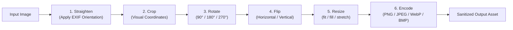

# Transformation Pipeline, Codecs & Barcodes

> [!NOTE]
> Autonomous agents frequently require programmatic manipulation of visual media—cropping specific diagrams, resizing photos for web uploads, generating contact sheets, or reading QR codes. **Nova AI Workspace** provides a deterministic 6-stage transformation engine (`nova.image_transform`), native WebP codec support, and barcode generation and decoding.

---

## 1. The 6-Stage Deterministic Pipeline (`nova.image_transform`)

Multi-step image transformations can produce inconsistent outputs if operations occur in unpredictable order. Nova guarantees identical mathematical output by executing operations in an immutable 6-stage pipeline:

$$\text{1. Straighten} \longrightarrow \text{2. Crop} \longrightarrow \text{3. Rotate} \longrightarrow \text{4. Flip} \longrightarrow \text{5. Resize} \longrightarrow \text{6. Encode}$$

### Visual Coordinate Cropping

Because `nova.image_transform` automatically straightens EXIF orientation in Stage 1 before evaluating crop boundaries:
* All crop arguments (`crop.x`, `crop.y`, `crop.width`, `crop.height`) correspond **strictly to visual pixel coordinates** reported by `nova.image_info`.
* Agents do not need to calculate inverse trigonometric transformations on rotated camera photos.

---

## 2. Scaling Modes & Upscaling Protection

Scaling is governed by three adaptive modes:

| Mode | Aspect Ratio | Behavior |
| :--- | :--- | :--- |
| **`fit` (Default)** | Preserved | Scales the image to fit entirely within the target box (`resize.width`, `resize.height`). No cropping occurs. |
| **`fill`** | Preserved | Scales the image to cover the entire target box and evenly crops overflowing edges. |
| **`stretch`** | Altered | Forces the output to the exact requested dimensions, distorting aspect ratio if dimensions do not match. |

### The Upscaling Guard (`allowUpscale: false`)

By default, smaller images are never enlarged. Upscaling pixelated low-resolution images degrades visual quality and wastes disk storage and network bandwidth. Upscaling requires explicit authorization via `allowUpscale: true`.

---

## 3. Supported Codecs & Native WebP

Nova includes its own compiled image engine (SkiaSharp), bypassing third-party software:

* **Read Support:** PNG, JPEG, WebP, GIF (static first frame), BMP, ICO natively; TIFF via Windows Imaging Component (WIC); HEIC and JPEG XR when system codecs are installed.
* **Write Support:** PNG, JPEG, WebP, BMP (32-bit with full alpha support).
* **Native WebP Without Store Extensions:** In standard Windows environments, WebP encoding requires optional Microsoft Store extensions. Nova includes complete native WebP support out of the box, supporting lossy compression (`quality: 1`–`99`) and lossless compression (`quality: 100`).

---

## 4. Contact Sheets & Barcode Operations

### Contact Sheet Generation (`nova.image_contact_sheet`)

Compiles an entire folder of images into a single structured overview grid:
* **Formats:** Generates single-image PNG or JPEG contact sheets, or multi-page A4 PDF documents.
* **Customization:** Configurable columns, thumbnail sizes, image filename labels, and document titles.

### QR Code & Barcode Generation (`nova.barcode_generate`)

Creates QR codes (any text, URL, or payload) and 1D barcodes (Code 128, EAN-13, EAN-8, UPC-A) as clean PNG or SVG files:
* **Pixel Grid Precision:** Every module is rendered with integer pixel boundaries and required quiet-zone margins.
* **Verification Loop:** Nova automatically decodes every drawn barcode back in memory before saving it to disk.

### Barcode Reading (`nova.barcode_decode`)

Extracts codes from photos, screenshots, or scans:
* **Robust Recognition:** Recognizes rotated, skewed, slightly blurred, or inverted (light on dark) codes.
* **Multi-Scan:** With `multiple: true`, returns all barcodes detected within the image.
* **Zero Autonomous Execution:** Extracted URLs are returned strictly as data strings; Nova never navigates to barcode links automatically.

---

## 5. Related Documentation

* [Local Image Intelligence & Processing Overview](../README.md)
* [Image Geometry Audit & Pre-Flight Meta-Tool](../geometry-audit-and-meta-tool/README.md)
* [Safety Guards & Privacy Commit](../safety-guards-and-privacy-commit/README.md)
* [Image Transform Tool Reference](../../../../mcp-reference/tools/files-and-documents/nova-image-transform.md)
* [Image Contact Sheet Tool Reference](../../../../mcp-reference/tools/files-and-documents/nova-image-contact-sheet.md)
* [Barcode Generate Tool Reference](../../../../mcp-reference/tools/files-and-documents/nova-barcode-generate.md)
* [Barcode Decode Tool Reference](../../../../mcp-reference/tools/files-and-documents/nova-barcode-decode.md)
