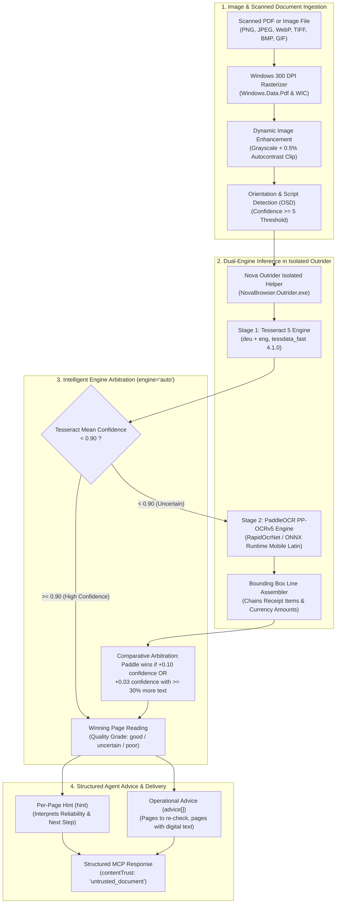

# Offline Optical Character Recognition (OCR) Architecture

Nova provides a 100% offline, dual-engine Optical Character Recognition (OCR) pipeline (`nova.ocr_read`). It enables autonomous AI agents to extract readable text from scanned PDF documents, photographed receipts, printed forms, letters, and digital images without internet connectivity, external cloud APIs, or third-party OCR software installations.

All text recognition engines and machine learning runtimes execute locally inside Nova's isolated native helper process, guaranteeing complete confidentiality for personal invoices, tax filings, medical documents, and corporate records.

> [!NOTE]
> **Upcoming.** Native dual-engine OCR arrives with 1.0.0-alpha.21, which is not published yet. Installed versions up to 1.0.0-alpha.20 do not have it.



---

## 1. Dual-Engine Local Inference Architecture

Single OCR engines typically exhibit stark trade-offs: classical engines excel at crisp, multi-page book scans, while deep-learning convolutional models excel at noisy camera shots and faded thermal paper receipts.

Nova integrates both paradigms into a complementary, two-stage pipeline:

| OCR Engine | Architecture & Model | Primary Strength | Engine Scale Grade Thresholds |
| :--- | :--- | :--- | :--- |
| **Tesseract 5** | Classical LSTM with language models (`deu+eng`, `tessdata_fast 4.1.0`) | Structured typography, high-resolution scanned letters, multi-column print documents | Good: $\ge 0.85$<br/>Uncertain: $0.65$–$0.84$<br/>Poor: $< 0.65$ |
| **PaddleOCR** | Deep Learning PP-OCRv5 Mobile Latin (`RapidOcrNet` via ONNX Runtime) | Low-contrast scans, mobile camera photos, receipt text boxes, distorted fonts, tabular receipts | Good: $\ge 0.90$<br/>Uncertain: $0.80$–$0.89$<br/>Poor: $< 0.80$ |

### Intelligent Auto-Arbitration (`engine: "auto"`)

When invoked with default `engine: "auto"`, Nova automatically picks the optimal reading:
1. **Fast-Path Evaluation:** Tesseract parses the page first. If its mean confidence is $\ge 0.90$, the page is considered reliably read, avoiding unnecessary neural inference cycles.
2. **Competitive Second Stage:** If Tesseract's mean confidence drops below $0.90$, PaddleOCR processes the same rasterized page.
3. **Rigorous Decision Formula:** PaddleOCR's reading is chosen over Tesseract if:
   * Its confidence score is at least **$+0.10$** higher, or
   * Its confidence is at least **$+0.03$** higher and extracts **$\ge 30\%$ more text**.
4. **Anti-Hallucination Guard:** PaddleOCR is never selected if it yields significantly less text than Tesseract, even if its confidence score appears slightly higher.
5. **Alternative Modes:** Agents can explicitly specify `engine: "tesseract"`, `engine: "paddle"`, or `engine: "both"` (which returns both engine readings side by side for manual cross-validation).

---

## 2. Image Pre-Processing & Layout Reconstruction

Raw scanned documents and camera photos frequently fail OCR due to poor contrast, skew, or fragmented text boxes. Nova executes a hardware-accelerated pre-processing pipeline before text detection:

1. **High-Resolution Page Rasterization:**
   * PDF pages are rendered at $300$ DPI via Windows native PDF rendering (`Windows.Data.Pdf`).
   * Images (PNG, JPEG, WebP, TIFF, BMP, GIF) are loaded via Windows Imaging Component (WIC), honoring EXIF orientation. Extreme resolutions are clamped so the longest edge never exceeds $7{,}000$ pixels.
2. **Dynamic Autocontrast (0.5% Percentile Clip):**
   * Fixed binarization thresholds often completely erase faded cash register receipts.
   * Nova converts pixels to grayscale and applies dynamic autocontrast with a $0.5\%$ percentile clip per page, stretching the dynamic range while preserving faint ink strokes.
3. **Orientation & Script Detection (OSD):**
   * Tesseract's orientation detector identifies upside-down or sideways pages.
   * To prevent false $180^\circ$ inversions on receipts, Nova requires a strict OSD confidence threshold of at least $5.0$ before rotating pixels.
4. **Receipt Line Assembler (PaddleOCR):**
   * Modern neural OCR detectors identify text as disjoint rectangular bounding boxes.
   * Nova's line assembler chains neighboring boxes whose vertical centers overlap and orders them horizontally. This guarantees that purchased line items and their corresponding currency amounts remain bound to the same line.

---

## 3. The Agent Guidance Contract (`hint` & `advice[]`)

A fundamental flaw of traditional OCR tools is that agents receive a block of text without knowing whether the engine misread crucial numbers.

Nova embeds explicit reliability assessments into every response:

### Per-Page Hint (`hint`)
Every page object includes a human-readable and machine-actionable `hint`:
* High confidence: *"Text recognized with good confidence."*
* Low confidence: *"Text recognition was uncertain; double-check extracted figures against the visual page or compare with engine='both'."*
* Empty scan: *"No text could be recognized on this page."*

### Global Strategic Advice (`advice[]`)
The top-level response aggregates operational recommendations for the agent's next steps:
* Suggests `convert_to_markdown` if Nova detects that pages already have a selectable digital text layer (which is $100\%$ exact and faster than OCR).
* Lists pages that had low confidence and would benefit from `engine: "both"` comparison.
* Lists missing or truncated pages when a document exceeded `maxChars`.

---

## 4. Native Process Isolation & Security Invariants

* **Isolated Native Helper (Outrider):** Tesseract, Leptonica, PaddleOCR, and ONNX Runtime are native C/C++ libraries. Nova runs them inside a dedicated one-shot Outrider process (`NovaBrowser.Outrider.exe --ocr-once`). If an anomalous image triggers an illegal instruction or memory violation, only that single Outrider task terminates; Nova's browser tabs and MCP connections remain uninterrupted.
* **Zero Intermediate Disk Scratch Files:** Rasterized page pixels are transferred directly in-memory to Leptonica and ONNX Runtime, preventing unencrypted temporary image files from lingering on disk.
* **Untrusted Document Content Tagging:** All OCR results carry `contentTrust: "untrusted_document"`. Agents are instructed to treat recognized text as passive data, mitigating prompt injection attacks embedded inside scanned documents.

---

## 5. Tool Reference & Examples

### JSON-RPC Call

```json
{
  "name": "nova_ocr_read",
  "arguments": {
    "path": "C:\\Users\\Operator\\Downloads\\ScannedReceipt.pdf",
    "engine": "auto",
    "pages": "1"
  }
}
```

### JSON-RPC Response

```json
{
  "structuredContent": {
    "ok": true,
    "source": "ocr",
    "contentTrust": "untrusted_document",
    "pageCount": 1,
    "pagesRead": [1],
    "text": "COFFEE BAR BISTRO\n1x Espresso Double   4.50\n1x Mineral Water     3.20\nTOTAL EUR            7.70",
    "pages": [
      {
        "pageNumber": 1,
        "engine": "paddle",
        "quality": "good",
        "confidence": 0.94,
        "hint": "Text recognized with good confidence using PaddleOCR.",
        "text": "COFFEE BAR BISTRO\n1x Espresso Double   4.50\n1x Mineral Water     3.20\nTOTAL EUR            7.70"
      }
    ],
    "advice": [
      "All pages recognized with good confidence."
    ]
  }
}
```

---

[Media Intelligence overview](../README.md) · [Local Image Processing](../image-processing/README.md) · [Document Conversion](../document-conversion/README.md) · [PDF Reading & Export](../pdf/README.md) · [All core features](../../README.md)
