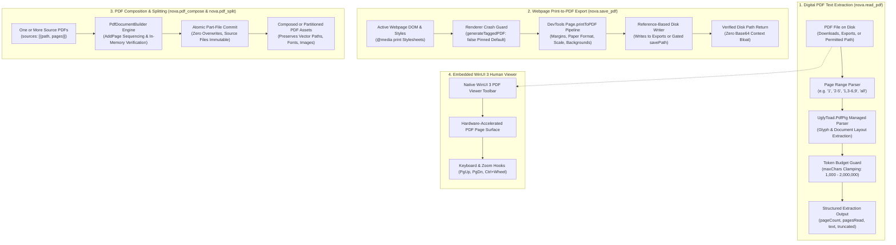
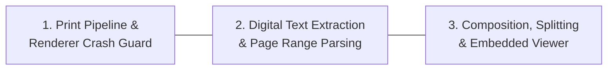

# PDF Reading, Export & Page Operations Architecture

> [!NOTE]
> Nova provides comprehensive PDF document intelligence through four complementary operations: extracting structured digital text from existing PDF files on disk (`nova.read_pdf`), generating pixel-accurate vector PDF documents from active web pages using Chromium's DevTools print engine (`nova.save_pdf`), assembling custom documents from page subsets (`nova.pdf_compose`), and partitioning documents into separate files (`nova.pdf_split`).

It bridges automated document processing for AI agents with a native, hardware-accelerated WinUI 3 PDF viewing surface for human operators.

> [!TIP]
> To read a PDF as structured Markdown—with page markers, headings from its bookmarks, links, and page images for checking—and to read Word, Excel, PowerPoint, and other files the same way, see [Document Conversion](../document-conversion/README.md). `nova.read_pdf` remains the dedicated tool for exact continuous digital text. For scanned bitmaps without a digital text layer, see [Offline OCR](../ocr/README.md).

---

## The 3 Pillars of PDF Document Operations

Nova's PDF subsystem is divided into three specialized architectural domains:

| Sub-System | Scope & Responsibilities | Deep Dive Specification |
| :--- | :--- | :--- |
| **Print Pipeline & Crash Guards** | Chromium `Page.printToPDF` pipeline, `@media print` CSS engine, `generateTaggedPDF: false` crash guard against internal Chromium CHECK assertions, margins/paper sizing/scale, and reference-based disk delivery. | [Print Pipeline & Crash Guards](print-pipeline-and-crash-guard/README.md) |
| **Digital Text & Range Parsing** | Digital text extraction via `nova.read_pdf`, `UglyToad.PdfPig` managed parser, continuous text layer extraction vs OCR, page range syntax parser (`"1,3-5,8-10"`), and token budget protection (`maxChars`). | [Text Extraction & Range Parsing](text-extraction-and-range-parsing/README.md) |
| **Composition, Splitting & Viewer** | Multi-source page assembly (`nova.pdf_compose`), document partitioning (`nova.pdf_split`), vector path and font preservation, atomic `.part` commit, and hardware-accelerated WinUI 3 PDF viewer surface. | [Composition, Splitting & Viewer](composition-splitting-and-viewer/README.md) |

---

## Comprehensive Documentation Index

Explore the dedicated deep-dive guides for technical specifications, layout parameters, and extraction pipelines:

### 1. [Webpage Print Pipeline & Crash Guards](print-pipeline-and-crash-guard/README.md)
* **The `generateTaggedPDF: false` Invariant:** Bypassing Chromium accessibility tree serialization to prevent uncatchable renderer process crashes.
* **Layout & Page Sizing:** Precise control over paper formats (A4, US Letter), granular margins, `@media print` prioritization, and CSS backgrounds.
* **Reference-Based Delivery:** Writing multi-megabyte files directly to disk to prevent context window token exhaustion.

### 2. [Digital Text Extraction & Page Range Parsing](text-extraction-and-range-parsing/README.md)
* **Engine Selection Matrix:** When to use `nova.read_pdf` vs `nova.convert_to_markdown` vs `nova.ocr_read`.
* **Managed PdfPig Parsing:** Fast, in-memory continuous text extraction without external command-line dependencies.
* **Page Range Syntax:** 1-indexed range parsing (`"1"`, `"2-5"`, `"1,3-6,9"`, `"all"`) with deduplication and bounds clamping.
* **Token Budget Guard:** Enforcing `maxChars` limits (`1,000` to `2,000,000`) with explicit truncation indicators.

### 3. [PDF Composition, Splitting & Embedded Viewer](composition-splitting-and-viewer/README.md)
* **Multi-Source Composition:** Merging page subsets from heterogeneous source documents using `nova.pdf_compose`.
* **Document Partitioning:** Dividing large PDF bundles into individual part documents using `nova.pdf_split`.
* **Embedded WinUI 3 Viewer:** Hardware-accelerated Direct2D viewing surface with smooth panning, zoom hooks, and navigation keys.

---

## Tool Reference

| Tool | Parameters | Output / Diagnostics |
| :--- | :--- | :--- |
| [`nova.read_pdf`](../../../mcp-reference/tools/files-and-documents/nova-read-pdf.md) | `path`, `pages?`, `maxChars?` | `pageCount`, `pagesRead`, `text`, `truncated` |
| [`nova.save_pdf`](../../../mcp-reference/tools/visual-evidence/nova-save-pdf.md) | `targetId?`, `printBackground?`, `preferCSSPageSize?`, `landscape?`, `scale?`, `paperWidth?`, `paperHeight?`, `pageRanges?`, `displayHeaderFooter?`, `saveDir?`, `savePath?`, `fileName?` | `savedPath`, `pages`, `bytes`, `url` |
| [`nova.pdf_compose`](../../../mcp-reference/tools/files-and-documents/nova-pdf-compose.md) | `sources`, `outputPath` | `pageCount`, `bytesWritten`, `sourceCount`, `outputPath` |
| [`nova.pdf_split`](../../../mcp-reference/tools/files-and-documents/nova-pdf-split.md) | `path`, `ranges`, `outputDir` | `partsCount`, `sourcePageCount`, `parts: [{outputPath, pages, pageCount, bytes}]` |

---

## Related Documentation

* [Media Intelligence Overview](../README.md)
* [Document Conversion & Office Generation](../document-conversion/README.md)
* [Offline Optical Character Recognition (OCR)](../ocr/README.md)
* [Connectors Subsystem](../../connectors/README.md)
* [All core features](../../README.md)
