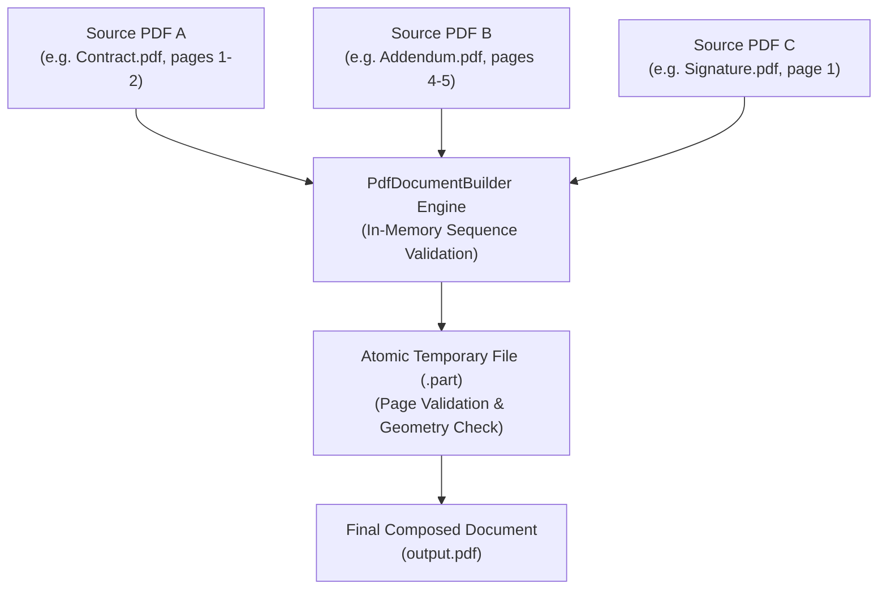
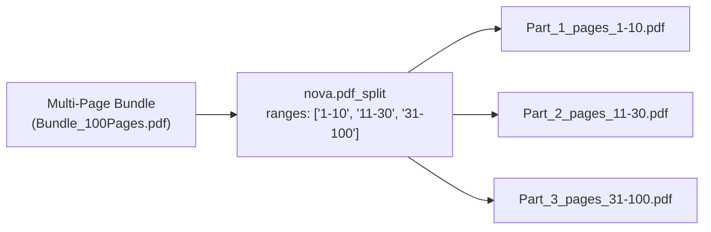
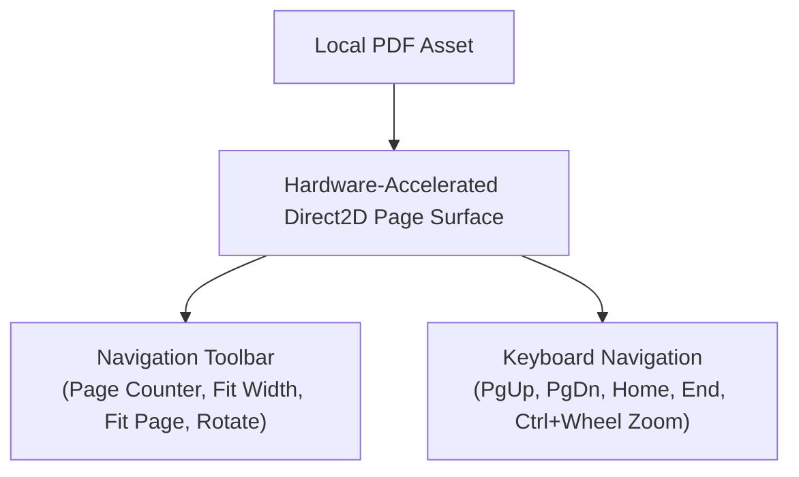

# PDF Composition, Splitting & Embedded Viewer

> [!NOTE]
> Autonomous document workflows often require combining multiple PDF exhibits into a single submission, or splitting a multi-invoice bundle into separate files. **Nova AI Workspace** implements programmatic composition (`nova.pdf_compose`), selective partitioning (`nova.pdf_split`), and an embedded hardware-accelerated WinUI 3 PDF viewing surface.

---

## 1. Multi-Source PDF Composition (`nova.pdf_compose`)

`nova.pdf_compose` merges selected pages from one or more local PDF documents into a newly synthesized document:



### JSON-RPC Example

```json
{
  "name": "nova_pdf_compose",
  "arguments": {
    "sources": [
      { "path": "C:\\Docs\\Executive_Summary.pdf", "pages": "1-3" },
      { "path": "C:\\Docs\\Financial_Exhibits.pdf", "pages": "12-15" },
      { "path": "C:\\Docs\\Signature_Page.pdf", "pages": "1" }
    ],
    "outputPath": "C:\\Docs\\Board_Submission.pdf"
  }
}
```

### Key Architectural Invariants

* **Lossless Vector Preservation:** Vector artwork, embedded TrueType/OpenType fonts, transparency layers, and high-resolution images are preserved without lossy rasterization.
* **Source Immutability:** Input PDF files are opened in read-only shared mode (`FileShare.Read`). Nova never modifies source files.
* **Atomic Part-File Commit:** Nova writes bytes to an ephemeral `.part` file, verifies structural integrity, and renames it to the destination path in a single atomic filesystem operation.

---

## 2. Document Partitioning (`nova.pdf_split`)

`nova.pdf_split` decomposes a single multi-page PDF into discrete documents based on page ranges:



### Protocol Parameters

* **`path`:** Absolute path to the source PDF document.
* **`ranges`:** Array of page range strings (e.g. `["1-5", "6-10", "11"]`).
* **`outputDir`:** Destination directory for partitioned PDF files.

---

## 3. Embedded WinUI 3 Human PDF Viewer

In addition to headless agent automation, Nova features a native WinUI 3 PDF viewer for human operators:



### Viewer Capabilities

* **Hardware-Accelerated Direct2D Rendering:** Smooth scrolling across high-DPI displays with sub-pixel text anti-aliasing.
* **Keyboard Navigation:** Full hotkey support for rapid page navigation (`PageUp`, `PageDown`, `Home`, `End`).
* **Interactive Zoom:** Smooth continuous zoom with `Ctrl + MouseWheel` or toolbar presets (`Fit Width`, `Fit Page`, `100%`).

---

## 4. Related Documentation

* [PDF Reading, Export & Page Operations Overview](../README.md)
* [Webpage Print Pipeline & Crash Guards](../print-pipeline-and-crash-guard/README.md)
* [Digital Text Extraction & Page Range Parsing](../text-extraction-and-range-parsing/README.md)
* [PDF Compose Tool Reference](../../../../mcp-reference/tools/files-and-documents/nova-pdf-compose.md)
* [PDF Split Tool Reference](../../../../mcp-reference/tools/files-and-documents/nova-pdf-split.md)
