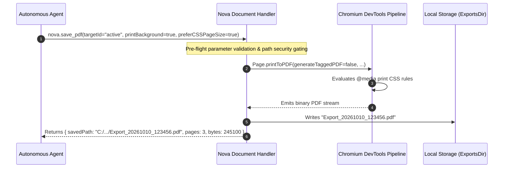

# Webpage Print Pipeline & Crash Guards

> [!NOTE]
> Converting active dynamic webpages into archival vector PDF documents requires direct integration with Chromium's DevTools protocol. **Nova AI Workspace** implements `nova.save_pdf` with an essential renderer crash guard: explicitly deactivating tagged PDF generation (`generateTaggedPDF: false`) to prevent catastrophic browser process assertion failures.

---

## 1. Webpage PDF Export (`nova.save_pdf`)

`nova.save_pdf` captures the active web tab into an archival vector PDF on disk using Chromium's `Page.printToPDF` protocol:



---

## 2. The `generateTaggedPDF: false` Renderer Crash Guard

A critical architectural invariant in Nova's PDF printing pipeline is the explicit deactivation of tagged PDF generation:

```json
{
  "generateTaggedPDF": false
}
```

### The Underlying Chromium Bug

In Chromium and WebView2, generating an accessible, tagged PDF forces the renderer to take an internal accessibility snapshot:

$$\text{PrintWithParams} \longrightarrow \text{PrintPagesNative} \longrightarrow \text{SnapshotAccessibilityTree} \longrightarrow \text{SerializeEntireTreeAndDispose}$$

On complex web pages containing deeply nested dynamic DOM structures or malformed ARIA trees, this code path triggers an unrecoverable internal Chromium `CHECK` assertion failure (`int 3`).

### The Failure Mode

When the assertion fails:
1. The entire WebView render process crashes mid-call.
2. The browser tab goes blank and loses all session state.
3. Nova is forced to rebuild the tab's WebView controller.
4. No PDF file is generated, leaving agent workflows stranded.

### The Safe Invariant

Untagged PDF export takes the exact same typographic layout, font embedding, and vector rendering path while completely bypassing the accessibility tree snapshot. By pinning `generateTaggedPDF: false` by default, Nova eliminates the renderer crash risk entirely while preserving 100% visual fidelity and selectable digital text.

---

## 3. Typographic & Layout Controls

`nova.save_pdf` exposes granular layout parameters:

| Parameter | Type | Default | Purpose & Behavioral Guarantees |
| :--- | :--- | :--- | :--- |
| **`printBackground`** | boolean | `true` | Renders CSS background colors, gradients, and images. Essential for authentic receipts, invoices, and dashboards. |
| **`preferCSSPageSize`**| boolean | `true` | Prioritizes `@page` rules declared within the website's print stylesheet over tool parameters. |
| **`landscape`** | boolean | `false` | Toggles orientation between portrait (`false`) and landscape (`true`). |
| **`scale`** | number | `1.0` | Uniform content scaling (range: `0.1` to `2.0`), preventing wide tables or fixed layouts from clipping. |
| **`paperWidth` / `Height`** | number | A4 | Explicit paper dimensions in inches (e.g. `8.27` $\times$ `11.69` for A4, `8.5` $\times$ `11.0` for US Letter). |
| **`marginTop` / `Bottom` / `Left` / `Right`** | number | `0.4` in | Independent margin offsets in inches. |
| **`pageRanges`** | string | `"all"` | Selective printing of specific pages (e.g. `'1-3'`, `'1,5'`). |
| **`displayHeaderFooter`** | boolean | `false` | Injects browser headers (date, page title) and footers (page number, URL). Disabled by default for clean exports. |

---

## 4. Reference-Based Delivery Invariant

A single rendered PDF frequently exceeds several megabytes in size. Encoding this binary stream into a JSON-RPC response via base64 would immediately consume hundreds of thousands of context tokens and risk blowing MCP client message limits.

Nova strictly enforces **reference-based delivery**:
* Exported PDFs are written directly to local disk storage (`StoragePaths.ExportsDir` by default).
* The tool returns the verified absolute filesystem path (`savedPath`), byte count, and page count.
* Agents can subsequently inspect, extract text from, or dispatch the document via Connectors without carrying binary payloads across context windows.

---

## 5. Related Documentation

* [PDF Reading, Export & Page Operations Overview](../README.md)
* [Digital Text Extraction & Page Range Parsing](../text-extraction-and-range-parsing/README.md)
* [PDF Composition, Splitting & Viewer](../composition-splitting-and-viewer/README.md)
* [Save PDF Tool Reference](../../../../mcp-reference/tools/visual-evidence/nova-save-pdf.md)
* [Document Conversion Architecture](../../document-conversion/README.md)
