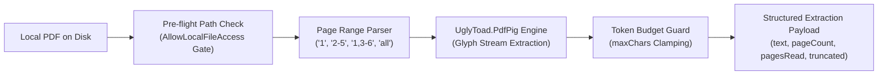

# Digital Text Extraction & Page Range Parsing

> [!NOTE]
> Autonomous agents frequently need to extract readable digital text from PDF reports, whitepapers, contracts, and invoices. **Nova AI Workspace** implements `nova.read_pdf` using the managed `UglyToad.PdfPig` engine, featuring resilient page range parsing and token budget guards.

---

## 1. Tool Selection: `read_pdf` vs. Alternatives

Nova provides three distinct tools capable of reading PDF files, each optimized for different structural requirements:

| Tool | Engine & Primary Strength | Ideal Use Case |
| :--- | :--- | :--- |
| **`nova.read_pdf`** | Managed `UglyToad.PdfPig` parser. Extracts exact continuous digital text layer. | Reading raw contract clauses, invoice text, data tables, and search indexing. |
| **`nova.convert_to_markdown`** | Multi-format document converter. Preserves headings, bookmarks, Markdown tables, and inline images. | Ingesting complex multi-page PDF documents into LLM context windows. |
| **`nova.ocr_read`** | Dual-engine offline OCR (Tesseract + PaddleOCR). Recognizes text from scanned bitmaps. | Scanned paper documents, receipts, and photos lacking a digital text layer. |

---

## 2. Extraction Pipeline (`nova.read_pdf`)



### Pre-Flight File Access Guard

In alignment with Nova's filesystem sandboxing, reading files outside Nova's internal storage directories requires the operator to enable **"Allow local files (file://)"**. Unauthorized access attempts fail immediately with error `-32035` (`mcp.file_access_disabled`).

---

## 3. Page Range Syntax & Validation

`nova.read_pdf` supports flexible, human-friendly page range strings:

* **Single Page:** `"1"` (extracts page 1 only).
* **Contiguous Range:** `"2-5"` (extracts pages 2, 3, 4, and 5).
* **Comma-Separated Disjoint List:** `"1,3,7"` (extracts specific pages).
* **Composite Expressions:** `"1,3-5,8-10"` (combines single pages and ranges).
* **Full Document:** `"all"` (or omitting the `pages` parameter entirely).

### Edge Case Handling

* **1-Indexed Conventions:** Page numbering follows human 1-indexed document conventions. Page 0 is rejected with a validation error.
* **Out-of-Bounds Clamping:** If a range requests pages beyond the document's total page count (e.g. `"5-20"` on a 10-page PDF), Nova clamps extraction to the available pages without crashing.
* **Deduplication:** Redundant page requests (e.g. `"1-3,2"`) are deduplicated and processed in ascending sequence.

---

## 4. Token Budget Guard (`maxChars`)

Feeding a 500-page technical manual into an LLM context window would instantly trigger token limit exceptions:

```json
{
  "name": "nova_read_pdf",
  "arguments": {
    "path": "C:\\Users\\Operator\\Downloads\\Annual_Report.pdf",
    "pages": "1-10",
    "maxChars": 50000
  }
}
```

### Protection Mechanics

1. **Configurable Clamping:** Accepts `maxChars` between `1,000` and `2,000,000` characters (default: `100,000`).
2. **Deterministic Truncation:** When extracted text exceeds `maxChars`, extraction halts cleanly at the boundary.
3. **Explicit Truncation Flag:** The response sets `"truncated": true`, informing the agent that additional text exists and prompting it to narrow its page range query.

---

## 5. Related Documentation

* [PDF Reading, Export & Page Operations Overview](../README.md)
* [Webpage Print Pipeline & Crash Guards](../print-pipeline-and-crash-guard/README.md)
* [PDF Composition, Splitting & Viewer](../composition-splitting-and-viewer/README.md)
* [Read PDF Tool Reference](../../../../mcp-reference/tools/files-and-documents/nova-read-pdf.md)
* [Document Conversion Architecture](../../document-conversion/README.md)
* [Offline OCR Architecture](../../ocr/README.md)
