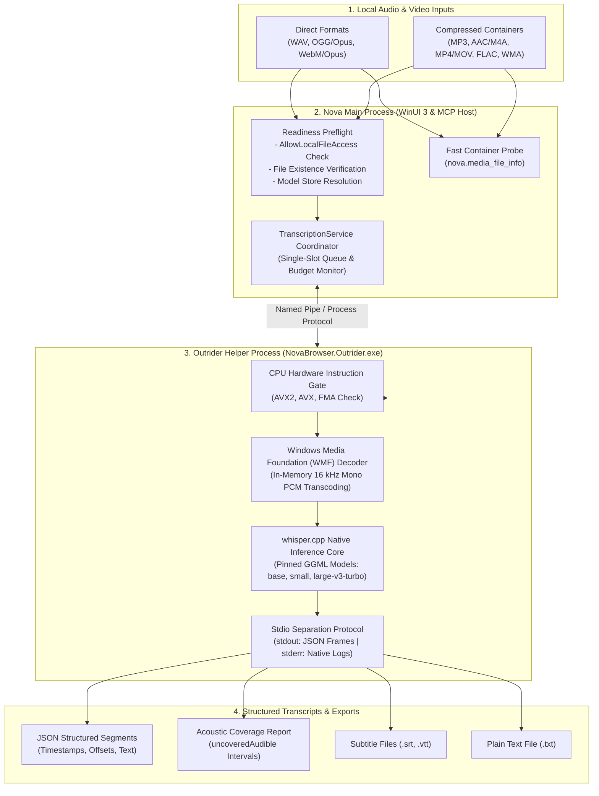
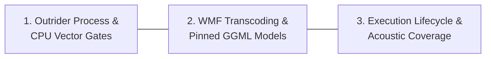

# Speech Transcription Architecture

> [!NOTE]
> Nova includes a native, privacy-first automatic speech recognition (ASR) subsystem powered by an optimized build of `whisper.cpp`. The engine runs 100% locally on the user's workstation, requires zero cloud connectivity for inference, and strictly isolates native code inside Nova's external helper process to ensure application resilience.

Autonomous agents and human operators can transcribe local audio or video files, monitor real-time decoding progress, extract timestamped dialogue segments, and export results into industry-standard subtitle or text formats.

---

## The 3 Pillars of Speech Transcription

Nova's speech transcription subsystem is divided into three specialized architectural domains:

| Sub-System | Scope & Responsibilities | Deep Dive Specification |
| :--- | :--- | :--- |
| **Outrider Process & CPU Gates** | Native process isolation in `NovaBrowser.Outrider.exe`, uncatchable access violation containment, `0xC000001D` illegal instruction protection, managed AVX2/FMA hardware pre-flight verification, and stdio protocol separation (`stdout` JSON / `stderr` native logs). | [Outrider Process & CPU Gates](outrider-process-and-cpu-gates/README.md) |
| **WMF Transcoding & Model Store** | In-memory container decoding via Windows Media Foundation, zero disk scratch leaks, automatic video track dropping, pre-flight container probing (`nova.media_file_info`), and pinned GGML speech models on Hugging Face with SHA-256 verification. | [WMF Transcoding & Models](wmf-transcoding-and-models/README.md) |
| **Execution Lifecycle & Subtitles** | Multi-stage state machine (`queued`, `converting`, `loading_model`, `recognizing`), synchronous inline wait (`waitMs`), compute budgets and stall protection, acoustic coverage metrics (`uncoveredAudible`), omission of synthetic confidence scores, and multi-format subtitle export. | [Lifecycle, Coverage & Subtitles](lifecycle-coverage-and-subtitles/README.md) |

---

## Comprehensive Documentation Index

Explore the dedicated deep-dive guides for technical specifications, protocol frame layouts, and edge-case behaviors across speech transcription:

### 1. [Outrider Helper Process & Hardware Instruction Gates](outrider-process-and-cpu-gates/README.md)
* **The Native Process Boundary:** Isolation of unmanaged `whisper.cpp` code inside `NovaBrowser.Outrider.exe` to contain native crashes.
* **CPU Vector Instruction Set Gates:** Managed verification of AVX, AVX2, and FMA instructions before native loading, eliminating fatal `0xC000001D` faults.
* **Worker Concurrency & Orphan Prevention:** Single-slot queue enforcement and Windows Job Object cleanup (`KILL_ON_JOB_CLOSE`).

### 2. [Audio Transcoding & Pinned Speech Models](wmf-transcoding-and-models/README.md)
* **In-Memory WMF Decoding:** Direct RAM decoding of MP4, MP3, M4A, FLAC, and WMA into 16 kHz mono float samples without disk leaks.
* **Video Track Dropping:** Automatically bypassing video frame decoding for multimedia containers, saving significant CPU resources.
* **Pre-Flight Container Probe:** Instant stream and container inspection via `nova.media_file_info`.
* **Pinned Model Store:** SHA-256 verified quantized GGML models (`base`, `small`, `large-v3-turbo`) and local user model adoption.

### 3. [Execution Lifecycle, Acoustic Coverage & Subtitles](lifecycle-coverage-and-subtitles/README.md)
* **Synchronous Inline Fast Path:** Completing short audio clips in a single tool call via `waitMs`.
* **Multi-Stage Telemetry:** Tracking job progress through `converting`, `loading_model`, and `recognizing` stages.
* **Compute Budgets & Stall Protection:** Hard deadlines and stall watchdog protection (`budgetStallMs`).
* **Acoustic Coverage Analysis:** Quantitative detection of non-speech audio intervals via `uncoveredAudible`.
* **Subtitle & Transcript Export:** Generation of millisecond-accurate SubRip (`.srt`), WebVTT (`.vtt`), and plain text (`.txt`) outputs.

---

## Tool Reference

| Tool | Parameters | Output / Diagnostics |
| :--- | :--- | :--- |
| [`nova.media_transcribe_start`](../../../mcp-reference/tools/media-and-transcription/nova-media-transcribe-start.md) | `path`, `model?`, `language?`, `waitMs?` | `jobId`, `state`, `model`, `stage`, `segments`, `progressRatio` |
| [`nova.media_transcribe_status`](../../../mcp-reference/tools/media-and-transcription/nova-media-transcribe-status.md) | `jobId`, `includeText?` | `state` (`queued`, `running`, `completed`, `canceled`, `failed`), `stageProgress`, `coveredSeconds`, `audioSeconds`, `uncoveredAudible`, `transcriptPath` |
| [`nova.media_transcribe_stop`](../../../mcp-reference/tools/media-and-transcription/nova-media-transcribe-stop.md) | `jobId` | Cancellation confirmation, partial segment list captured prior to termination |
| [`nova.media_transcribe_models`](../../../mcp-reference/tools/media-and-transcription/nova-media-transcribe-models.md) | None | Catalog of speech models, installed states, disk paths, CPU instruction support, and effective model choice |
| [`nova.media_transcribe_model_install`](../../../mcp-reference/tools/media-and-transcription/nova-media-transcribe-model-install.md) | `modelId?`, `path?` | Download progress, SHA-256 verification status, final installed path |
| [`nova.media_transcribe_model_remove`](../../../mcp-reference/tools/media-and-transcription/nova-media-transcribe-model-remove.md) | `fileName` | Deletion confirmation, freed disk space |
| [`nova.media_file_info`](../../../mcp-reference/tools/media-and-transcription/nova-media-file-info.md) | `path` | Fast container probe: format, stream inventory, duration in seconds |

---

## Related Documentation

* [Media Intelligence Overview](../README.md)
* [Media Capture Architecture](../media-capture/README.md)
* [Media Playback Inspection](../media-playback/README.md)
* [Media Devices & Permissions](../devices-and-permissions/README.md)
* [Outrider Component Reference](../../../components/outrider/README.md)
* [Transcription User Guide](../../../user-guide/tools/transcription.md)
* [All core features](../../README.md)
