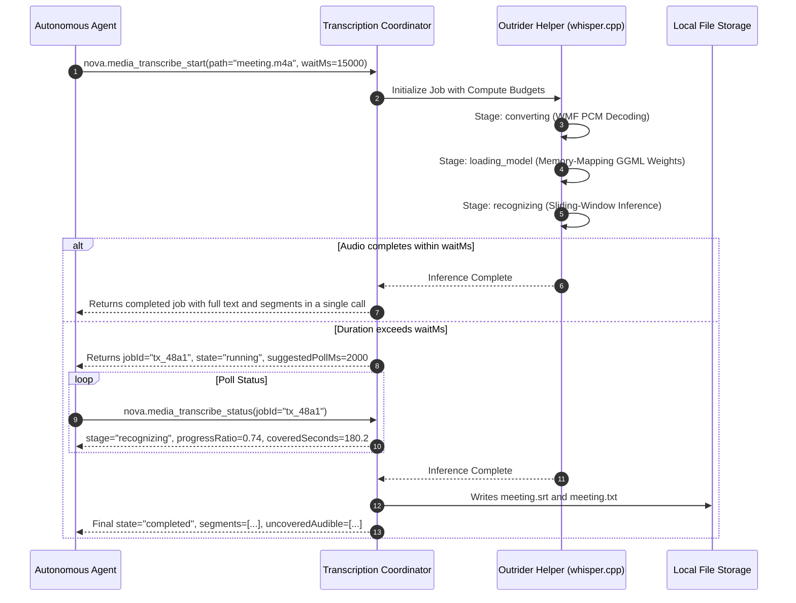
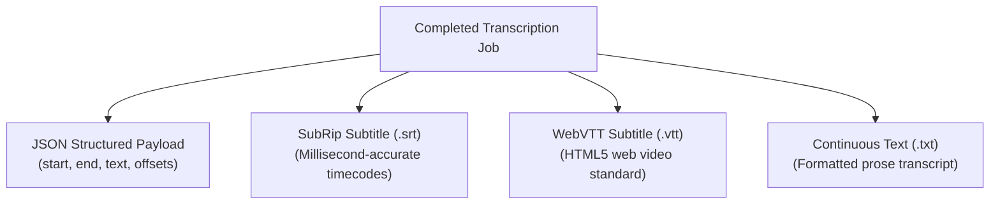

# Execution Lifecycle, Acoustic Coverage & Subtitles

> [!NOTE]
> Speech transcription in **Nova AI Workspace** combines multi-stage operational telemetry, intelligent synchronous completion shortcuts, rigorous acoustic coverage analysis, and standardized subtitle generation.

---

## 1. Transcription Job Lifecycle & Telemetry

Transcribing long-form audio involves distinct computational phases, from container decoding to neural token emission:



### The Synchronous Inline Wait (`waitMs`)

Standard automated tasks often transcribe short voice memos or 10-second notifications:
* `nova.media_transcribe_start` accepts an optional `waitMs` parameter (up to `30,000` ms).
* **Single-Call Fast Path:** If transcription finishes before `waitMs` expires, Nova returns the completed text and segments directly in the initial tool response, saving round-trip polling latency.
* **Graceful Asynchronous Transition:** If audio duration exceeds `waitMs`, Nova seamlessly falls back to asynchronous tracking, returning an active `jobId` and `suggestedPollMs`.

### Multi-Stage State Machine

| Stage | Activity | Key Telemetry Reported |
| :--- | :--- | :--- |
| **`queued`** | Awaiting single-run worker slot | Queue position and wait time. |
| **`converting`** | WMF is decoding container to 16 kHz PCM | `stageProgress` (0.0 to 1.0) tracking audio transcoding. |
| **`loading_model`** | Outrider is mapping GGML weights into RAM | Model ID, memory allocation metrics. |
| **`recognizing`** | Whisper is processing 30-second windows | `coveredSeconds`, `progressRatio`, emitted segments. |
| **`completed`** | Inference finished; files written | Full text, segments, acoustic coverage report. |

---

## 2. Compute Budgets & Stall Protection

To protect system resources and prevent runaway processes, Nova enforces comprehensive compute budgets:

* **`budgetMs`:** Total hard deadline for the entire transcription job.
* **`budgetModelLoadMs`:** Dedicated allowance for reading weights from disk into memory.
* **`budgetRecognitionMs`:** Maximum processing time permitted for audio tensor operations.
* **`budgetStallMs`:** The stall watchdog timeout. Represents the maximum permitted gap between consecutive signs of life (emitted 30-second windows). A slow job that continues emitting progress is never terminated, whereas a deadlocked worker process is cleanly evicted.

---

## 3. Acoustic Coverage Analysis (`uncoveredAudible`)

Machine learning speech recognizers output fluent-sounding prose even when background noise corrupts speech. Nova solves this by pairing text tokens with acoustic energy analysis:

```
Audio Timeline:
00:00 [==== Speech: "Hello everyone" ====] (Covered by Text Tokens)
00:15 [.... Ambient Silence / Mute .....] (Silent Interval)
00:22 [#### Loud Acoustic Energy ########] (Zero Text Tokens Emitted!)
      ▲
      uncoveredAudible Interval (e.g. coughing, music, unintelligible murmur)
```

### Uncovered Audible Intervals

* **Definition:** Identifies time spans where significant acoustic volume was measured in the decoded PCM stream, but Whisper emitted zero transcribed words.
* **Interpretation:** Pinpoints background music, applause, coughs, paper rustling, or foreign language speech omitted by the active model.
* **Structured Payload:**
  ```json
  {
    "uncoveredAudibleCount": 2,
    "uncoveredAudible": [
      { "start": 22.4, "end": 26.8 },
      { "start": 84.0, "end": 88.5 }
    ]
  }
  ```

### Omission of Artificial Confidence Scores

Many speech wrappers surface synthetic confidence numbers (e.g. `confidence: 0.000` or heuristic probabilities). Nova deliberately avoids reporting artificial confidence scores because `whisper.cpp` leaves segment probability uncalibrated; presenting heuristic numbers conveys a false sense of mathematical precision. Nova instead provides concrete, empirical acoustic coverage and duration metrics.

### Mandatory Accuracy Notice (`accuracyNote`)

Every transcription result carries an explicit caution for autonomous agents:
> *"Machine transcript from model 'small'. Do not take numbers, amounts, proper nouns or technical terms as verified, and treat a passage that does not add up as a transcription error rather than an odd statement."*

---

## 4. Subtitle Export & Human UI Integration

Transcripts can be archived and shared in industry-standard formats:



### WinUI 3 Transcription Window

In addition to headless agent automation, Nova equips human operators with a native transcription window accessible from the main toolbar:
* **Drag-and-Drop:** Drop any audio or video file directly into the window.
* **Visual Progress:** Real-time progress bars reflect audio decoding and Whisper inference.
* **One-Click Export:** Save plain text, SRT, or VTT files with a single click.

---

## 5. Related Documentation

* [Speech Transcription Architecture Overview](../README.md)
* [Outrider Helper Process & Hardware Instruction Gates](../outrider-process-and-cpu-gates/README.md)
* [Audio Transcoding & Pinned Speech Models](../wmf-transcoding-and-models/README.md)
* [Media Transcribe Status Tool Reference](../../../../mcp-reference/tools/media-and-transcription/nova-media-transcribe-status.md)
* [Media Transcribe Stop Tool Reference](../../../../mcp-reference/tools/media-and-transcription/nova-media-transcribe-stop.md)
