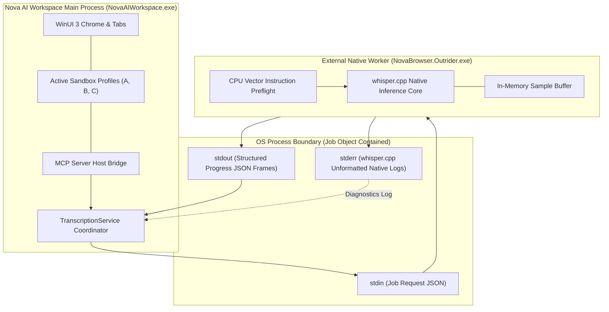
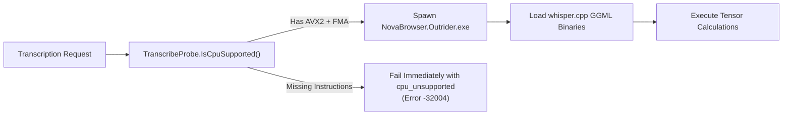

# Outrider Helper Process & Hardware Instruction Gates

> [!NOTE]
> High-performance speech-to-text recognition in **Nova AI Workspace** relies on native C/C++ inference routines powered by `whisper.cpp`. In modern .NET runtimes, native memory access violations, illegal CPU vector instructions, or unhandled exceptions inside unmanaged binaries cannot be caught by managed `try / catch` blocks and immediately terminate the host process. Nova isolates all native Whisper inference inside an external helper process: **Nova Outrider** (`NovaBrowser.Outrider.exe`).

---

## 1. The Outrider Native Process Boundary

Executing machine learning inference in-process within the main WinUI 3 browser host creates unacceptable availability risks for developers and autonomous agents:



### Architectural Guarantees

1. **Complete Fault Containment:** If a corrupt audio container, damaged model file, or native library defect triggers an access violation, only the Outrider worker process terminates. Nova's main browser window, tab state, active sandboxes, and MCP client sessions remain fully operational.
2. **Instant Cancellation:** When an agent cancels a transcription via `nova.media_transcribe_stop` or when a job exceeds its compute budget, Nova terminates the Outrider worker process immediately. Memory is instantly reclaimed by the Windows kernel without waiting for complex native tensor loops to unwind.
3. **Stdio Protocol Separation:**
   * `stdout`: Dedicated strictly to structured, single-line JSON progress frames parsed by Nova's coordination service.
   * `stderr`: Receives all raw C++ diagnostic logs emitted by `whisper.cpp`. This physical separation guarantees that native log noise never tears or corrupts JSON frames.

---

## 2. CPU Vector Instruction Set Gates (AVX2 & FMA)

High-throughput Whisper inference relies heavily on Advanced Vector Extensions (AVX, AVX2, and FMA) to accelerate matrix multiplications:



### The Illegal Instruction Crash Hazard (`0xC000001D`)

Whisper GGML binaries are compiled against AVX2, FMA, and F16C vector instruction sets:
* **The Failure Mode:** If an executable compiled with AVX2 executes on an older or virtualized CPU lacking AVX2, the processor raises an unmaskable hardware exception: `STATUS_ILLEGAL_INSTRUCTION` (`0xC000001D`).
* **Why Probing In-Process Fails:** This hardware fault occurs at the CPU level before any C++ instruction can trap it. The operating system forcefully terminates the process instantly without invoking structured exception handlers.

### Managed Pre-Flight Verification

Nova inspects hardware capabilities in managed C# code using the `System.Runtime.Intrinsics.X86` API *before* spawning Outrider or loading native libraries:

```
Required Instruction Sets:
- AVX (Advanced Vector Extensions)
- AVX2 (256-bit Integer Vectors)
- FMA (Fused Multiply-Add)
```

If the host CPU lacks any of these instruction sets, Nova rejects the request gracefully with a structured JSON-RPC error:

```json
{
  "code": -32004,
  "message": "Processor lacks required instruction sets (missing:AVX2+FMA).",
  "data": {
    "reasonCode": "cpu_unsupported",
    "permanent": true
  }
}
```

This ensures automated agent workflows receive clean, machine-actionable errors rather than suffering unexpected helper crashes.

---

## 3. Worker Concurrency & Single-Slot Queue

Whisper inference consumes significant CPU cores and memory bandwidth:

| Resource Constraint | Enforcement Mechanism | Rationale |
| :--- | :--- | :--- |
| **Worker Concurrency** | Single-Slot Queue (`MaxConcurrentJobs = 1`) | Prevents CPU saturation and thermal throttling; ensures interactive browser operations remain smooth. |
| **Memory Isolation** | External Process Heap | Audio samples and model weights are allocated in Outrider's heap, never bloating Nova's working set. |
| **Orphan Prevention** | Windows Job Object Containment | If Nova terminates abruptly, the Windows kernel terminates Outrider automatically (`KILL_ON_JOB_CLOSE`). |

---

## 4. Related Documentation

* [Speech Transcription Architecture Overview](../README.md)
* [Audio Transcoding & Pinned Speech Models](../wmf-transcoding-and-models/README.md)
* [Execution Lifecycle, Acoustic Coverage & Subtitles](../lifecycle-coverage-and-subtitles/README.md)
* [Outrider Component Reference](../../../../components/outrider/README.md)
* [Media Transcribe Start Tool Reference](../../../../mcp-reference/tools/media-and-transcription/nova-media-transcribe-start.md)
* [Media Transcribe Stop Tool Reference](../../../../mcp-reference/tools/media-and-transcription/nova-media-transcribe-stop.md)
