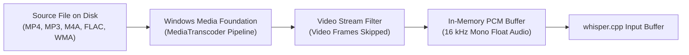
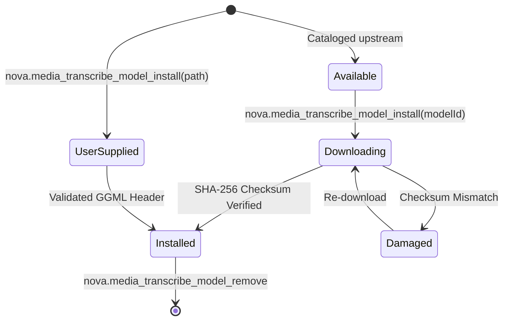

# Audio Transcoding & Pinned Speech Models

> [!NOTE]
> To process real-world audio and video files without external cloud dependencies or third-party GPL codec binaries, **Nova AI Workspace** integrates the native **Windows Media Foundation (WMF)** pipeline for in-memory audio transcoding and maintains a strictly verified catalog of pinned **GGML speech models**.

---

## 1. In-Memory Container Decoding via Windows Media Foundation

Modern web applications, conference tools, and voice recorders export audio in dozens of container formats (MP4, MP3, M4A, FLAC, WMA, WAV, WebM). Whisper models require uncompressed **16 kHz 16-bit mono float samples**.



### Why Windows Media Foundation (WMF) over FFmpeg

1. **Enterprise License Safety:** FFmpeg builds bundled with common patented codecs (e.g. H.264, AAC) carry GPL or proprietary license complications. WMF is an integral component of the Windows operating system, introducing zero licensing risks for commercial deployment.
2. **Zero Disk Scratch Leaks:** WMF decodes directly into an in-memory buffer in RAM. One hour of 16 kHz mono audio requires approximately 115 MB. Nova never writes temporary unencrypted `.wav` scratch files to disk, eliminating data leaks if a job terminates unexpectedly.
3. **Video Track Dropping:** For multimedia video containers (MP4, MOV, MKV), WMF reads exclusively the audio track. Video frame decoding is skipped entirely, saving substantial CPU cycles and reducing power consumption.

---

## 2. Pre-Flight Container Inspection (`nova.media_file_info`)

Before committing heavy compute resources to an ASR run, agents can probe local media files using `nova.media_file_info`:

```json
{
  "name": "nova_media_file_info",
  "arguments": {
    "path": "C:\\Users\\Operator\\Downloads\\Conference_Call.m4a"
  }
}
```

### Reported Structural Facts

* **Container Format:** Identifies format families (`mp4/m4a`, `mp3`, `wav`, `webm`, `flac`, `ogg`).
* **Duration Metrics:** Reports exact duration in seconds, allowing agents to estimate processing time before starting.
* **Audio Stream Attributes:** Channel count, sample rate (e.g. 44.1 kHz, 48 kHz), bit depth, and bitrate.
* **Video Stream Detection:** Reports whether video streams are present, confirming that video decoding will be bypassed during transcription.

---

## 3. Pinned Speech Model Catalog & Storage

Nova utilizes quantized GGML models hosted upstream on Hugging Face. Each official model is strictly pinned to an exact byte size and cryptographic SHA-256 checksum:

| Model ID | Filename | Disk Size | Architecture & Recommended Use Case |
| :--- | :--- | :--- | :--- |
| **`base`** | `ggml-base-q5_1.bin` | ~57 MB | High speed, basic transcription. Bundled with Nova out of the box. Ideal for clean voice memos and quick commands. |
| **`small`** | `ggml-small-q5_1.bin` | ~181 MB | **Recommended Default.** Balanced accuracy and speed. Handles accented speech and conversational dialogue reliably. |
| **`large-v3-turbo`** | `ggml-large-v3-turbo-q5_0.bin` | ~547 MB | **Highest Precision.** Whisper v3 Turbo architecture. Exceptional multilingual accuracy and technical vocabulary handling. |

### Storage Directory & Path Isolation

Official speech models reside centrally in the local application data directory:
```
%LOCALAPPDATA%\NovaBrowser\WhisperModels\
```
Model files survive application updates and browser restarts without requiring re-downloading.

---

## 4. Model Lifecycle & Adoption Protocol



### Installation & Checksum Verification (`nova.media_transcribe_model_install`)

* **Official Catalog Download:** When given a `modelId` (`"small"`, `"large-v3-turbo"`), Nova streams the model file from Hugging Face into a temporary `.part` file, verifies its SHA-256 checksum, and atomically commits the file to disk.
* **Local File Adoption:** Operators can provide custom fine-tuned GGML models by passing an absolute `path`. Nova verifies the model header and registers the file with state `userSupplied`.

### Inventory Inspection (`nova.media_transcribe_models`)

Queries the complete model inventory:
* **Installed Models:** Lists model IDs, filenames, disk sizes, and installation timestamps.
* **Effective Model Resolution:** Returns the currently active default model (`small`).
* **Hardware Support:** Reports host CPU instruction status (`hasAvx2`, `hasFma`).

### Disk Reclamation (`nova.media_transcribe_model_remove`)

Deletes installed model files to reclaim disk space when speech recognition tasks are completed. Bundled models cannot be deleted.

---

## 5. Related Documentation

* [Speech Transcription Architecture Overview](../README.md)
* [Outrider Helper Process & Hardware Instruction Gates](../outrider-process-and-cpu-gates/README.md)
* [Execution Lifecycle, Acoustic Coverage & Subtitles](../lifecycle-coverage-and-subtitles/README.md)
* [Media File Info Tool Reference](../../../../mcp-reference/tools/media-and-transcription/nova-media-file-info.md)
* [Media Transcribe Models Tool Reference](../../../../mcp-reference/tools/media-and-transcription/nova-media-transcribe-models.md)
* [Media Transcribe Model Install Tool Reference](../../../../mcp-reference/tools/media-and-transcription/nova-media-transcribe-model-install.md)
