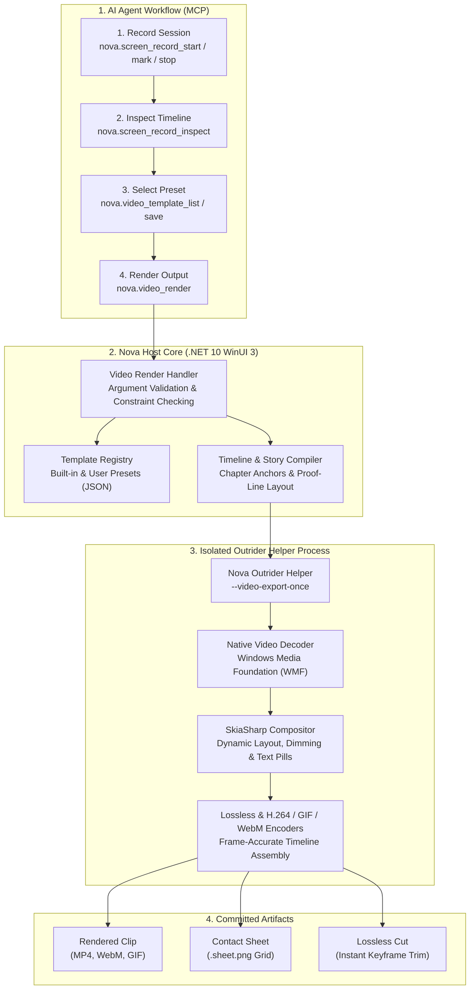
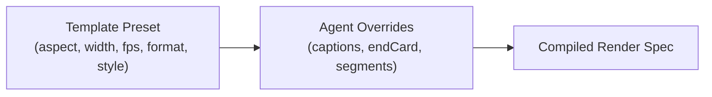

# Programmatic Video Editing, Rendering & Template Architecture

> [!NOTE]
> Nova provides an integrated, 100% on-device video composition and rendering engine. It empowers autonomous AI agents to transform raw screen recordings into professional, structured video assets—complete with timeline trimming, chapter headlines, animated captions, visual verification callouts, result summary cards, and branded end cards—without third-party editing suites or cloud rendering pipelines.

All video decoding, frame-accurate compositing, subtitle rendering, and encoding execute locally on the host workstation within an isolated native helper process, strictly preserving privacy and protecting the host application from native codec crashes.

---

## 1. High-Level Architecture & Process Topology

Nova strictly separates **recording** (`nova.screen_record_*`) from **editing and rendering** (`nova.video_render`, `nova.video_template_*`). The screen recorder captures raw browser tab video and chronological interaction evidence; the video editing subsystem processes that material into polished presentation clips:

---

## 2. Core Concepts & Subsystems

### A. Two-Phase Workflow: Record First, Edit Second
Autonomous video generation follows a disciplined chronological cycle:
1. **Material Collection:** The agent records the browser tab using `nova.screen_record_start(area='tab', evidence=true)`. During interaction, the agent drops contextual markers (`nova.screen_record_mark`) with specific roles:
   * `role: "task"` — Sets the initial objective or hook.
   * `role: "step"` — Marks an intermediate operation or state change.
   * `role: "check"` — Marks a verified UI assertion (with `item`, `expected`, `actual`).
   * `role: "result"` — Marks the final completed outcome.
2. **Timeline Assembly:** The agent invokes `nova.video_render` with `fromMarks: true` to automatically derive chapter boundaries, speed ramps, and captions from the evidence timeline, or supplies explicit segment arrays.

### B. Outrider Process Isolation
Native video decoding and encoding can encounter corrupted frames, non-standard container metadata, or driver faults. Nova executes all rendering passes inside an isolated helper process:
* **Fault Barrier:** A decoder fault or GPU driver timeout never terminates Nova's main browser window, active tabs, or MCP agent sessions.
* **Deterministic Resource Teardown:** Once rendering finishes or if the agent cancels execution, the helper process exits cleanly, immediately releasing all allocated memory and GPU surfaces.
* **Clean Stdout Separation:** The helper communicates completion status over standard pipes, keeping native logging out of MCP communication channels.

### C. The "Nova Cinematic" Design System
Rendered videos feature a modern, minimalist design aesthetic:
* **Canvas Layout:** High-contrast dark backdrop (`#0E1119` to `#151924`) with rounded browser viewport windows and soft drop shadows.
* **Accent & Semantic Colors:** Action highlights utilize violet accents (`#9270F5`), secondary details use neutral slate (`#ADB4C4`), and verified UI assertions display semantic green (`#55D6A4`).
* **Visual Verification Callouts (Proof Effects):** When displaying verified assertions, Nova dims the surrounding interface and draws a highlighted focus box around the verified DOM element, displaying an authoritative green checkmark only after verifying matching values.
* **Smooth Typography:** Chapter kickers, headlines, captions, and result summary cards fade in and out cleanly with dedicated easing curves.

---

## 3. Render Templates & Presets

Nova provides reusable render templates to enforce consistent dimensions, framerates, and presentation styles across social feeds, documentation, and internal reports.

### Built-in Templates
* **`nova-linkedin`:**
  * **Aspect Ratio & Size:** 4:5 vertical feed format (1080x1350 px, 30 fps MP4).
  * **Ideal For:** Social posts, mobile feed viewing, self-explanatory walkthroughs.
  * **Structure:** Top header bar, sequential chapter counters (`1/3`, `2/3`), headline kicker, framed recording window (1.4:1), bottom caption pill, and animated closing end card.
* **`nova-readme`:**
  * **Aspect Ratio & Size:** Compact widescreen format (960 px wide, 10 fps GIF).
  * **Ideal For:** GitHub repository README files, pull request summaries, bug reports.
  * **Structure:** Frameless, pixel-sharp interface presentation, optimized 256-color palette quantization, and automatic `maxBytes` enforcement (e.g. staying under GitHub's inline rendering limit).

### Custom Agent-Authored Templates
Agents can persist specialized templates for automated reporting pipelines:
* `nova.video_template_save`: Validates and saves named presets (e.g. `release-showcase`, `bug-repro-720p`). Built-in presets starting with `nova-` are protected from modification.
* `nova.video_template_list`: Lists all built-in and user-saved templates along with authoring guidelines.
* `nova.video_template_delete`: Removes obsolete custom templates.

---

## 4. Key Render Capabilities

### 1. Motion & Speed Ramping (`segments`, `idle`)
To prevent viewer fatigue during long automation runs, Nova supports selective time-lapse speed ramping:
* **Interactive Steps:** Played at standard real-time speed (`speed: 1.0`) during active clicks, typing, or state transitions.
* **Still Periods:** Accelerated by `8x` to `10x` over idle pauses or static page loads when `idle: "auto"` is configured.
* **Proof Pace:** Verified assertion callouts are held for a consistent readable duration regardless of how quickly the underlying script executed.

### 2. Lossless Keyframe Cuts (`lossless: true`)
When an agent only needs a specific sub-range of a recorded MP4 without re-encoding frames or applying visual styling, passing `lossless: true` triggers an instantaneous keyframe-accurate stream copy. This produces an output file in milliseconds with zero generation loss.

### 3. Contact Sheet Generation (`format: "sheet"`)
For static visual audits, PR attachments, or documentation overviews, Nova can render a multi-frame contact sheet (`.sheet.png`). It samples key moments across the video timeline and organizes them into a labeled grid with timestamp overlays.

### 4. Result & End Cards (`resultCard`, `endCard`)
* **`resultCard`:** A structured summary table placed immediately after the action sequence, listing checked attributes (e.g. source vs. target data reconciliations).
* **`endCard`:** A branded conclusion screen displaying an overarching summary headline, accent callout, secondary description, and actionable URL link.

---

## 5. Tool Catalog & Capabilities

| MCP Tool | Capability & Responsibility | Primary Parameters |
| :--- | :--- | :--- |
| [`nova.video_render`](../../../mcp-reference/tools/video-editing/nova-video-render.md) | Compiles and renders a recorded video into an MP4, WebM, GIF, lossless cut, or contact sheet. | `filePath`, `template`, `format`, `segments`, `fromMarks`, `captions`, `endCard`, `resultCard`, `lossless` |
| [`nova.video_template_list`](../../../mcp-reference/tools/video-editing/nova-video-template-list.md) | Enumerates all available built-in and agent-authored video templates with detailed guidelines. | — |
| [`nova.video_template_save`](../../../mcp-reference/tools/video-editing/nova-video-template-save.md) | Saves or updates a named custom rendering template with validated style and geometry parameters. | `name`, `description`, `notes`, `values` |
| [`nova.video_template_delete`](../../../mcp-reference/tools/video-editing/nova-video-template-delete.md) | Permanently deletes a custom agent-authored rendering template. | `name` |

---

## 6. Operational Invariants & Red-Team Defenses

1. **Evidence Truthfulness:** Video captions and chapter headlines must strictly reflect visible proof on the screen. Nova's timeline compiler verifies that chapters marked with `startAt: "nextChange"` only commence after the recorded visual mutation has settled.
2. **No Instructions in Video Notes:** Template descriptions and authoring notes are treated strictly as bounded text metadata. They are never parsed as executable agent instructions.
3. **Atomic File Creation:** Rendered video files are written to temporary `.part` files and verified for valid container headers and playable durations before being atomically renamed to the final destination.
