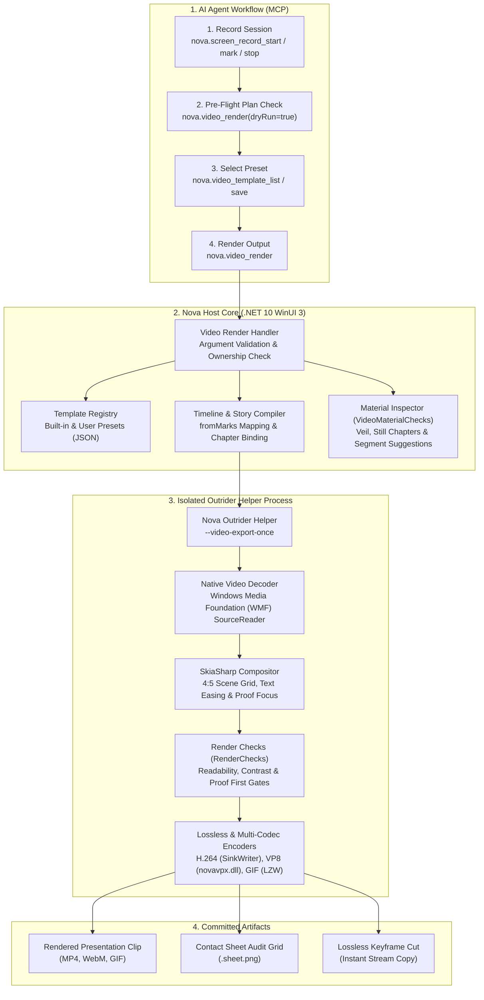
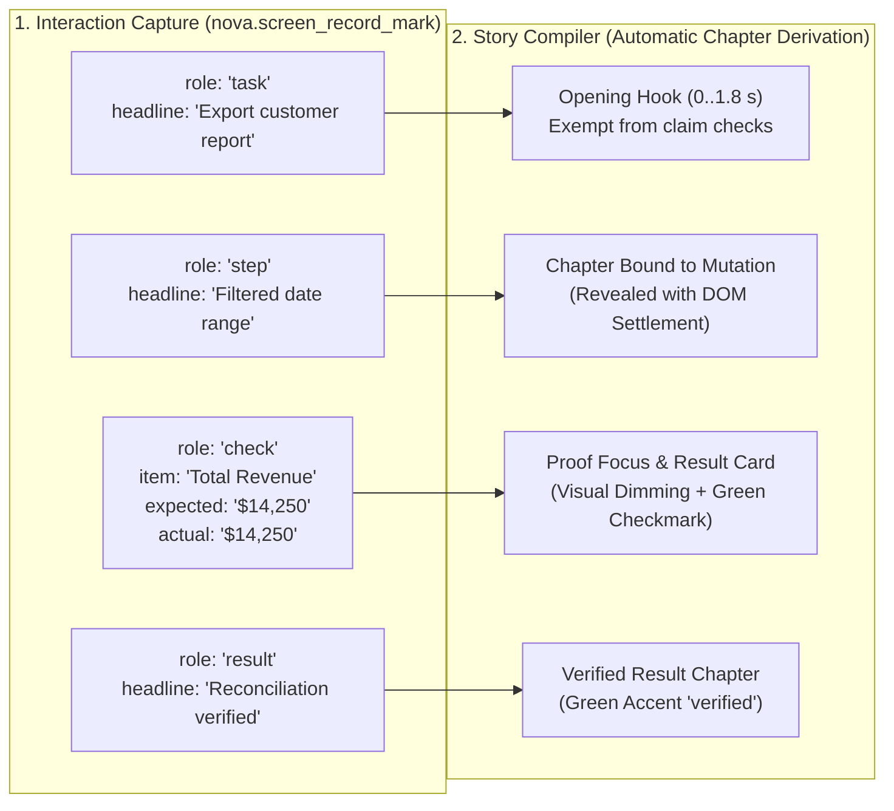
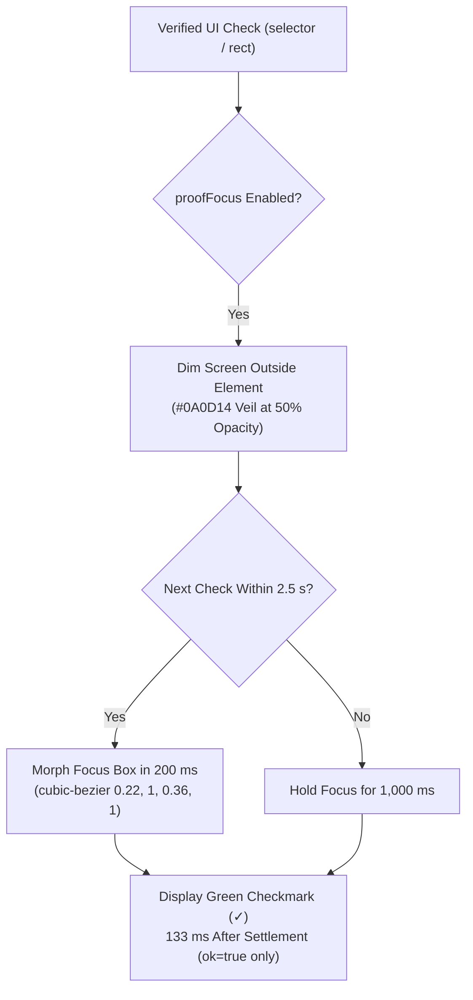
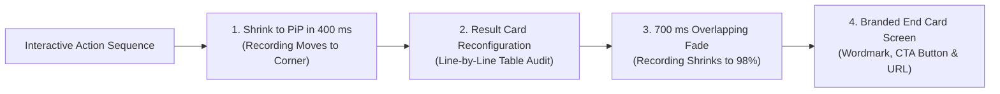

# Programmatic Video Editing, Rendering & Template Architecture

> [!NOTE]
> Nova provides an integrated, 100% on-device video composition and rendering engine. It empowers autonomous AI agents to transform raw screen recordings into professional, structured video assets—complete with timeline trimming, chapter headlines, animated captions, visual verification callouts, result summary cards, and branded end cards—without third-party editing suites, cloud rendering pipelines, or external Python scripts.

All video decoding, frame-accurate compositing, subtitle rendering, and encoding execute locally on the host workstation within an isolated native helper process (`NovaBrowser.Outrider.exe`), ensuring hardware crash isolation, zero context-window bloat, and strict data privacy.

---

## 1. High-Level Architecture & Process Topology

Nova strictly separates **recording** (`nova.screen_record_*`) from **editing and rendering** (`nova.video_render`, `nova.video_template_*`). The screen recorder captures raw browser tab video and chronological interaction evidence; the video editing subsystem processes that material into polished presentation clips:



---

## 2. The Automated Storytelling Pipeline (`fromMarks: true`)

Hand-crafting timestamps for video segments and chapters is brittle: network latency, dynamic page loads, and variable DOM rendering make fixed timings prone to drift. Nova solves this by allowing agents to author videos declaratively through **semantic timeline markers** during interaction:



### Marker Roles & Automatic Transformation:
1. **Opening Hook (`role: "task"`):**
   * Sets the overarching objective or scenario hook at $t = 0$.
   * Automatically fitted to play for exactly **1.8 seconds** (`TaskChapterMs`), ensuring mobile viewers immediately understand what is happening without delay.
   * Exempt from claim-before-evidence verification rules.
2. **Intermediate Milestone (`role: "step"`):**
   * Automatically scans backwards up to 5,000 ms (`StepLookBackMs`) to bind to the preceding large visual DOM mutation ($\ge 25\%$ screen area).
   * The chapter title reveals synchronously as the new page state settles, preventing visual flashes of unstyled content.
3. **Verified UI Check (`role: "check"`):**
   * Feeds the `proofFocus` focus box and the `resultCard` comparison table.
   * Carries `{ ok: boolean, expected: string, actual: string, unit?: string, selector?: string, rect?: object }`.
4. **Final Conclusion (`role: "result"`):**
   * Summarizes the completed task.
   * **Semantic Green Invariant:** Nova sets `tone: "verified"` (rendering chapter kickers and accent words in semantic green `#55D6A4`) **only if every check mark in the run succeeded (`check.ok: true`)**. If even one check failed or if no checks exist, green verification styling is strictly denied.
5. **Captions from Marks (`captionsFromMarks: true`):**
   * Derives animated caption pills directly from marker captions (or labels $\le 40$ chars). Each caption displays until the next marker up to a maximum duration of 4.0 seconds.

---

## 3. Visual Proof & Focus Engine (`proofFocus`, `proofPace`)

Nova enforces an **Invariable Truthfulness Standard**: video captions and highlighted boxes must reflect actual on-screen evidence. Highlights are never drawn on guessed coordinates.



### 1. Visual Dimming & Highlighting (`proofFocus`)
* **Veil Dimming:** When displaying a verified check, Nova dims the surrounding interface with a `#0A0D14` dark veil at 50% opacity, applying an 8 px padding and 6 px soft edge outside the target element. Inside the element box, original screen brightness is strictly preserved.
* **Focus Morphing:** Multiple consecutive checks occurring within 2.5 seconds of clip time form a continuous "proof run": the focus box smoothly morphs between DOM positions in 200 ms using `cubic-bezier(0.22, 1, 0.36, 1)`.
* **Authoritative Tick:** An animated green checkmark ($\checkmark$) is rendered 133 ms after the mark arrives, strictly reserved for checks verified as identical by Nova (`check.ok: true`).

### 2. Automatic Proof Pacing (`proofPace`)
When AI agents execute automation scripts, checks often finish in under 50 milliseconds—far too fast for human eyes to read:
* `proofPace: true` automatically adjusts the speed of check sequences:
  * Each intermediate check in a run is allocated approximately **650 ms of clip time** (450 ms reading hold + 200 ms morph).
  * The final check is held for **1,200 ms** at real-time speed (1.0x).
* Accelerated sections run between 1x and 16x speed without altering user-defined cuts.

---

## 4. Stage Reconfiguration: Result & End Cards

To communicate complex multi-attribute reconciliations (such as financial audits or inventory comparisons) clearly, Nova provides dedicated stage transitions:



### A. The Result Card (`resultCard`)
* **Layout Transition:** The active recording shrinks to a picture-in-picture (PiP) window in 400 ms.
* **Row-by-Row Table Audit:** A structured comparison card builds line-by-line (233 ms per row with 167 ms stagger), rendering `"Item · Source Value = Target Value"` with identical numeric formatting as captured on screen.
* **Capacity Governance:** Displays up to 8 individual checks. When 9 or more checks exist, excess rows are neatly summarized in the final summary line (`ResultCardTiming.Shown`).
* **Minimum Display Duration:** The result card holds for at least 2,400 ms to guarantee readability.

### B. The Overlapping End Card (`endCard`)
* **700 ms Overlap:** The recording and captions fade out over 700 ms while shrinking slightly to 98%.
* **Sequential Component Entrance:**
  * Brand wordmark enters at $+300\text{ ms}$.
  * Main headline with accent line enters at $+567\text{ ms}$.
  * Supporting subtext enters at $+867\text{ ms}$.
  * Call-to-action button (`endCard.cta`) and URL address (`endCard.url`) enter at $+1,134\text{ ms}$ with a 16 px upward rise.
* **Hold Duration:** The CTA button stands for at least 2,200 ms (`endHoldMs: 2500` default), ensuring the call to action remains legible.
* **Custom Logo Support:** Specify `endCard.logo: "nova"` for Nova's bundled vector star symbol, or provide an absolute path to a local PNG logo (up to 10 MB).

---

## 5. The 4:5 Fixed Scene Grid (`SceneGrid`)

When rendering with a styled template in **4:5 aspect ratio** (1080x1350 px, optimized for LinkedIn, Instagram, and mobile feed cards), Nova employs a mathematically rigid layout grid to ensure brand elements never overlap or clip:

```
+-------------------------------------------------------------------+
|  BRAND HEADER (96, 82)                           CHAPTER (858, 82)|
|  ACME CORP SYSTEMS                                         01 / 03|
+-------------------------------------------------------------------+
|  ===================[ PROGRESS BAR (96, 136) ]====================|
+-------------------------------------------------------------------+
|  KICKER (96, 218)                                PROOF (Right)    |
|  AUTOMATION PIPELINE                                  TIME-LAPSE 3x|
|                                                                   |
|  HEADLINE WITH WIPING ACCENT WORD (96, 268)                       |
|  Quarterly Ledger Reconciled Cleanly.                             |
+-------------------------------------------------------------------+
|                                                                   |
|  +-------------------------------------------------------------+  |
|  |                                                             |  |
|  |             BROWSER RECORDING VIEWPORT                      |  |
|  |             (54, 402) - 972 x 708 px                        |  |
|  |             16 px Radius, Contain, 32% Drop Shadow          |  |
|  |                                                             |  |
|  +-------------------------------------------------------------+  |
|                                                                   |
+-------------------------------------------------------------------+
|  [ CAPTION PILL (96, 1130) - Inter Medium 26 px ]                 |
+-------------------------------------------------------------------+
|                                                                   |
|  [ RESERVED 200 PX ZONE FOR MOBILE FEED CONTROLS & TIMELINE ]     |
|                                                                   |
+-------------------------------------------------------------------+
```

* **Viewport Containment:** The browser recording sits inside a dedicated frame (`54, 402, 972x708 px`) with 16 px border radius, a 1 px border (`#343A4A`), and a 32% black drop shadow (42 px blur). The recording is scaled using `contain` (14 px internal padding), ensuring zero edge clipping.
* **Reserved Feed Buffer:** The bottom ~200 pixels are intentionally left free of text so mobile app play bars, pause overlays, and comments do not obscure captions.

---

## 6. Camera Direction per Chapter (`chapters[].camera`)

Agents can direct the camera to zoom into specific UI areas during key workflow phases:

```json
{
  "startMs": 4000,
  "headline": "Configuring payment gateway",
  "camera": {
    "x": 240,
    "y": 180,
    "width": 640,
    "height": 480,
    "pushIn": 1.04,
    "pushMs": 3000
  }
}
```

* **Calm Camera Invariant (`ExportZoom.Calm`):** If a declared focus area is already fully visible within the current camera frame, Nova **suppresses unnecessary camera panning**, avoiding disorienting camera movements.
* **Cinematic Push-In:** The camera can slowly push inward toward the center by a factor between `1.00` and `1.08` over `pushMs` (default 3,000 ms) using `cubic-bezier(0.45, 0, 0.55, 1)`.
* **Proof First Protection (`protect: [...]`):** Agents can declare up to 10 protected bounding boxes (`protect`). If a camera zoom or reframing cuts off more than 2% of a protected area during its active timeframe, the render is **strictly refused with `render.proof_covered`**.

---

## 7. The 2-Layer Inspection Check Engine (`checks`)

Every render execution evaluates a dual diagnostic suite, returning `{ ok: boolean, items: [...] }` to help agents refine future recordings:

### A. Material Checks (Host Analysis of `timeline.json`)
* **`material.veil_visible` / `material.veil_subtle`:** Warning if the recording captured Nova's gray action veil during clicks.
* **`material.end_too_soon`:** Warning if the last timeline mark occurred less than 1.5 seconds before the recording ended.
* **`material.still_chapter`:** Warning if a chapter spans $\ge 4.0\text{ seconds}$ without any observed visual DOM mutation.
* **`material.segments_suggested`:** Informational advice providing an optimized `segments` array when more than 3 seconds of idle pause is detected.

### B. Render Checks (Outrider Plan Analysis)
* **`render.readability_short`:** Warning if a headline or caption is visible for less than 1,000 ms in the final output clip.
* **`render.contrast_low`:** Warning if text-to-background contrast falls below WCAG thresholds (4.5:1 for body text, 3:1 for headlines).
* **`render.motion_budget`:** Warning if excessive camera zooms occur (more than two zooms within 20 seconds).
* **`render.proof_covered`:** **Refusal.** Aborts generation if camera reframing cuts off any protected proof area.
* **`render.claim_before_evidence`:** Warning if an unbound chapter claims an outcome $\ge 1.0\text{ second}$ before the corresponding visual mutation appears on screen.
* **`render.task_too_long`:** Warning if a task chapter stands longer than 2,500 ms in the clip; the hook should give way to the story sooner.

---

## 8. Multi-Format Encoding Engines & Audio Sync

Nova includes four specialized on-device rendering backends within Outrider:

| Format | Codec & Container | Target Use Case | Technical Features |
| :--- | :--- | :--- | :--- |
| **`mp4`** | H.264 (NV12) + AAC (160 kbps) via WMF SinkWriter | LinkedIn, Reddit, YouTube, Customer Demos | Hardware-compatible High Profile H.264, even-pixel alignment, color space tagging (BT.709 for $\ge 720p$, BT.601 otherwise). |
| **`webm`** | VP8 + Opus (128 kbps) via native `novavpx.dll` & Concentus | Web apps, documentation sites, team chats | Full-color raster output at a fraction of GIF file size, BT.601 limited range I420. |
| **`gif`** | Optimized 256-color LZW via `GifWriter` | GitHub READMEs, pull request comments, bug tickets | 2-pass rendering: 15-bit color histogram, median-cut palette (255 colors + 1 transparent), differential bounding-box updates, variable frame delays. |
| **`png`** | Lossless SkiaSharp raster still (`atMs`) | Video thumbnails, poster previews | Single-frame export at specified millisecond offset or final frame. |

### Lossless Stream Cuts (`lossless: true`)
When an agent needs an excerpt of a recorded MP4 without re-encoding frames or applying styling:
* Nova performs an instantaneous keyframe-accurate stream copy via `Mp4Remux`.
* Starts at the keyframe at or before `startMs` and preserves all B-frames and reference frames up to `endMs`.
* Synchronizes audio samples with edit lists and fragment timestamps, guaranteeing **0.0 ms audio/video drift**.

### Audio Synchronization & 5 ms Micro-Fading
* Normal speed (1.0x) segments retain their original captured audio.
* Accelerated segments (including `idle: "auto"`), holds, and end cards are automatically silenced.
* Where active audio meets silence or where non-continuous segments join, Nova applies **5 ms micro-fades** across audio sample edges, eliminating audible clicks and waveform pops.

---

## 9. Render Templates & Presets

### Built-in Templates
* **`nova-linkedin`:**
  * **Geometry & Format:** 4:5 vertical feed format (1080x1350 px, 30 fps, MP4).
  * **Structure:** Fixed scene grid, top header bar, chapter counter (`01 / 03`), progress line, headline, contained media viewport, caption pill, and animated end card.
* **`nova-readme`:**
  * **Geometry & Format:** Compact widescreen format (960 px wide, 10 fps, GIF).
  * **Structure:** Frameless presentation, 256-color palette quantization, automatic `maxBytes` enforcement (staying under GitHub's inline rendering limits).

### Custom Agent Templates
* [`nova.video_template_save`](../../../mcp-reference/tools/video-editing/nova-video-template-save.md): Saves named presets (e.g. `team-release-clip`, `bug-repro-720p`). Built-in `nova-*` names are protected.
* [`nova.video_template_list`](../../../mcp-reference/tools/video-editing/nova-video-template-list.md): Lists all available templates.
* [`nova.video_template_delete`](../../../mcp-reference/tools/video-editing/nova-video-template-delete.md): Deletes obsolete custom presets.

---

## 10. Pre-Flight Simulation (`dryRun: true`)

Before committing to a multi-minute video render, agents can execute a pre-flight dry run:

```json
{
  "name": "nova.video_render",
  "arguments": {
    "template": "nova-linkedin",
    "fromMarks": true,
    "dryRun": true
  }
}
```

* Executes in approximately 1 second.
* Compiles the editorial plan, measures font layouts, checks contrast, computes chapter and caption timing, and evaluates all material and render checks.
* Returns `{ ok, plan: { chapters, captions, proofMarks }, durationMs, checks, segments }` without decoding video frames or writing a single file to disk.

---

## 11. Security & Operational Invariants

1. **Ownership Isolation (`video.not_owner`):** An agent can only render recordings captured within its own active agent session. Accessing another agent's recording via `filePath` without permission is blocked.
2. **Prompt Injection Quarantine:** Agent-authored template descriptions and notes are strictly returned under the `agentWritten` field and are never evaluated as executable system instructions.
3. **Atomic File Staging:** Rendered videos are initially written to `.part` files and validated for valid container headers and playable durations before being atomically moved to `Exports/ScreenRecordings/`. Existing files are never overwritten.
4. **No Instructions in Video Metadata:** Rendered clips contain only visual and acoustic evidence; metadata fields never inject autonomous instructions into player pipelines.
