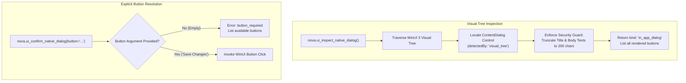

# DOM File Upload Bypass & In-App Modals

> **Direct file injection via `nova.file_upload`, the native vs. DOM decision matrix, WinUI 3 XAML dialog traversal, and prompt injection defense boundaries.**

---

## 1. The Two Paradigms: DOM Bypass vs. Native Automation

When a web workflow requires uploading files, autonomous agents can choose between two distinct execution paths:

```mermaid
flowchart TD
    subgraph Trigger ["Web Page Upload Trigger"]
        A["Agent Identifies Upload Requirement"]
    end

    subgraph DOMPath ["Route A: Direct DOM Bypass (nova.file_upload)"]
        D1["Query DOM for <input type='file'>"]
        D2["Dispatch CDP Command: DOM.setFileInputFiles"]
        D3["Browser Injects File Handles Directly"]
        D4["Page Fires 'change' & 'input' Events"]
        D5["100% Deterministic • Zero Window Focus Needed"]
    end

    subgraph NativePath ["Route B: Native Win32 Automation Pipeline"]
        N1["Click Upload Button (Spawns #32770)"]
        N2["nova.ui_inspect_native_dialog()"]
        N3["nova.ui_set_native_dialog_file_name(path)"]
        N4["nova.ui_confirm_native_dialog()"]
        N5["Controls Real OS Shell Dialog Window"]
    end

    A -->|"Standard <input type='file'> Present"| D1 --> D2 --> D3 --> D4 --> D5
    A -->|"Custom Button / Native Save / OS Print"| N1 --> N2 --> N3 --> N4 --> N5
```



1. **Route A: Direct DOM Bypass ([`nova.file_upload`](../../../../mcp-reference/tools/browser-automation/nova-file-upload.md)):** Uses the Chromium DevTools Protocol (`DOM.setFileInputFiles`) to directly bind file paths to an HTML `<input type="file">` element. It **never creates an operating system window**, operates instantly, and is completely immune to desktop resolution, monitor focus, or OS language shifts.
2. **Route B: Native Win32 Automation:** Controls a live Windows Common Item Dialog (`#32770`) that has already appeared on screen. Mandatory when web applications rely on custom JavaScript buttons that spawn shell dialogs or during file export operations.

---

## 2. Decision Matrix: Selecting the Optimal Upload Route

| Scenario | Recommended Route | Primary Tool | Key Rationale |
| :--- | :--- | :--- | :--- |
| **Standard File Input in DOM** | **Route A (DOM Bypass)** | [`nova.file_upload`](../../../../mcp-reference/tools/browser-automation/nova-file-upload.md) | Highest reliability; bypasses windowing subsystem completely. |
| **Hidden / Styled `<input>`** | **Route A (DOM Bypass)** | [`nova.file_upload`](../../../../mcp-reference/tools/browser-automation/nova-file-upload.md) | CDP binds directly to hidden inputs (`display: none`, `opacity: 0`). |
| **Custom Button Spawns Picker** | **Route B (Native Win32)** | [`nova.ui_set_native_dialog_file_name`](../../../../mcp-reference/tools/app-shell-and-ui/nova-ui-set-native-dialog-file-name.md) | DOM exposes no `<input>` element; `#32770` is already open. |
| **File Save / Download As Dialog** | **Route B (Native Win32)** | [`nova.ui_confirm_native_dialog`](../../../../mcp-reference/tools/app-shell-and-ui/nova-ui-confirm-native-dialog.md) | Export locations require native shell confirmation. |
| **System Print Dialog** | **Route B (Native Win32)** | [`nova.ui_confirm_native_dialog`](../../../../mcp-reference/tools/app-shell-and-ui/nova-ui-confirm-native-dialog.md) | Print subsystems spawn native Win32 printer dialogs. |

---

## 3. The DOM Bypass Primitive: `nova.file_upload`

[`nova.file_upload`](../../../../mcp-reference/tools/browser-automation/nova-file-upload.md) binds an array of absolute local file paths directly to an input element:

```json
{
  "targetId": "tab-101",
  "selector": "input[type='file']#resume-upload",
  "filePaths": [
    "C:\\Users\\Operator\\Documents\\resume_2026.pdf"
  ]
}
```

### Operational Sequence
1. **Node Resolution:** Nova locates the target element in the DOM tree via CSS selector or XPath.
2. **Validation:** Verifies that the specified paths exist on disk and are readable.
3. **CDP Injection:** Dispatches `DOM.setFileInputFiles`, passing absolute Windows paths.
4. **Synthetic Event Dispatch:** Chromium automatically dispatches standard `change` and `input` DOM events to the element, triggering client-side validation and file preview generators.

---

## 4. WinUI 3 In-App Modals (`in_app_dialog`)

In addition to Win32 operating system dialogs, Nova's own application frame renders modal prompts—such as connection setup wizards, profile configuration prompts, and onboarding confirmations—using WinUI 3 `ContentDialog` controls.



### Visual Tree Inspection Mechanics
Because a `ContentDialog` is rendered inside Nova's direct DirectX / XAML visual tree rather than as a top-level Win32 window:
* It has no independent `HWND` handle.
* It is discovered via XAML automation peers.
* The inspection response identifies it as:
  ```json
  {
    "nativeDialog": {
      "isOpen": true,
      "kind": "in_app_dialog",
      "detectedBy": "visual_tree",
      "title": "Confirm Settings Update"
    },
    "automation": {
      "dialogType": "in_app_dialog",
      "buttons": [
        { "text": "Save Changes", "role": "confirm", "enabled": true },
        { "text": "Discard", "role": "cancel", "enabled": true }
      ]
    }
  }
  ```

### Prompt Injection Security Guard (200-Char Truncation)
> [!IMPORTANT]
> To defend against **Indirect Prompt Injection**—where a malicious webpage crafts an adversarial `<title>` designed to inject instructions into an agent's reasoning context—Nova strictly truncates dialog titles and rendered body texts to **200 characters** before exposing them in MCP responses.

### Explicit Button Targeting Mandate
Unlike Win32 dialogs where `confirm` can safely default to `IDOK`, in-app dialogs require explicit button names because each button possesses distinct semantic meaning:

```json
// Explicit targeting
{
  "button": "Save Changes"
}
```

If an agent invokes `nova.ui_confirm_native_dialog` without specifying `button` on an in-app dialog, Nova rejects the call with `reasonCode: "native_dialog.button_required"` and surfaces all available button options.

---

## 5. Related Architecture Guides

* [Win32 Dialog Discovery & Heuristics](../win32-dialog-discovery-and-control-heuristics/README.md): Operating system dialog identification and non-blocking messaging.
* [File Dialogs & OS Pickers Hub](../README.md): High-level domain overview.
* [V8 Thread Unblocking & Auto-Dismissal](../../javascript-dialog-interception/v8-thread-unblocking-and-auto-dismissal/README.md): Handling in-page JavaScript modals.
* [Security & Platform Prompts](../../security-and-platform-prompts/README.md): Resolving HTTP auth, certificate warnings, and permissions.
* [Native Dialogs Master Hub](../../README.md): Master subsystem architectural catalog.
