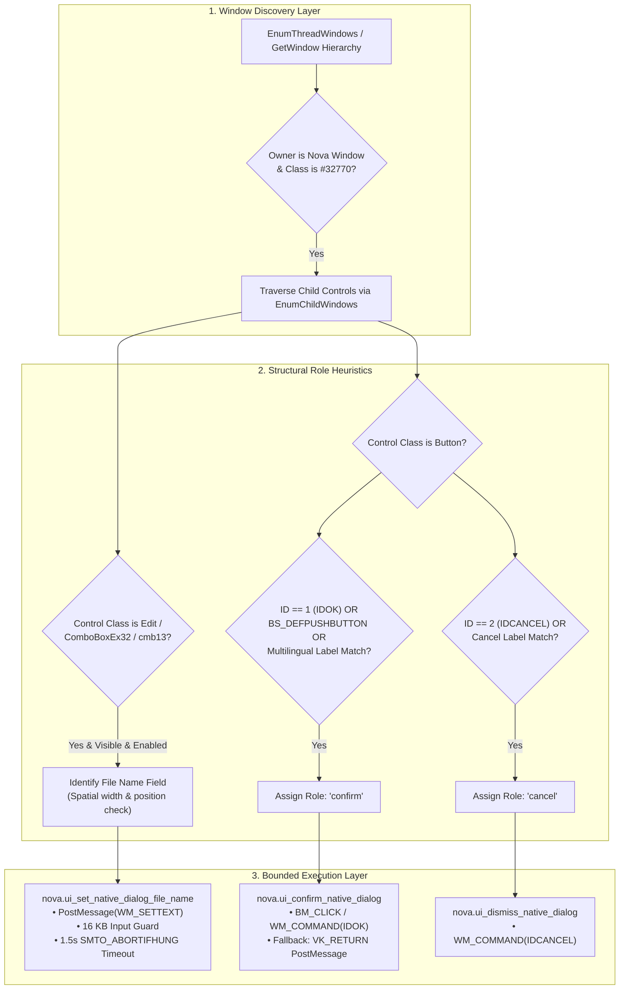
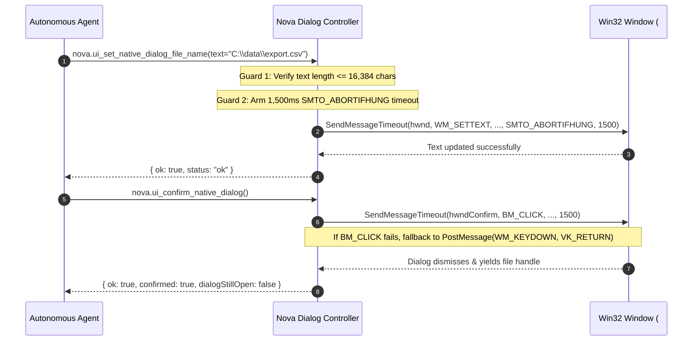

# Win32 Dialog Discovery & Control Heuristics

> **In-depth architecture of Nova's native `#32770` dialog discovery engine, child control heuristics, bilingual label matching, non-blocking Win32 messaging, and buffer overflow boundaries.**

---

## 1. Operating System Window Architecture (`#32770`)

When a web application opens an operating system file picker (via `<input type="file">`, `window.showOpenFilePicker()`, or file export actions), the Windows Shell instantiates a native Win32 window of class `#32770` (the standard Windows dialog class) wrapping the Common Item Dialog (`IFileDialog`) COM interface.

Because this window exists in the Windows desktop manager window hierarchy rather than the Chromium DOM tree, standard web selectors are useless. Furthermore, automating `#32770` windows presents severe stability hazards:
* **Hung Message Queues:** If an automation driver uses blocking Win32 APIs (such as synchronous `SendMessage`) and the target window fails to pump its message loop, the entire automation process deadlocks indefinitely.
* **Coordinate Fragility:** Buttons move based on system font scaling (DPI 100% vs 175%), multi-monitor geometry, and window resizing.
* **Localization Shifts:** Standard buttons alter their text based on the Windows display language ("Open" vs. "Öffnen", "Save" vs. "Speichern").

Nova overcomes these hurdles through heuristic window discovery, structural role identification, and timeout-bounded messaging.



---

## 2. Child Control Discovery Heuristics

Nova traverses the window's child control tree using `EnumChildWindows`, assigning functional roles based on strict structural properties:

### 1. File Name Edit Control
* **Candidate Classes:** `Edit`, `ComboBoxEx32`, `ComboBox`, `cmb13`.
* **Spatial Filter:** The file name field in standard Common Item Dialogs is horizontally wide and positioned in the lower-middle quadrant of the dialog. Nova filters candidate edit controls by visibility, enabled state, and bounding box dimensions, selecting the primary entry field.

### 2. Primary Affirmative Button (`confirm`)
* **Control ID Match:** Windows assigns `IDOK` (value `1`) to the default affirmative action in standard dialog templates.
* **Button Style Match:** Nova checks for the `BS_DEFPUSHBUTTON` window style flag.
* **Bilingual Label Match:** If control IDs are obfuscated by custom shell extensions, Nova normalizes the control's text and tests against its built-in multilingual catalog:

```text
English: open, save, ok, choose, select, print, upload
German:  öffnen, speichern, ok, auswählen, wählen, drucken, hochladen
```

### 3. Cancel / Dismiss Button (`cancel`)
* **Control ID Match:** Standard Windows `IDCANCEL` (value `2`).
* **Bilingual Label Match:**
```text
English: cancel, close, abort, dismiss
German:  abbrechen, schließen, verwerfen
```

---

## 3. Non-Blocking Messaging & Safety Boundaries

Directly calling `SendMessage(hwnd, ...)` in automation code is an antipattern that causes permanent deadlocks if the target window displays a secondary nested modal (e.g. "File already exists, overwrite?").

Nova guarantees host stability through three rigorous safety boundaries:



### 1. The 1.5-Second Win32 Timeout (`SMTO_ABORTIFHUNG`)
All synchronous Win32 window messages are dispatched using `SendMessageTimeout` configured with `SMTO_ABORTIFHUNG` and a hard **1,500 millisecond timeout**. If the target dialog hangs or displays an unhandled prompt, the call returns an error to the MCP server rather than hanging the agent.

### 2. The 16 KB Text Buffer Limit
The `text` parameter in [`nova.ui_set_native_dialog_file_name`](../../../../mcp-reference/tools/app-shell-and-ui/nova-ui-set-native-dialog-file-name.md) is strictly bounded to a maximum of **16,384 characters** (16 KB). This prevents memory corruption, stack overflows, or heap exhaustion in legacy Win32 edit controls when handling malformed input paths.

### 3. Keyboard `VK_RETURN` Fallback
If UI automation cannot identify a clickable button handle, [`nova.ui_confirm_native_dialog`](../../../../mcp-reference/tools/app-shell-and-ui/nova-ui-confirm-native-dialog.md) posts a `WM_KEYDOWN` message with `VK_RETURN` (Enter) directly to the dialog window, invoking the default dialog procedure affirmative handler.

---

## 4. Parameter Reference & Schema

### [`nova.ui_inspect_native_dialog`](../../../../mcp-reference/tools/app-shell-and-ui/nova-ui-inspect-native-dialog.md)
* **Parameters:** None.
* **Output Payload:**
  ```json
  {
    "ok": true,
    "status": "ok",
    "nativeDialog": {
      "isOpen": true,
      "kind": "file_picker",
      "title": "Open",
      "className": "#32770",
      "foreground": true
    },
    "automation": {
      "dialogType": "file_picker",
      "supportsConfirm": true,
      "supportsCancel": true,
      "supportsSetFileName": true,
      "supportedActions": ["confirm", "cancel", "set_file_name"],
      "fileNameField": {
        "className": "Edit",
        "controlId": 1152,
        "visible": true,
        "enabled": true
      },
      "buttons": [
        { "text": "Open", "role": "confirm", "controlId": 1, "isDefault": true },
        { "text": "Cancel", "role": "cancel", "controlId": 2, "isDefault": false }
      ]
    }
  }
  ```

### [`nova.ui_set_native_dialog_file_name`](../../../../mcp-reference/tools/app-shell-and-ui/nova-ui-set-native-dialog-file-name.md)

| Parameter | Type | Required | Range | Description |
| :--- | :--- | :---: | :--- | :--- |
| `text` | `string` | **Yes** | 1–16,384 chars | The absolute path to inject into the file name control. |

### [`nova.ui_confirm_native_dialog`](../../../../mcp-reference/tools/app-shell-and-ui/nova-ui-confirm-native-dialog.md)

| Parameter | Type | Required | Default | Description |
| :--- | :--- | :---: | :--- | :--- |
| `button` | `string` | No | Default affirmative | Explicit label of the button to click (e.g. `"Open"`, `"Save"`). Case and whitespace are normalized. |

---

## 5. Related Architecture Guides

* [DOM File Upload Bypass & In-App Modals](../dom-file-upload-bypass-and-in-app-dialogs/README.md): Bypassing Win32 dialogs via `nova.file_upload` and WinUI 3 dialog control.
* [File Dialogs & OS Pickers Hub](../README.md): High-level domain overview.
* [V8 Thread Unblocking & Auto-Dismissal](../../javascript-dialog-interception/v8-thread-unblocking-and-auto-dismissal/README.md): Interception of synchronous in-page modals.
* [Security & Platform Prompts](../../security-and-platform-prompts/README.md): Resolving HTTP auth, certificate warnings, and permissions.
* [Native Dialogs Master Hub](../../README.md): Master subsystem architectural catalog.
