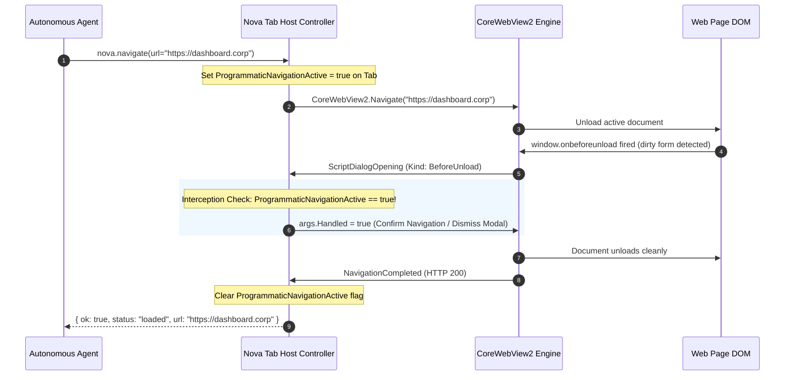

# BeforeUnload Interception & Navigation Lifecycle

> **Preventing navigation traps, the `window.onbeforeunload` infinite loop hazard, programmatic navigation flags, and clean tab teardown guarantees.**

---

## 1. Architectural Problem: The `beforeunload` Navigation Trap

Web applications frequently attach event handlers to `window.onbeforeunload` to protect users against accidental data loss:

```javascript
window.onbeforeunload = function(event) {
    if (formIsDirty) {
        event.preventDefault();
        return "You have unsaved changes. Are you sure you want to leave?";
    }
};
```

In human browsing, this pattern displays a standard browser dialog ("Leave site? Changes you made may not be saved") with "Leave" and "Stay" options.

In autonomous agent automation, however, this pattern presents a severe **Navigation Trap**:

```mermaid
flowchart TD
    subgraph NaiveAutomation ["Naive Automation Engine (Deadlock Loop)"]
        CmdClose["Agent Issues Close / Navigate Command"] --> EngineClose["Engine Dispatches Navigation / Destroy"]
        EngineClose --> BeforeUnload["Page Fires window.onbeforeunload"]
        BeforeUnload --> ModalBlock["Native Modal Prompt Halts Execution"]
        ModalBlock --> TimeoutFail["Command Times Out (30s)"]
        TimeoutFail --> RetryClose["Agent / Framework Retries Tab Close"]
        RetryClose --> BeforeUnload
    end

    subgraph NovaSolution ["Nova Safe Navigation Architecture"]
        NovaCmd["Agent Calls nova.navigate or nova.tab_close"] --> SetFlag["Set Host Flag: ProgrammaticNavigationActive = true"]
        SetFlag --> DispatchNav["Dispatch CoreWebView2 Navigation / Close"]
        DispatchNav --> HookCheck{"CoreWebView2.ScriptDialogOpening<br/>Kind == BeforeUnload?"}
        HookCheck -- "Flag is True (Agent Action)" --> AutoBypass["Auto-Confirm 'Leave' (args.Handled = true)<br/>Bypass modal completely"]
        AutoBypass --> CleanTeardown["Tab Closes / Navigates Cleanly<br/>Zero Deadlocks / Zero Zombie Processes"]
        HookCheck -- "Flag is False (User Action)" --> DisplayPrompt["Display Standard Confirmation Modal"]
    end
```



### The Infinite Loop & Zombie Process Hazard
1. **The Navigation Freeze:** When an agent calls `nova.navigate` to navigate to a new site, a `beforeunload` modal halts navigation. The agent waits indefinitely for the `navigate` promise to resolve.
2. **The Zombie Process Dilemma:** If a test framework forcibly kills a hung browser tab without properly clearing `beforeunload` hooks, the underlying Chromium renderer process can remain orphaned in the background as a zombie process, locking cache files and consuming memory.

---

## 2. Programmatic Navigation Flagging

Nova eliminates navigation traps by coupling host-level intent signaling with the `ScriptDialogOpening` event pipeline:



### Lifecycle Invariants

1. **Explicit Intent Binding:** Every programmatic navigation primitive—including [`nova.navigate`](../../../../mcp-reference/tools/browser-automation/nova-navigate.md), [`nova.route`](../../../../mcp-reference/tools/browser-automation/nova-route.md), [`nova.back`](../../../../mcp-reference/tools/browser-automation/nova-back.md), [`nova.forward`](../../../../mcp-reference/tools/browser-automation/nova-forward.md), and [`nova.tab_close`](../../../../mcp-reference/tools/browser-automation/nova-tab-close.md)—arms the `ProgrammaticNavigationActive` guard immediately before calling the WebView2 API.
2. **Zero-Latency Dismissal:** If a `BeforeUnload` dialog fires while this guard is armed, Nova handles the event instantly, allowing the navigation or closure to proceed without interruption.
3. **Automatic Guard Clearing:** The guard is disarmed immediately upon `NavigationCompleted` or `NavigationStarting` on the target URL, ensuring that subsequent unprompted page transitions do not inadvertently suppress legitimate user warnings.

---

## 3. Human Browsing vs. Automated Teardown

Nova preserves data integrity for human users while ensuring zero resistance for automated workloads:

| Operational Mode | Trigger | `beforeunload` Behavior | User Experience |
| :--- | :--- | :--- | :--- |
| **Interactive Browsing** | User clicks close button on tab strip or navigates via address bar. | **Prompt Displayed** | Standard WinUI modal asks user whether to stay or leave, preventing loss of unsaved text. |
| **Autonomous Agent Run** | Agent calls `nova.tab_close` or `nova.navigate` via MCP. | **Automatically Suppressed** | Immediate execution; tab closes cleanly or navigates without blocking the agent workflow. |
| **Application Shutdown** | System shutdown or Nova window close event. | **Graceful Prompt / Park** | Prompts user if interactive; tears down cleanly if launched in automated headless mode. |

---

## 4. Diagnostic Inspection of Unsaved Form Changes

When building high-autonomy agents, an agent may wish to inspect whether a webpage contains unsaved form data **before** choosing to navigate away:

Instead of relying on `beforeunload` dialogs, agents should proactively inspect form dirty states directly through DOM perception:

```json
// Evaluate whether forms contain modified inputs
// nova.eval
{
  "script": "Array.from(document.forms).some(form => Array.from(form.elements).some(el => el.value !== el.defaultValue))"
}
```

```json
// Response
{
  "result": true
}
```

If unsaved changes exist, the agent can explicitly submit the form ([`nova.guarded_submit_form`](../../../../mcp-reference/tools/guarded-actions/nova-guarded-submit-form.md)) or take an intentional decision to discard them prior to issuing `nova.navigate`.

---

## 5. Related Architecture Guides

* [V8 Thread Unblocking & Auto-Dismissal](../v8-thread-unblocking-and-auto-dismissal/README.md): Interception of `alert()`, `confirm()`, and `prompt()` modals.
* [JavaScript Dialog Interception Hub](../README.md): High-level domain overview.
* [Win32 Dialog Discovery & Heuristics](../../file-dialogs-and-os-pickers/win32-dialog-discovery-and-control-heuristics/README.md): Low-level Win32 control automation.
* [Browser Navigation Architecture](../../../browser-interaction/README.md): Navigation pipelines and history stacks.
* [Native Dialogs Master Hub](../../README.md): Complete native dialogs and prompts catalog.
