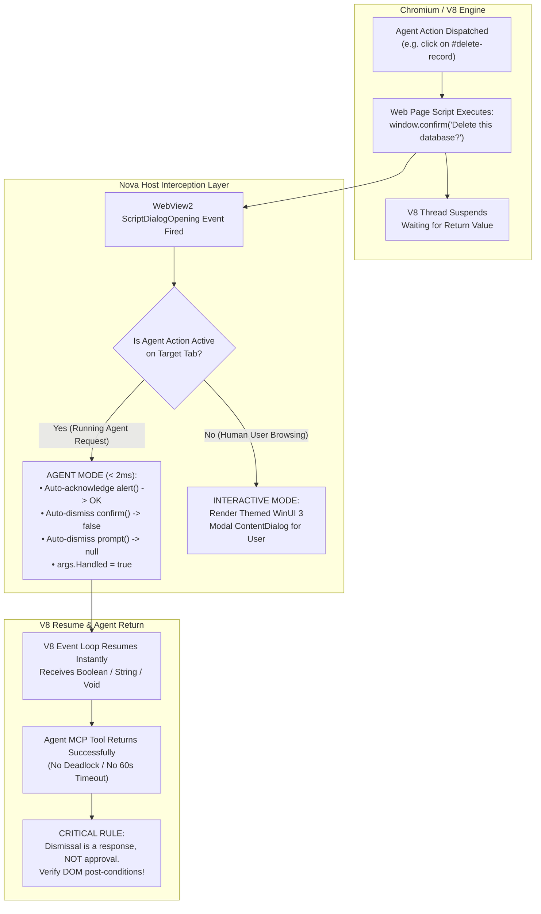
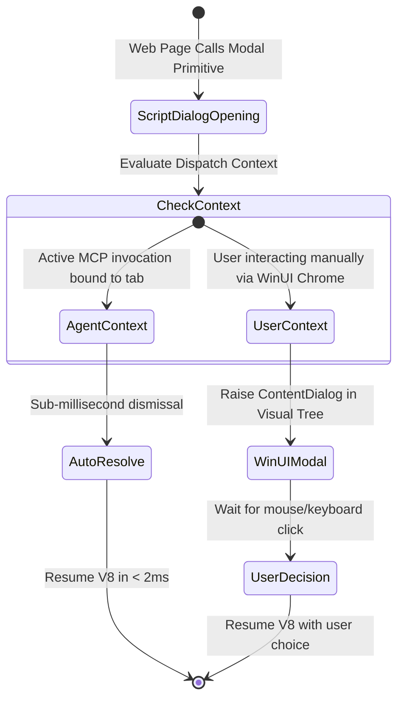
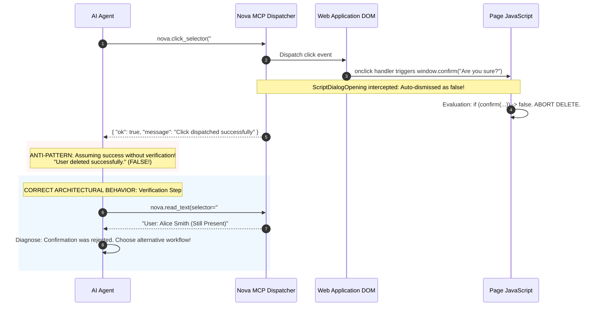

# V8 Thread Unblocking & Automated Dialog Dismissal

> **Deep dive into the synchronous JavaScript dialog freeze problem, host-level `ScriptDialogOpening` interception, autonomous agent auto-dismissal rules, and the post-condition verification mandate.**

---

## 1. Architectural Problem: The V8 Execution Freeze

In web browsers, modal JavaScript primitives—specifically `window.alert()`, `window.confirm()`, and `window.prompt()`—originate from the early days of the web. Unlike modern asynchronous APIs that return Promises, these functions execute **synchronously**:

1. **V8 Event Loop Halting:** The moment a script invokes `window.confirm("Proceed?")`, the Chromium V8 JavaScript engine completely pauses execution. The microtask queue, macrotask queue, DOM mutation observers, and CSS animation timers are frozen.
2. **CDP Automation Deadlock:** In standard browser automation protocols (such as raw Chromium DevTools Protocol or CDP-based frameworks), a command that triggers a click (e.g. `Runtime.evaluate` or `Input.dispatchMouseEvent`) remains pending until the JavaScript call stack returns. Because the modal blocks the call stack, the CDP command never finishes. The calling agent experiences a hard timeout (typically 30–60 seconds) and fails.
3. **Absence of DOM Footprint:** JavaScript dialogs are not rendered as HTML elements within the webpage. They are rendered by the browser shell or operating system. Consequently, neither CSS selectors (`button:has-text("OK")`) nor XPath expressions can detect or manipulate them.

Nova resolves this deadlock through active host interception at the Microsoft WebView2 native interface.



---

## 2. Host Interception Pipeline (`ScriptDialogOpening`)

When any script running in a WebView2 frame calls a modal primitive, Microsoft WebView2 raises the `CoreWebView2.ScriptDialogOpening` event before displaying any system UI. Nova hooks this event across every browser tab and sandbox profile.

### Dual-Mode Processing Architecture

Nova distinguishes between automated agent execution and human interactive sessions:



### 1. Agent Mode (Sub-2ms Automatic Resolution)
When an MCP tool call (e.g. `nova.click_selector`, `nova.type_selector`, `nova.eval`) is executing on the target tab:
* Nova intercepts the event synchronously.
* It populates the event argument's default return value.
* It sets `args.Handled = true` and defers UI creation.
* **Latency Guarantee:** The V8 execution thread unblocks in **less than 2 milliseconds**, completely preventing CDP deadlocks and tool timeouts.

### 2. User Interactive Mode (Themed WinUI 3 Modals)
When a human operator browses manually without an active agent command:
* Nova defers handling to its visual host chrome.
* A themed WinUI 3 `ContentDialog` matching Nova's modern interface is presented to the user.
* The user's explicit button selection is relayed back to the V8 thread upon click.

---

## 3. Primitive-Specific Resolution Semantics

Nova enforces distinct, deterministic resolution semantics for each JavaScript primitive during automated agent runs:

| JavaScript Primitive | Script Dialog Kind | Agent Mode Default | Return Value to V8 | Rationale & Safety Boundary |
| :--- | :--- | :--- | :---: | :--- |
| `window.alert(msg)` | `Alert` | **Acknowledged** | `void` | Informational notification; unblocking immediately is safe. |
| `window.confirm(msg)` | `Confirm` | **Cancelled** | `false` | Prevents unintended destructive actions (e.g. deleting production records). |
| `window.prompt(msg, def)`| `Prompt` | **Cancelled** | `null` | Prevents injection of unverified default text into web application state. |
| `window.onbeforeunload` | `BeforeUnload` | **Suppressed** | `true` | Prevents navigation traps when closing tabs or redirecting. |

### The Safety Rationale for `confirm()` Dismissal
> [!CAUTION]
> In Agent Mode, `window.confirm()` defaults to `false` (Cancel).
> 
> Web applications commonly guard critical deletions behind confirmations:
> ```javascript
> if (confirm("Permanently wipe organization data?")) {
>     api.wipeDatabase();
> }
> ```
> Automatically answering `true` to every unknown confirmation could result in catastrophic data destruction. By defaulting to `false`, Nova guarantees that automated exploration remains non-destructive.

---

## 4. The Golden Verification Rule: Dismissal Is Not Approval

A pervasive vulnerability in autonomous LLM agents is conflating tool execution with business logic success:

> [!WARNING]
> **Dismissal is a response, NOT approval!**
> 
> When Nova automatically dismisses a `confirm()` modal, it supplies `false` to the calling script. From the webpage's perspective, the user explicitly clicked "Cancel". If an agent clicks "Delete Item" and the tool returns `{ "ok": true }`, this only proves that the click was delivered and the resultant dialog was unblocked—**it does NOT mean the item was deleted**.



### The Post-Condition Verification Protocol

Every autonomous agent interacting with dialog-prone surfaces must follow this 3-step verification protocol:

1. **Step 1 (Action):** Trigger the desired action via `nova.click_selector` or `nova.type_selector`.
2. **Step 2 (Verification):** Immediately re-read the target DOM element or surrounding container using [`nova.read_text`](../../../../mcp-reference/tools/dom-and-reading/nova-read-text.md) or [`nova.dom_extract`](../../../../mcp-reference/tools/dom-and-reading/nova-dom-extract.md).
3. **Step 3 (Evaluation):** Compare the observed state against the intended target:
   * If the item is still present, the script required affirmative confirmation.
   * Proceed via an alternative path: direct form submission, detached API replay ([Detached Request Replay](../../../network/network-interception/README.md)), or native button overrides.

---

## 5. Related Architecture Guides

* [BeforeUnload & Navigation Lifecycle](../beforeunload-and-navigation-lifecycle/README.md): Bypassing navigation traps and orphan prevention.
* [JavaScript Dialog Interception Hub](../README.md): High-level domain overview.
* [Win32 Dialog Discovery & Heuristics](../../file-dialogs-and-os-pickers/win32-dialog-discovery-and-control-heuristics/README.md): Operating system dialog controls.
* [DOM File Upload Bypass](../../file-dialogs-and-os-pickers/dom-file-upload-bypass-and-in-app-dialogs/README.md): Bypassing native file pickers via CDP.
* [Native Dialogs Master Hub](../../README.md): Complete native dialogs and prompts catalog.
