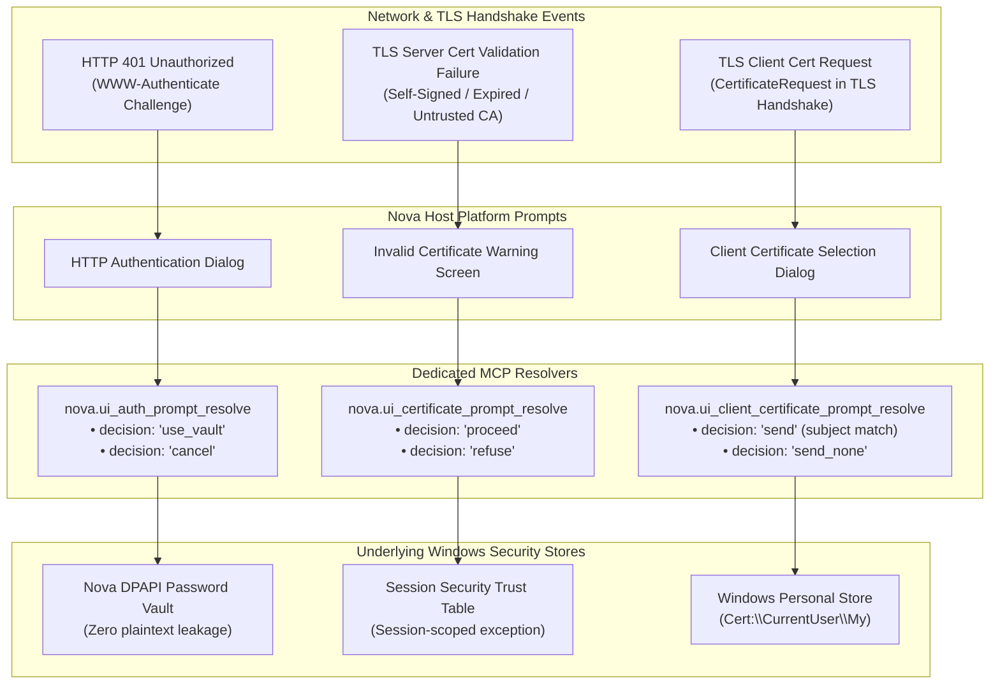

# HTTP Authentication & Certificate Security Resolvers

> **Programmatic resolution of HTTP 401 challenges, zero-leak DPAPI credential injection, SSL/TLS certificate exception overrides, and enterprise mTLS handshakes.**

---

## 1. Architectural Concept: Platform Security Prompts

Unlike in-page HTML elements, security and identity prompts originate from the browser host chrome or network security subsystem. They represent critical trust boundaries:

1. **HTTP 401 Authentication (RFC 7617 / RFC 7616):** When accessing internal network devices (routers, switches, legacy ERPs, or staging proxies), the web server challenges the client with `WWW-Authenticate: Basic` or `Digest`. The browser halts page loading and demands credentials.
2. **Untrusted SSL/TLS Certificates:** In development, staging, or private PKI environments, websites often present self-signed certificates, certificates with mismatched Subject Alternative Names (SAN), or expired validity dates. WebView2 halts navigation with an invalid certificate modal.
3. **Mutual TLS (mTLS) Client Authentication:** High-security enterprise gateways challenge the client during the TLS handshake to present an X.509 client certificate proving workstation identity.

Standard DOM automation tools cannot see or resolve these prompts. Nova provides three dedicated, deterministic platform resolvers:



---

## 2. HTTP 401 Authentication (`nova.ui_auth_prompt_resolve`)

When a web server or proxy challenges the browser with an HTTP 401 response, Nova's `BasicAuthenticationRequested` handler captures the challenge.

```mermaid
sequenceDiagram
    autonumber
    participant Server as HTTP Web Server / Proxy
    participant Browser as Nova WebView2 Host
    participant Agent as Autonomous Agent
    participant Vault as DPAPI Password Vault

    Server->>Browser: HTTP 401 Unauthorized (WWW-Authenticate: Basic realm="Internal")
    Browser->>Browser: Suspend navigation; surface Auth Prompt
    
    Agent->>Browser: nova.ui_inspect_native_dialog()
    Browser-->>Agent: { isOpen: true, kind: "http_auth", origin: "https://router.corp" }

    rect rgb(240, 248, 255)
        Note over Agent,Vault: Zero-Leak Authentication Route
        Agent->>Browser: nova.ui_auth_prompt_resolve(decision="use_vault", username="admin")
        Browser->>Vault: Match stored secret for origin "https://router.corp" & "admin"
        Vault-->>Browser: Decrypt in-memory byte buffer
        Browser->>Browser: Ingest credentials directly into CoreWebView2 args
    end

    Browser->>Server: HTTP GET with Authorization: Basic YWRtaW46...
    Server-->>Browser: HTTP 200 OK (Page loads)
    Browser-->>Agent: { ok: true, status: "resolved", action: "authenticated" }
```

### Zero-Leakage Credential Security
> [!IMPORTANT]
> When resolving an HTTP authentication challenge with `decision: "use_vault"`, the plaintext password **never touches agent tool arguments, MCP server log files, or LLM context transcripts**.
> 
> Nova matches the target origin against its Windows Data Protection API (DPAPI) encrypted vault, decrypts the secret directly inside the host process memory, and injects it into the native WebView2 credential handler.

### Protocol Parameters

| Parameter | Type | Required | Values | Description |
| :--- | :--- | :---: | :--- | :--- |
| `decision` | `string` | **Yes** | `"use_vault"`, `"cancel"` | `"use_vault"` injects DPAPI credentials; `"cancel"` aborts challenge. |
| `username` | `string` | No | — | Optional username hint to select among multiple vault entries for the origin. |

---

## 3. SSL/TLS Certificate Prompts (`nova.ui_certificate_prompt_resolve`)

When navigating to internal infrastructure, embedded hardware devices, or development clusters that use self-signed certificates, WebView2 displays a blocking certificate warning screen.

### Passive Inspection vs. Active Trust Override

Nova enforces a strict separation between **passive diagnostic analysis** and **active trust overrides**:

| Capability | [`nova.tls_inspect`](../../../../mcp-reference/tools/proxy-and-network/nova-tls-inspect.md) | [`nova.ui_certificate_prompt_resolve`](../../../../mcp-reference/tools/app-shell-and-ui/nova-ui-certificate-prompt-resolve.md) |
| :--- | :--- | :--- |
| **Operational Nature** | **Passive Diagnostic** | **Active Trust Override** |
| **Action** | Connects out-of-band to inspect and return cryptographic X.509 chain details. | Overrides the browser's certificate error screen for the current session. |
| **Browser State** | Leaves browser security policies unchanged. | Grants a session-scoped security exception. |

```json
// Overriding an invalid certificate prompt
// nova.ui_certificate_prompt_resolve
{
  "decision": "proceed"
}
```

* **`proceed`:** Bypasses the certificate warning for the **current browser session only**. Navigation resumes, and the target page renders.
* **`refuse`:** Declines the certificate exception. Navigation is aborted, and the connection remains closed.

---

## 4. Mutual TLS Client Certificates (`nova.ui_client_certificate_prompt_resolve`)

In zero-trust enterprise architectures, servers require the client to present a personal X.509 certificate during the TLS handshake (`ClientCertificateRequested`).

### Windows Certificate Store Integration

Nova integrates directly with the Windows Personal Certificate Store (`Cert:\CurrentUser\My`):

```json
// Selecting a client certificate
// nova.ui_client_certificate_prompt_resolve
{
  "decision": "send",
  "subject": "CN=Joel Aniol (Workstation Client)"
}
```

* **`decision: "send"`:** Scans the `CurrentUser\My` certificate store for a valid client authentication certificate whose Subject distinguished name contains the provided `subject` substring. Nova binds the matched certificate to the active TLS handshake.
* **`decision: "send_none"`:** Declines to provide a client certificate. The server responds according to its mTLS policy (either terminating the connection or serving an unauthorized page).

---

## 5. Related Architecture Guides

* [Sensor Permissions, Download Warnings & Recovery](../sensor-permissions-download-warnings-and-recovery/README.md): Resolving device sensors, executable download warnings, and startup tab restoration.
* [Security & Platform Prompts Hub](../README.md): High-level domain overview.
* [Password Vault & DPAPI Credentials](../../../privacy/vault-and-secrets/README.md): The encrypted vault architecture backing `use_vault`.
* [TLS Inspection & Diagnostics](../../../network/tls-inspection/README.md): Passive out-of-band certificate analysis.
* [Native Dialogs Master Hub](../../README.md): Master subsystem architectural catalog.
