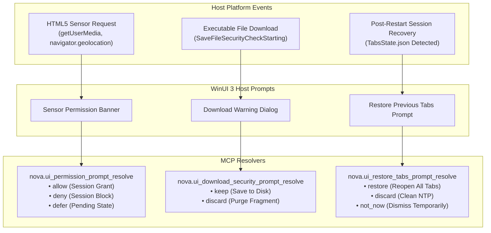
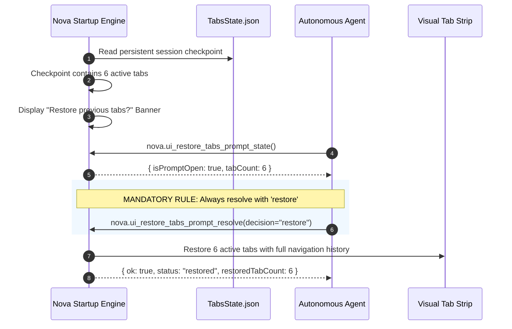

# Sensor Permissions, Download Warnings & Crash Recovery

> **Deep dive into HTML5 hardware sensor grants, executable download warnings, and startup tab crash recovery orchestration.**

---

## 1. Architectural Overview

Beyond network authentication and cryptographic handshakes, browser platform chrome presents modal prompts governing three critical operational areas:

1. **HTML5 Sensor & Hardware Access:** Modern web applications request access to physical sensors (camera, microphone, geolocation) and sensitive operating system capabilities (notifications, clipboard read, MIDI).
2. **Executable Download Warnings:** When downloading executable binaries or scripts (`.exe`, `.msi`, `.bat`, `.ps1`), Chromium and Windows SmartScreen raise security barriers to prevent drive-by execution.
3. **Session Recovery After Restarts:** Following an application crash, Windows restart, or developer rebuild, Nova halts on startup to ask whether previously active tabs should be restored.

Nova equips autonomous agents with dedicated resolvers to answer these challenges deterministically without manual human intervention.



---

## 2. HTML5 Sensor & Device Permissions (`nova.ui_permission_prompt_resolve`)

When a web page calls sensitive browser APIs (such as `navigator.mediaDevices.getUserMedia` or `navigator.geolocation.getCurrentPosition`), WebView2 halts execution until permission is granted or denied.

```mermaid
sequenceDiagram
    autonumber
    participant Page as Web Application
    participant WV as CoreWebView2 Engine
    participant Agent as Autonomous Agent
    participant Perm as Permission Center

    Page->>WV: navigator.mediaDevices.getUserMedia({ video: true })
    WV->>WV: Suspend promise; surface Permission Prompt
    
    Agent->>WV: nova.ui_inspect_native_dialog()
    WV-->>Agent: { isOpen: true, promptType: "permission", permissionKind: "camera" }

    Agent->>WV: nova.ui_permission_prompt_resolve(decision="allow")
    WV->>Perm: Record session-scoped grant for origin
    WV->>Page: Resolve getUserMedia() promise with active MediaStream
    WV-->>Agent: { ok: true, status: "resolved", decision: "allow" }
```

### Supported Permission Types
* **`camera`:** Video capture devices.
* **`microphone`:** Audio input devices.
* **`geolocation`:** High-accuracy GPS/Wi-Fi positioning coordinates.
* **`notifications`:** Desktop toast notifications.
* **`clipboard-read`:** Direct reading of the Windows system clipboard.
* **`midi`:** System MIDI hardware synthesizer access.

### Decision Semantics

| Decision | State Effect | Scope | Recommended Use Case |
| :--- | :--- | :--- | :--- |
| **`allow`** | Grants requested sensor access immediately. | Active Session | Legitimate video/audio test suites, mapping workflows. |
| **`deny`** | Blocks sensor access and suppresses further prompts. | Active Session | Untrusted websites or privacy-critical workflows. |
| **`defer`** | Leaves the prompt unresolved without granting access. | Transient | Default safe state when intent is ambiguous. |

> [!TIP]
> For permanent, domain-wide permission management that persists across browser restarts, use Nova's Permission Center: [`nova.permission_center_set`](../../../../mcp-reference/tools/app-shell-and-ui/nova-permission-center-set.md).

---

## 3. Download Security Prompts (`nova.ui_download_security_prompt_resolve`)

When an interactive workflow triggers a download of an executable file (`.exe`, `.bat`, `.ps1`, `.msi`) or a file flagged by Windows SmartScreen:

```json
{
  "decision": "keep"
}
```

* **`decision: "keep"`:** Overrides the security barrier. Nova permits the download stream to finalize and commits the verified file to disk. An audit event is logged immediately.
* **`decision: "discard"`:** Immediately cancels the transfer, aborts the disk stream, and permanently purges any temporary partial file segments (`.crdownload`).

> [!NOTE]
> On unattended background surfaces or automated worker threads where no UI dialog host is present, Nova automatically enforces **Fail-Closed Security**, discarding executable downloads immediately (see [Executable Download Security Gates](../../../downloads/security-and-policy/executable-gates-and-security-prompts/README.md)).

---

## 4. Startup Tab Recovery (`nova.ui_restore_tabs_prompt_resolve`)

Following an unexpected application crash, system restart, or developer rebuild, Nova detects prior tab state and displays the startup recovery prompt: *"Restore previous tabs?"*



### The Developer Work-In-Progress Mandate
> [!IMPORTANT]
> **Always resolve with `restore` on developer workstations!**
> In automated developer environments, test runners and autonomous agents must **always** resolve the tab restoration prompt with `decision: "restore"`. Discarding the prompt destroys the user's active workspaces, open tabs, and live session state.

### Querying Prompt State
Agents can inspect whether the recovery banner is active before dispatching commands:

```json
// Query state
// nova.ui_restore_tabs_prompt_state
{}
```

```json
// Response
{
  "isPromptOpen": true,
  "tabCount": 4,
  "lastSavedUtc": "2026-10-18T10:15:30Z"
}
```

### Resolution Decisions
* **`restore`:** Reopens all previously active tabs, preserving isolated sandbox assignments, cookies, and history.
* **`discard`:** Purges the recovery checkpoint and opens a clean New Tab Page (NTP).
* **`not_now`:** Temporarily hides the banner without deleting the recovery checkpoint.

---

## 5. Related Architecture Guides

* [HTTP Auth & Certificate Exception Resolvers](../http-auth-and-certificate-exception-resolvers/README.md): Resolving HTTP 401 challenges, TLS exceptions, and mTLS handshakes.
* [Security & Platform Prompts Hub](../README.md): High-level domain overview.
* [Executable Download Security Gates](../../../downloads/security-and-policy/executable-gates-and-security-prompts/README.md): Pre-flight executable blocklist and fail-closed policies.
* [Downloads Master Hub](../../../downloads/README.md): Complete downloads and synchronization catalog.
* [Native Dialogs Master Hub](../../README.md): Master subsystem architectural catalog.
