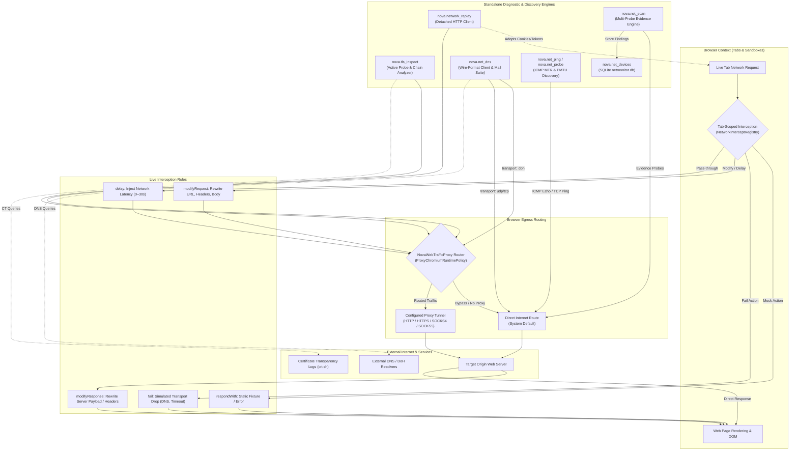

# Network Architecture & Traffic Control

The Network subsystem in Nova AI Workspace provides developers and autonomous agents with granular, enterprise-grade control over browser egress, in-flight traffic manipulation, standalone API testing, deep cryptographic inspection, and local/remote network infrastructure diagnostics. Modern web applications and cloud deployments rely on complex distributed microservices, strict Cross-Origin policies (CORS), dynamic WebSockets, Content Security Policies (CSP), and multi-tier network topologies. Debugging, automating, and securing these systems requires tools that go far beyond standard browser DevTools.

Nova unifies five specialized network disciplines into a single coherent architecture:
1. **Dynamic Proxy Routing:** System-wide or sandbox-isolated proxy routing (HTTP, HTTPS, SOCKS4, SOCKS5) with DPAPI-backed credential authentication, circuit-breaker fail-closed isolation, and WebRTC IP-leak prevention.
2. **Tab-Scoped Network Interception:** In-flight request and response modification within a live browser tab, supporting mock responses, transport failure simulation, header rewriting, and controlled delays.
3. **Detached Request Replay:** An independent HTTP/HTTPS client outside the browser context capable of adopting live browser session credentials (`HttpOnly` cookies and `localStorage` bearer tokens) with cryptographic redacting previews.
4. **Deep SSL/TLS Cryptographic Inspection:** In-depth cryptographic analysis of X.509 certificate chains, server cipher suite negotiation, HTTP Strict Transport Security (HSTS), and public Certificate Transparency (CT) logs.
5. **Network Discovery, Diagnostics & Infrastructure Administration:** Native, permission-governed network scanning (`nova.net_scan`), persistent device inventory (`nova.net_devices`), root-to-leaf DNS and mail security inspection (`nova.net_dns`), continuous MTR-style path diagnostics and PMTU discovery (`nova.net_ping`), and low-overhead port probing (`nova.net_probe`).

---

## 1. High-Level Architecture & Traffic Flow

The following diagram illustrates how outgoing and incoming network traffic flows through Nova's various control planes:



### Core Routing & Diagnostic Invariants:
1. **The Single Egress Policy:** All active network probes initiated by `nova.tls_inspect`, request replay operations via `nova.network_replay`, and DoH queries via `nova.net_dns(transport="doh")` respect Nova's active browser proxy route. If a proxy is configured and fails or goes offline, Nova **never falls back to a direct, unproxied route**, preventing accidental IP exposure.
2. **Replay Traffic Isolation:** Requests generated via `nova.network_replay` are executed by an independent HTTP client outside the browser tab. Replay traffic **never traverses the page's tab-scoped interception rules**, ensuring that replayed requests test the real server rather than local browser mocks.
3. **Session Replay Decoupling:** Adopting a browser session into request replay copies authentication headers and cookies into a new request draft. It does not clone the browser's execution state or bind to the page's transport socket.
4. **Direct Diagnostic Transport:** Raw ICMP echo requests and low-level TCP/UDP socket checks executed by `nova.net_ping`, `nova.net_probe`, and `nova.net_scan` operate over local host sockets (`route: "direct"`), as standard HTTP/SOCKS proxies cannot transport raw ICMP or TTL expired packets.
5. **Private vs. Public Scan Boundaries:** Network scans against private RFC 1918, CGNAT, link-local, and loopback ranges execute freely under standard agent permissions. Any scan targeting public IP addresses strictly requires explicit, per-range user approval in the UI (`scan_approval_required`), protecting external infrastructure against unapproved probing.

---

## 2. Comprehensive Documentation Index

The Network architecture is organized into five primary domains and specialized deep-dive architecture subguides:

```
network/
├── README.md                                                       # Master Architectural Hub
├── proxy/                                                          # Domain 1: Proxy Routing & Traffic Isolation
│   ├── README.md                                                   # Domain Hub
│   ├── profile-management-and-runtime-leak-protection/
│   │   └── README.md                                               # Schemas, CLI projection, WebRTC & SOCKS5 DNS protection
│   ├── credential-security-and-dpapi-storage/
│   │   └── README.md                                               # DPAPI vault, HTTP 407 challenge, Security Root URI Guard
│   └── auxiliary-routing-and-health-probing/
│       └── README.md                                               # NovaWebTrafficProxy, DownloadProxyResolver, Circuit Breakers
├── network-interception/                                           # Domain 2: Network Interception & Request Replay
│   ├── README.md                                                   # Domain Hub
│   ├── tab-scoped-interception/
│   │   └── README.md                                               # 5 action primitives, request/response editing, CDP pipeline
│   └── request-replay-and-session-adoption/
│       └── README.md                                               # Detached HTTP client, compareTo, session adoption, bounds
├── tls-inspection/                                                 # Domain 3: SSL/TLS Cryptographic Inspection
│   ├── README.md                                                   # Domain Hub
│   ├── certificate-chains/
│   │   └── README.md                                               # X.509 chains, intermediate caching fallacies, offline checks
│   ├── cipher-suites-and-protocols/
│   │   └── README.md                                               # Protocol negotiation, AEAD, PFS, post-quantum groups
│   └── certificate-transparency/
│       └── README.md                                               # RFC 6962 framework, SCT parsing, public CT log mining
├── network-discovery-and-inventory/                                # Domain 4: Network Discovery & Device Inventory
│   └── README.md                                                   # Multi-probe evidence engine, device classification, netmonitor.db
├── dns-diagnostics/                                                # Domain 5: DNS Diagnostics & Mail Security
│   └── README.md                                                   # Wire-Format client, DoH, root delegation, SPF/DMARC/DKIM/MTA-STS
└── path-diagnostics-and-probing/                                   # Domain 6: Path Diagnostics, MTR & Probing
    └── README.md                                                   # ICMP MTR traceroute, rate-limit filter, PMTU discovery, TCP ping
```

### Complete Guide Reference Table

| Domain Area | Specialized Architecture Guide | Key Focus Areas & Technical Invariants |
| :--- | :--- | :--- |
| **Proxy Routing & Isolation**<br>([Domain Hub](proxy/README.md)) | **[Profile Management & Leak Protection](proxy/profile-management-and-runtime-leak-protection/README.md)** | Profile schemas, URL paste parsing, IPv6 bracket formatting, Chromium runtime projection, WebRTC non-proxied UDP blocking, remote SOCKS5 DNS resolution (`MAP * ~NOTFOUND`), and sandbox isolation modes (`global`, `none`, `profile`). |
| | **[Credential Security & DPAPI Storage](proxy/credential-security-and-dpapi-storage/README.md)** | Zero-plaintext credential policy, DPAPI encrypted storage (`proxy-credentials.dat`), write-protection invariants, dynamic HTTP 407 authentication challenges, and the Security Root URI Guard against credential harvesting. |
| | **[Auxiliary Routing & Health Probing](proxy/auxiliary-routing-and-health-probing/README.md)** | Auxiliary tool routing parity via `NovaWebTrafficProxy` (`IWebProxy`), `DownloadProxyResolver` modes, `ProxyProbeService` 4KB bounded probing, rolling latency EMA smoothing, visual URL-bar states, and fail-closed disconnect/reconnect circuit breaker. |
| **Network Interception & Replay**<br>([Domain Hub](network-interception/README.md)) | **[Tab-Scoped Interception](network-interception/tab-scoped-interception/README.md)** | Tab-scoped CDP `Fetch`/`Network` pipeline, the 5 action primitives (`fail`, `respondWith`, `modifyRequest`, `modifyResponse`, `delay`), request/response header and body rewriting, glob pattern matching ($\ge 4$ literal chars), one-hit rules, and application evidence tracking. |
| | **[Request Replay & Session Adoption](network-interception/request-replay-and-session-adoption/README.md)** | Detached .NET HTTP client, the 4-step draft lifecycle (`prepare`, `send`, `get`, `discard`), controlled A/B baseline comparisons (`compareTo`), session adoption from active tabs (`HttpOnly` cookies and `localStorage`), same-site security gates, and transport framing protection. |
| **SSL/TLS Cryptographic Inspection**<br>([Domain Hub](tls-inspection/README.md)) | **[Certificate Chain Analysis & Validation](tls-inspection/certificate-chains/README.md)** | X.509 certificate hierarchy (Leaf, Intermediate, Root), RFC 6125 SAN matching, intermediate CA caching fallacies, Windows `X509Chain` offline verification policies, and raw PEM exports. |
| | **[Cipher Suites, Protocols & PFS](tls-inspection/cipher-suites-and-protocols/README.md)** | Deprecation of SSLv3–TLS 1.1, TLS 1.2/1.3 cipher negotiation, AEAD algorithms, Perfect Forward Secrecy (PFS), Post-Quantum hybrid groups (Kyber768), and ALPN protocol selection. |
| | **[Certificate Transparency & Subdomains](tls-inspection/certificate-transparency/README.md)** | RFC 6962 framework, Signed Certificate Timestamps (SCTs), automated public CT log mining via `crt.sh`, subdomain discovery, and proxy privacy boundaries. |
| **Network Discovery & Inventory** | **[Discovery & Device Inventory](network-discovery-and-inventory/README.md)** | Multi-probe evidence engine (14 sources: ARP, ICMP, TCP, UPnP, WSD, IPP, mDNS, NetBIOS, SMB, SSH, LDAP, TLS, HTTP, SNMP), multicast listening window (`listenSeconds`), target CIDR bounds, public approval gates, persistent SQLite inventory (`netmonitor.db`), identity decoupling from IP addresses, and automated risk findings. |
| **DNS Diagnostics & Mail Security** | **[DNS Diagnostics & Mail Security](dns-diagnostics/README.md)** | Native Wire-Format DNS client (UDP/TCP/DoH), all standard record types, multi-resolver propagation comparison, root-to-leaf delegation consistency tracing, DNSSEC validation, candidate nameserver pre-testing, and comprehensive Mail Domain Security Suite (MX, SPF, DMARC, DKIM, MTA-STS, BIMI, DANE). |
| **Path Diagnostics & Probing** | **[Path Diagnostics, MTR & Probing](path-diagnostics-and-probing/README.md)** | Native Windows `IcmpSendEcho2Ex` P/Invoke, MTR-style continuous traceroute (`route: true`), RFC 3550 jitter calculation, anti-hallucination router rate-limit filters (`icmp_rate_limit_likely`), Path MTU Discovery binary search with DF bit, offline IP-to-ASN mapping, and port probing (`nova.net_probe`). |

---

## 3. MCP Network Tool Reference Matrix

The `proxy-and-network` capability bundle provides 24 specialized tools:

| Tool Name | Subsystem | Action & Operational Scope |
| :--- | :--- | :--- |
| [`nova.proxy_create`](../../mcp-reference/tools/proxy-and-network/nova-proxy-create.md) | Proxy | Registers a new named proxy profile (HTTP/SOCKS5, host, port, credentials). |
| [`nova.proxy_update`](../../mcp-reference/tools/proxy-and-network/nova-proxy-update.md) | Proxy | Modifies configuration parameters of an existing proxy profile. |
| [`nova.proxy_remove`](../../mcp-reference/tools/proxy-and-network/nova-proxy-remove.md) | Proxy | Deletes an existing proxy profile from the workspace. |
| [`nova.proxy_list`](../../mcp-reference/tools/proxy-and-network/nova-proxy-list.md) | Proxy | Lists all configured proxy profiles and identifies the currently active route. |
| [`nova.proxy_status`](../../mcp-reference/tools/proxy-and-network/nova-proxy-status.md) | Proxy | Returns live operational status, egress IP, latency, and connection health. |
| [`nova.proxy_switch`](../../mcp-reference/tools/proxy-and-network/nova-proxy-switch.md) | Proxy | Dynamically switches the active browser routing profile without browser restarts. |
| [`nova.proxy_test`](../../mcp-reference/tools/proxy-and-network/nova-proxy-test.md) | Proxy | Probes proxy reachability, authentication validity, and round-trip latency. |
| [`nova.proxy_set_password`](../../mcp-reference/tools/proxy-and-network/nova-proxy-set-password.md) | Proxy | Updates authentication credentials stored in the DPAPI Vault for a proxy profile. |
| [`nova.proxy_disconnect`](../../mcp-reference/tools/proxy-and-network/nova-proxy-disconnect.md) | Proxy | Disconnects the active proxy, engaging the fail-closed navigation killswitch. |
| [`nova.proxy_reconnect`](../../mcp-reference/tools/proxy-and-network/nova-proxy-reconnect.md) | Proxy | Probes proxy health and unblocks browsing only upon confirmed connectivity. |
| [`nova.proxy_log`](../../mcp-reference/tools/proxy-and-network/nova-proxy-log.md) | Proxy | Retrieves recent diagnostic connection events and authentication logs. |
| [`nova.network_intercept_add`](../../mcp-reference/tools/proxy-and-network/nova-network-intercept-add.md) | Interception | Registers a tab-scoped interception rule (`fail`, `respondWith`, `modify`, `delay`). |
| [`nova.network_intercept_list`](../../mcp-reference/tools/proxy-and-network/nova-network-intercept-list.md) | Interception | Lists all armed interception rules for a specific browser tab. |
| [`nova.network_intercept_clear`](../../mcp-reference/tools/proxy-and-network/nova-network-intercept-clear.md) | Interception | Removes armed interception rules from a browser tab. |
| [`nova.network_replay`](../../mcp-reference/tools/proxy-and-network/nova-network-replay.md) | Replay | Executes standalone HTTP requests outside the tab with optional session adoption. |
| [`nova.tls_inspect`](../../mcp-reference/tools/proxy-and-network/nova-tls-inspect.md) | TLS | Performs in-depth cryptographic and certificate chain inspection for a host or tab. |
| [`nova.net_scan`](../../mcp-reference/tools/proxy-and-network/nova-net-scan.md) | Discovery | Scans local/remote network ranges, runs multi-probe evidence detection, and registers devices. |
| [`nova.net_scan_status`](../../mcp-reference/tools/proxy-and-network/nova-net-scan-status.md) | Discovery | Inspects progress, intermediate results, or past scan history for background scan jobs. |
| [`nova.net_scan_stop`](../../mcp-reference/tools/proxy-and-network/nova-net-scan-stop.md) | Discovery | Terminates an active background network scan cleanly while preserving all collected evidence. |
| [`nova.net_devices`](../../mcp-reference/tools/proxy-and-network/nova-net-devices.md) | Inventory | Queries persistent device inventory, filters by class/port/subnet, and performs scan diffs. |
| [`nova.net_devices_update`](../../mcp-reference/tools/proxy-and-network/nova-net-devices-update.md) | Inventory | Updates operator-assigned custom names and notes for tracked network inventory devices. |
| [`nova.net_dns`](../../mcp-reference/tools/proxy-and-network/nova-net-dns.md) | DNS | Queries DNS records via UDP/DoH, compares resolvers, audits mail security, and traces delegation. |
| [`nova.net_ping`](../../mcp-reference/tools/proxy-and-network/nova-net-ping.md) | Diagnostics | Executes ICMP echo rounds, MTR traceroute, RFC 3550 jitter analysis, and Path MTU discovery. |
| [`nova.net_probe`](../../mcp-reference/tools/proxy-and-network/nova-net-probe.md) | Probing | Checks TCP port reachability (up to 32 ports) and verifies HTTP proxy CONNECT tunnels. |

---

## 4. Decision Matrix: Selecting the Right Network Tool

When diagnosing network anomalies or building autonomous workflows, selecting the appropriate tool ensures minimal overhead:

| Diagnostic or Engineering Objective | Recommended Tool / Action | Target Scope |
| :--- | :--- | :--- |
| **Mask the browser's outward IP address** | `nova.proxy_switch(profileId="proxy-2")` | System / Sandbox Profile |
| **Verify proxy egress IP and latency** | `nova.proxy_status()` or `nova.proxy_test(profileId="proxy-2")` | Proxy Profile |
| **Simulate backend API outage (HTTP 503)** | `nova.network_intercept_add(action="respondWith", status=503)` | Active Tab Only |
| **Test frontend offline recovery** | `nova.network_intercept_add(action="fail", errorReason="InternetDisconnected")` | Active Tab Only |
| **Test slow network or 3G throttling** | `nova.network_intercept_add(action="delay", delayMs=3000)` | Active Tab Only |
| **Test API endpoint with live browser token** | `nova.network_replay(action="prepare", url="https://api.example.com/v1/profile", adoptSessionFrom={"targetId": "tab-101"})` | Standalone Client |
| **Investigate untrusted SSL certificate** | `nova.tls_inspect(targetId="tab-101", checks=["certificate"])` | Tab Handshake State |
| **Audit server cipher suites & TLS 1.3** | `nova.tls_inspect(url="api.example.com", checks=["server"])` | Active Host Probe |
| **Enumerate subdomains via CT logs** | `nova.tls_inspect(url="example.com", checks=["ct_subdomains"])` | Public crt.sh Service |
| **Discover local network devices and services** | `nova.net_scan(targets=["local"], portSets=["quick"])` | Local Subnets |
| **Scan specific server subnet for administration ports** | `nova.net_scan(targets=["192.168.10.0/24"], portSets=["admin"])` | Targeted IP Range |
| **List tracked devices and check for changes** | `nova.net_devices(class="nas_storage", presence="seen")` | Network Inventory |
| **Check DNS propagation across global providers** | `nova.net_dns(name="example.com", resolvers=["cloudflare", "google", "quad9"])` | DNS Resolvers |
| **Audit domain email security (SPF, DMARC, DKIM)** | `nova.net_dns(name="example.com", checks=["mail"])` | DNS Domain Zone |
| **Trace DNS delegation from root servers to zone** | `nova.net_dns(name="example.com", checks=["delegation"])` | Authoritative Servers |
| **Measure packet loss and latency across all hops** | `nova.net_ping(host="example.com", route=true)` | End-to-End Route |
| **Determine maximum MTU on VPN / WAN connection** | `nova.net_ping(host="vpn.example.com", mtuDiscovery=true)` | Tunnel Path |
| **Measure TCP handshake latency on ICMP-blocked host** | `nova.net_ping(host="api.example.com", method="tcp", port=443)` | Single Host / Port |
| **Fast reachability test across multiple ports** | `nova.net_probe(host="192.168.1.50", tcpPorts=[22, 80, 443, 8080])` | Host TCP Ports |

---

## 5. Security, Privacy & Boundary Guarantees

1. **WebRTC Leak Protection:**
   * Standard browser proxies often leak local and public IP addresses through WebRTC STUN/ICE queries.
   * Nova's proxy routing subsystem enforces WebRTC interface binding: non-proxied UDP traffic is disabled, binding all WebRTC communication strictly through the proxy tunnel. See [Anti-Tracking & Leak Protection](../privacy/anti-tracking-and-leak-protection/README.md).
2. **Credential Storage in DPAPI Vault:**
   * Proxy authentication passwords and SNMP credentials are encrypted using the Windows Data Protection API (DPAPI) and never stored in plain text configuration files.
3. **Session Adoption Security Boundary:**
   * Adopting browser cookies or `localStorage` tokens into `nova.network_replay` requires approval under the [Site Data Permission Gate](../site-data-management/permissions-and-audit/README.md).
   * Adopted secrets are masked in tool result transcripts, preventing credentials from entering agent memory transcripts.
4. **No Direct Route Fallback:**
   * Active TLS probes and replay requests strictly enforce proxy binding: if the proxy connection fails, the operation aborts with a connection error rather than silently leaking data over the direct network interface.
5. **Private vs. Public Range Boundaries:**
   * Private address scans (RFC 1918, CGNAT, link-local, loopback) execute freely within standard agent permissions.
   * Public IP scans require per-range interactive confirmation by the user. Unattended automated tasks cannot initiate public scans without explicit prior approval, returning `scan_approval_required`.
6. **Local Host Resource Safety:**
   * Diagnostic socket sweeps use immediate connection resets (TCP RST) rather than lingering `TIME_WAIT` states, protecting the Windows kernel from local port exhaustion. If system resources become constrained, scans abort with `local_resources_exhausted` instead of reporting false positive timeouts.

---

## 6. Related Architecture Guides

* [Network Discovery & Inventory Architecture](network-discovery-and-inventory/README.md): Detailed multi-probe evidence engine, classification weights, and persistent inventory storage.
* [DNS Diagnostics & Mail Domain Security](dns-diagnostics/README.md): Native Wire-Format DNS client, DoH proxy integration, DNSSEC validation, and mail security auditing.
* [Path Diagnostics, MTR & Probing](path-diagnostics-and-probing/README.md): ICMP MTR traceroute, RFC 3550 jitter, anti-hallucination loss filters, and Path MTU discovery.
* [Multi-Sandbox Session Isolation](../sandbox-isolation/README.md): Physical profile separation across sandboxes and proxy inheritance.
* [Session Recording & Time-Travel Debugging](../session-recording/README.md): Capturing network streams (`network.cdp.jsonl`) for post-mortem forensics.
* [Site Data Management](../site-data-management/README.md): Cookie and Web Storage management, session adoption, and permission controls.
* [Privacy & Credential Protection](../privacy/README.md): DPAPI Vault architecture, SecretRef single-use tokens, and fingerprint noise.
* [Proxy & Network Tool Reference](../../mcp-reference/tools/proxy-and-network/README.md): Detailed parameter schemas for all 24 network tools.

---

[All core features](../README.md)
