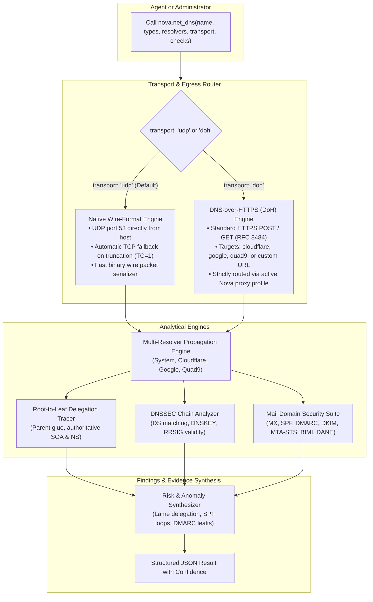
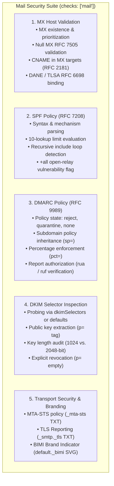

# DNS Diagnostics & Mail Domain Security Architecture

Domain Name System (DNS) resolution is the central nervous system of modern internet infrastructure. A single DNS misconfiguration—such as an overlooked dangling CNAME, an unpropagated zone record, an expired DNSSEC signature, or an incomplete SPF include chain—can lead to catastrophic service outages, email delivery failure into spam folders, or domain hijacking.

Standard diagnostic utilities like `nslookup` or `dig` are command-line utilities that do not evaluate the business impact of their findings, fail to compare multiple global resolvers concurrently, and do not validate email protection frameworks.

Nova AI Workspace includes a comprehensive, native DNS diagnostic engine ([`nova.net_dns`](../../../mcp-reference/tools/proxy-and-network/nova-net-dns.md)). Built entirely from scratch in pure C# wire format with zero third-party dependencies, `nova.net_dns` provides autonomous agents and systems administrators with root-to-leaf delegation tracing, global propagation analysis, DNSSEC signature validation, and an automated Mail Domain Security Suite.

---

## 1. High-Level Architecture & Transport Pathways

Nova's DNS engine operates over two distinct transport pathways, ensuring compliance with corporate proxies and network environments:



### Transport Mechanisms & Invariants:
1. **Direct Wire-Format UDP/TCP (`transport: "udp"`):**
   * Default mode. Nova crafts raw RFC 1035 binary DNS query packets and transmits them over UDP port 53 directly from the host network adapter (`route: "direct"`).
   * **Automatic TCP Truncation Handling:** When a resolver returns an answer with the Truncation bit set (`TC = 1`), Nova automatically opens a stream-oriented TCP port 53 connection to retrieve the complete, untruncated record set.
2. **DNS-over-HTTPS (`transport: "doh"`):**
   * Encapsulates wire-format DNS queries inside HTTPS requests formatted according to RFC 8484 (`application/dns-message`).
   * **Strict Proxy Compliance:** All DoH traffic travels through Nova's active browser proxy route. If the browser is routed through a corporate SOCKS5 or HTTPS tunnel, DoH queries traverse that tunnel, ensuring queries are never leaked directly over local network interfaces.
   * **Provider Shortcuts:** Supports built-in resolver endpoints (`"cloudflare"`, `"google"`, `"quad9"`) or any custom RFC 8484 endpoint URL (e.g. `https://dns.example.net/dns-query`).

---

## 2. Multi-Resolver Propagation & Status Classification

When updating DNS records (such as during a web hosting migration or DNS provider transfer), records take varying amounts of time to propagate globally due to caching TTLs and authoritative nameserver synchronization.

Passing multiple resolvers to `nova.net_dns(resolvers=["system", "cloudflare", "google", "quad9"])` performs a simultaneous multi-point audit:
* **Consensus Reporting:** Records agreed upon by all resolvers are returned once in the primary records block.
* **Drift Detection:** Any resolver returning diverging answers is isolated in the response, highlighting stale records or localized caching.
* **Intelligent CDN Awareness:** Differences in `A` or `AAAA` IP addresses across resolvers are classified as normal operational variation (due to Content Delivery Networks and GeoDNS), rather than reported as anomalies. Divergences in `NS`, `MX`, `TXT`, `SOA`, or `CAA` records are flagged as actionable findings.

### Unambiguous Status Classifications:
Unlike basic CLI tools that output raw numbers or ambiguous text, Nova maps every query response to a strict status taxonomy:

| Status Code | RFC Meaning & Diagnostic Implication |
| :--- | :--- |
| **`answered`** | The query succeeded, and the requested record type exists and was returned. |
| **`nodata`** | The domain name exists, but it has no records matching the requested type (e.g. domain has `A` records, but no `AAAA`). |
| **`nxdomain`** | The requested domain name does not exist in the DNS zone (RFC 2308). |
| **`dangling_cname`** | A `CNAME` alias points to a target domain that returns `NXDOMAIN`. **High vulnerability risk:** can allow unauthorized parties to register the target name and hijack traffic. |
| **`dnssec_failure`** | The resolver failed to validate the DNSSEC signature chain, but the zone answered when DNSSEC checking was disabled (`CD=1`). |
| **`server_failure`** | The upstream nameserver returned `SERVFAIL` (broken delegation, zone transfer error, or network partition). |
| **`refused`** | The nameserver refused to process the query (e.g. query disallowed by recursion policy). |
| **`timeout`** | The queried resolver failed to reply within the specified `timeoutMs`. |

---

## 3. Root-to-Leaf Delegation Tracing (`checks: ["delegation"]`)

When migrating domains or diagnosing "lame delegation" errors, asking a local caching resolver is insufficient because resolvers mask authoritative nameserver failures using cached glue and records.

With `checks: ["delegation"]`, Nova bypasses all recursive caches and performs an end-to-end iteration from the root:
1. **Root Nameservers:** Interrogates global root servers (`a.root-servers.net` ... `m.root-servers.net`) to locate the authoritative servers for the Top-Level Domain (TLD).
2. **TLD Parent Zone:** Queries the TLD registry (e.g. `.com` or `.de` nameservers) to inspect the parent's delegated `NS` records and Glue `A`/`AAAA` addresses.
3. **Zone Nameservers:** Directly contacts every designated authoritative nameserver over both UDP and TCP to verify:
   * **Authoritative Answer (`AA = 1`):** Verifies that the server actually serves the zone authoritatively.
   * **SOA Serial Consistency:** Compares the SOA `serial` across all authoritative servers to detect replication delays.
   * **Lame Delegation Detection:** Flags nameservers delegated at the parent that refuse queries or lack zone data.
   * **Single Point of Failure:** Warns if a domain relies on only a single nameserver or single AS.

### Pre-Migration Testing with `candidateNameservers`:
Before updating registrar delegations to a new DNS host, operators can pass `candidateNameservers: [{"host": "ns1.newhost.com", "ipv4": "198.51.100.1"}]`. Nova verifies that the new provider's servers already answer authoritatively with matching serials and records, preventing accidental downtime before changing registrar settings.

---

## 4. DNSSEC Validation & Signature Lifecycle

DNS Security Extensions (DNSSEC) protect against DNS cache poisoning and spoofing by signing DNS resource record sets with cryptographic signatures.

When evaluating a zone, Nova inspects:
* **Delegation Signer (`DS`) Match:** Verifies that the `DS` record registered at the parent TLD matches the public Key Signing Key (`DNSKEY`) served by the child zone.
* **Mismatched Key Outages:** Detects the common failure mode where a parent publishes a `DS` record while the zone has no matching `DNSKEY` (which causes all validating resolvers like Google, Cloudflare, and major ISPs to reject the entire domain).
* **RRSIG Expiration Countdown:** Inspects the validity timestamps (`Inception` and `Expiration`) of `RRSIG` records, issuing warnings for signatures expiring within 24 hours.
* **Key Rollovers:** Distinguishes normal key rollovers (coexistence of old and new valid signatures) from broken trust anchors.

---

## 5. Automated Mail Domain Security Suite (`checks: ["mail"]`)

Email deliverability and anti-spoofing defense rely on five interlocking DNS specifications. When `checks: ["mail"]` is requested, Nova executes an automated, multi-vector compliance audit:



### 1. Mail Exchange (MX) & DANE Validation
* **RFC 2181 CNAME Prohibition:** RFC 2181 strictly forbids pointing MX records at a `CNAME` alias. Nova validates that all MX targets resolve directly to canonical hostnames with `A` or `AAAA` records.
* **Null MX (RFC 7505):** Verifies that domains that do not send or receive email publish a valid Null MX (`. 0`), explicitly instructing remote servers to reject incoming mail attempts.
* **DANE / TLSA (RFC 6698):** Verifies that mail servers protected by DNSSEC publish valid `_25._tcp.mail.example.com` TLSA records to prevent STARTTLS stripping attacks.

### 2. Sender Policy Framework (SPF, RFC 7208)
* **The 10-DNS-Lookup Limit:** RFC 7208 specifies that an SPF evaluation must not exceed 10 recursive DNS lookups (`include`, `a`, `mx`, `ptr`, `exists`, `redirect`). Nova parses the complete include tree, calculates the total lookup depth, and issues a high-severity finding if lookups exceed 10 (which causes receiving servers to return `PermError`).
* **Loop Detection:** Detects circular includes (e.g. `domainA` includes `domainB` which includes `domainA`).
* **Permissive Policy Warnings:** Flags dangerous `+all` configurations that permit any server on the internet to send email on behalf of the domain.

### 3. DMARC Policy Evaluation (RFC 9989)
* **Policy Strength Audit:** Inspects the `p=` tag at `_dmarc.example.com`. Categorizes policies into `none` (monitoring only; does not protect against spoofing), `quarantine` (deliver to spam folder), and `reject` (full rejection).
* **Subdomain Inheritance:** Audits whether `sp=` is explicitly configured or inherits from the organizational domain.
* **External Report Destination Validation:** RFC 7489 requires that if a DMARC record sends reports to an external domain (`rua=mailto:reports@thirdparty.com`), the destination domain must explicitly authorize this by publishing a verification record at `example.com._report._dmarc.thirdparty.com`. Nova audits this cross-domain verification.

### 4. DomainKeys Identified Mail (DKIM)
* **Selector Probing:** Callers provide active selectors via `dkimSelectors: ["selector1", "google", "k1"]`. Nova queries `selector._domainkey.example.com`, parses the public key record, audits the cryptographic key length (flagging deprecated 1024-bit RSA keys), and identifies revoked keys (`p=` empty).

### 5. MTA-STS, TLS-RPT & BIMI
* **MTA-STS (RFC 8461):** Checks for `_mta-sts.example.com` TXT records, enforcing encrypted TLS SMTP connections.
* **SMTP TLS Reporting (RFC 8460):** Checks for `_smtp._tls.example.com` TXT records receiving transport failure reports.
* **Brand Indicators for Message Identification (BIMI):** Queries `default._bimi.example.com` to inspect published SVG brand logo indicators.

---

## 6. Privacy & Information Disclosure Guards

To prevent accidental data leakage from enterprise or home networks to public resolvers, Nova enforces strict privacy filters:
1. **Internal Domain Guard:** Single-label hostnames (`server1`), internal top-level domains (`.local`, `.lan`, `.internal`, `.home.arpa`, `.corp`), and private reverse DNS queries (`10.in-addr.arpa`, `168.192.in-addr.arpa`) are **never transmitted to public resolvers** (such as Cloudflare or Google). If public resolvers are requested for internal names, Nova skips them and records them under `context.skippedResolvers`.
2. **Untrusted Remote Text Trust Boundary:** All DNS text records (such as `TXT` records, SPF strings, and DMARC policies) originate from remote servers and are tagged with `remoteTextTrust: "untrusted_remote"` to prevent prompt injection when evaluated by LLM agents.

---

## 7. MCP Protocol Examples

### Example 1: Comparing Multi-Resolver Propagation
```json
{
  "name": "nova.net_dns",
  "arguments": {
    "name": "example.com",
    "types": [
      "A",
      "AAAA",
      "MX",
      "TXT"
    ],
    "resolvers": [
      "system",
      "cloudflare",
      "google"
    ]
  }
}
```

### Example 2: Complete Mail Domain Security Audit
```json
{
  "name": "nova.net_dns",
  "arguments": {
    "name": "example.com",
    "checks": [
      "mail"
    ],
    "dkimSelectors": [
      "google",
      "selector1"
    ]
  }
}
```

### Example 3: Tracing Authoritative Delegation and Pre-Testing New Nameservers
```json
{
  "name": "nova.net_dns",
  "arguments": {
    "name": "example.com",
    "checks": [
      "delegation"
    ],
    "candidateNameservers": [
      {
        "host": "ns1.newdns.com"
      },
      {
        "host": "ns2.newdns.com"
      }
    ]
  }
}
```

### Example 4: DNS-over-HTTPS via Configured Proxy
```json
{
  "name": "nova.net_dns",
  "arguments": {
    "name": "internal-service.example.org",
    "types": [
      "A"
    ],
    "resolvers": [
      "cloudflare"
    ],
    "transport": "doh"
  }
}
```

---

## 8. Related Documentation

* [Master Network Architecture Hub](../README.md): Overview of all 5 network disciplines and the complete 24-tool reference matrix.
* [Network Discovery & Inventory Architecture](../network-discovery-and-inventory/README.md): Active and passive subnet scanning and device tracking.
* [Path Diagnostics, MTR & Probing](../path-diagnostics-and-probing/README.md): Measuring latency, jitter, and MTU limits to resolved IP addresses.
* [SSL/TLS Cryptographic Inspection](../tls-inspection/README.md): Deep-dive certificate chain analysis and server cipher evaluation.
* [MCP Tool Reference: `nova.net_dns`](../../../mcp-reference/tools/proxy-and-network/nova-net-dns.md): Detailed parameter schema and return structures.
