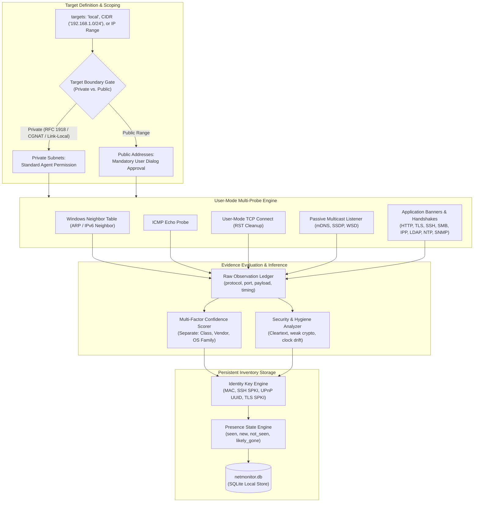
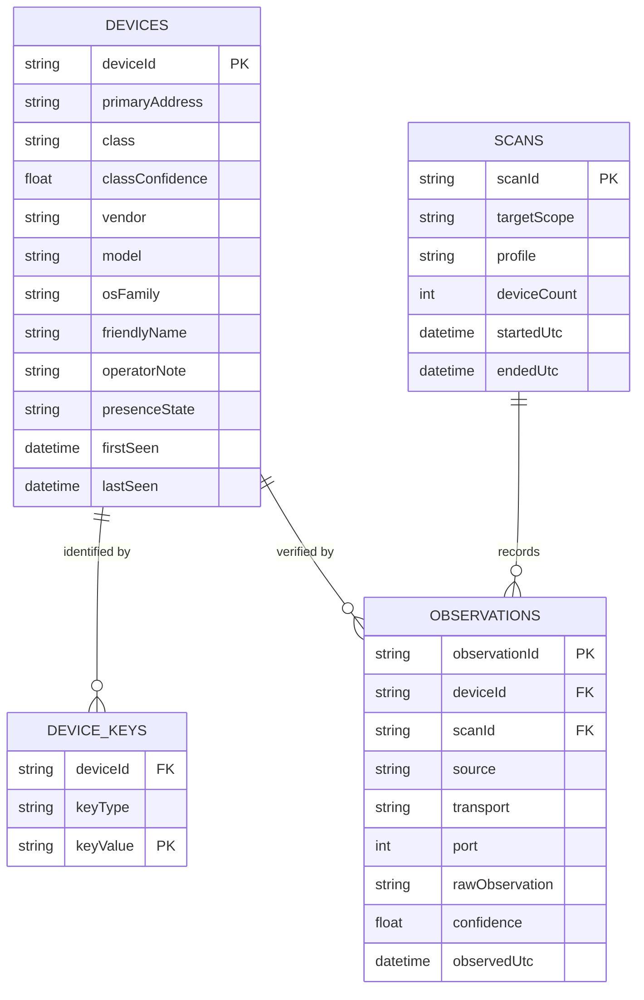

# Network Discovery & Device Inventory Architecture

Modern enterprise environments, cloud VPCs, and home offices host heterogeneous device ecosystems: routers, switches, NAS appliances, IoT sensors, hypervisors, and domain controllers. Understanding what is running on a network is the foundational prerequisite for infrastructure security, automated monitoring, and reliable operational administration.

Nova AI Workspace includes a native, non-destructive network scanner ([`nova.net_scan`](../../../mcp-reference/tools/proxy-and-network/nova-net-scan.md)) and persistent device inventory engine ([`nova.net_devices`](../../../mcp-reference/tools/proxy-and-network/nova-net-devices.md)). Unlike conventional port scanners that require root or administrative privileges, deploy invasive kernel drivers (e.g. WinPcap or Npcap), or blindly guess passwords, Nova operates entirely from standard user-mode processes using a multi-probe evidence engine and strict security boundaries.

---

## 1. High-Level Architecture & Evidence Pipeline

Nova separates **raw observation** from **interpretative classification**. Rather than deciding a device's identity based on a single open port, Nova gathers multiple independent observations across the network stack and feeds them into a unified evidence evaluation engine:



---

## 2. The Multi-Probe Evidence Engine

A single open port (such as TCP 80 or 443) does not prove that a host is a web server: routers, network printers, IP cameras, switches, and NAS appliances almost universally expose web management interfaces. Nova's evidence engine queries open ports with targeted, non-destructive application probes to observe factual properties:

| Discovery / Probe Source | Transport & Port | Observed Attributes & Evidence Extraction | Diagnostic Weight |
| :--- | :--- | :--- | :--- |
| **Neighbor Table (ARP / IPv6)** | User-mode API (`GetIpNetTable2`) | Physical MAC address, IPv4-to-IPv6 link correlation, interface index. Proves existence even if ICMP ping is blocked. | **Definitive** for LAN presence & MAC |
| **IEEE OUI Registry** | Shipped offline database | Resolves the vendor prefix of physical MAC addresses (e.g. `3C:A6:2F` $\rightarrow$ AVM). Locally administered (randomized) MACs are excluded from vendor tagging. | **Medium** for hardware vendor |
| **ICMP Echo** | Local ICMP API | Host responsiveness, round-trip latency, IPv4/IPv6 reachability. | **Definitive** for active layer-3 responsiveness |
| **User-Mode TCP Connect** | TCP handshake | `open` (SYN-ACK received), `closed` (RST received), or `no_response` (timeout). Connections are immediately terminated via TCP RST to prevent `TIME_WAIT` socket buildup. | **Definitive** for port reachability |
| **UPnP / SSDP Discovery** | UDP 1900 | Multicast `M-SEARCH` response and device description XML: Manufacturer, device friendly name, model name, model number, device type URI, unique device UUID. | **Very High** for device model & class |
| **WS-Discovery** | UDP 3702 | SOAP `Probe` and XML metadata exchange: device categories, endpoint references, printer/scanner capabilities. | **Very High** for Windows clients & printers |
| **mDNS / DNS-SD** | UDP 5353 | Service announcements (`_services._dns-sd._udp.local`): `_ipp._tcp` (printers), `_smb._tcp` (storage), `_airplay._tcp`, `_googlecast._tcp`, `_hap._tcp` (smart home). | **High** for device category & capabilities |
| **Printer Attributes (IPP)** | TCP 631 | Internet Printing Protocol `Get-Printer-Attributes` query: extracts printer manufacturer, exact model string, supported page formats, and firmware version without printing a byte. | **Very High** for printers and multifunction devices |
| **SMB Negotiation** | TCP 445 | SMB-2/3 dialect negotiation and unauthenticated NTLM challenge inspection: Server NetBIOS name, Active Directory domain name, Windows build number, SMB signing requirements, and SMBv1 legacy enablement. | **High** for Windows servers, domain members, and NAS |
| **SSH Server Banner** | TCP 22 | Protocol version string, server software package (e.g. OpenSSH, Dropbear), operating system/distribution indicators (e.g. `Debian-10`, `Ubuntu`), and server host key fingerprints. | **Medium–High** for Linux/BSD and network appliances |
| **Directory Services (LDAP)** | TCP 389, 636, 3268, 3269 | Anonymous RootDSE query: Active Directory domain controller status, forest functional level, domain DNS name, LDAP service vendor. (No bind attempted; restricted to RootDSE). | **Very High** for domain controllers and identity servers |
| **TLS Analysis & ALPN** | HTTPS / TLS ports | Server certificate Subject, SANs, Issuer, expiration date, self-signed status, and ALPN negotiated protocols (e.g. `h2`, `http/1.1`). | **Medium** for certificates & virtual host names |
| **HTTP Surface Probing** | HTTP ports | HTTP response status, `Server` header, `<title>` DOM tag, authentication realm name, and redirect location. | **Medium** for administrative web consoles |
| **NTP Clock Verification** | UDP 123 | Standard client query (Mode 3): Stratum, reference ID, round-trip latency, and `clockOffsetMs` relative to the local PC's clock. (Control/Monlist modes are never invoked). | **High** for clock drift and Kerberos/TLS risks |
| **SNMP Probing** | UDP 161 | Targeted single-OID GetRequest (`sysDescr`, `sysObjectID`, `sysName`, `sysUpTime`) using pre-configured SNMP credentials. (See [SNMP Connectors](../../connectors/snmp/README.md)). | **Very High** for managed switches, routers, and enterprise hardware |

---

## 3. Passive Multicast Listening Window

Active scanning alone can miss transient devices (such as mobile phones, tablets, or smart TVs) that enter low-power sleep modes and ignore direct unicast probes.

When scanning a local network (`"local"` or a private subnet), `nova.net_scan` opens a bounded **passive listening window** (governed by `listenSeconds`, default 8 seconds; 0 for public scans):
1. Nova temporarily joins local multicast groups:
   * **mDNS / Bonjour:** `224.0.0.251` (IPv4) and `ff02::fb` (IPv6).
   * **SSDP (UPnP):** `239.255.255.250`.
   * **WS-Discovery:** `239.255.255.250` and `ff02::c`.
2. It passively collects unsolicited presence announcements emitted by devices waking up or announcing services.
3. Observed devices are correlated with the active scan inventory without triggering firewall alerts or generating outbound traffic bursts.

> [!NOTE]
> Passive listening never captures raw packet streams or promiscuous link data. It only listens on designated multicast group sockets. If local Windows Firewall rules restrict multicast reception, Nova flags the scan with `passive: "blocked_by_firewall"` and completes the scan using active probes alone.

---

## 4. Target Scoping, Boundaries & Safety Gates

Network scanning involves sensitive infrastructure. Nova enforces strict security and resource controls:

```
+-----------------------------------------------------------------------------------+
| TARGET SPECIFICATION       | SCOPE & BOUNDARY RULES                               |
+-----------------------------------------------------------------------------------+
| "local"                    | Auto-resolves active adapter subnets with default    |
|                            | gateways or VPN routes. Internal Hyper-V, WSL, and   |
|                            | host-only interfaces are excluded from "local" and   |
|                            | listed in context.skippedNetworks.                   |
+----------------------------+------------------------------------------------------+
| CIDR Block                 | Explicit IPv4 or IPv6 prefix (e.g. 192.168.1.0/24).  |
|                            | Hard ceiling: /20 maximum (4096 addresses per scan). |
+----------------------------+------------------------------------------------------+
| IP Range                   | Bounded range (e.g. 10.0.0.10-10.0.0.80).            |
+----------------------------+------------------------------------------------------+
| Single Host / Domain       | Single IP or domain name (resolves up to 8 IPs).     |
+-----------------------------------------------------------------------------------+
```

### Safety & Permission Governance:
* **Private Ranges (Unrestricted within Agent Permissions):** RFC 1918 (`10.0.0.0/8`, `172.16.0.0/12`, `192.168.0.0/16`), Carrier-Grade NAT (`100.64.0.0/10`), Link-Local (`169.254.0.0/16`, `fe80::/10`), and Loopback (`127.0.0.0/8`, `::1`) can be scanned once the operator grants general network scan permission in Settings.
* **Public Ranges (Mandatory Per-Range User Approval):** Scanning external public IP ranges presents significant operational and legal risks. Nova enforces an interactive UI confirmation prompt **per target range**. The user's approval is valid only for the current Nova session. Automated or unattended scheduled tasks that target public ranges without prior user confirmation fail immediately with `scan_approval_required`.
* **Public Scan Rate Limiting:** Public scans are throttled to a maximum of 1 concurrent connection per host, an aggregate rate of approximately 8 connection attempts per second, and randomized jitter to prevent triggering remote intrusion detection systems (IDS).
* **Resource Exhaustion Defense:** If local socket buffers or ephemeral ports become constrained, Nova pauses, attempts recovery, and halts the job with `incompleteReason: "local_resources_exhausted"` rather than misreporting dropped connections as remote firewalls.

---

## 5. Device Classification & Evidence Scoring

Nova separates device categorization into three independent assertions, each carrying its own normalized confidence score ($0.0 \dots 1.0$):
1. **Device Class (`class`):** `router_gateway`, `firewall`, `switch`, `access_point`, `server`, `nas_storage`, `printer_scanner`, `camera`, `tv_media`, `iot`, `windows_client`, `hypervisor`, `database`, `mail`, `unknown`.
2. **Hardware Vendor (`vendor`):** Manufacturer brand (e.g. `Synology`, `Cisco`, `AVM`, `HP`, `Apple`, `Dell`).
3. **Operating System Family (`osFamily`):** `windows`, `linux`, `freebsd`, `routeros`, `embedded_rtos`, `unknown`.

### Confidence Evaluation Rules:
* **Independent Source Aggregation:** Evidence must originate from independent network layers. Multiple HTTP headers on the same port count as a single HTTP evidence point.
* **Non-Misleading Negative Results:**
  * An ICMP drop is reported as `icmp_no_reply`, not as "device offline" (many secure firewalls and Windows PCs drop ping).
  * A TCP port timeout is reported as `no_response`, not `filtered` (without raw socket access, packet filtering cannot be proven).
  * Devices not observed in a single scan are marked `not_seen`, not "removed". A device transitions to `likely_gone` only after multiple consecutive scans over the same network interface fail to observe it.

---

## 6. Persistent Network Inventory (`netmonitor.db`)

Every device discovered by `nova.net_scan` is automatically stored in Nova's local SQLite database (`netmonitor.db`), accessible via [`nova.net_devices`](../../../mcp-reference/tools/proxy-and-network/nova-net-devices.md):



### Decoupling Identity from IP Addresses
In modern DHCP and Wi-Fi networks, IP addresses change frequently. Nova pins device identities to persistent hardware and cryptographic anchors:
* **Physical MAC Address:** Verified via local ARP / IPv6 neighbor tables (excluding locally administered/randomized addresses).
* **SSH Host Key Fingerprint:** SHA-256 fingerprint of the server's public key (`ssh-ed25519`, `ecdsa-sha2-nistp256`, `rsa-sha2-512`).
* **TLS Subject Public Key Info (SPKI):** SHA-256 hash of the public key certificate presented on HTTPS or FTPS ports.
* **UPnP / WS-Discovery UUID:** Globally unique device identifiers embedded in discovery payloads.

When a device obtains a new DHCP address, Nova detects the address change, updates `primaryAddress`, and marks `isNew: false`, preserving historical notes and telemetry.

---

## 7. Automated Security Findings & Hygiene Audit

Every scan automatically compiles risk indicators in the `findings` array:

```json
{
  "severity": "high",
  "code": "telnet_open",
  "deviceId": "dev_4b8f10a2",
  "text": "192.168.1.45 (camera) exposes unencrypted Telnet management on TCP port 23."
}
```

### Audited Security Risks:
1. **Unencrypted Remote Access:** Plaintext Telnet (TCP 23) or FTP (TCP 21) reachable on the network.
2. **Cleartext Admin Consoles:** Web management interfaces prompting for authentication over unencrypted HTTP (TCP 80, 8080) instead of HTTPS.
3. **SMB Security Hygiene:** Active SMB services running without mandatory packet signing (`signingRequired: false`) or advertising legacy SMBv1 support.
4. **Exposed Database & Infrastructure Ports:** Databases (MySQL 3306, PostgreSQL 5432, Redis 6379, MongoDB 27017) or Remote Desktop (RDP 3389) exposed to broad subnets without boundary controls.
5. **NTP Clock Skew:** Local time servers exhibiting substantial clock drift (`clockOffsetMs` $> 5000\text{ ms}$), creating risks for Kerberos ticket validation and TLS certificate verification.
6. **Host Key Mismatches:** Known devices presenting altered SSH host keys at the same IP address (indicating a machine replacement, reinstall, or potential interception).

---

## 8. MCP Protocol Examples

### Example 1: Local Subnet Discovery Scan
```json
{
  "name": "nova.net_scan",
  "arguments": {
    "targets": [
      "local"
    ],
    "portSets": [
      "quick"
    ],
    "discovery": [
      "arp",
      "icmp",
      "mdns",
      "ssdp"
    ],
    "waitSeconds": 20
  }
}
```

### Example 2: Targeted Server Admin Scan with Background Polling
```json
{
  "name": "nova.net_scan",
  "arguments": {
    "targets": [
      "10.0.10.0/24"
    ],
    "portSets": [
      "admin",
      "database"
    ],
    "probes": [
      "ssh",
      "tls",
      "smb",
      "ldap"
    ],
    "timeBudgetSeconds": 300,
    "waitSeconds": 0
  }
}
```
*When `waitSeconds: 0` is passed, the tool returns immediately with a `scanId` and `status: "running"`. The agent subsequently checks progress with `nova.net_scan_status(scanId="...")` or halts execution with `nova.net_scan_stop(scanId="...")`.*

### Example 3: Querying the Device Inventory with Filtering
```json
{
  "name": "nova.net_devices",
  "arguments": {
    "class": "nas_storage",
    "presence": "seen"
  }
}
```

### Example 4: Assigning Operator Name and Context Note
```json
{
  "name": "nova.net_devices_update",
  "arguments": {
    "deviceId": "dev_7f3a91c0",
    "name": "Backup-NAS-Primary",
    "note": "Synology DS920+ hosting nightly database backups and media library."
  }
}
```

---

## 9. Related Documentation

* [Master Network Architecture Hub](../README.md): Overview of all 5 network disciplines and the complete 24-tool reference matrix.
* [SNMP Connectors Architecture](../../connectors/snmp/README.md): Integrating authenticated SNMPv3/v2c hardware telemetry with network scanning.
* [DNS Diagnostics & Mail Security](../dns-diagnostics/README.md): Resolving domain records, delegation paths, and mail security records.
* [Path Diagnostics, MTR & Probing](../path-diagnostics-and-probing/README.md): Measuring hop-by-hop packet loss, jitter, and MTU limits to discovered hosts.
* [MCP Tool Reference: `nova.net_scan`](../../../mcp-reference/tools/proxy-and-network/nova-net-scan.md): Detailed parameter schema and return structures.
