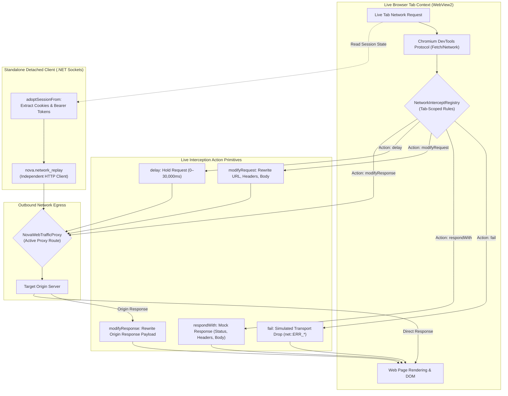

# Network Interception & Request Replay

> [!NOTE]
> Nova AI Workspace provides developers and autonomous agents with two complementary methodologies for inspecting and controlling network traffic: in-flight manipulation of requests and responses **inside a live browser tab**, and isolated **detached request replay** using an independent HTTP client outside the browser context. This dual architecture enables deterministic failure testing, mock responses, controlled latency injection, and deep API debugging with authenticated session adoption.

---

## 1. Executive Summary & Core Mission

Standard browser developer tools allow developers to view outgoing network requests, but automating edge-case behaviors—such as slow backends, microservice outages, or subtle payload modifications—usually requires complex external proxy servers.

Nova eliminates this complexity by embedding traffic manipulation directly into its architecture:
1. **Live Tab-Scoped Interception:** Intercepts traffic at the Chromium DevTools Protocol (CDP) layer for an individual tab without impacting global browser traffic.
2. **Deterministic Action Primitives:** Supports five core actions: transport failure simulation (`fail`), mock response generation (`respondWith`), request rewriting (`modifyRequest`), response rewriting (`modifyResponse`), and latency injection (`delay`).
3. **Detached Request Repeater:** Executes standalone HTTP requests outside the tab, allowing agents to test endpoints without CORS boundaries, DOM side-effects, or ambient cookie interference.
4. **Secure Session Adoption:** Imports `HttpOnly` cookies and `localStorage` bearer tokens into detached requests with redacted previews and same-site origin protection.

---

## 2. Comprehensive Documentation Index

The Network Interception and Request Replay subsystem is detailed across specialized architecture subguides:

| Architecture Guide | Focus Areas & Technical Invariants | Primary Components |
| :--- | :--- | :--- |
| **[Tab-Scoped Interception](tab-scoped-interception/README.md)** | Tab-scoped CDP `Fetch`/`Network` pipeline, the 5 action primitives (`fail`, `respondWith`, `modifyRequest`, `modifyResponse`, `delay`), request/response header and body rewriting, glob pattern matching ($\ge 4$ literal chars), one-hit rules, and application evidence tracking (`hits`, `applied`, `failed`). | `nova.network_intercept_add` `nova.network_intercept_list` `nova.network_intercept_clear` `CDP Fetch.enable` `NetworkInterceptRegistry` |
| **[Request Replay & Session Adoption](request-replay-and-session-adoption/README.md)** | Detached .NET HTTP client, the 4-step draft lifecycle (`prepare`, `send`, `get`, `discard`), controlled A/B baseline comparisons (`compareTo`), session adoption from active tabs (`HttpOnly` cookies and `localStorage`), same-site security gates, and transport framing protection. | `nova.network_replay` `SessionAdoption` `CompareTo` `RedactedPreview` `TransportBoundaries` |

---

## 3. High-Level Architectural Paths

---

## 4. Key Architectural Invariants

* **Interception Rule Isolation:** Requests executed by `nova.network_replay` **never traverse tab interception rules**. Replay requests always test the real destination server.
* **Proxy Route Parity:** Both live browser requests and detached replay operations route through [`NovaWebTrafficProxy`](../proxy/auxiliary-routing-and-health-probing/README.md), ensuring strict proxy consistency without IP leaks.
* **Literal Density Guard:** URL glob patterns for tab interception require at least four literal characters. Bare wildcards (`*`) are rejected immediately.
* **Application Evidence Contract:** A match counter (`hits > 0`) does not guarantee a successful modification. Agents must verify `applied > 0` and inspect `lastError` to confirm rule execution.
* **Redacted Secret Previews:** Adopted session credentials (`HttpOnly` cookies, `localStorage` tokens) are masked in tool result transcripts, preventing secret leakage into agent model memory.

---

## Related Documentation

* [Tab-Scoped Interception Subguide](tab-scoped-interception/README.md)
* [Request Replay & Session Adoption Subguide](request-replay-and-session-adoption/README.md)
* [Parent: Network Architecture & Traffic Control](../README.md)
* [Proxy Routing & Traffic Isolation](../proxy/README.md)
* [SSL/TLS Inspection & Debugging](../tls-inspection/README.md)
* [Tool Reference: `nova.network_intercept_add`](../../../mcp-reference/tools/proxy-and-network/nova-network-intercept-add.md)
* [Tool Reference: `nova.network_replay`](../../../mcp-reference/tools/proxy-and-network/nova-network-replay.md)
