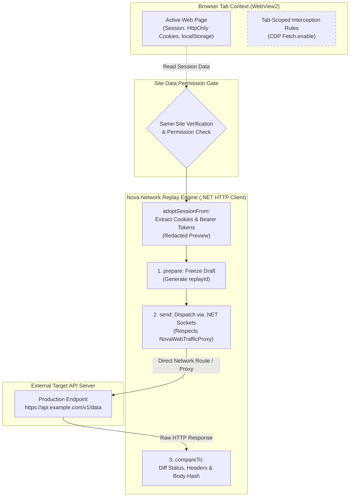
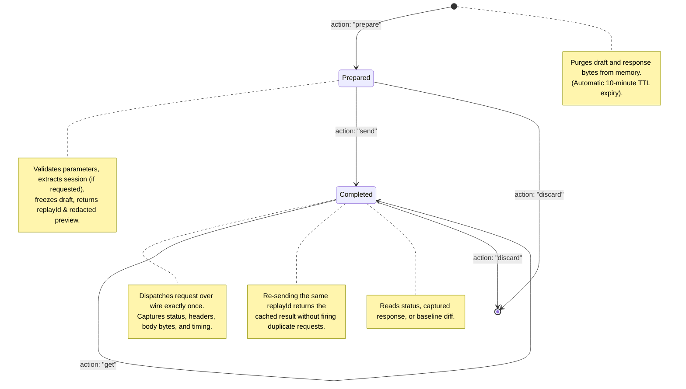
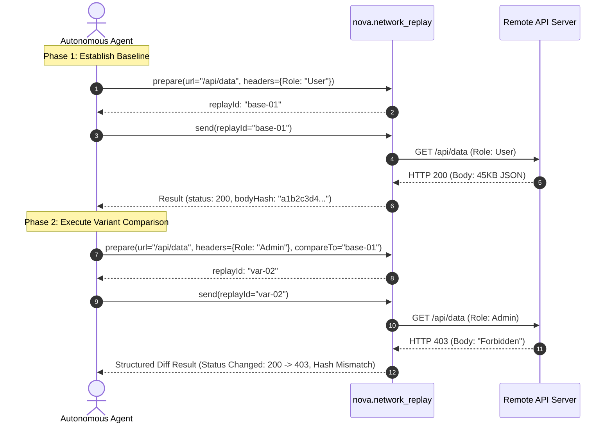

# Detached Request Replay & Session Adoption

> [!IMPORTANT]
> When investigating backend API endpoints, autonomous agents often need to inspect raw HTTP responses, test subtle payload mutations, or compare behavior across authenticated sessions. Navigating through the browser UI triggers Cross-Origin Resource Sharing (CORS) enforcement, executes client-side scripts, and alters DOM state. Nova AI Workspace provides **detached request replay** via [`nova.network_replay`](../../../../mcp-reference/tools/proxy-and-network/nova-network-replay.md), an independent .NET HTTP client outside the browser context capable of controlled A/B baseline comparisons and secure session adoption.

---

## 1. Architectural Motivation: Detached Repeater vs. In-Page Fetch

Executing an API test by evaluating JavaScript (`window.fetch()`) inside a browser tab introduces significant technical constraints:

1. **CORS Restrictions:** In-page scripts cannot query arbitrary endpoints or customize protected headers (such as `Host`, `Origin`, or `User-Agent`) due to browser security boundaries.
2. **DOM & State Pollution:** Firing API calls from the page can trigger unwanted client-side routing, popups, alert dialogs, or state changes in Single-Page Applications.
3. **Ambient Cookie Jar Interlocking:** In-page requests automatically send all matching cookies, preventing agents from isolating specific headers or testing unauthenticated baseline requests.
4. **Interception Rule Collisions:** If the active tab has armed interception rules, in-page test requests will hit those rules rather than testing the real production server.

Nova resolves this with a **standalone, out-of-browser HTTP repeater**:



### Key Architectural Guarantees:
* **Interception Rule Bypass:** Replay traffic **never traverses the active tab's interception rules**. Replaying a request always tests the real destination server.
* **Egress Proxy Consistency:** The replay client routes through [`NovaWebTrafficProxy`](../../proxy/auxiliary-routing-and-health-probing/README.md), ensuring it inherits the active browser proxy profile.
* **Immutability:** Once prepared, a request draft is frozen and immutable, guaranteeing cryptographic repeatability.

---

## 2. The 4-Step Replay Lifecycle

Replay operations follow a deterministic four-stage state machine keyed by an agent-specific identifier (`agentId`):



### Detailed Lifecycle Actions:

1. **`prepare`:**
   * Validates the URL, HTTP method, and headers.
   * Resolves optional session adoption (`adoptSessionFrom`).
   * Computes a unique, immutable `replayId`.
   * Returns a **redacted preview** of the request, withholding sensitive tokens.
2. **`send`:**
   * Dispatches the prepared request over the network.
   * Enforces strict timeout deadlines (configurable up to 60,000ms).
   * Caches the HTTP response (status code, response headers, body bytes, execution latency).
   * **Idempotency Invariant:** Invocations of `send` with an already completed `replayId` return the cached outcome without resending network packets.
3. **`get`:**
   * Queries the current status or cached response payload of a draft.
4. **`discard`:**
   * Explicitly purges the draft and associated response buffers from process memory.
   * *Memory Budget:* Each `agentId` can maintain up to 32 active drafts, with an automatic 10-minute time-to-live (TTL).

---

## 3. Session Adoption (`adoptSessionFrom`)

A primary strength of `nova.network_replay` is its ability to bridge authenticated browser sessions into standalone API tests without exposing plain text credentials to agent transcripts.

```json
{
  "name": "nova.network_replay",
  "arguments": {
    "agentId": "agent-security-audit",
    "action": "prepare",
    "url": "https://api.example.com/v2/orders",
    "method": "GET",
    "adoptSessionFrom": {
      "targetId": "tab-101",
      "cookies": true,
      "storageKeys": {
        "access_token": "Authorization: Bearer"
      }
    },
    "_meta": { "intent": "Audit orders endpoint using active tab session" }
  }
}
```

### Security Boundaries & Invariants:

1. **Same-Site Origin Guard:** Session adoption evaluates the destination URL against the origin of `targetId`. Adopting cookies or storage tokens into an unrelated third-party domain is strictly blocked to prevent token exfiltration attacks.
2. **Permission Gate & Audit Logging:** Accessing `HttpOnly` cookies and storage values requires authorization under the [Site Data Permission Gate](../../../site-data-management/permissions-and-audit/README.md). Every adoption event is recorded in the persistent security audit log.
3. **Redacted Previews:** In the `prepare` response, adopted values are masked:
   ```json
   {
     "replayId": "replay-789a",
     "preview": {
       "url": "https://api.example.com/v2/orders",
       "method": "GET",
       "headers": {
         "Authorization": "[ADOPTED_TOKEN: 48 chars from localStorage.access_token]",
         "Cookie": "[ADOPTED_COOKIES: 2 session cookies from tab-101]"
       }
     }
   }
   ```
4. **Caller Precedence:** Explicit headers supplied by the caller in `headers` take precedence over adopted values; Nova never silently overwrites explicitly provided parameters.

---

## 4. Controlled A/B Baseline Comparisons (`compareTo`)

To evaluate the impact of subtle payload or header modifications, agents can link a variant request to an existing baseline draft via `compareTo`:



### What `compareTo` Evaluates:
* **HTTP Status Delta:** Explicit comparison (e.g. `200 OK` vs `403 Forbidden`).
* **Header Name Delta:** Lists added, removed, or modified header keys (e.g. cache flags, rate limit headers).
* **Cryptographic Body Equality:** Computes SHA-256 digests over the complete response bodies. If both responses yield identical hashes, `bodyIdentical: true` is reported.
* **Truncation Awareness:** If either response exceeded the capture buffer and was truncated, full-body hash equality is refused, alerting the agent that binary equivalence cannot be guaranteed.

---

## 5. Transport Boundaries & Safety Constraints

To maintain security and prevent automated tools from destabilizing networks, `nova.network_replay` enforces strict operational bounds:

| Boundary Dimension | Enforcement Specification | Architectural Rationale |
| :--- | :--- | :--- |
| **Payload Limits** | Request bodies: maximum **1 MiB**.<br/>Response capture: default **256 KiB**, max **1 MiB**. | Prevents high memory consumption or buffer starvation on large binary streams. |
| **Execution Deadlines** | Configurable from **1,000ms to 60,000ms** (default: 15,000ms). | Ensures hanging sockets or slow servers do not block agent execution loops. |
| **Memory Retention** | Max **32 drafts/results** per agent; **10-minute TTL**. | Automatically cleans up idle replay sessions without resource leakage. |
| **Framing Protection** | Prohibits caller-supplied `Content-Length`, `Transfer-Encoding`, or `Host` headers. | The underlying .NET HTTP client owns HTTP transport framing. Rejects request smuggling attempts. |
| **Transport Identity** | Operates over standard .NET HTTP/1.1 sockets; **no browser TLS fingerprinting**. | Does not emulate Chromium's JA4 or TLS extension order; pure HTTP repeater semantics. |
| **Uncertain Dispatch** | Tracks `mayHaveBeenSent` boolean flag on network exceptions. | Informs the agent if a socket timed out during write, preventing accidental duplicate actions on non-idempotent endpoints. |

---

## Related Documentation

* [Domain Hub: Network Interception & Request Replay](../README.md)
* [Subguide: Tab-Scoped Network Interception](../tab-scoped-interception/README.md)
* [Master Hub: Network Architecture & Traffic Control](../../README.md)
* [Site Data Management: Permissions & Audit](../../../site-data-management/permissions-and-audit/README.md)
* [Tool Reference: `nova.network_replay`](../../../../mcp-reference/tools/proxy-and-network/nova-network-replay.md)
