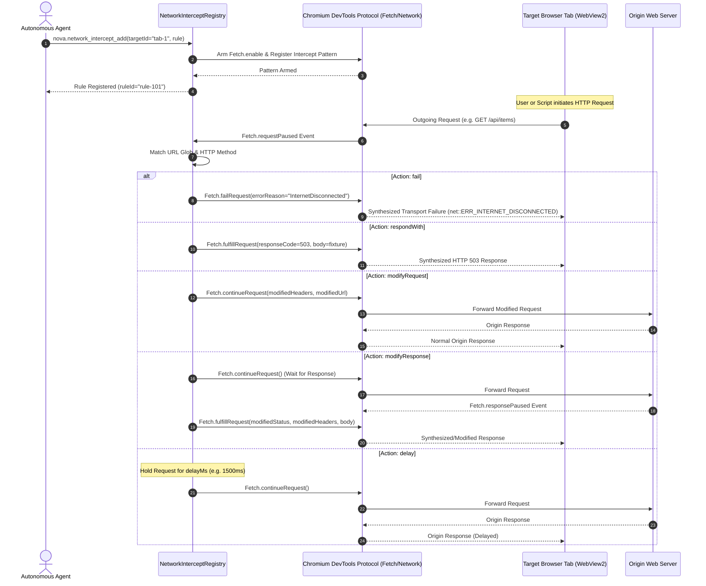
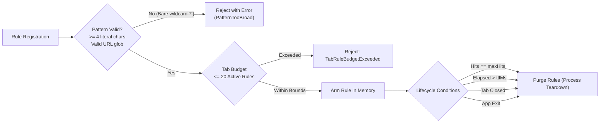

# Tab-Scoped Network Interception

> [!NOTE]
> Autonomous testing and debugging of web applications often requires simulating hostile or degraded backend conditions without modifying production APIs. Nova AI Workspace provides **tab-scoped network interception** via [`nova.network_intercept_add`](../../../../mcp-reference/tools/proxy-and-network/nova-network-intercept-add.md), [`nova.network_intercept_list`](../../../../mcp-reference/tools/proxy-and-network/nova-network-intercept-list.md), and [`nova.network_intercept_clear`](../../../../mcp-reference/tools/proxy-and-network/nova-network-intercept-clear.md). Operating directly within the target tab's Chromium DevTools Protocol (CDP) session, it supports five deterministic action primitives: transport failure, mock response, request rewriting, response rewriting, and artificial latency injection.

---

## 1. Architectural Overview & In-Tab CDP Pipeline

Unlike external reverse proxies or global HTTP interceptors that impact the entire operating system, Nova's interception engine is **tab-scoped**:



### Key Architectural Invariants:
1. **Zero Model Turn Latency:** Once a rule is deposited, Nova evaluates and applies it directly within the host process whenever a matching CDP event arrives. It does not pause execution to wait for a model turn.
2. **Fail-Safe Fallback:** If applying an armed rule encounters an internal error or timeout, Nova automatically continues the request unchanged (`Fetch.continueRequest`) to avoid permanently freezing the page's event loop.
3. **Tab Isolation:** Interception rules armed on `tab-1` have zero effect on `tab-2` or standalone background clients, ensuring parallel agent tasks do not contaminate each other's network streams.

---

## 2. The Five Interception Action Primitives

Nova models all network manipulations through five orthogonal action primitives:

| Action | Execution Phase | What Nova Does | Primary Testing Objective |
| :--- | :--- | :--- | :--- |
| **`fail`** | Pre-Flight (Request) | Fails the request with a chosen transport error code without contacting the origin server. | Tests frontend error boundaries, offline UI resilience, DNS failure recovery, and transport timeouts. |
| **`respondWith`** | Pre-Flight (Request) | Synthesizes an HTTP response with specified status code, headers, and body without contacting the origin server. | Tests frontend handling of backend outages (HTTP 503), rate limits (HTTP 429), or mock JSON payloads. |
| **`modifyRequest`** | In-Flight (Request) | Rewrites the outgoing request (URL, HTTP method, headers, or body) before forwarding it to the origin server. | Tests backend routing variations, parameter tampering, diagnostic header injection, and payload variations. |
| **`modifyResponse`** | Post-Flight (Response) | Allows the origin server to respond, then modifies status codes, headers, or payload before delivering to the DOM. | Tests cache-control stripping, `Set-Cookie` removal, error status simulation with real bodies, or API payload overrides. |
| **`delay`** | In-Flight (Request) | Holds a matching request for `delayMs` (up to 30,000ms), then forwards it unchanged to the origin server. | Tests loading spinners, skeleton screens, race conditions, and graceful degradation during high network latency. |

---

## 3. Deep Dive: Failure Simulation (`fail`) vs. HTTP Mocks (`respondWith`)

A frequent testing error is conflating an **HTTP error status** with a **transport failure**:

```
┌────────────────────────────────────────────────────────────────────────┐
│                   Transport Failure vs. HTTP Error Status              │
├──────────────────────────────────┬─────────────────────────────────────┤
│ Dimension                        │ Transport Error (`fail`)            │
├──────────────────────────────────┼─────────────────────────────────────┤
│ Protocol Layer                   │ TCP/IP / DNS / TLS Layer Failure    │
│ HTTP Status Code                 │ None (0 / null)                     │
│ DOM JavaScript Behavior          │ `fetch()` rejects with `TypeError`  │
│                                  │ `XMLHttpRequest` fires `onerror`    │
│ Supported Error Reasons          │ `InternetDisconnected`, `TimedOut`, │
│                                  │ `ConnectionRefused`, `DnsFailure`,  │
│                                  │ `AccessDenied`, `AddressUnreachable`│
├──────────────────────────────────┼─────────────────────────────────────┤
│ Dimension                        │ HTTP Mock (`respondWith`)           │
├──────────────────────────────────┼─────────────────────────────────────┤
│ Protocol Layer                   │ Valid HTTP/1.1 or HTTP/2 Response   │
│ HTTP Status Code                 │ Explicit (e.g. 400, 404, 429, 503)  │
│ DOM JavaScript Behavior          │ `fetch()` resolves with `Response`  │
│                                  │ (`response.ok === false`)           │
│ Response Data                    │ Explicit headers and body payload   │
└──────────────────────────────────┴─────────────────────────────────────┘
```

### Delay with Any Action
The `delayMs` parameter can accompany **any** action primitive. For instance, combining `respondWith` (status 503) with `delayMs: 2000` simulates a slow backend gateway that hangs for two seconds before returning an error.

---

## 4. Request & Response Modification Mechanics

### 4.1 Modifying Outgoing Requests (`modifyRequest`)
When modifying an outgoing request:
* **Header Preservation & Merging:** Nova retains existing request headers, applies explicit overrides, and processes header removals. Supplying a single diagnostic header (e.g. `X-Debug-Trace: true`) does not discard existing authorization or user-agent headers.
* **Header Removal:** Pass empty or null values in `removeHeaders: ["Authorization", "Cookie"]` to strip specific credentials.
* **Body Rewriting:**
  * `body`: Replaces the outgoing request payload.
  * `setBody: ""`: Explicitly clears the payload.
  * Omission preserves the original body unchanged.
* **Framing Sanitization:** Replacing the body automatically updates or removes stale `Content-Length` headers, preventing HTTP request smuggling or framing errors.

### 4.2 Modifying Server Responses (`modifyResponse`)
When modifying an incoming response:
* **Zero-Copy Pass-Through:** If only headers or status codes are modified without supplying a replacement `body`, the original response body stays within Chromium's memory stream rather than being buffered into Nova.
* **Decompression & Unframing:** Supplying replacement response text unzips and replaces the body; Nova automatically strips obsolete `Content-Encoding: gzip/br` and `Transfer-Encoding: chunked` headers to prevent rendering corruption.
* **Bodyless HTTP Statuses:** HEAD requests and bodyless statuses (HTTP 204 No Content, HTTP 304 Not Modified) strictly reject payload injection.

---

## 5. Pattern Matching, Lifetime & Rule Budgets

To protect browser stability and prevent lingering test rules from breaking subsequent tasks, Nova enforces strict matching constraints and lifecycle boundaries:



### Pattern Matching Invariants:
* **Glob Syntax:** Supports standard wildcards (`*` matches any characters, `?` matches a single character).
* **Literal Density Guard:** Patterns require at least four literal characters. A bare wildcard (`*`) or root domain pattern (`https://*`) is rejected immediately to prevent inadvertent interception of browser shell resources.
* **Method Filtering:** Rules can optionally bind to specific HTTP verbs (e.g. `methods: ["POST", "PUT"]`). If omitted, all methods match.

### Lifecycle & Evidence Tracking:
* **Default Lifetime:** Rules expire automatically after 120 seconds (`ttlMs: 120000`, maximum allowed: 15 minutes).
* **Default Hit Budget:** Rules expire after 20 hits (`maxHits: 20`). For one-time tests, specify `maxHits: 1`.
* **Application Evidence:** In [`nova.network_intercept_list`](../../../../mcp-reference/tools/proxy-and-network/nova-network-intercept-list.md), Nova reports three distinct counters:
  * `hits`: Number of times incoming requests matched the URL glob.
  * `applied`: Number of times the modification or mock was successfully executed.
  * `failed`: Number of times rule execution failed (with `lastError` detail).
  * *Invariant:* A match (`hits > 0`) is **not** proof of a successful modification. Agents must inspect `applied > 0` before declaring a test successful.

---

## 6. Concrete Tool Usage Examples

### Example 1: One-Hit Slow Mock Error (HTTP 503)
Simulates a backend items API failure to test frontend recovery:

```json
{
  "name": "nova.network_intercept_add",
  "arguments": {
    "targetId": "tab-101",
    "urlPattern": "https://example.com/api/items*",
    "methods": ["GET"],
    "action": "respondWith",
    "status": 503,
    "contentType": "application/json",
    "body": "{\"error\":\"Service temporarily unavailable\",\"retryAfter\":30}",
    "delayMs": 1500,
    "maxHits": 1,
    "ttlMs": 30000,
    "note": "Verify error banner and retry button appear on 503"
  }
}
```

### Example 2: Simulating Total Network Disconnection
Tests offline banner handling:

```json
{
  "name": "nova.network_intercept_add",
  "arguments": {
    "targetId": "tab-101",
    "urlPattern": "https://example.com/api/telemetry*",
    "action": "fail",
    "errorReason": "InternetDisconnected",
    "maxHits": 5,
    "ttlMs": 60000,
    "note": "Verify offline queueing of telemetry beacons"
  }
}
```

### Example 3: Response Header Stripping (`modifyResponse`)
Removes caching headers to force cache misses during testing:

```json
{
  "name": "nova.network_intercept_add",
  "arguments": {
    "targetId": "tab-101",
    "urlPattern": "https://example.com/static/*",
    "action": "modifyResponse",
    "removeHeaders": ["ETag", "Last-Modified", "Cache-Control"],
    "setHeaders": {
      "Cache-Control": "no-store, no-cache, must-revalidate"
    },
    "maxHits": 10
  }
}
```

---

## Related Documentation

* [Domain Hub: Network Interception & Request Replay](../README.md)
* [Subguide: Request Replay & Session Adoption](../request-replay-and-session-adoption/README.md)
* [Master Hub: Network Architecture & Traffic Control](../../README.md)
* [Domain Hub: Proxy Routing & Traffic Isolation](../../proxy/README.md)
* [Tool Reference: `nova.network_intercept_add`](../../../../mcp-reference/tools/proxy-and-network/nova-network-intercept-add.md)
