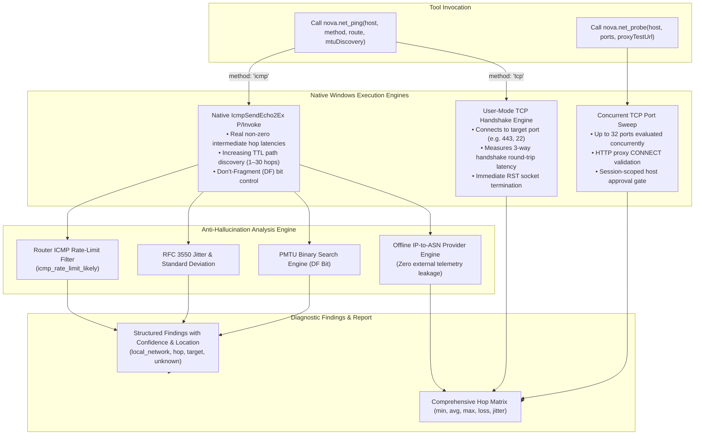

# Path Diagnostics, MTR Traceroute & Probing Architecture

When web applications or remote services suffer from intermittent disconnects, high latency, or sudden throughput collapse, developers and systems engineers frequently struggle to diagnose where the bottleneck resides. Is packet loss occurring on the local Wi-Fi, at the internet service provider's gateway, within an intermediate transit provider's peering link, or directly at the target origin server? Furthermore, in modern enterprise networks configured with IPsec or WireGuard VPN tunnels, packets exceeding the Path Maximum Transmission Unit (PMTU) are silently dropped when fragmentation is disabled, resulting in stalled TLS handshakes.

Nova AI Workspace provides advanced, user-mode network diagnostic tools:
* **[`nova.net_ping`](../../../mcp-reference/tools/proxy-and-network/nova-net-ping.md):** Continuous MTR-style path traceroute, RFC 3550 jitter analysis, TCP handshake pinging, and automated Path-MTU discovery.
* **[`nova.net_probe`](../../../mcp-reference/tools/proxy-and-network/nova-net-probe.md):** Rapid, session-approved TCP port reachability checks (up to 32 ports) and HTTP proxy CONNECT tunnel verification.

These tools operate entirely from standard user-mode processes without requiring administrator privileges or third-party packet sniffing drivers.

---

## 1. High-Level Architecture & Diagnostic Engines



---

## 2. Real Hop Latencies via `IcmpSendEcho2Ex`

Standard .NET implementations (such as `System.Net.NetworkInformation.Ping`) suffer from a documented operating system limitation when performing traceroutes: when an intermediate router returns an ICMP Time Exceeded packet (`TTL Expired in Transit`), the framework returns `RoundtripTime = 0`, rendering intermediate hop latency calculations useless.

Nova bypasses this limitation by interfacing directly with the Windows IP Helper library using a native P/Invoke binding to `IcmpSendEcho2Ex`:
* **True Non-Zero Hop Latencies:** Nova accurately captures the exact millisecond round-trip time between the host and each intermediate router on the path.
* **Continuous MTR Rounds (`route: true`):** Rather than sending a single echo per hop like standard `tracert`, Nova runs repeated measurement rounds (default 10, configurable up to 30). Each round sends an echo to every discovered hop on the path and to the target, calculating true statistical metrics: packet loss percentage, minimum, average, maximum, last round-trip time, and jitter.

---

## 3. The Anti-Hallucination Reasoning Engine

The most common mistake made by automated diagnostic scripts and junior administrators is misinterpreting intermediate hop packet loss as a network outage.

Modern internet routers operate separated control planes and data forwarding planes. Forwarding transit traffic across hardware ASICs occurs in nanoseconds. However, generating an ICMP Time-to-Live Exceeded reply requires redirecting the packet to the router's central CPU, which aggressively rate-limits ICMP generation to protect itself from Denial of Service (DoS) attacks.

Nova's analytical engine implements strict evaluation rules to prevent false positive alerts:

```
+-----------------------------------------------------------------------------------+
| OBSERVED PHENOMENON        | NOVA ANALYSIS & CLASSIFICATION                       |
+-----------------------------------------------------------------------------------+
| Loss only at Hop K, but    | Router ICMP Rate-Limiting (icmp_rate_limit_likely).  |
| Hops K+1 to Target show 0% | Traffic is passing cleanly through the router; the   |
| packet loss.               | router is merely throttling ICMP to its own control  |
|                            | plane. NOT an outage or network defect.              |
+----------------------------+------------------------------------------------------+
| Elevated latency at Hop K, | Control Plane Delay. The router takes longer to      |
| but downstream hops show   | generate ICMP packets, but does not delay transit    |
| normal low latency.        | traffic. Traffic through Hop K is unaffected.        |
+----------------------------+------------------------------------------------------+
| Loss begins at Hop K and   | True Transit Link Loss. Physical congestion, link    |
| persists through all       | flapping, or degradation on the transit section      |
| downstream hops to Target. | between Hop K-1 and Hop K. Flags specific ASN/hop.   |
+----------------------------+------------------------------------------------------+
| Silent hop (* * *)         | Firewall Drop. The router forwards traffic normally  |
|                            | but drops ICMP TTL Exceeded entirely. Normal.        |
+----------------------------+------------------------------------------------------+
| Multiple IPs answering at  | ECMP (Equal-Cost Multi-Path) Routing. Multiple       |
| the same Hop index.        | upstream links sharing load, not a route oscillation.|
+-----------------------------------------------------------------------------------+
```

Every diagnostic conclusion emitted in `findings` carries an explicit confidence level (`observed`, `likely`, `inconclusive`) and a diagnosed location (`local_network`, `hop`, `target`, `unknown`).

---

## 4. RFC 3550 Jitter & Statistical Variance

Latency averages alone do not capture stream quality. For real-time applications, WebRTC voice/video, and WebSocket connections, packet arrival variance (**jitter**) is the primary source of buffer bloat and stutter.

Nova calculates RFC 3550 interarrival jitter across consecutive echo probes:
$$D(i, j) = |R_j - S_j| - |R_i - S_i|$$
$$J(i) = J(i-1) + \frac{|D(i-1, i)| - J(i-1)}{16}$$

In addition to RFC 3550 jitter, Nova calculates the standard deviation ($\sigma$) and 95th percentile latency ($P_{95}$) across the run, providing a complete statistical profile of connection stability.

---

## 5. Automated Path MTU Discovery (`mtuDiscovery: true`)

A common, highly elusive source of network failure occurs when client packets fit within the standard Ethernet MTU of 1500 bytes, but intermediate network hops (such as PPPoE encapsulation, IPsec tunnels, WireGuard, or Cloud overlay networks like VXLAN) reduce the maximum permissible frame size (e.g. to 1420 or 1492 bytes). If an application sets the IPv4 Don't-Fragment (`DF`) bit and an intermediate router drops oversized packets without returning an ICMP Fragmentation Needed message (a "PMTU Black Hole"), connections stall during TLS handshakes.

When `mtuDiscovery: true` is enabled, `nova.net_ping`:
1. Executes an automated binary search using IPv4 ICMP Echo packets with the Don't-Fragment (`DF`) bit set.
2. Varies payload sizes between 32 bytes and 1472 bytes (corresponding to a 1500-byte IP packet).
3. Evaluates router responses within at most 12 probes:
   * **`confirmed`:** An intermediate router returned an ICMP Type 3, Code 4 ("Fragmentation Needed and DF set") packet, explicitly identifying the bottleneck MTU.
   * **`likely`:** Larger packet sizes consistently timed out while smaller sizes answered, isolating the PMTU threshold even in the presence of black-hole routers.

---

## 6. Offline IP-to-ASN Provider Attribution

To provide actionable diagnostic context without leaking examined network targets to third-party WHOIS or cloud intelligence APIs, Nova includes an offline, embedded IP-to-ASN mapping database.

* **Zero Outbound Telemetry:** Every intermediate router IP address discovered during traceroute execution is cross-referenced locally in memory.
* **Autonomous System & Geographic Enrichment:** Each hop is enriched with its Autonomous System Number (e.g. `AS15169`), public provider organization name (e.g. `Google LLC`), and registered country code.
* **Privacy Isolation:** Private RFC 1918, CGNAT, loopback, and link-local addresses are recognized immediately and excluded from external ASN lookups (`asn: null, reason: "private"`).

---

## 7. Fast Port Probing & CONNECT Tunnels (`nova.net_probe`)

For scenarios where an agent requires an immediate, low-overhead check across multiple ports before initiating a large workflow, [`nova.net_probe`](../../../mcp-reference/tools/proxy-and-network/nova-net-probe.md) provides high-speed port verification:
* **Batch Concurrency:** Tests up to 32 TCP ports simultaneously against a single target host.
* **Immediate Reset Cleanup:** Accepted connections are closed immediately via TCP RST, ensuring zero lingering sockets on the client or server.
* **HTTP Proxy CONNECT Verification (`proxyTestUrl`):** If an open port is suspected of being an HTTP proxy, Nova sends an `HTTP CONNECT` handshake directed to `proxyTestUrl`. This verifies whether the endpoint functions as an authenticating or open forward proxy.
* **Session-Scoped Approval Gate:** Initiating a port probe prompts the operator once per target host. Upon confirmation, that specific host remains approved for the duration of the current Nova session.

---

## 8. MCP Protocol Examples

### Example 1: Full Hop-by-Hop MTR Traceroute to Server
```json
{
  "name": "nova.net_ping",
  "arguments": {
    "host": "api.example.com",
    "route": true,
    "count": 10,
    "intervalMs": 1000
  }
}
```

### Example 2: Path MTU Discovery on a VPN Endpoint
```json
{
  "name": "nova.net_ping",
  "arguments": {
    "host": "vpn.example.com",
    "mtuDiscovery": true
  }
}
```

### Example 3: TCP Ping against an ICMP-Silent Server
```json
{
  "name": "nova.net_ping",
  "arguments": {
    "host": "secure-origin.example.com",
    "method": "tcp",
    "port": 443,
    "count": 5
  }
}
```

### Example 4: Rapid Port Reachability Check
```json
{
  "name": "nova.net_probe",
  "arguments": {
    "host": "192.168.1.100",
    "ports": [
      22,
      80,
      443,
      3306,
      8080
    ]
  }
}
```

---

## 9. Related Documentation

* [Master Network Architecture Hub](../README.md): Overview of all 5 network disciplines and the complete 24-tool reference matrix.
* [Network Discovery & Inventory Architecture](../network-discovery-and-inventory/README.md): Active and passive subnet scanning and device tracking.
* [DNS Diagnostics & Mail Security](../dns-diagnostics/README.md): Resolving domain records, delegation paths, and mail security records.
* [SSL/TLS Cryptographic Inspection](../tls-inspection/README.md): Deep-dive certificate chain analysis and server cipher evaluation.
* [MCP Tool Reference: `nova.net_ping`](../../../mcp-reference/tools/proxy-and-network/nova-net-ping.md): Detailed parameter schema and return structures.
* [MCP Tool Reference: `nova.net_probe`](../../../mcp-reference/tools/proxy-and-network/nova-net-probe.md): Port reachability and proxy CONNECT testing.
