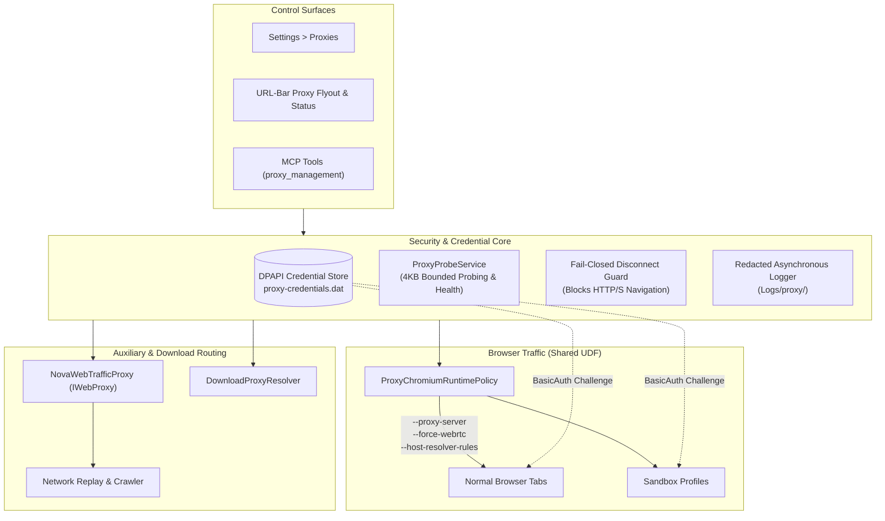

# Proxy Routing & Traffic Isolation

> [!NOTE]
> Nova AI Workspace provides an enterprise-grade proxy and traffic isolation subsystem supporting HTTP, HTTPS, SOCKS4, and SOCKS5 protocols. It enforces zero plaintext credentials on Chromium command lines, comprehensive WebRTC and SOCKS5 DNS leak protection, auxiliary tool routing parity via `NovaWebTrafficProxy`, download-specific fail-safe policies, live URL-bar health monitoring with exponential latency smoothing, and a fail-closed disconnect/reconnect circuit breaker.

---

## 1. Executive Summary & Core Mission

Standard browser automation frameworks frequently suffer from critical leak vectors: command-line password exposure, non-proxied WebRTC UDP bindings, local DNS leaks when using SOCKS5, and auxiliary background tasks (crawlers, request replay) bypassing proxies entirely.

Nova eliminates these vulnerabilities with an end-to-end traffic isolation architecture:
1. **Sanitized Runtime Projection:** Zero plaintext credentials on command lines; dynamic DPAPI-backed HTTP 407 challenge handling.
2. **Comprehensive Leak Elimination:** Mandatory WebRTC UDP blocking and remote SOCKS5 DNS resolution.
3. **Auxiliary Traffic Parity:** `NovaWebTrafficProxy` ensures standalone .NET HTTP clients match browser routing rules without silent direct-connection fallbacks.
4. **Proactive Health & Circuit Breaking:** Bounded 30-second probing with exponential latency smoothing and fail-closed emergency disconnect guards.

---

## 2. Comprehensive Documentation Index

The Proxy Routing & Traffic Isolation subsystem is detailed across specialized architecture subguides:

| Architecture Guide | Focus Areas & Technical Invariants | Primary Components |
| :--- | :--- | :--- |
| **[Profile Management & Leak Protection](profile-management-and-runtime-leak-protection/README.md)** | Profile schemas (12 max), URL paste parsing, IPv6 bracket formatting, Chromium runtime projection, WebRTC non-proxied UDP blocking, remote SOCKS5 DNS resolution (`MAP * ~NOTFOUND`), and sandbox isolation modes (`global`, `none`, `profile`). | `AppSettings.ProxyProfiles` `ProxyChromiumRuntimePolicy` `WebRTCLeakProtection` `Socks5DnsLeakProtection` `SandboxProxyMode` |
| **[Credential Security & DPAPI Storage](credential-security-and-dpapi-storage/README.md)** | Zero-plaintext credential policy, DPAPI encrypted storage (`proxy-credentials.dat`), write-protection invariants, dynamic HTTP 407 authentication challenges, and the Security Root URI Guard against credential harvesting. | `ProxyCredentialStore` `DPAPIVault` `BasicAuthenticationRequested` `SecurityRootUriGuard` `SOCKSAuthLimitations` |
| **[Auxiliary Routing & Health Probing](auxiliary-routing-and-health-probing/README.md)** | Auxiliary tool routing parity via `NovaWebTrafficProxy` (`IWebProxy`), `DownloadProxyResolver` modes, `ProxyProbeService` 4KB bounded probing, rolling latency EMA smoothing, visual URL-bar states, and fail-closed disconnect/reconnect circuit breaker. | `NovaWebTrafficProxy` `DownloadProxyResolver` `ProxyProbeService` `LatencySmoothingEMA` `nova.proxy_disconnect` `nova.proxy_reconnect` |

---

## 3. High-Level System Architecture

---

## 4. Key Architectural Invariants

* **No Plaintext Passwords on CLI:** Proxy credentials are never passed via Chromium command-line flags. HTTP/HTTPS proxies authenticate dynamically via `BasicAuthenticationRequested`.
* **Single Egress Policy:** If a proxy is configured and fails or goes offline, Nova **never falls back to an unproxied direct connection**. Both browser tabs and auxiliary tools abort with connection errors to prevent IP exposure.
* **Security Root URI Guard:** Authentication challenges are answered only if the challenge matches the configured proxy host, points to the root path, and does not originate from a web page sharing the proxy's IP address.
* **Probe-Gated Reconnection:** Lifting a fail-closed disconnect block via [`nova.proxy_reconnect`](../../../mcp-reference/tools/proxy-and-network/nova-proxy-reconnect.md) requires an isolated health probe to pass. If the probe fails, traffic remains blocked.

---

## Related Documentation

* [Profile Management & Leak Protection Subguide](profile-management-and-runtime-leak-protection/README.md)
* [Credential Security & DPAPI Storage Subguide](credential-security-and-dpapi-storage/README.md)
* [Auxiliary Routing & Health Probing Subguide](auxiliary-routing-and-health-probing/README.md)
* [Parent: Network Architecture & Traffic Control](../README.md)
* [Network Interception & Request Replay](../network-interception/README.md)
* [SSL/TLS Inspection & Debugging](../tls-inspection/README.md)
* [Multi-Sandbox Session Isolation](../../sandbox-isolation/README.md)
* [Tool Catalog: Proxy & Network Management](../../../mcp-reference/tools/proxy-and-network/README.md)
