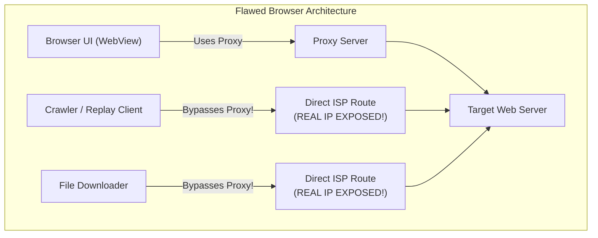
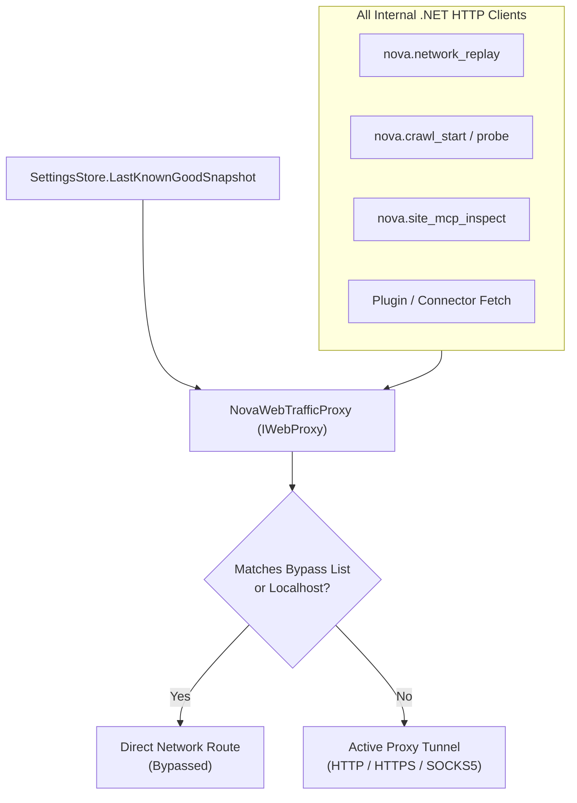
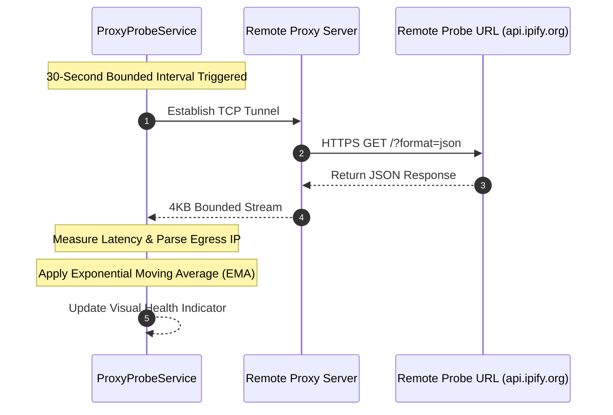
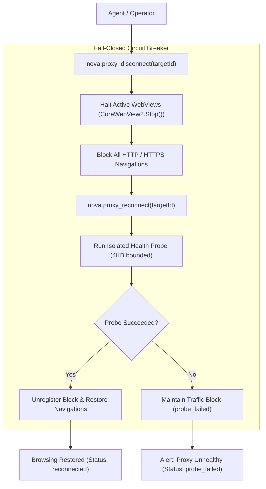

# Auxiliary Routing, Health Probing & Circuit Breakers

> [!NOTE]
> Configuring a proxy for a browser's UI does not guarantee complete privacy if background processes, file downloaders, and standalone API diagnostic tools bypass the proxy and establish direct network connections. Nova AI Workspace enforces **auxiliary traffic routing parity** through `NovaWebTrafficProxy`, isolates file download streams via `DownloadProxyResolver`, monitors connection health via `ProxyProbeService`, and provides a fail-closed disconnect/reconnect circuit breaker.

---

## 1. The Auxiliary Traffic Bifurcation Problem

In conventional browser automation architectures, traffic frequently splits along two divergent paths:

This vulnerability—**auxiliary traffic bifurcation**—deanonymizes autonomous agents without warning. An agent may navigate through a secure residential proxy, but the moment it invokes a crawler probe, replays an API request, or downloads a file, its true IP address is revealed to external servers.

Nova resolves this by routing all auxiliary .NET HTTP clients through `NovaWebTrafficProxy`.

---

## 2. Auxiliary Traffic Routing Parity (`NovaWebTrafficProxy`)

`NovaWebTrafficProxy` is an implementation of `System.Net.IWebProxy` that synchronizes dynamically with Nova's active browser proxy profile:

### Architectural Guarantees:
1. **Dynamic Route Synchronization:** When the global proxy profile is changed via UI or MCP, `NovaWebTrafficProxy` updates immediately. Existing static `HttpClient` instances switch their egress route without requiring application restarts.
2. **Bypass Parity:** Evaluates the active profile's `BypassList` (including `<local>`, CIDR notation, and domain wildcards) identically to Chromium's internal resolver.
3. **No Direct Route Fallback:** If the configured proxy goes offline, auxiliary tools **never fall back silently to a direct connection**. Requests fail with connection errors, protecting the agent's identity.

---

## 3. Dedicated Download Routing (`DownloadProxyResolver`)

File downloads can impose heavy bandwidth loads or require independent routing policies. Nova provides dedicated download routing modes:

| Mode | Operational Behavior | Fail-Safe & Privacy Enforcements |
| :--- | :--- | :--- |
| **`Off`** | Direct connection | Only active when explicitly selected by the operator. |
| **`Global`** | Inherits the active global proxy profile | Defaults to system route if no global proxy is configured. |
| **`Sandbox`** | Inherits the active sandbox proxy profile | Falls back to the global proxy profile if the sandbox has no proxy. |
| **`Custom`** | Routes downloads through a dedicated download proxy | **Fail-Closed Invariant:** If the selected custom profile is unavailable, downloads fall back to the global proxy rather than exposing the real IP on a direct connection. |

---

## 4. Real-Time Health Probing (`ProxyProbeService`)

To prevent agents from getting stuck behind dead or unresponsive proxies, Nova continuously monitors proxy connectivity and round-trip latency:

### 4.1 Probing Specifications:
* **Bounded Probing Interval:** Probes execute automatically every 30 seconds for active proxy profiles.
* **Default Probe Endpoint:** `https://api.ipify.org/?format=json`.
* **4 KB Bounded Read (`MaxProbeResponseBytes`):** Custom probe URLs are read header-first and strictly capped at 4,096 bytes. This prevents memory leaks or thread hanging if a misconfigured probe URL points to an infinite streaming endpoint.
* **Remote IP Extraction:** Extracts the outward egress IP from JSON response attributes (`ip`, `origin`, `query`, `clientIp`, `client_ip`) or plaintext bodies.

### 4.2 Rolling Latency Smoothing
Raw network latency fluctuates significantly. Nova calculates smoothed latency using an Exponential Moving Average (EMA):

$$\text{Latency}_{\text{avg}} = (\text{Latency}_{\text{prev}} \times 0.65) + (\text{Sample}_{\text{new}} \times 0.35)$$

This filter eliminates single-packet jitter while maintaining sensitivity to persistent network degradation.

---

## 5. Visual Health Indicators & URL-Bar Flyout

The live proxy status is continuously projected to the browser's URL bar:

| Visual State | Indicator Glyph | Technical Trigger Condition |
| :--- | :---: | :--- |
| **Hidden** | — | No proxy active on the current tab. |
| **Unknown** | ⚪ | Proxy configured but pending initial probe. |
| **Healthy** | 🟢 | Last probe succeeded; average latency $< 1000$ ms. |
| **Slow** | 🟡 | Last probe succeeded; average latency $1000\text{--}2499$ ms. |
| **Degraded** | 🟠 | Last probe succeeded; average latency $\ge 2500$ ms. |
| **Failed** | 🔴 | Last probe failed, timed out, or returned an HTTP error. |
| **Disconnected** | ⛔ | Manually paused via circuit breaker; traffic is strictly blocked. |

---

## 6. The Fail-Closed Disconnect / Reconnect Circuit Breaker

Nova includes an emergency traffic killswitch for rapid isolation:

### Circuit Breaker Invariants:
1. **Immediate Navigation Interception:** Invoking [`nova.proxy_disconnect`](../../../../mcp-reference/tools/proxy-and-network/nova-proxy-disconnect.md) halts active WebViews and registers a navigation blocker. Any attempt to navigate fails immediately with an error.
2. **Probe-Gated Reconnection:** Invoking [`nova.proxy_reconnect`](../../../../mcp-reference/tools/proxy-and-network/nova-proxy-reconnect.md) **does not unblock traffic unconditionally**. It executes an isolated health probe while browsing remains paused. The block is lifted **only if the health probe confirms connectivity**. If the probe fails, traffic remains strictly blocked to protect the user's real IP address.

---

## Related Documentation

* [Domain Hub: Proxy Routing & Traffic Isolation](../README.md)
* [Subguide: Profile Management & Runtime Leak Protection](../profile-management-and-runtime-leak-protection/README.md)
* [Subguide: Credential Security & DPAPI Storage](../credential-security-and-dpapi-storage/README.md)
* [Master Hub: Network Architecture & Traffic Control](../../README.md)
* [Tool Reference: `nova.proxy_status`](../../../../mcp-reference/tools/proxy-and-network/nova-proxy-status.md)
* [Tool Reference: `nova.proxy_disconnect`](../../../../mcp-reference/tools/proxy-and-network/nova-proxy-disconnect.md)
