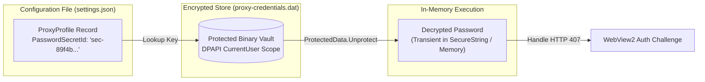
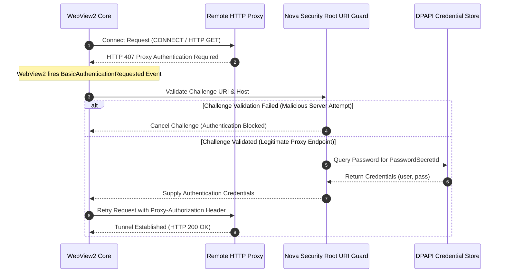

# Proxy Credential Security & DPAPI Storage

> [!CAUTION]
> Proxy credentials represent sensitive access tokens that must never be exposed in plaintext configuration files, shell scripts, or process listings. Nova AI Workspace enforces a strict **zero-plaintext credential architecture**: proxy passwords are encrypted using the Windows Data Protection API (DPAPI), dynamically provided to Chromium via HTTP 407 authentication challenges, and guarded by security root URI verification to prevent credential-harvesting exploits.

---

## 1. Architectural Threat Model: Credential Exposure Vectors

In typical browser automation setups, proxy passwords face severe vulnerabilities:

```
┌────────────────────────────────────────────────────────────────────────┐
│                     Proxy Credential Threat Model                      │
├──────────────────────────────────┬─────────────────────────────────────┤
│ Exposure Vector                  │ Risk & Impact                       │
├──────────────────────────────────┼─────────────────────────────────────┤
│ Process Startup Arguments        │ Passwords in `--proxy-server` are   │
│                                  │ visible in Task Manager and WMI.    │
├──────────────────────────────────┼─────────────────────────────────────┤
│ Plaintext JSON Configuration     │ Storing passwords in settings files │
│                                  │ exposes them to backups & repo sync.│
├──────────────────────────────────┼─────────────────────────────────────┤
│ Credential-Harvesting Servers    │ A malicious site running on the     │
│                                  │ proxy host triggers fake auth dialog│
│                                  │ to capture proxy credentials.       │
├──────────────────────────────────┼─────────────────────────────────────┤
│ SOCKS Engine Authentication      │ Chromium does not support SOCKS4/5  │
│                                  │ credentials, causing silent leaks.  │
└──────────────────────────────────┴─────────────────────────────────────┘
```

Nova resolves these risks by isolating credential storage from settings configuration and verifying authentication challenges cryptographically.

---

## 2. DPAPI Credential Store (`proxy-credentials.dat`)

Proxy passwords are never stored in `settings.json`. Instead, `settings.json` contains only a stable indirection key (`PasswordSecretId`). The corresponding password is encrypted and persisted in a protected binary datastore:

```
%LOCALAPPDATA%\NovaBrowser\proxy-credentials.dat
```



### 2.1 Storage Specifications & Security Guarantees:
* **Operating System Encryption:** Encrypted via Windows `ProtectedData.Protect` using `DataProtectionScope.CurrentUser`. The encryption key is tied to the current Windows user login and cannot be decrypted by other user accounts on the same machine.
* **Bounded Capacity:** Capped at the 64 newest entries and a maximum file size of 1 MB.
* **Write-Protection Invariant:** If an existing `proxy-credentials.dat` file cannot be read during initialization (e.g. due to temporary file locks), `ProxyCredentialStore` **strictly refuses to write**. This prevents a transient read failure from overwriting and erasing the user's stored credentials with an empty dictionary.

---

## 3. Dynamic HTTP 407 Challenge Handling

Because credentials cannot be passed via command-line arguments without exposing them in process tables, HTTP and HTTPS proxies must authenticate dynamically at runtime:



---

## 4. The Security Root URI Guard

A critical attack vector against automated browsers involves **proxy credential harvesting**:
* If an attacker hosts a malicious website on the same server IP or domain as a public or corporate proxy (e.g. `proxy.corp.net`), the web server could deliberately return an HTTP 407 challenge to trick the browser into sending its proxy credentials.

Nova eliminates this vulnerability by enforcing three strict validation rules in `BasicAuthenticationRequested`:

```csharp
// Architectural Guard against Credential Harvesting
public static bool IsLegitimateProxyChallenge(
    Uri challengeUri, 
    ProxyProfile activeProfile, 
    Uri currentTabUri)
{
    // 1. Host and Port Match
    if (!string.Equals(challengeUri.Host, activeProfile.Host, StringComparison.OrdinalIgnoreCase) ||
        challengeUri.Port != activeProfile.Port)
    {
        return false;
    }

    // 2. Proxy Root URI Check
    if (challengeUri.AbsolutePath != "/" && challengeUri.AbsolutePath != string.Empty)
    {
        return false;
    }

    // 3. Top-Level Page Origin Exclusion
    if (string.Equals(currentTabUri.Host, activeProfile.Host, StringComparison.OrdinalIgnoreCase))
    {
        return false; // Target page shares the proxy host; block credential dispatch
    }

    return true;
}
```

### Enforcement Rules:
1. **Host and Port Verification:** The challenge host and port must match the active `ProxyProfile` configuration exactly.
2. **Root URI Matching:** The challenge path must target the root endpoint (`/`). Sub-path challenges are rejected.
3. **Top-Level Origin Exclusion:** If the page being viewed in the active tab shares the same host as the proxy server, Nova refuses to supply credentials. This blocks malicious sites hosted on the proxy server from stealing credentials.

---

## 5. The SOCKS Credential Limitation

Chromium and WebView2 do **not** support username/password authentication for SOCKS4 or SOCKS5 proxies at the browser engine level:

> [!WARNING]
> While SOCKS5 protocol specifications support username/password authentication (RFC 1929), Chromium's network stack does not implement SOCKS authentication challenges. Providing username/password credentials for a SOCKS5 profile will cause connection failures or silent authentication rejections.

### Recommended Architectural Alternatives for SOCKS5:
1. **IP Allowlisting:** Configure the remote SOCKS5 server to authorize connections based on the client's public IP address without requiring credentials.
2. **HTTP/HTTPS Proxy:** Migrate the endpoint to an authenticated HTTP/HTTPS proxy, which fully supports DPAPI-backed dynamic authentication in Nova.
3. **Local Loopback Relay:** Run a local authenticated tunneling client (such as SSH dynamic port forwarding or a local relay) on `127.0.0.1`, which connects to the authenticated SOCKS server upstream.

---

## Related Documentation

* [Domain Hub: Proxy Routing & Traffic Isolation](../README.md)
* [Subguide: Profile Management & Runtime Leak Protection](../profile-management-and-runtime-leak-protection/README.md)
* [Subguide: Auxiliary Routing & Health Probing](../auxiliary-routing-and-health-probing/README.md)
* [Privacy & Credential Protection](../../../privacy/README.md)
* [Tool Reference: `nova.proxy_set_password`](../../../../mcp-reference/tools/proxy-and-network/nova-proxy-set-password.md)
