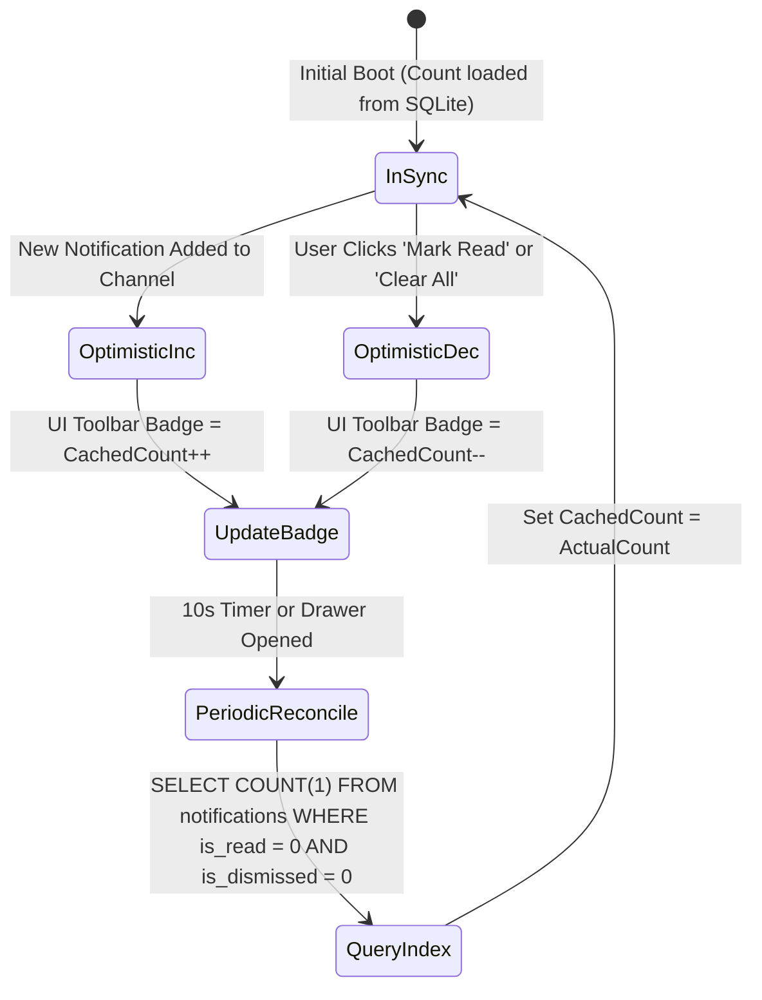
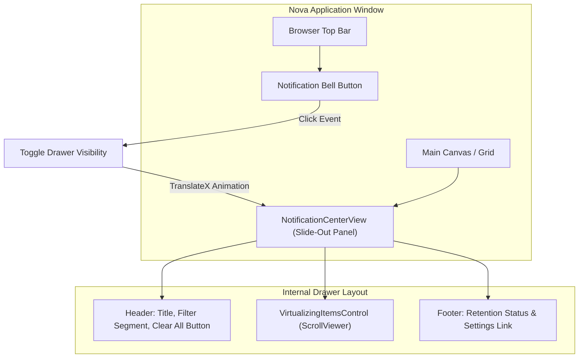
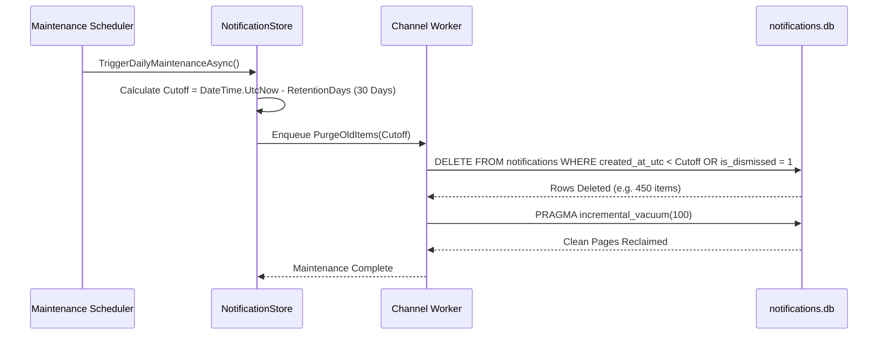

# Query Facades, Badge Metrics & Retention Maintenance

This sub-guide details Nova AI Workspace's asynchronous read facade for notifications, reactive badge metric synchronization, slide-out WinUI 3 Notification Center rendering mechanics, and database retention maintenance.

---

## 1. Asynchronous Data Access Facade (`NotificationStore`)

All read, filter, and pagination queries against the persistent notification inbox execute through the `NotificationStore` facade. This architectural boundary prevents tight coupling between UI views or agent MCP handlers and low-level SQL syntax:

```mermaid
flowchart TD
    subgraph Clients["Read Clients"]
        UI["WinUI 3 Shell & Toolbar Bell"]
        Drawer["Slide-Out Notification Center"]
        Agent["MCP Tools (nova.notifications_*)"]
    end

    subgraph Facade["NotificationStore Data Facade"]
        Count["GetUnreadCountAsync()<br>Optimistic Cache + Partial Index"]
        List["GetNotificationsAsync(filter, offset, limit)<br>Paginated Query Builder"]
        Get["GetByIdAsync(guid)<br>Direct Primary Key Lookup"]
        Summary["GetNotificationSummaryAsync()<br>Source breakdowns & metrics"]
    end

    subgraph Database[("SQLite (WAL Mode)")]
        Table["notifications Table"]
        Idx["idx_notifications_unread"]
    end

    UI --> Count
    Drawer --> List
    Agent --> List
    Agent --> Get
    Agent --> Summary

    Count --> Idx
    List --> Table
    Get --> Table
    Summary --> Table
```

### Key Read Operations:

| Method | Parameters | Return Type | Description |
| :--- | :--- | :--- | :--- |
| `GetUnreadCountAsync()` | None | `Task<int>` | Returns the total count of unread, non-dismissed notifications. Resolves from optimistic memory cache or partial index in $<0.1\text{ ms}$. |
| `GetNotificationsAsync()` | `NotificationFilter filter, int offset, int limit` | `Task<IReadOnlyList<NotificationEntry>>` | Fetches a paginated slice of notifications matching source, read status, or date range filters. |
| `GetByIdAsync()` | `Guid id` | `Task<NotificationEntry?>` | Retrieves complete metadata and visual asset URIs for a specific notification. |
| `GetNotificationSummaryAsync()` | None | `Task<NotificationSummary>` | Returns aggregate telemetry (total count, unread count, counts by source kind: Web, Nova, Agent). |

---

## 2. Optimistic In-Memory Badge Synchronization

Nova's browser toolbar features an interactive bell icon that displays a numeric badge indicating unread notifications. Because notifications can arrive in rapid succession, querying the disk-based SQLite database for every incoming event would create needless CPU overhead.

Nova solves this using an **optimistic memory counter with background reconciliation**:



1. **Optimistic Increment:** When a new notification is posted to the write channel, the in-memory unread counter is incremented immediately, updating the WinUI 3 badge in $<0.01\text{ ms}$.
2. **Optimistic Decrement:** When the user marks notifications as read or dismisses them, the counter drops immediately.
3. **Reconciliation Sweeps:** Periodic checks (or triggering the slide-out center) execute the indexed SQLite count query to reconcile any discrepancies caused by external background purges or process terminations.
4. **Agent Inspection:** AI agents invoke [`nova.notifications_unread_count`](../../../../mcp-reference/tools/notifications/nova-notifications-unread-count.md) to inspect this reconciled counter before deciding whether to alert the user.

---

## 3. Slide-Out Notification Center UI Architecture

The In-App Notification Center (`NotificationCenterView`) is a code-only WinUI 3 slide-out drawer positioned along the right edge of the main browser window:



### Card Layout & Virtualization:
* **Incremental Reconciliation:** When new notifications arrive while the drawer is open, incoming items are inserted at the top of the observable collection incrementally. The view avoids full layout reconstruction, ensuring that user scroll position is preserved.
* **Relative Human-Friendly Timestamps:** Timestamps are computed dynamically using relative intervals (`Just now`, `12m ago`, `3h ago`, `Yesterday`), updating every minute via a lightweight UI timer.
* **Rich Source Icons & Hero Banners:**
  * **Web Alerts:** Display the canonical website favicon and domain origin badge.
  * **Nova System Alerts:** Display the Nova system shield or download progress icon.
  * **Agent Notifications:** Display custom agent avatars and expandable hero screenshot banners.

---

## 4. Automated Retention Pruning & Vacuum Maintenance

To maintain lean database performance and prevent indefinite disk growth across years of operation, Nova executes automated background retention routines:



### Maintenance Parameters:
* **`AppSettings.NotificationRetentionDays`:** Configurable retention threshold (default: 30 days). Notifications older than this threshold are pruned automatically.
* **Dismissed Item Purging:** Notifications flagged as dismissed (`is_dismissed = 1`) are eligible for deletion during daily maintenance sweeps regardless of age.
* **Incremental Vacuum:** Instead of executing an expensive full `VACUUM` that locks the database and rewrites the entire file, Nova uses `PRAGMA incremental_vacuum` to reclaim freed database pages in small, unnoticeable increments.

---

## 5. Agent Bulk Management Tools (MCP)

Autonomous agents can query, organize, and prune the notification inbox using dedicated MCP tools:

```json
// Example: Pruning stale agent notifications older than 7 days
{
  "name": "nova.notifications_clear",
  "arguments": {
    "source": "Agent",
    "olderThanDays": 7
  }
}
```

* **[`nova.notifications_list`](../../../../mcp-reference/tools/notifications/nova-notifications-list.md):** Returns paginated notifications with optional filtering by `source`, `unreadOnly`, or `sandbox`.
* **[`nova.notifications_mark_read`](../../../../mcp-reference/tools/notifications/nova-notifications-mark-read.md):** Marks one or more notification IDs as read, decrementing the unread badge.
* **[`nova.notifications_dismiss`](../../../../mcp-reference/tools/notifications/nova-notifications-dismiss.md):** Dismisses notifications from the active inbox without deleting the underlying database record.
* **[`nova.notifications_clear`](../../../../mcp-reference/tools/notifications/nova-notifications-clear.md):** Permanently removes notifications matching specified criteria.
* **[`nova.notifications_unread_count`](../../../../mcp-reference/tools/notifications/nova-notifications-unread-count.md):** Retrieves the current unread count.

---

## 6. Related Documentation

* **[Inbox Storage & Channel Worker Architecture](../README.md)** — Domain hub for storage architecture and write queues.
* **[SQLite Database Schema & Channel Worker Pipeline](../sqlite-schema-and-channel-worker/README.md)** — Database schema, partial indexes, and channel producer-consumer worker.
* **[Desktop Notifications Master Hub](../../README.md)** — Master notification architecture and MCP tool index.
* **[Windows Toasts & Deep-Link Activation Router](../../windows-toasts-and-activation/README.md)** — Native Windows App SDK integration and toast activation.
* **[W3C Web Permissions & Lifecycle Handshake](../../web-permissions-and-lifecycle/README.md)** — Web notification standards and origin policies.
