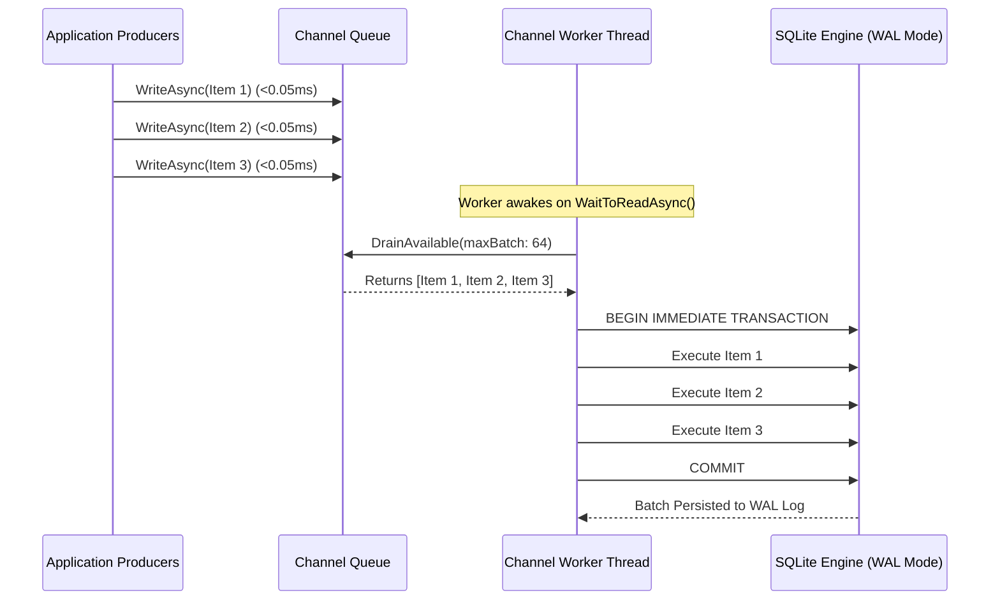
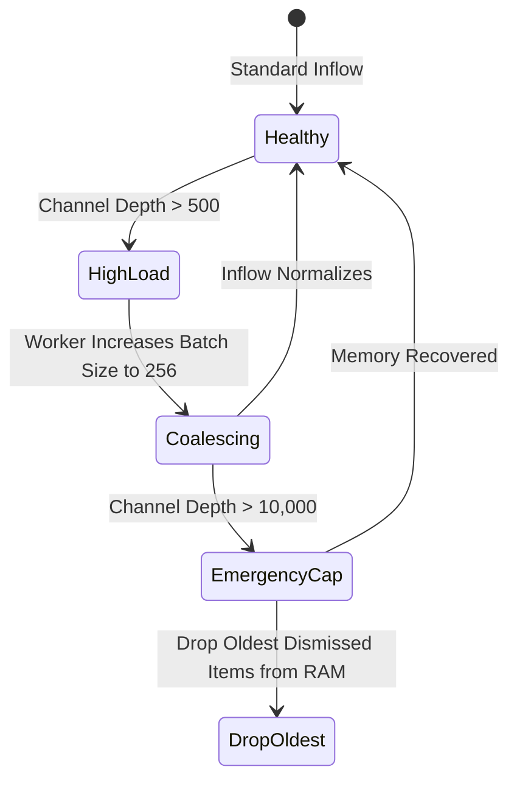

# SQLite Database Schema & Channel Worker Pipeline

This sub-guide details the persistence layer of Nova AI Workspace's unified notification inbox, covering the SQLite relational schema, index structures, the asynchronous `System.Threading.Channels` lock-free write queue, and the micro-batch single-writer execution engine.

---

## 1. Relational Database Design (`notifications.db`)

All notifications emitted within Nova AI Workspace—whether from web applications, host browser features, or autonomous MCP agents—are persisted to a high-performance SQLite database:

```
%LOCALAPPDATA%\NovaBrowser\notifications.db
```

### Table Schema Specification: `notifications`

```sql
CREATE TABLE IF NOT EXISTS notifications (
    id TEXT PRIMARY KEY NOT NULL,
    source_kind INTEGER NOT NULL,            -- 0 = Website, 1 = Nova, 2 = Agent
    origin TEXT,                             -- e.g. "https://chat.com"
    target_id TEXT,                          -- Specific tab identifier
    tab_id TEXT,
    sandbox_id TEXT,                         -- e.g. "A" or "B"
    profile_id TEXT,
    title TEXT NOT NULL,
    body TEXT,
    tag TEXT,                                -- W3C Web Notification tag for upserts
    icon_path TEXT,                          -- App logo override / site favicon URI
    image_path TEXT,                         -- Inline preview image URI
    hero_image_path TEXT,                    -- Top banner preview image URI
    use_circle_app_logo INTEGER NOT NULL,    -- Boolean: circular avatar cropping
    action_button_label TEXT,                -- Optional CTA button text
    urgent INTEGER NOT NULL,                 -- Boolean: Focus Assist priority override
    is_silent INTEGER NOT NULL,              -- Boolean: audio suppression
    requires_interaction INTEGER NOT NULL,   -- Boolean: persistent banner
    language TEXT,                           -- BCP47 language code (e.g. "en-US")
    timestamp_ms REAL,                       -- JavaScript epoch millisecond timestamp
    created_at_utc TEXT NOT NULL,            -- ISO-8601 creation timestamp
    is_read INTEGER NOT NULL DEFAULT 0,      -- 0 = Unread, 1 = Read
    is_dismissed INTEGER NOT NULL DEFAULT 0, -- 0 = Active, 1 = Dismissed
    delivery_state INTEGER NOT NULL DEFAULT 0-- 0=Pending, 1=Delivered, 2=Failed, 3=Suppressed
);
```

### Index Architecture & Performance Strategy

```sql
-- Fast chronologically sorted pagination for inbox feed rendering
CREATE INDEX IF NOT EXISTS idx_notifications_created 
    ON notifications(created_at_utc DESC);

-- Accelerated W3C tag upsert resolution
CREATE INDEX IF NOT EXISTS idx_notifications_tag_origin 
    ON notifications(tag, origin) 
    WHERE tag IS NOT NULL AND origin IS NOT NULL;

-- Instant O(1) unread badge calculation via partial index
CREATE INDEX IF NOT EXISTS idx_notifications_unread 
    ON notifications(is_read, is_dismissed) 
    WHERE is_read = 0 AND is_dismissed = 0;
```

* **Filtered Partial Indexes:** By conditioning `idx_notifications_unread` on `WHERE is_read = 0 AND is_dismissed = 0`, the index contains only active, unread notifications. As the vast majority of historical notifications are read or dismissed, this index remains tiny (often fitting inside a single CPU cache line), enabling sub-millisecond badge updates even with hundreds of thousands of historical entries.
* **Tag & Origin Filtering:** `idx_notifications_tag_origin` ignores null entries, providing instant point-lookups for websites updating active progress banners.

---

## 2. Lock-Free Write Queue (`System.Threading.Channels`)

In high-concurrency environments—such as autonomous AI agents emitting dozens of progress updates while parallel downloads complete—direct database writes from multiple threads would cause mutex contention and SQLite database locked exceptions (`SQLITE_BUSY`).

To solve this, Nova implements an asynchronous producer-consumer channel pipeline:

```mermaid
flowchart TD
    subgraph Producers["Multi-Threaded Producers"]
        P1["Website Notification Receiver<br>(WebView2 Thread)"]
        P2["Host Browser Notifications<br>(UI Thread)"]
        P3["Agent Tools (nova.notifications_send)<br>(ThreadPool Task)"]
    end

    subgraph ChannelQueue["Lock-Free Bounded/Unbounded Channel"]
        Chan["System.Threading.Channels.Channel<DbWorkItem>"]
    end

    subgraph DedicatedConsumer["Dedicated Background Consumer Worker"]
        Reader["Channel.Reader.WaitToReadAsync()"]
        Batcher["Coalesce up to 64 Items into Micro-Batch"]
        Tx["Begin Immediate Transaction"]
        Execute["Execute Batch INSERT / UPDATE Statements"]
        Commit["Commit Transaction"]
    end

    subgraph Storage[("SQLite Database")]
        DBFile["notifications.db (WAL Mode)"]
    end

    P1 -->|Post WorkItem| Chan
    P2 -->|Post WorkItem| Chan
    P3 -->|Post WorkItem| Chan

    Chan --> Reader
    Reader --> Batcher
    Batcher --> Tx
    Tx --> Execute
    Execute --> Commit
    Commit --> DBFile
```

### Operational Work Item Types

The channel transport processes polymorphic `DbWorkItem` packets:

| Work Item | Parameters | SQL Execution |
| :--- | :--- | :--- |
| `InsertNotificationItem` | `NotificationEntry` | `INSERT INTO notifications (...) VALUES (...)` |
| `UpsertTagNotificationItem` | `NotificationEntry` | Atomic `SELECT` followed by `UPDATE` or `INSERT` within transaction |
| `MarkReadItem` | `Guid id` or `List<Guid> ids` | `UPDATE notifications SET is_read = 1 WHERE id IN (...)` |
| `DismissItem` | `Guid id` or `List<Guid> ids` | `UPDATE notifications SET is_dismissed = 1 WHERE id IN (...)` |
| `PurgeOldItems` | `DateTime cutoffUtc` | `DELETE FROM notifications WHERE created_at_utc < ? OR is_dismissed = 1` |

---

## 3. Micro-Batching & WAL Mode Optimization

SQLite's default journaling mode incurs severe synchronous disk flushes per transaction. Nova tunes the database connection for high-throughput desktop application execution:



### Key Performance Configurations:
1. **Write-Ahead Logging (WAL):** Enabled via `PRAGMA journal_mode = WAL;`. Readers and writers never block each other. Background queries from UI drawers proceed concurrently with active worker batch flushes.
2. **Synchronous Normal:** Enabled via `PRAGMA synchronous = NORMAL;`. Provides full integrity against application crashes while eliminating excessive disk platter/SSD sync barriers on every insert.
3. **Micro-Batch Coalescing:** If multiple items enter the channel within a 5-millisecond window, the consumer bundles them into a single `BEGIN...COMMIT` block, reducing filesystem fsync overhead by up to 98%.

---

## 4. Failure Isolation & Memory Backpressure

Under extreme burst conditions (e.g., an automated load test generating thousands of events per second), the channel worker safeguards memory stability:



1. **Lock-Free Non-Blocking Push:** UI threads and web workers never wait on disk I/O; `ChannelWriter.TryWrite()` succeeds immediately.
2. **Self-Regulating Backpressure:** As queue depth grows, the worker automatically increases its batching threshold from 32 to 256 items per transaction, dramatically increasing write IOPS efficiency under heavy load.
3. **Graceful Shutdown Flush:** When Nova AI Workspace initiates application shutdown, the worker stops accepting new items, drains all remaining pending records from the channel, completes the final database commit, and cleanly closes the SQLite connection handle.

---

## 5. Related Documentation

* **[Inbox Storage & Channel Worker Architecture](../README.md)** — Domain hub for database storage and worker queues.
* **[Query Facades, Badge Metrics & Retention](../query-facades-badge-metrics-and-retention/README.md)** — Read facade, badge calculations, UI panel rendering, and automated maintenance sweeps.
* **[Desktop Notifications Master Hub](../../README.md)** — Master three-source notification topology and MCP tool index.
* **[Windows Toasts & Deep-Link Activation Router](../../windows-toasts-and-activation/README.md)** — Windows App SDK integration and toast activation.
* **[W3C Web Permissions & Lifecycle Handshake](../../web-permissions-and-lifecycle/README.md)** — Origin policies and DOM lifecycle hooks.
