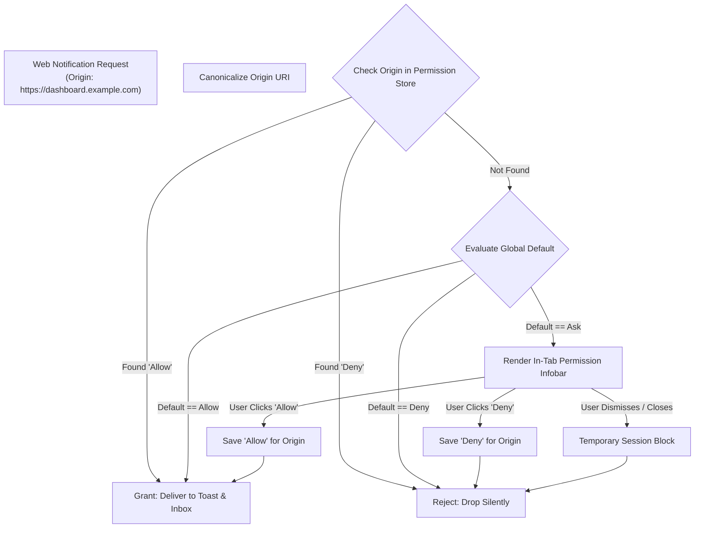
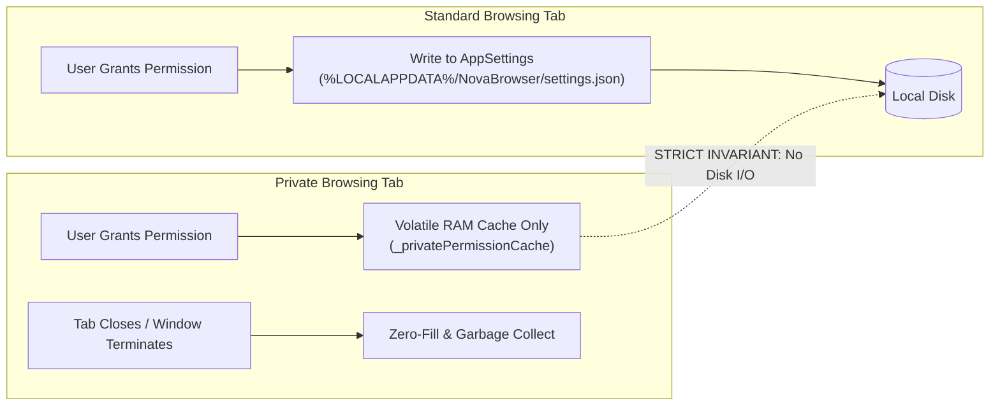
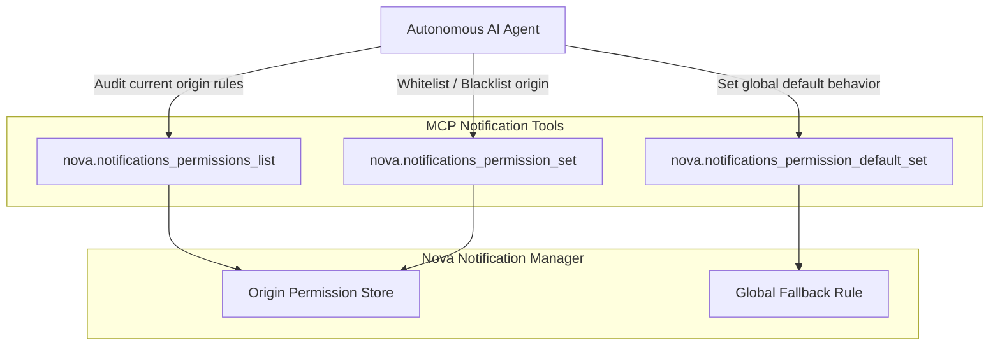

# Origin Permissions & Private Tab Isolation

This sub-guide details Nova AI Workspace's origin-based notification permission model, the tri-state policy state machine, ephemeral private tab memory isolation, and programmatic control via Model Context Protocol (MCP) tools.

---

## 1. Tri-State Origin Permission Architecture

Web notification delivery is gated by a strict origin-based permission model. Because arbitrary websites can emit noisy or intrusive alerts, Nova enforces a configurable tri-state policy for every URI origin (`scheme://host:port`):



### Tri-State Modes Explained

| Mode | Behavior | Persistence | Use Case |
| :--- | :--- | :--- | :--- |
| **`Allow`** | The origin is granted permission to push notifications. Calls bypass prompt bars and immediately enter the delivery pipeline. | Stored permanently in configuration. | Trusted enterprise hubs, project management boards, chat portals. |
| **`Deny`** | The origin is strictly forbidden from pushing notifications. All `NotificationReceived` events are suppressed without user interruption. | Stored permanently in configuration. | Ad networks, untrusted third-party sites, aggressive marketing domains. |
| **`Ask` (Default)** | Nova presents an in-tab notification infobar when the site first attempts to post a notification, allowing explicit user approval. | Evaluated at runtime until user makes a selection. | Standard browsing behavior for previously unvisited domains. |

---

## 2. Canonical Origin Resolution & Normalization

To prevent permission evasion through subdomain manipulation, port variations, or protocol discrepancies, Nova canonicalizes all origins prior to evaluation:

```
https://sub.domain.com:443/app/dashboard -> https://sub.domain.com
http://localhost:8080/api/v1             -> http://localhost:8080
```

1. **Scheme Enforcement:** `http` and `https` origins are isolated. An authorization granted to `http://example.com` does not automatically extend to `https://example.com`.
2. **Path & Query Stripping:** Path segments, matrix parameters, and query strings are removed. Permission is scoped to the web origin root.
3. **Punycode Handling:** Internationalized domain names (IDNs) are normalized into ASCII Punycode representations to prevent homograph phishing spoofing attacks against the permission store.

---

## 3. Ephemeral Private Tab Isolation (Zero-Disk-Leak)

Nova AI Workspace provides isolated private (incognito) browsing tabs designed for high-assurance confidentiality. A key security invariant of private browsing is that **no persistent telemetry, cached credentials, or user choices may leak to non-volatile disk storage**.



### Private Tab Invariants:
1. **In-Memory Cache Only:** Permission decisions made inside a private tab are recorded solely in a thread-safe in-memory cache scoped to that specific browsing session.
2. **Zero Disk Footprint:** Under no circumstances are private tab permissions written to `%LOCALAPPDATA%\NovaBrowser\settings.json`.
3. **Lifecycle Destruction:** When the private tab is closed, or when Nova terminates, the ephemeral memory cache is immediately freed, leaving zero trace of the visited origin or its granted privileges.
4. **Partition Separation:** Grants made inside private tabs do not contaminate or modify existing permanent rules for standard sandbox tabs (`Sandbox A`, `Sandbox B`).

---

## 4. Programmatic MCP Governance for Autonomous Agents

Autonomous agents orchestrating web workflows inside Nova can inspect, grant, revoke, and reset origin permissions programmatically using Nova's dedicated Model Context Protocol (MCP) tools:



### Agent Tool Operations:

* **Audit Permissions (`nova.notifications_permissions_list`):**
  Returns the complete directory of custom origin permissions alongside the current global default policy.
  ```json
  {
    "default_policy": "Ask",
    "origins": {
      "https://github.com": "Allow",
      "https://spammy-tracker.net": "Deny"
    }
  }
  ```

* **Explicit Grant or Revocation (`nova.notifications_permission_set`):**
  Assigns a specific mode (`Allow`, `Deny`, or `Ask`) to a target web origin:
  ```json
  {
    "origin": "https://ci.internal.corp",
    "mode": "Allow"
  }
  ```

* **Global Policy Configuration (`nova.notifications_permission_default_set`):**
  Changes the fallback behavior for all unconfigured websites (e.g., locking down a corporate workstation by setting the default policy to `Deny` across all unapproved domains):
  ```json
  {
    "mode": "Deny"
  }
  ```

---

## 5. Related Documentation

* **[W3C Web Permissions & Lifecycle Handshake](../README.md)** — Domain hub for web notification policies.
* **[W3C Web Notifications & DOM Lifecycle Interception](../w3c-notifications-and-dom-lifecycle/README.md)** — DOM event hooks, COM object mappings, and tag deduplication.
* **[Windows Toasts & Deep-Link Activation Router](../../windows-toasts-and-activation/README.md)** — Native Windows App SDK integration and activation routing.
* **[Inbox Storage & Channel Worker Architecture](../../inbox-and-storage/README.md)** — SQLite database schema and lock-free write queues.
* **[Desktop Notifications Master Hub](../../README.md)** — System-wide notification architecture and MCP tool index.
