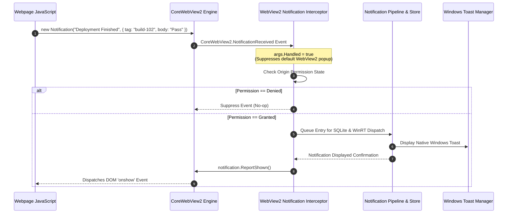
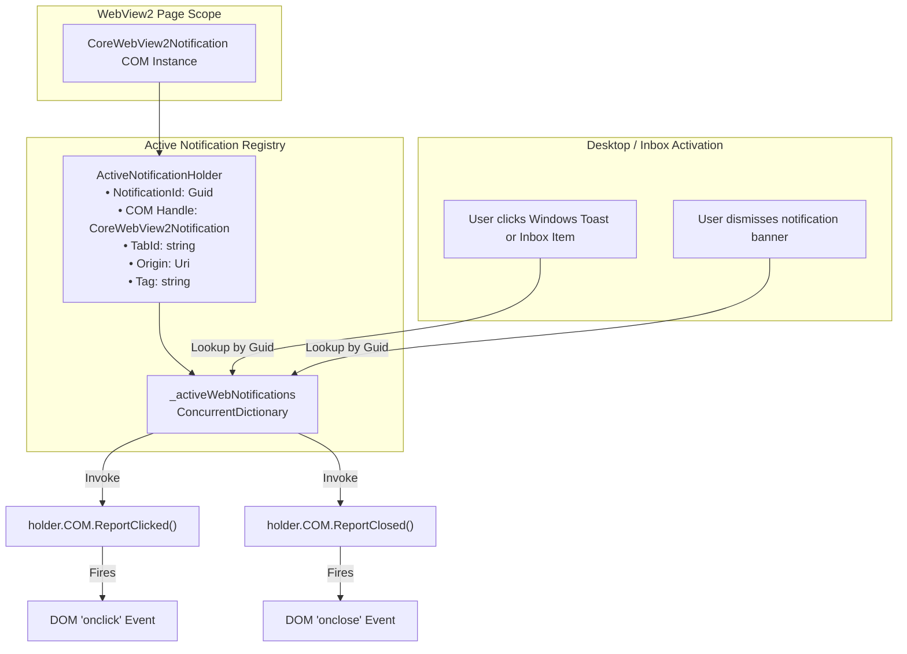
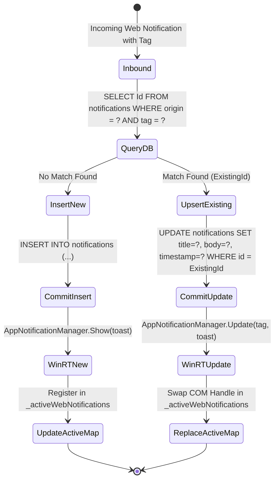
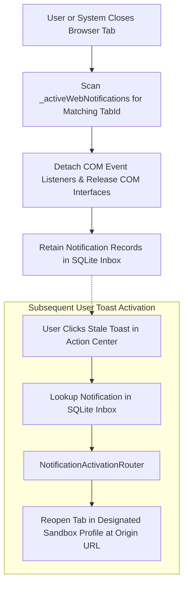

# W3C Web Notifications & DOM Lifecycle Interception

This sub-guide details how Nova AI Workspace intercepts the standard W3C Web Notifications API within Microsoft WebView2 instances, bridges DOM events to native desktop actions, manages COM object lifecycles, and implements tag-based replacement and anti-spam deduplication.

---

## 1. W3C Web Notifications Standard Interception

Web applications running within modern browsers invoke the standard W3C `Notification` interface to display alerts to users. Under standard browser engines, notifications are rendered directly by the shell without native OS integration or persistent inbox storage.

In Nova AI Workspace, all web notification requests originating from JavaScript execution inside a WebView2 environment are intercepted at the native runtime boundary:

### The `args.Handled = true` Invariant
When the `CoreWebView2.NotificationReceived` event fires, Nova immediately asserts `args.Handled = true`. This critical step guarantees:
1. **Suppression of Generic Popups:** The default, unstyled WebView2 web notification toast is prevented from displaying.
2. **Unified Delivery Architecture:** Every notification passes through Nova's centralized delivery gate where it is recorded in the persistent SQLite database, rendered in the WinUI 3 Notification Center, and posted as a rich native Windows toast.
3. **Auditability:** AI agents inspecting workspace state via MCP tools observe all incoming web notifications in real time.

---

## 2. Active Notification Lifecycle Mapping & COM Interop

The W3C specification stipulates that notifications are stateful entities capable of receiving user interactions and emitting DOM lifecycle events back to the webpage:
* `onshow`: Dispatched when the notification is visible to the user.
* `onclick`: Dispatched when the user activates or clicks the notification.
* `onclose`: Dispatched when the notification is dismissed or closed by the user or system.
* `onerror`: Dispatched if an error prevents presentation.

To bridge asynchronous Windows desktop activation and slide-out inbox actions back to the originating webpage, Nova maintains an in-memory active notification lookup table:

### Lifecycle Callback Mechanics

| Method | Trigger Source | Webpage Reaction | Cleanup Action |
| :--- | :--- | :--- | :--- |
| `ReportShown()` | Dispatched when SQLite persistence succeeds and toast is delivered. | Fires `notification.onshow` handler in the webpage. | Retains COM reference in `_activeWebNotifications`. |
| `ReportClicked()` | Dispatched when the user clicks the native toast banner or clicks the notification item in the slide-out center. | Fires `notification.onclick` handler; commonly focuses window or navigates tab. | Notifies deep-link router, maintains active reference until closed. |
| `ReportClosed()` | Dispatched when the user clicks the dismiss button or the toast auto-dismisses to the Windows Action Center. | Fires `notification.onclose` handler in the webpage. | Removes entry from `_activeWebNotifications` and decrements COM reference count. |

---

## 3. Tag-Based Upsert & Anti-Spam Deduplication

Web applications frequently push rapid status updates (e.g., continuous integration progress bars, audio playback positions, sporting event scores) using the W3C `tag` property. When a notification is created with a `tag` that matches an existing notification from the same origin, the specification mandates replacement rather than stacking.

### Architectural Guarantees for Tagged Notifications:
1. **Inbox Anti-Spam Guarantee:** The unified SQLite inbox contains exactly one entry per active `(origin, tag)` combination. A deployment status notification updated 50 times produces 1 persistent inbox item, not 50.
2. **Native Toast In-Place Replacement:** By supplying the `tag` and `group` attributes to the Windows App SDK `AppNotificationManager`, Nova instructs Windows Shell to update the existing visual toast in-place rather than spamming multiple sound chimes and banners across the user's screen.
3. **COM Handle Handoff:** When a tagged notification is updated, the previous `CoreWebView2Notification` COM instance has `ReportClosed()` invoked on it before the new COM handle is registered in `_activeWebNotifications`, ensuring proper garbage collection within the WebView2 runtime.

---

## 4. Cold-Tab & Cross-Session Resilience

Web notifications are inherently tied to active page contexts. When a tab or WebView2 instance terminates while notifications remain in the user's inbox or Windows Action Center, Nova's lifecycle manager maintains system stability:

1. **Clean COM Teardown:** When a tab is closed, Nova detaches all active COM wrappers associated with that tab ID. Invoking methods on orphaned COM pointers is safely guarded with try-catch wrappers to prevent `RO_E_CLOSED` or `RPC_E_DISCONNECTED` exceptions.
2. **Decoupled Persistence:** Even after the originating webpage and WebView2 control have ceased execution, the notification record in the SQLite database remains completely valid and actionable.
3. **Restoration on Click:** If the user subsequently clicks the toast or inbox item, Nova's deep-link router detects that the originating tab no longer exists, selects the correct sandbox container, and opens a new tab directed at the notification's origin URL.

---

## 5. Related Documentation

* **[W3C Web Permissions & Lifecycle Handshake](../README.md)** — Domain hub for web notification policies.
* **[Origin Permissions & Private Tab Isolation](../origin-permissions-and-private-tab-isolation/README.md)** — Tri-state permission rules and memory-only private browsing boundaries.
* **[Windows Toasts & Deep-Link Activation Router](../../windows-toasts-and-activation/README.md)** — Native Windows App SDK integration and activation routing.
* **[Unpackaged WinRT & Toast Templates](../../windows-toasts-and-activation/unpackaged-winrt-and-toast-templates/README.md)** — XML payload generation and AUMID/CLSID setup.
* **[Desktop Notifications Master Hub](../../README.md)** — System-wide notification architecture and MCP tool index.
