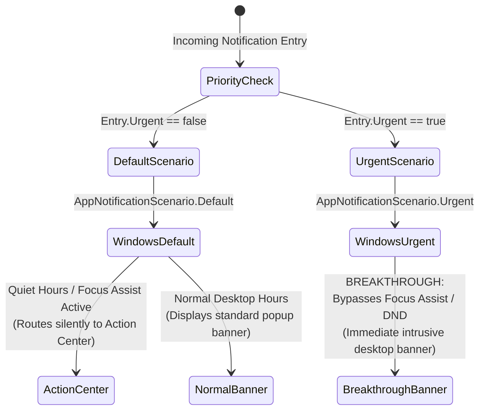
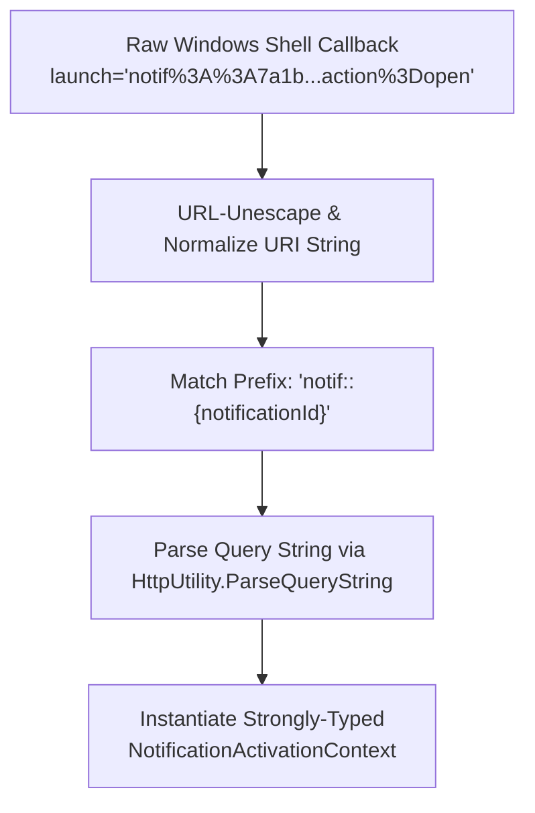
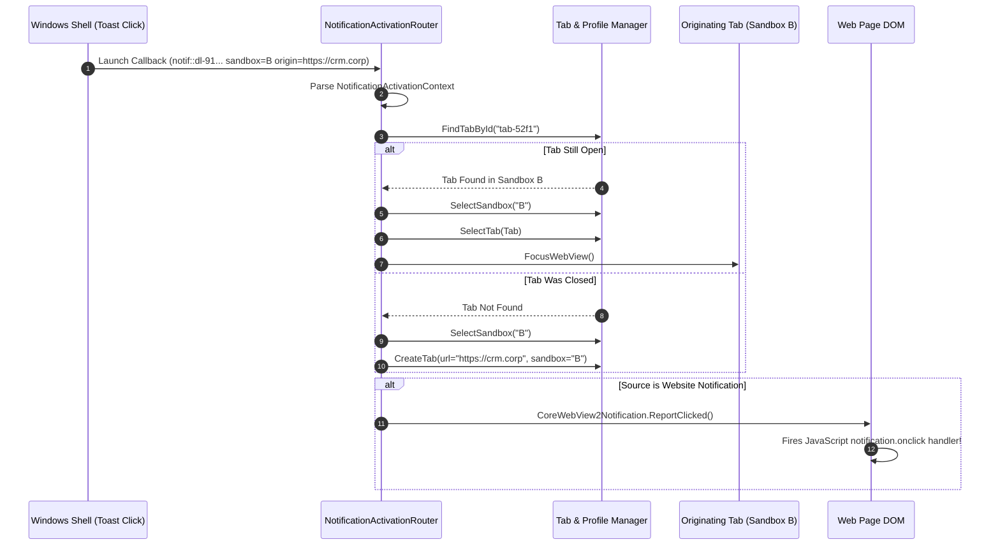

# Focus Assist Escalation & Deep-Link Activation Routing

> **Windows Focus Assist breakthrough mechanics, priority escalation, encoded activation protocols, and multi-sandbox deep-link routing.**

---

## 1. Focus Assist & Priority Escalation

In modern desktop environments, users rely on Windows Focus Assist (formerly Do Not Disturb) to suppress interruptions during presentations, focused work, or fullscreen applications. However, automated workflows occasionally produce critical security or failure alerts that require immediate human intervention.

Nova balances user focus with operational urgency by mapping notification priorities directly to the Windows App SDK's `AppNotificationScenario`:



### Scenario Mapping & Behaviors

| Priority Level | App Notification Scenario | Behavior in Normal Hours | Behavior in Focus Assist | Intended Alert Types |
| :--- | :--- | :--- | :--- | :--- |
| **Routine (`Urgent = false`)** | `AppNotificationScenario.Default` | Desktop popup banner + sound. | Silent delivery directly to Windows Action Center; no banner, no sound. | Standard web notifications, completed downloads, routine cron tasks. |
| **Urgent (`Urgent = true`)** | `AppNotificationScenario.Urgent` | High-priority desktop popup banner. | **Breaks through Focus Assist.** Displays immediate banner regardless of DND state. | Security certificate invalidations, failed scheduled workflows, administrative gates. |

---

## 2. Activation Argument Protocol & Serialization

When a user clicks a toast banner, an action button, or selects an item in the Windows Action Center, the Windows Shell executes Nova's notification activator, delivering an encoded URI string:

```text
notif::{notificationId}?action=open&source={source}&sandbox={sandbox}&origin={origin}&target={target}
```



### Strongly-Typed Context Properties

Nova deserializes the callback payload into a typed `NotificationActivationContext`:

| Parameter | Type | Required | Description | Example |
| :--- | :--- | :---: | :--- | :--- |
| `NotificationId` | `Guid` | **Yes** | Primary key GUID matching the row in `notifications.db`. | `e9b21f3a-4c28-4f81-a62e-9d8a1c3b5e7f` |
| `Action` | `string` | **Yes** | The requested interaction verb (`open`, `dismiss`). | `open` |
| `Source` | `NotificationSource` | **Yes** | Source category (`Website`, `Nova`, or `Agent`). | `Website` |
| `SandboxId` | `string` | No | ID of the originating sandbox partition. | `"B"` or `"corporate-vpn"` |
| `Origin` | `string` | No | Full target web origin URI. | `https://dashboard.corp` |
| `TargetId` | `string` | No | Identifier of the originating tab or job. | `tab-52f1` |

---

## 3. Multi-Sandbox Deep-Link Router

Clicking an alert must return the user to the exact context where the alert was generated. Nova's `NotificationActivationRouter` orchestrates window focus, sandbox profile switching, tab selection, and lifecycle feedback:



### Core Routing Invariants

1. **Zero Cross-Profile Session Contamination:**
   If a notification originated within an isolated authenticated profile (e.g. **Sandbox B**), activating the notification will **never** navigate or open inside **Sandbox A**. If Sandbox B is not currently the visual foreground selection, Nova automatically switches to Sandbox B before resolving the tab.
2. **Alive-Tab Refocusing:**
   If the originating browser tab is still open, Nova focuses the existing tab strip item without reloading the page or resetting in-progress form inputs.
3. **Dead-Tab Recovery:**
   If the originating tab was closed prior to the user clicking the notification, Nova instantiates a fresh tab in the exact originating sandbox, navigating to the saved `Origin` URL.
4. **W3C `onclick` Lifecycle Feedback:**
   For website notifications, the router locates the active `CoreWebView2Notification` COM reference and invokes `ReportClicked()`, which dispatches the standard JavaScript `onclick` event directly to the webpage's DOM.

---

## 4. Programmatic MCP Activation (`nova.notifications_open`)

Autonomous agents can programmatically trigger the exact same deep-link activation flow using the [`nova.notifications_open`](../../../../mcp-reference/tools/notifications/nova-notifications-open.md) MCP tool:

```json
// Agent triggers deep-link routing for a notification
{
  "notificationId": "e9b21f3a-4c28-4f81-a62e-9d8a1c3b5e7f"
}
```

Example response:
```json
{
  "ok": true,
  "status": "opened",
  "tabAction": "focused_existing",
  "sandboxId": "B",
  "targetUrl": "https://dashboard.corp/reports/weekly"
}
```

This guarantees full human-agent parity: an agent can simulate a user clicking an alert banner, cleanly restoring tab focus and triggering client-side web callbacks.

---

## 5. Related Architecture Guides

* [Unpackaged WinRT & Toast Templates](../unpackaged-winrt-and-toast-templates/README.md): Windows App SDK registration and XML template construction.
* [Windows Toasts & Activation Hub](../README.md): High-level domain overview.
* [W3C Notifications & DOM Lifecycle](../../web-permissions-and-lifecycle/w3c-notifications-and-dom-lifecycle/README.md): Web notifications interception.
* [Multi-Sandbox Session Isolation](../../../sandbox-isolation/README.md): Multi-profile isolation and cookie jar boundaries.
* [Desktop Notifications Master Hub](../../README.md): Master subsystem architectural catalog.
