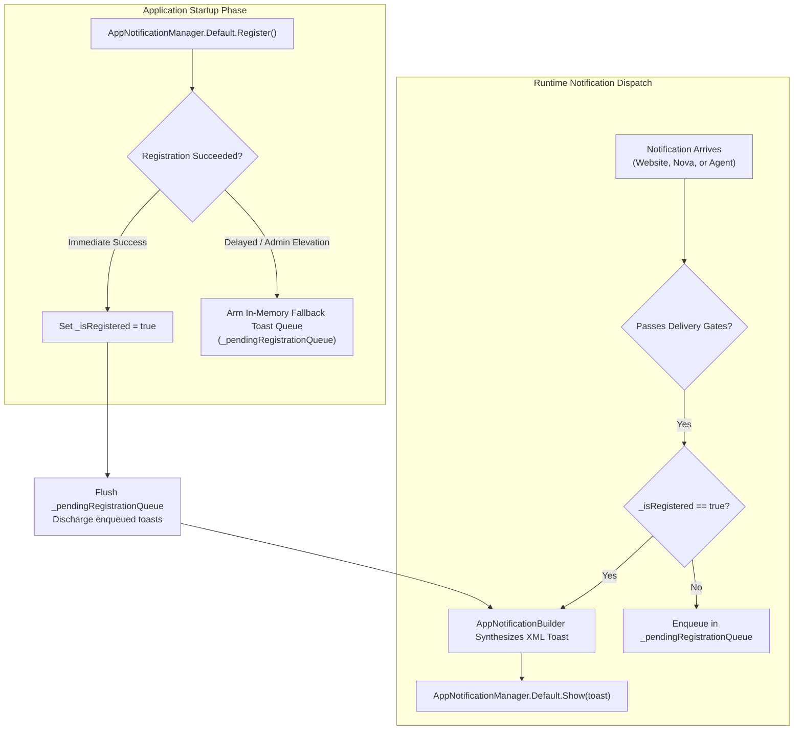
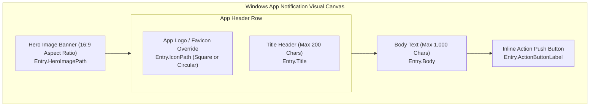

# Unpackaged WinRT Registration & Toast Templates

> **Architecture of Nova's unpackaged Windows App SDK integration, AUMID and CLSID shell registration, cold-boot toast queuing, and rich XML visual template synthesis.**

---

## 1. Operating System Integration in Unpackaged WinUI 3

In the Windows operating system, application toasts are managed by the Windows Push Notification Platform (WNP) and Windows Shell. Packaged applications (MSIX packages) automatically possess an identity declared in their package manifest.

Nova AI Workspace, however, is distributed as a high-performance **unpackaged WinUI 3 desktop application** (`NovaAIWorkspace.exe`). Unpackaged desktop applications must establish identity and notification handling dynamically using the Windows App SDK's `AppNotificationManager`:



### Challenges & Invariants in Unpackaged Environments

1. **App User Model ID (AUMID) & COM Activator:**
   Windows requires a registered AUMID and a COM CLSID notification activator in the Windows registry to associate incoming toasts with `NovaAIWorkspace.exe`. Without this mapping, Windows silently drops notifications.
2. **Elevated Execution Boundary:**
   If Nova is executed in an elevated administrator context (e.g. during specific developer debugging sessions), the Windows Shell intentionally blocks standard COM activation callbacks to protect against privilege escalation. Nova gracefully adapts by guaranteeing that **all notifications are persistently committed to the SQLite inbox (`notifications.db`)**, ensuring zero data loss even if shell toasts are suppressed.
3. **Cold-Boot Queueing (`QueueUntilRegistered`):**
   If a background scheduled task or quick-start tab triggers a notification before the Windows App SDK finishes its registration handshake with the shell, Nova intercepts the event, buffers it in a thread-safe queue (`_pendingRegistrationQueue`), and flushes it immediately upon registration confirmation.

---

## 2. Toast Visual Layouts & Template Construction

Nova constructs native Windows toasts dynamically using `Microsoft.Windows.AppNotifications.Builder.AppNotificationBuilder`. The visual hierarchy adapts according to the originating source:



### Visual Components & Customization

| Component | Property | Specification | Operational Use Case |
| :--- | :--- | :--- | :--- |
| **Hero Image Banner** | `HeroImagePath` | 16:9 aspect ratio, max 3 MB, local file URI. | Rich screenshot previews generated by scheduled crawler runs or media captures. |
| **App Logo Override** | `IconPath` | Square or circle crop, local PNG/ICO URI. | Origin website favicon or agent identity avatar, replacing default browser icon. |
| **Circular Crop Styling** | `UseCircleAppLogo` | Boolean flag. | Circular portrait cropping for contact notifications and autonomous agent personas. |
| **Title Header** | `Title` | Plain text, capped at 200 characters. | Concise summary of the alert; protected against prompt injection. |
| **Body Description** | `Body` | Plain text, capped at 1,000 characters. | Detailed message body, task results, or error diagnostics. |
| **Inline Action CTA** | `ActionButtonLabel` | Plain text button label. | Direct desktop button (e.g. "Open Report", "View Download"). |

---

## 3. Dynamic XML Synthesis via `AppNotificationBuilder`

The underlying Windows Notification Platform consumes an XML-based schema. Nova synthesizes this schema programmatically:

```csharp
// Architectural illustration of toast construction
var builder = new AppNotificationBuilder();

// 1. Add Title and Body text
builder.AddText(entry.Title);
if (!string.IsNullOrEmpty(entry.Body))
{
    builder.AddText(entry.Body);
}

// 2. Configure Logo override
if (!string.IsNullOrEmpty(entry.IconPath))
{
    builder.SetAppLogoOverride(new Uri(entry.IconPath), 
        entry.UseCircleAppLogo ? AppNotificationImageCrop.Circle : AppNotificationImageCrop.Default);
}

// 3. Attach Hero Banner
if (!string.IsNullOrEmpty(entry.HeroImagePath))
{
    builder.SetHeroImage(new Uri(entry.HeroImagePath));
}

// 4. Attach Encoded Activation Argument
builder.AddArgument("launch", activationArgument);

// 5. Add Interactive Button
if (!string.IsNullOrEmpty(entry.ActionButtonLabel))
{
    builder.AddButton(new AppNotificationButton(entry.ActionButtonLabel)
        .AddArgument("action", "open")
        .AddArgument("launch", activationArgument));
}
```

---

## 4. Audio & Notification Sound Suppression

Nova respects operating system audio policies and caller-specified silence directives:

* **Audio Suppression (`isSilent: true`):** When an agent dispatches an alert via [`nova.notifications_send`](../../../../mcp-reference/tools/notifications/nova-notifications-send.md) with `isSilent: true`, Nova sets `builder.MuteAudio()` on the notification builder. The toast manifests silently on screen without playing the default Windows chime.
* **Respecting System Quiet Hours:** If Windows is configured for quiet hours or Focus Assist, sound playback is automatically governed by OS audio routing.

---

## 5. Related Architecture Guides

* [Focus Assist & Deep-Link Routing](../focus-assist-and-deep-link-routing/README.md): Breakthrough escalation and multi-sandbox routing.
* [Windows Toasts & Activation Hub](../README.md): High-level domain overview.
* [W3C Notifications & DOM Lifecycle](../../web-permissions-and-lifecycle/w3c-notifications-and-dom-lifecycle/README.md): Website notification interception.
* [SQLite Schema & Channel Worker](../../inbox-and-storage/sqlite-schema-and-channel-worker/README.md): Durable database storage.
* [Desktop Notifications Master Hub](../../README.md): Master subsystem architectural catalog.
