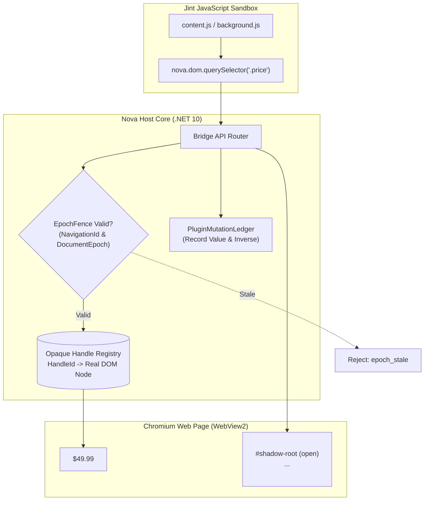
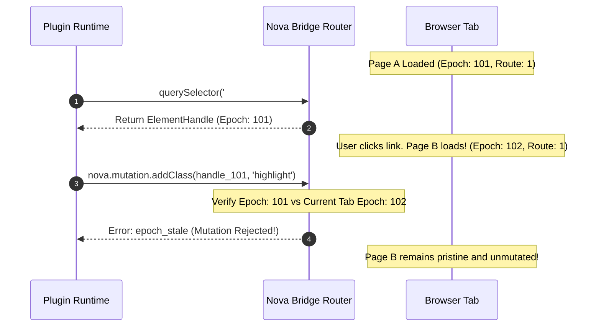
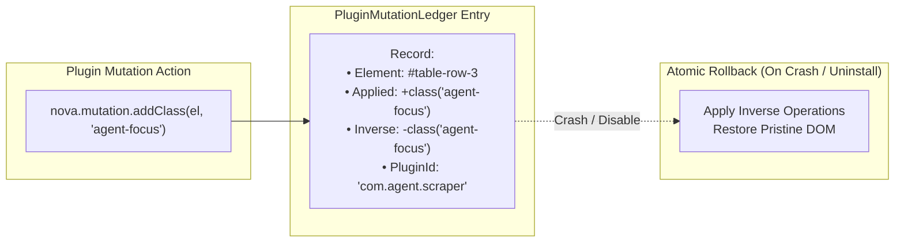

# Bridge APIs, DOM Virtualization & Overlays

> [!WARNING]
> **Unavailable during the public alpha.** The plugin subsystem is currently disabled in Nova AI Workspace and cannot be activated via settings. This document describes bridge APIs, element handle virtualization, and Shadow DOM isolation for technical reference and developer preview. See [Alpha status and limitations](../../../../ALPHA.md).

> [!NOTE]
> This guide details the global bridge namespace, opaque element handles, epoch consistency fencing, the reversible mutation ledger, and open Shadow DOM UI isolation within the **Agent-Authored Plugins (AAP)** subsystem in Nova AI Workspace. For runtime engines and dispatch pumps, see [Jint Runtime, Dispatcher Pump & Lifecycle State Machine](../jint-runtime-dispatcher-and-lifecycle/README.md). For manifest specifications and dynamic tool exports, see [Manifest Specification, Permissions & Dynamic MCP Tools](../manifest-permissions-and-dynamic-mcp-tools/README.md). For master overview, see the [Agent-Authored Plugins Hub](../README.md).

---

## 1. Executive Overview & Virtualization Architecture

Inside the isolated Jint JavaScript engine, plugins do not possess direct memory references to native browser DOM nodes (`window`, `document`, `HTMLElement`). Directly exposing DOM nodes across process boundaries would create memory leaks, trigger browser security barriers, and introduce severe race conditions when web pages navigate.

Instead, Nova implements **DOM Virtualization**:
1. **Opaque Element Handles:** DOM nodes are referenced as opaque tokens tied to specific document epochs.
2. **Epoch Fences:** Bridge calls verify navigation counters to prevent delayed mutations from executing against freshly loaded pages.
3. **Reversible Mutation Ledgers:** All style and class modifications record an exact inverse delta, allowing atomic rollbacks.
4. **Encapsulated Shadow DOM Hosts:** Plugin UI elements are rendered inside isolated Shadow DOM containers, completely separated from page stylesheets and keylogger scripts.



---

## 2. The Global `nova.*` Bridge Namespace

Inside the Jint execution context, all host capabilities are exposed through the global `nova.*` namespace:

| Bridge Subsystem | Primary Capabilities & Scope | Requires Permission |
| :--- | :--- | :---: |
| **`nova.dom.*`** | DOM querying (`querySelector`, `querySelectorAll`), text extraction (`getInnerText`), and geometry calculation (`getBoundingRect`). | `DomRead` |
| **`nova.mutation.*`** | Adding/removing CSS class names and modifying inline CSS styles on target elements. | `MutationClassWrite` / `MutationStyleWrite` |
| **`nova.overlay.*`** | Mounting, updating, and removing visual UI components inside the isolated Shadow DOM overlay host. | `OverlayWrite` |
| **`nova.storage.*`** | Key-value data persistence partitioned into `local`, `session`, `sync`, and read-only `managed` scopes. | `StorageReadWrite` |
| **`nova.net.*`** | Dispatched HTTPS requests restricted to declared `hostPermissions.matches` domains. | `NetworkFetch` |
| **`nova.tools.*`** | Dynamic registration of custom MCP tools callable by the AI agent (`nova.tools.register`). | None (Implicit) |
| **`nova.on.*`** | Tab navigation, DOM mutation, and message passing event subscriptions. | Context-dependent |

---

## 3. DOM Traversal via Opaque Element Handles

When a plugin queries an element using `nova.dom.querySelector(selector)`, Nova does not return a JavaScript object wrapping the DOM node. Instead, it returns an **`ElementHandle`**:

```javascript
// Inside content.js
const handle = await nova.dom.querySelector("table.financial-summary");

if (handle) {
  // Query text and bounding box using the handle
  const text = await nova.dom.getInnerText(handle);
  const rect = await nova.dom.getBoundingRect(handle);
  
  console.log(`Table dimensions: ${rect.width}x${rect.height}`);
}
```

### The ElementHandle Structure
An `ElementHandle` is an immutable value object comprising three fields:
$$\text{ElementHandle} = \langle \text{HandleId}, \text{FrameId}, \text{DocumentEpoch} \rangle$$

* **`HandleId`:** An opaque integer or GUID assigned by the host runtime.
* **`FrameId`:** Identifies the specific subframe or top-level window hosting the element.
* **`DocumentEpoch`:** The exact revision counter of the root document when the handle was minted.

If the user or agent navigates away from the page, the underlying `DocumentEpoch` advances. Any subsequent bridge call presenting the old handle is immediately invalidated, preventing stale handle exploitation.

---

## 4. Epoch Fences & Consistency Guards

In asynchronous browser automation, slow network calls or delayed JavaScript execution can lead to **Out-of-Order Execution**: a plugin starts an action on Page A, Page B loads in the meantime, and the plugin's delayed mutation inadvertently fires on Page B.

Nova eliminates this class of bugs through **Epoch Fencing**:



### 4.1 Epoch Coordinates
Every bridge operation passes an `EpochFence` payload containing three coordinates:
1. **`NavigationId`:** Monotonically increasing counter incremented on every HTTP navigation.
2. **`DocumentEpoch`:** Increments whenever the root document context is recreated.
3. **`RouteEpoch`:** Increments on Single-Page Application (SPA) client-side URL updates (`pushState`, `hashchange`).

### 4.2 Consistency Modes

* **`DocumentOnly`:** Tolerates in-page client route transitions while keeping the document context intact. Recommended for idempotent read operations (`nova.dom.querySelector`, `nova.dom.getInnerText`).
* **`DocumentAndRoute`:** Enforces strict synchronization across both full navigations and client route changes. Required for all mutating calls (`nova.mutation.addClass`, `nova.mutation.setStyle`).

If a fence mismatch occurs, Nova rejects the operation with `epoch_stale`, ensuring that stale background scripts never corrupt newly rendered page layouts.

---

## 5. Reversible Mutation Ledger (`PluginMutationLedger`)

When plugins apply visual highlighting, badge annotations, or CSS tweaks to live web pages, uninstallation or crashes must not leave orphan styles corrupting the site.

Nova records every DOM modification inside the **`PluginMutationLedger`**:



### 5.1 Inverse Delta Tracking
For every mutation applied via `nova.mutation.*`:
* The host captures the element's prior attribute state.
* The ledger stores both the forward mutation (`ValueJson`) and the exact restoration operation (`InverseJson`).

### 5.2 Atomic Recovery Tools
If a plugin crashes or is disabled, Nova executes atomic rollbacks automatically:
* **[`nova.plugin_css_reset`](../../../mcp-reference/tools/plugins/nova-plugin-css-reset.md):** Reverts all injected stylesheets and class mutations across all open tabs.
* **[`nova.plugin_inject_reset`](../../../mcp-reference/tools/plugins/nova-plugin-inject-reset.md):** Removes all injected DOM nodes and script containers, returning the document to its original state.

---

## 6. Shadow DOM UI Overlay Isolation

When plugins render interactive UI components (such as data extraction wizards, floating status chips, or selection boxes), the visual components are injected into a dedicated **Open Shadow DOM** container:

```mermaid
flowchart LR
    subgraph HostWebPage["Target Web Page Document"]
        HostDiv["<div id='nova-plugin-host-...'>"]
        ShadowRoot["#shadow-root (open)"]
        
        subgraph OverlayContainer["Isolated Shadow Boundary"]
            Card["<div class='nova-overlay-card'>"]
            Button["<button class='action-btn'>Extract</button>"]
        end

        PageStyles["Page CSS Stylesheets\n(Bootstrap, Tailwind, Global Reset)"]
        PageScripts["Page Keylogger & Event Listeners"]
    end

    HostDiv --> ShadowRoot
    ShadowRoot --> Card
    Card --> Button
    PageStyles -.x|Styles Blocked by Shadow Boundary| Card
    PageScripts -.x|Keystrokes Blocked from Page Listeners| Button
```

### 6.1 Two-Way Style Encapsulation
1. **Protection Against Page Styles:** Aggressive page resets (e.g. `* { all: unset }` or global CSS frameworks) cannot penetrate the shadow root. The plugin's controls render reliably regardless of host page CSS.
2. **Protection Against Style Leakage:** CSS rules defined inside the plugin's overlay cannot bleed outward or distort the host webpage's layout.

### 6.2 Keylogger & Input Defense
When an agent or user enters text into an input field hosted inside a plugin overlay:
* Input events are captured by listeners inside the Shadow DOM.
* Events do not bubble past the shadow root into the main page document.
* Malicious page scripts and third-party trackers running on the website cannot intercept sensitive text typed into plugin controls.

---

## 7. Related Documentation

* **[Agent-Authored Plugins Hub](../README.md)** — Master architecture and problem statement.
* **[Jint Runtime, Dispatcher Pump & Lifecycle State Machine](../jint-runtime-dispatcher-and-lifecycle/README.md)** — Execution engines, message pumps, and lifecycle state transitions.
* **[Manifest Specification, Permissions & Dynamic MCP Tools](../manifest-permissions-and-dynamic-mcp-tools/README.md)** — Manifest schemas, review gates, and dynamic tool exports.
* **[Browser Interaction Architecture](../../browser-interaction/README.md)** — Coordinate mouse physics, selector mechanics, and event dispatch.
* **[MCP Reference: Plugins Catalog](../../../mcp-reference/tools/plugins/README.md)** — Complete catalog of all 22 plugin management tools.

[All core features](../../README.md)
