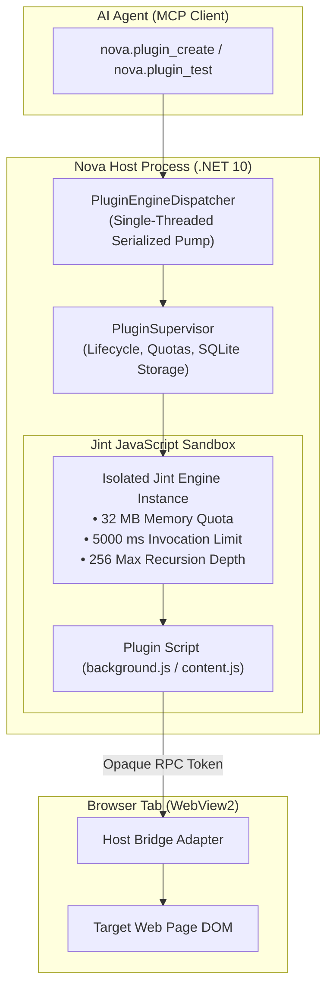
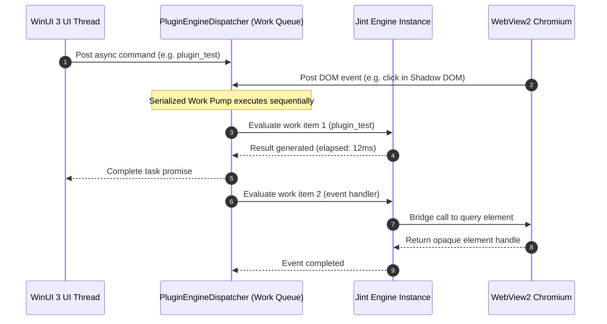
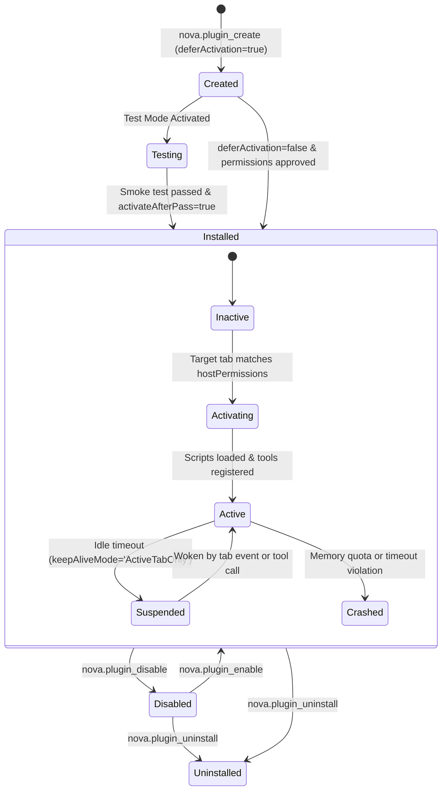

# Jint Runtime, Dispatcher Pump & Lifecycle State Machine

> [!WARNING]
> **Unavailable during the public alpha.** The plugin subsystem is currently disabled in Nova AI Workspace and cannot be activated via settings. This document describes the runtime execution engine, message pump, and lifecycle state machine for technical reference and developer preview. See [Alpha status and limitations](../../../../ALPHA.md).

> [!NOTE]
> This guide details the managed EcmaScript execution engine, single-threaded serialized message pump, and two-phase lifecycle management of the **Agent-Authored Plugins (AAP)** subsystem in Nova AI Workspace. For manifest specifications and dynamic tool exports, see [Manifest Specification, Permissions & Dynamic MCP Tools](../manifest-permissions-and-dynamic-mcp-tools/README.md). For bridge APIs and Shadow DOM overlays, see [Bridge APIs, DOM Virtualization & Overlays](../bridge-apis-dom-virtualization-and-overlays/README.md). For master overview, see the [Agent-Authored Plugins Hub](../README.md).

---

## 1. Executive Overview & Jint Execution Architecture

In Nova AI Workspace, Agent-Authored Plugins (AAP) execute inside **Jint**—an embeddable, fully managed EcmaScript engine running directly within Nova's .NET 10 host process. Rather than launching separate Node.js runtimes or injecting unconstrained scripts into the Chromium web page, Jint provides a host-governed execution environment with zero ambient system privileges.



---

## 2. Sandbox Isolation Guarantees & Resource Budgets

To protect host integrity and prevent misbehaving plugins from stalling the application, each plugin instance runs in a fully constrained sandbox:

### 2.1 Zero Ambient Host Access
* **No Node.js or OS Runtimes:** The JavaScript engine contains no filesystem access (`fs`), process spawning (`child_process`), or network sockets (`net`).
* **No .NET Reflection:** All CLR reflection, internal type resolution, and host assembly inspections are completely stripped from the engine.
* **No Direct Page DOM Reference:** The plugin runtime does not expose native `window`, `document`, or `navigator` objects from the browser page. All interactions occur across host-mediated bridge channels using opaque element tokens.

### 2.2 Deterministic Resource Budgets

| Constraint | Default Threshold | Runtime Enforcement Behavior |
| :--- | :---: | :--- |
| **Heap Memory Quota** | `32 MB` | Evaluated on memory allocations. Exceeding the quota triggers a soft heap warning, halts script execution, and marks the plugin as `Crashed`. |
| **Invocation Timeout** | `5,000 ms` | Strict wall-clock execution limit per execution slice. Prevents infinite loops (`while(true)`) from blocking the host. |
| **Call Stack Depth** | `256 frames` | Hard limit on recursion depth to prevent stack overflow exceptions within the managed host runtime. |

---

## 3. The Serialized Engine Dispatcher Pump (`PluginEngineDispatcher`)

A critical architectural challenge in desktop browser automation is synchronizing three competing concurrency models:
1. **The WinUI 3 UI Thread:** Single-threaded, dispatch-driven native Windows message loop.
2. **The Chromium / WebView2 IPC Pipeline:** Multi-threaded, asynchronous Chromium browser event pump.
3. **The Jint Engine Instances:** Synchronous EcmaScript execution sandboxes.

Nova resolves this via the **`PluginEngineDispatcher`**:



### 3.1 Serialization & Deadlock Prevention
* **Single Work Queue:** All state mutations, script evaluations, event dispatches, and bridge calls pass through a single serialized queue.
* **Non-Blocking UI:** The WinUI thread never blocks synchronously waiting for a JavaScript engine. Tasks post work items to the dispatcher and await asynchronous completion tokens.
* **Re-entrancy Depth Guard:** To prevent cascading event storms (e.g. a plugin mutation triggering a DOM observer which immediately posts back to the plugin), execution depth is strictly bounded to a maximum depth of 16.

---

## 4. Two-Phase Lifecycle State Machine

Nova separates plugin deployment state on disk (`PluginInstallState`) from in-memory session execution (`PluginRuntimeState`):



### 4.1 Deployment States (`PluginInstallState`)
Stored persistently in SQLite (`plugins.db`):
* **`Created`:** Manifest and source files registered on disk; awaiting review or test execution.
* **`Testing`:** Staged for isolated testing; content scripts do not attach to live user browser tabs.
* **`Installed`:** Fully installed and eligible for activation on matching web domains.
* **`Disabled`:** Preserved on disk, but de-registered from all browser tabs and MCP catalogs.
* **`Uninstalled`:** Scrubbed from disk, database, and local SQLite storage partitions.

### 4.2 Runtime Execution States (`PluginRuntimeState`)
Transient states held in host memory during an active browsing session:
* **`Inactive`:** Plugin is installed, but no open browser tab matches its `hostPermissions`.
* **`Activating`:** Target tab navigated to matching URL; background and content scripts are compiling.
* **`Active`:** Bridge hooks armed, Shadow DOM overlays mounted, and custom MCP tools published.
* **`Suspended`:** Tab moved to background or idle; memory retained but CPU cycles paused.
* **`Crashed`:** Sandboxed execution exceeded memory quota, hit wall-clock timeout, or threw an unhandled exception.

---

## 5. Rollout, Testing & Rollback Lifecycles

Autonomous agents must not deploy untested extensions directly onto critical user pages. Nova enforces a structured promotion and rollback pipeline:

### 5.1 Staged Creation (`deferActivation = true`)
When calling `nova.plugin_create`, setting `deferActivation = true` installs the plugin into the `Testing` state:
```json
{
  "manifest": "{\n  \"id\": \"com.agent.scraper\",\n  \"version\": \"1.0.0\",\n  \"name\": \"Scraper\",\n  \"entryPoint\": \"index.js\"\n}",
  "code": "console.log('Testing initialized');",
  "deferActivation": true
}
```

### 5.2 Isolated Smoke Testing (`nova.plugin_test`)
Agents verify plugin logic in an isolated verification sandbox:
* **`mode = "execute"`:** Evaluates code directly against an active plugin session for rapid debugging.
* **`mode = "smoke"`:** Spawns a temporary isolated runtime, runs verification probes, inspects generated DOM mutations, and tracks warnings.
* **`activateAfterPass = true`:** Automatically promotes the plugin from `Testing` to `Installed` if all verification assertions succeed.
* **`applyWrites = true`:** Temporarily applies DOM class and style mutations to the live page to test layout effects, automatically rolling them back when the test session ends.

```json
{
  "pluginId": "com.agent.scraper",
  "mode": "smoke",
  "activateAfterPass": true,
  "applyWrites": true
}
```

### 5.3 Version History & Atomic Rollbacks
Every call to `nova.plugin_update` archives the previous manifest and JavaScript files into versioned SQLite storage:
* **`nova.plugin_get_version_code`:** Allows agents to inspect previous code iterations to analyze regressions.
* **`nova.plugin_rollback`:** Reverts the plugin atomically to a prior version number, swapping files and restarting the runtime without downtime.

### 5.4 Portability Bundles (`.novaplugin`)
Plugins can be exported and distributed across machines:
* **`nova.plugin_export`:** Packages the manifest, scripts, and static assets into a standard ZIP archive (`.novaplugin`).
* **`nova.plugin_import`:** Unpacks, validates, and installs a plugin bundle archive.

---

## 6. Related Documentation

* **[Agent-Authored Plugins Hub](../README.md)** — Master architecture and problem statement.
* **[Manifest Specification, Permissions & Dynamic MCP Tools](../manifest-permissions-and-dynamic-mcp-tools/README.md)** — Manifest schemas, review gates, and dynamic tool exports.
* **[Bridge APIs, DOM Virtualization & Overlays](../bridge-apis-dom-virtualization-and-overlays/README.md)** — Opaque element handles, epoch fences, and Shadow DOM isolation.
* **[MCP Reference: Plugins Catalog](../../../mcp-reference/tools/plugins/README.md)** — Parameter reference for all 22 plugin management tools.

[All core features](../../README.md)
