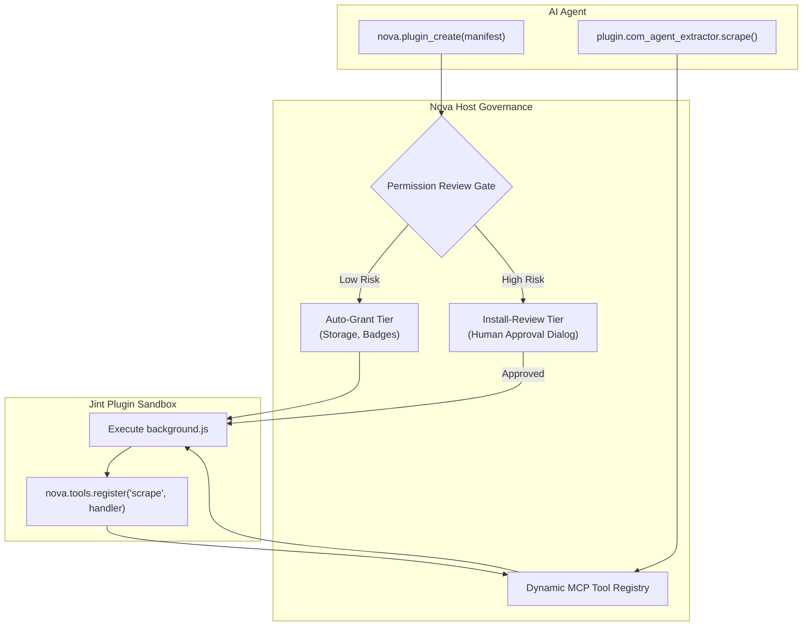
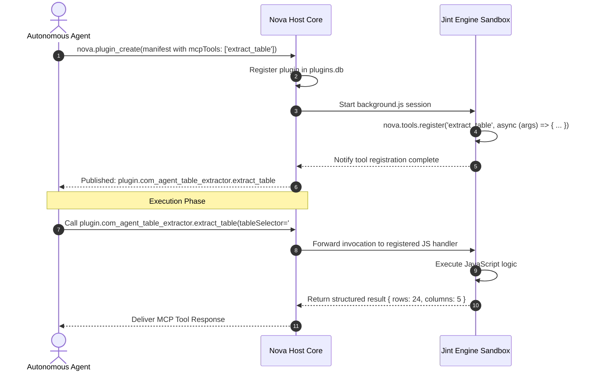

# Manifest Specification, Permissions & Dynamic MCP Tools

> [!WARNING]
> **Unavailable during the public alpha.** The plugin subsystem is currently disabled in Nova AI Workspace and cannot be activated via settings. This document describes the manifest schema, permission model, and dynamic tool export system for technical reference and developer preview. See [Alpha status and limitations](../../../../ALPHA.md).

> [!NOTE]
> This guide details the manifest specification, two-tier permission governance, human approval review gates, and dynamic Model Context Protocol (MCP) tool exports of the **Agent-Authored Plugins (AAP)** subsystem in Nova AI Workspace. For runtime execution and dispatch pumps, see [Jint Runtime, Dispatcher Pump & Lifecycle State Machine](../jint-runtime-dispatcher-and-lifecycle/README.md). For DOM virtualization and overlays, see [Bridge APIs, DOM Virtualization & Overlays](../bridge-apis-dom-virtualization-and-overlays/README.md). For master overview, see the [Agent-Authored Plugins Hub](../README.md).

---

## 1. Executive Overview & Human Sovereignty

The core philosophy of Agent-Authored Plugins balances machine agility with human control:
> *The AI agent authors the tool, but the human user retains total runtime sovereignty.*

An autonomous agent can generate complex extensions dynamically to solve scraping, extraction, or dashboarding tasks. However, plugins cannot unilaterally grant themselves sensitive capabilities (such as inspecting page DOM, modifying network traffic, or transmitting external network requests).

Nova enforces this boundary through:
1. **Strict Manifest Schemas:** Every capability, host scope, and custom tool must be declared up-front in `manifest.json`.
2. **Two-Tier Permission Model:** Low-hazard operations (isolated storage, toolbar badges) are auto-granted; high-hazard capabilities require explicit human review or active-tab authorization.
3. **Dynamic MCP Tool Exports:** Plugins can publish brand-new, strongly typed MCP tools back to the agent layer under strict namespacing.



---

## 2. AAP Manifest Specification (`manifest.json`)

Every plugin package requires a valid `manifest.json` file conforming to the AAP Schema v1:

```json
{
  "manifestVersion": 1,
  "id": "com.agent.table-extractor",
  "version": "1.0.0",
  "name": "Intelligent Table Extractor",
  "description": "Extracts pagination tables and presents interactive preview overlays.",
  "entryPoint": "background.js",
  "createdBy": {
    "agentClient": "claude-code",
    "model": "claude-3-7-sonnet",
    "timestampUtc": "2026-10-10T14:30:00Z"
  },
  "requestedPermissions": [
    "DomRead",
    "OverlayWrite",
    "StorageReadWrite",
    "BadgeWrite"
  ],
  "hostPermissions": {
    "matches": ["*://*.example.com/*", "*://internal-portal.corp/*"]
  },
  "lifecycle": {
    "memoryLimitMb": 32,
    "invocationTimeoutMs": 5000,
    "keepAliveMode": "ActiveTabOnly"
  },
  "storage": {
    "quotaBytes": 5242880
  },
  "contentScripts": [
    {
      "entryPoint": "content.js",
      "matches": ["*://*.example.com/reports/*"],
      "runAt": "DocumentIdle",
      "allFrames": false
    }
  ],
  "mcpTools": [
    {
      "name": "extract_table",
      "description": "Extracts tabular data from the active report page.",
      "inputSchema": {
        "type": "object",
        "properties": {
          "tableSelector": { "type": "string" },
          "maxRows": { "type": "integer" }
        },
        "required": ["tableSelector"]
      }
    }
  ]
}
```

### Manifest Schema Rules
* **`id`:** Reverse-DNS string adhering to `^[a-z][a-z0-9._-]{1,62}[a-z0-9]$` (e.g. `com.agent.table-extractor`).
* **`version`:** Semantic versioning string (`MAJOR.MINOR.PATCH`).
* **`entryPoint`:** Relative filename of the background script executed when the plugin initializes.
* **`contentScripts`:** Array of scripts injected into web pages matching defined URL glob patterns.
* **`runAt`:** Execution timing for content scripts: `DocumentStart`, `DocumentEnd`, or `DocumentIdle`.
* **`lifecycle.keepAliveMode`:** Governs suspension behavior: `ActiveTabOnly` (suspends when tab loses focus) or `AlwaysAlive`.

---

## 3. Two-Tier Permission Model & Review Gates

Nova enforces a clear boundary between non-invasive operations and high-impact capabilities:

| Permission Identifier | Tier | Security Scope & Operational Effect |
| :--- | :---: | :--- |
| **`StorageReadWrite`** | **Auto-Grant** | Reads and writes the plugin's own isolated SQLite partition. Cannot touch global browser cookies or user settings. |
| **`BadgeWrite`** | **Auto-Grant** | Updates the numeric badge or visual accent color on the browser toolbar icon. |
| **`DomRead`** | **Install-Review** | Queries DOM elements, computes styles, and reads textual nodes on matched hosts. |
| **`OverlayWrite`** | **Install-Review** | Mounts and updates interactive HTML/CSS UI components inside the isolated Shadow DOM overlay. |
| **`MutationClassWrite`**| **Install-Review** | Adds or removes CSS class names on target page DOM elements (recorded in the reversible mutation ledger). |
| **`MutationStyleWrite`**| **Install-Review** | Modifies inline CSS styles on target page DOM elements (recorded in the reversible mutation ledger). |
| **`NetworkFetch`** | **Install-Review** | Dispatches outbound HTTPS requests conforming strictly to declared `hostPermissions.matches`. |
| **`NotifySend`** | **Install-Review** | Triggers desktop toast notifications via Nova's Notification Subsystem. |
| **`FrameMatchedSubframes`** | **Install-Review** | Injects and executes content scripts inside matching child `<iframe>` elements. |
| **`RequestFilter`** | **Install-Review** | Intercepts, inspects, or blocks outgoing browser network requests. |

### 3.1 Permission Request Flow (`nova.plugin_request_permission`)
When an agent installs a plugin requesting Install-Review capabilities, the permissions remain pending. The agent must trigger the review workflow:
* The host displays a native WinUI modal dialog presenting the plugin name, requested permissions, matched web origins, and code summary.
* The human operator can approve all permissions, grant selected scopes, or deny the request.

```json
{
  "pluginId": "com.agent.table-extractor",
  "permissions": ["DomRead", "OverlayWrite"]
}
```

### 3.2 Temporary Active-Tab Grants (`nova.plugin_grant_active_tab`)
For one-off operational tasks, human operators can grant temporary permissions scoped strictly to the currently focused browser tab:
* Bypasses persistent global installation reviews.
* Automatically expires when the active tab is closed or navigated to a different web origin.

---

## 4. Dynamic MCP Tool Export Architecture

One of AAP's most powerful capabilities is allowing an agent to author a plugin that **exports brand-new MCP tools** dynamically. Once exported, the agent (or other subagents in a swarm) can invoke these tools as standard MCP primitives.



### 4.1 Export Constraints & Namespacing
1. **Quantity Limit:** A single plugin can export up to 10 dynamic MCP tools.
2. **Deterministic Namespacing:** Tool names are transformed to prevent collisions across plugins:
   $$\text{Namespace} = \text{plugin}.\{\text{normalizedPluginId}\}.\{\text{toolName}\}$$
   For example: `plugin.com_agent_table_extractor.extract_table`.
3. **Strict Registration Protocol:** Tools declared in `manifest.json` remain uncallable until the plugin's JavaScript code explicitly invokes `nova.tools.register`:
   ```javascript
   // Inside background.js
   nova.tools.register("extract_table", async (args) => {
     const selector = args.tableSelector;
     const maxRows = args.maxRows || 100;
     // Extraction logic using bridge APIs
     return { success: true, rowsExtracted: 25 };
   });
   ```

---

## 5. Security Auditing & Managed Storage

Nova equips operators and agents with forensic tools to monitor plugin behavior:

### 5.1 Runtime Diagnostics (`nova.plugin_logs`)
Captures all `console.log`, `console.warn`, and `console.error` invocations generated inside Jint sandboxes:
```json
{
  "pluginId": "com.agent.table-extractor",
  "tail": 50
}
```

### 5.2 Security Audit Ledger (`nova.plugin_security_log`)
Records policy violations, attempted unauthorized network calls, and resource exhaustion events:
* Blocked attempts to access undeclared domains.
* Memory quota soft and hard limit warnings.
* Bridge calls rejected due to stale document epoch fences.

### 5.3 Host-Managed Configuration Storage
Administrators can supply host-level read-only configurations to plugins using managed storage:
* **`nova.plugin_managed_storage_update`:** Sets administrative key-value pairs (e.g. enterprise API endpoints, department IDs).
* **`nova.plugin_managed_storage_get`:** Reads host configuration from within Jint via `nova.storage.managed`.

---

## 6. Related Documentation

* **[Agent-Authored Plugins Hub](../README.md)** — Master architecture and problem statement.
* **[Jint Runtime, Dispatcher Pump & Lifecycle State Machine](../jint-runtime-dispatcher-and-lifecycle/README.md)** — Execution engines, message pumps, and lifecycle state transitions.
* **[Bridge APIs, DOM Virtualization & Overlays](../bridge-apis-dom-virtualization-and-overlays/README.md)** — Opaque element handles, epoch fences, and Shadow DOM isolation.
* **[Agent Security](../../agent-security/README.md)** — Content screening, prompt injection defenses, and knowledge integrity.
* **[MCP Reference: Plugins Catalog](../../../mcp-reference/tools/plugins/README.md)** — Complete catalog of all 22 plugin management tools.

[All core features](../../README.md)
