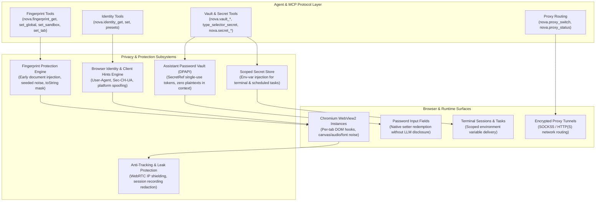
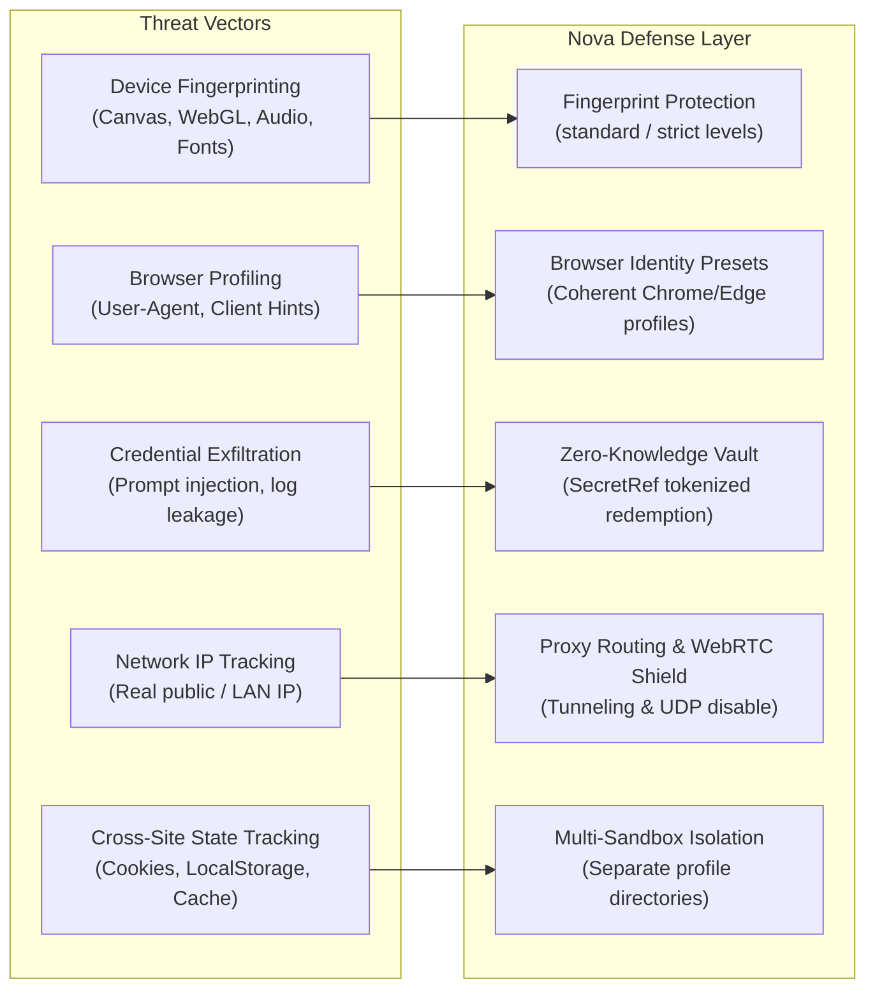

# Privacy Architecture Hub

Privacy in Nova AI Workspace is built on defense-in-depth principles across multiple independent layers: browser hardware fingerprint masking, browser identity emulation, zero-knowledge credential vaulting, scoped secret delivery, network routing isolation, and capture-time recording redaction.

Rather than offering a superficial "incognito mode" that merely clears local history, Nova provides fine-grained, verifiable controls that protect users and autonomous agents against device fingerprinting, cross-session correlation, IP leakage, and credential exfiltration.

---

## 1. Documentation Suite Index

Explore the complete modular documentation suite across the three privacy domains:

### Domain 1: Password Vault & Scoped Secrets
* **[Password Vault & Secrets Hub](vault-and-secrets/README.md)**: Zero-knowledge autofill architecture, Windows DPAPI encryption, and threat modeling.
  * **[DPAPI Assistant Vault & SecretRef Tokens](vault-and-secrets/dpapi-vault-and-secretref-tokens/README.md)**: Zero-knowledge fill flow, DPAPI `vault.dat` storage, ephemeral 128-bit `SecretRef` token minting, strict origin binding, 2-hour TTL, native property setter DOM injection (`HTMLInputElement.prototype.value`), and instant token destruction.
  * **[Scoped Environment Secrets & Execution Audit](vault-and-secrets/scoped-environment-secrets-and-audit/README.md)**: Scoped secret store (`nova.secret_*`), process environment variable delivery into ConPTY terminal runners and scheduled tasks, zero command-line/shell history leaks, task-scoped workspace isolation, and audit trail guarantees.

### Domain 2: Fingerprint Protection & Browser Identity
* **[Fingerprint Protection & Identity Hub](fingerprint-and-identity/README.md)**: Multi-tiered hardware noise injection, scope resolution, and identity presets.
  * **[Hardware Noise & Canvas Fingerprint Protection](fingerprint-and-identity/hardware-noise-and-canvas-protection/README.md)**: Multi-tiered protection levels (`off`, `standard`, `strict`), deterministic PRNG seeding (`Mulberry32`), $\pm 1$ RGB Canvas jitter, $\pm 10^{-7}$ Web Audio noise, font enumeration whitelisting, generic WebGL GPU strings, early document injection, and `Function.prototype.toString` camouflage via `WeakSet`.
  * **[Browser Identity Emulation & Client Hints Architecture](fingerprint-and-identity/browser-identity-and-client-hints/README.md)**: Outbound `User-Agent` and RFC 8941 `Sec-CH-UA` Client Hints synthesis, in-page `navigator.userAgentData` synchronization, identity presets (`chrome`, `firefox`, `safari`, `default`), and engine coherence boundaries on Chromium WebView2.

### Domain 3: Anti-Tracking & Leak Protection
* **[Anti-Tracking & Leak Protection Hub](anti-tracking-and-leak-protection/README.md)**: Defense against network side-channels, IP disclosures, and diagnostic recording leaks.
  * **[WebRTC IP Shielding & Peripheral Device Isolation](anti-tracking-and-leak-protection/webrtc-shielding-and-peripheral-isolation/README.md)**: WebRTC ICE/STUN protocol mechanics, disabling non-proxied UDP, RFC 1918 private IP candidate filtering, `navigator.mediaDevices.enumerateDevices` generic masking, and proxy tunnel synchronization.
  * **[Capture-Time Credential Redaction & Tracker Scrubbing](anti-tracking-and-leak-protection/capture-redaction-and-tracker-scrubbing/README.md)**: Pre-persistence in-memory credential redaction, multi-encoding HMAC-SHA-256 fingerprint matching (raw, URL-encoded, JSON-escaped, Base64), marketing query parameter stripping (`utm_*`, `gclid`, `fbclid`), and `strict-origin-when-cross-origin` referrer trimming.

---

## 2. Architectural Threat Model & Boundary Contracts

Understanding what each privacy control addresses—and what it does not—is critical for designing secure agent workflows:

### Essential Invariants & Boundaries
1. **Fingerprinting vs. Anonymity:** 
   Fingerprint protection obscures peripheral and rendering signatures, but **does not make an agent anonymous**. If an agent signs into an account, accepts tracking cookies, or navigates from a static public IP address, the destination origin can correlate visits regardless of fingerprint settings.
2. **Identity Presets vs. Engine Emulation:**
   Selecting the `firefox` or `safari` identity preset modifies the `User-Agent` header, but does not transform the Chromium WebView2 engine into Gecko or WebKit. Bot detection engines that perform deep JavaScript engine divergence checks will detect Chromium-specific quirks. For maximum stealth, the `chrome` preset provides fully matched `Sec-CH-UA` Client Hints on Chromium.
3. **The Vault Zero-Knowledge Boundary:**
   The password vault guarantees that plaintext credentials **never enter the LLM's conversation context window or transcript logs**. However, once `nova.type_selector_secret` fills the password into the website's DOM input field, the destination website has full access to the credential. The destination origin must still be trusted.
4. **Proxy Routing vs. Profile Storage:**
   Changing a network route via [`nova.proxy_switch`](../../mcp-reference/tools/proxy-and-network/nova-proxy-switch.md) directs HTTP/HTTPS traffic through an external tunnel, but does not clear existing cookies, local storage, or cached authentication tokens. True identity separation requires pairing proxies with [Multi-Sandbox Session Isolation](../sandbox-isolation/README.md).

---

## 3. Comprehensive MCP Tool Capability Matrix

Agents interact with the privacy subsystem through dedicated tool bundles:

| Tool Name | Bundle | Primary Function | Sensitive Output Guard |
| :--- | :--- | :--- | :--- |
| [`nova.vault_list`](../../mcp-reference/tools/vault-and-security/nova-vault-list.md) | `vault-and-security` | Discovers saved logins matching a target site domain. | Returns site and username metadata only; **zero passwords**. |
| [`nova.vault_prepare_fill`](../../mcp-reference/tools/vault-and-security/nova-vault-prepare-fill.md) | `vault-and-security` | Mints an ephemeral, origin-bound `SecretRef` token. | Returns opaque UUID handle; **zero passwords**. |
| [`nova.type_selector_secret`](../../mcp-reference/tools/vault-and-security/nova-type-selector-secret.md) | `vault-and-security` | Injects password into DOM field using native setter. | Redeems token directly inside host; returns `{ ok: true }`. |
| [`nova.vault_get`](../../mcp-reference/tools/vault-and-security/nova-vault-get.md) | `vault-and-security` | Queries vault entry metadata by ID. | Returns metadata only; **zero plaintexts**. |
| [`nova.vault_set`](../../mcp-reference/tools/vault-and-security/nova-vault-set.md) | `vault-and-security` | Stores or updates a login entry. | Encrypted on disk via Windows DPAPI. |
| [`nova.vault_delete`](../../mcp-reference/tools/vault-and-security/nova-vault-delete.md) | `vault-and-security` | Deletes a login entry from the vault. | Overwrites entry and updates `vault.dat` atomically. |
| [`nova.secret_set`](../../mcp-reference/tools/vault-and-security/nova-secret-set.md) | `vault-and-security` | Stores a scoped environment secret. | Encrypted on disk via Windows DPAPI. |
| [`nova.secret_list`](../../mcp-reference/tools/vault-and-security/nova-secret-list.md) | `vault-and-security` | Enumerates registered scoped secret keys. | Returns key names and descriptions only; **zero secret values**. |
| [`nova.secret_delete`](../../mcp-reference/tools/vault-and-security/nova-secret-delete.md) | `vault-and-security` | Deletes a scoped secret from disk. | Destroys secret bytes and updates store atomically. |
| [`nova.fingerprint_get`](../../mcp-reference/tools/site-data-and-identity/nova-fingerprint-get.md) | `site-data-and-identity` | Queries active fingerprint protection level and techniques. | Read-only configuration query. |
| [`nova.fingerprint_set_tab`](../../mcp-reference/tools/site-data-and-identity/nova-fingerprint-set-tab.md) | `site-data-and-identity` | Overrides fingerprint level for a single tab (ephemeral). | Affects target tab memory only. |
| [`nova.fingerprint_set_sandbox`](../../mcp-reference/tools/site-data-and-identity/nova-fingerprint-set-sandbox.md) | `site-data-and-identity` | Sets default fingerprint level for a sandbox profile. | Persisted in `settings.json`. |
| [`nova.fingerprint_set_global`](../../mcp-reference/tools/site-data-and-identity/nova-fingerprint-set-global.md) | `site-data-and-identity` | Configures global default fingerprint level. | Persisted in `settings.json`. |
| [`nova.identity_get`](../../mcp-reference/tools/site-data-and-identity/nova-identity-get.md) | `site-data-and-identity` | Queries active browser persona and Client Hints. | Read-only configuration query. |
| [`nova.identity_set`](../../mcp-reference/tools/site-data-and-identity/nova-identity-set.md) | `site-data-and-identity` | Sets browser identity preset (`chrome`, `firefox`, etc.). | Synchronizes headers and DOM properties. |
| [`nova.identity_presets`](../../mcp-reference/tools/site-data-and-identity/nova-identity-presets.md) | `site-data-and-identity` | Lists all supported browser identity presets. | Read-only catalog query. |

---

## 4. Related Architecture Guides

* [Multi-Sandbox Profile Isolation](../sandbox-isolation/README.md): Strict cookie, cache, and storage boundary separation.
* [Network Proxy Routing & Traffic Control](../network/proxy/README.md): SOCKS5, HTTP(S), and PAC proxy tunnels.
* [Session Recording & Time-Travel Debugging](../session-recording/README.md): Encrypted multi-stream capture and capture-time credential redaction.
* [Terminal Workspaces Architecture](../terminal-workspaces/README.md): ConPTY terminal runners and scoped environment delivery.
* [Scheduled Tasks Architecture](../scheduled-tasks/README.md): Autonomous background tasks and secret binding.

---

[All core features](../README.md)
