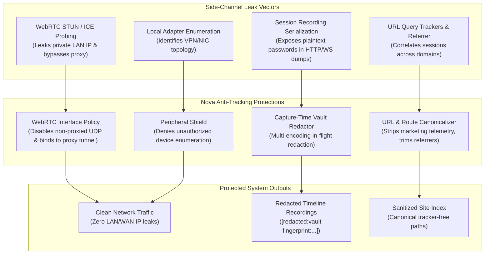

# Anti-Tracking, WebRTC IP Leak Prevention & Session Redaction

Even when an autonomous agent operates through an encrypted proxy tunnel and uses isolated browser sandboxes, standard web browsers routinely leak sensitive identity markers through subtle side channels:
1. **WebRTC IP Leakage:** Interactive WebRTC STUN queries enumerate local network adapters, exposing the user's private local LAN IP (`192.168.x.x`, `10.x.x.x`) and real public IP past the proxy.
2. **Session Recording Credential Leaks:** Network debugging tools and automated recording streams capture raw authentication tokens, API keys, and passwords in cleartext HTTP request bodies.
3. **URL Tracker Correlation:** Marketing query parameters (`utm_*`, `gclid`, `fbclid`) and HTTP `Referer` headers track user trajectories across independent domains.

Nova AI Workspace incorporates proactive, capture-time defensive mechanisms to seal these side channels before sensitive telemetry leaves the browser runtime.

---

## 1. Domain Architecture & Subguides

The Anti-Tracking & Leak Protection subsystem is divided into two specialized technical guides:

```
+-----------------------------------------------------------------------------------+
|                     ANTI-TRACKING & LEAK PROTECTION DOMAIN                        |
+-----------------------------------------------------------------------------------+
| 1. WebRTC Shielding & Peripheral        | Non-proxied UDP disabling, local ICE    |
|    Isolation                            | candidate stripping, device masking.    |
+-----------------------------------------+-----------------------------------------+
| 2. Capture Redaction & Tracker Scrubbing| In-flight multi-encoding secret scan,   |
|                                         | URL marketing tracker removal, Referer. |
+-----------------------------------------------------------------------------------+
```

| Guide | Focus Area | Core Architectural Concepts |
| :--- | :--- | :--- |
| **[WebRTC Shielding & Peripheral Isolation](webrtc-shielding-and-peripheral-isolation/README.md)** | Network & Device Side-Channels | WebRTC ICE/STUN protocol mechanics, disabling non-proxied UDP, RFC 1918 private IP candidate filtering, `navigator.mediaDevices.enumerateDevices` generic masking, and proxy tunnel synchronization. |
| **[Capture Redaction & Tracker Scrubbing](capture-redaction-and-tracker-scrubbing/README.md)** | Telemetry & URL Sanitization | Pre-persistence in-memory credential redaction, multi-encoding HMAC-SHA-256 fingerprint matching (raw, URL-encoded, JSON-escaped, Base64), marketing query parameter stripping (`utm_*`, `gclid`, `fbclid`), and `strict-origin-when-cross-origin` referrer trimming. |

---

## 2. Threat Topology & Defensive Layers



---

## 3. Core Protection Invariants

1. **Non-Proxied UDP Disabled:** When an active proxy is configured, WebRTC is prohibited from transmitting UDP datagrams over direct physical adapters. Traffic must route through the proxy tunnel or fail closed.
2. **Local Candidate Scrubbing:** Host ICE candidates exposing internal RFC 1918 IP addresses (`192.168.0.0/16`, `10.0.0.0/8`, `172.16.0.0/12`) are stripped prior to delivery to JavaScript listeners.
3. **In-Flight Secret Redaction:** Secrets registered in the [Password Vault](../vault-and-secrets/README.md) are scrubbed in memory before disk persistence, protecting session recordings from accidental credential capture.
4. **Referrer Privacy:** By default, outbound cross-origin HTTP requests transmit only origin metadata, preventing internal URLs from leaking to third parties.

---

## 4. Related Architecture Guides

* [WebRTC Shielding & Peripheral Isolation](webrtc-shielding-and-peripheral-isolation/README.md): Detailed WebRTC policies and device virtualization.
* [Capture Redaction & Tracker Scrubbing](capture-redaction-and-tracker-scrubbing/README.md): In-memory secret scrubbing and URL canonicalization.
* [Privacy Architecture Hub](../README.md): High-level privacy overview, threat modeling, and defense layers.
* [Password Vault & Scoped Secrets](../vault-and-secrets/README.md): DPAPI storage and single-use `SecretRef` tokens.
* [Fingerprint Protection & Identity](../fingerprint-and-identity/README.md): Canvas/audio noise injection and User-Agent spoofing.
* [Proxy Routing Architecture](../../network/proxy/README.md): SOCKS5, HTTP(S), and PAC proxy tunnel management.
* [Session Recording Architecture](../../session-recording/README.md): Encrypted multi-stream capture and time-travel debugging.
