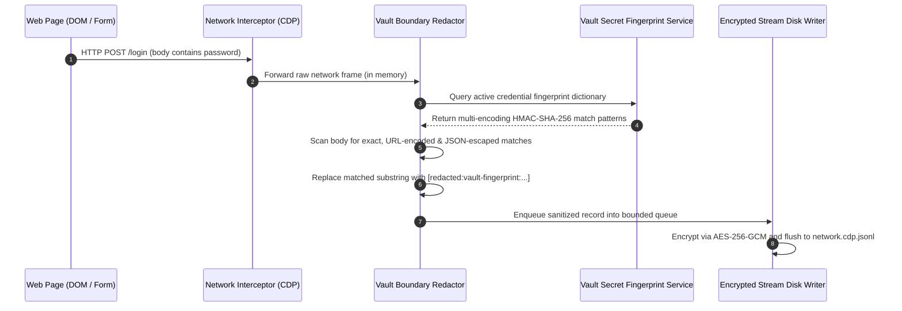

# Capture-Time Credential Redaction & Tracker Scrubbing

Autonomous agents and developers frequently capture web session telemetry for audit trails, compliance verification, and time-travel debugging. However, serializing raw network traffic directly to disk creates severe data leakage risks: cleartext passwords, OAuth bearer tokens, and session cookies are captured in request logs. Furthermore, external marketing networks track user and agent trajectories across websites using tracking query parameters and HTTP referrer headers.

Nova AI Workspace addresses these risks through two synchronized defenses:
1. **Capture-Time Credential Redaction:** In-flight, pre-persistence scrubbing of sensitive credentials across multiple text encodings.
2. **URL Tracker & Referrer Scrubbing:** Automated stripping of cross-site tracking parameters (`utm_*`, `gclid`, `fbclid`) and enforcement of strict referrer trimming policies.

---

## 1. Capture-Time Credential Redaction Architecture

Post-recording redaction (scanning files after they have been written to disk) is an unacceptable architectural anti-pattern—it leaves recoverable traces in temporary disk caches, SSD wear-leveling blocks, and memory-mapped files.

Nova executes secret redaction **in-flight within volatile process memory** before records enter the background persistence queue:



---

## 2. Multi-Encoding Fingerprint Matching

Credentials rarely appear in HTTP streams in simple, unadorned UTF-8 strings. A single password or token may be encoded in various formats depending on transport context:

| Context / Transport | Raw Value | Encoded Form in Network Payload |
| :--- | :--- | :--- |
| **URL Query Parameter** | `P@ss+word#1` | `P%40ss%2Bword%231` (Percent-Encoded) |
| **JSON Payload Body** | `"P@ss"word"` | `"\"P@ss\\\"word\""` (JSON Escaped) |
| **Basic Auth Header** | `user:password` | `dXNlcjpwYXNzd29yZA==` (Base64 Encoded) |
| **Form Data (`x-www-form-urlencoded`)** | `user & pass` | `user+%26+pass` (Form URL-Encoded) |

### The Multi-Encoding Match Engine
When credentials are registered in the [Password Vault](../../vault-and-secrets/README.md), the `VaultSecretFingerprintService` pre-computes matching patterns across all four representations:
1. **Raw String:** Exact UTF-8 byte match.
2. **URL-Encoded:** Standard RFC 3986 percent-encoding.
3. **JSON-Escaped:** Backslash-escaped quote and control character strings.
4. **Base64 Fragments:** Aligned Base64 chunks matching common header padding boundaries.

When an outgoing request body or header enters the redaction pipeline, it is scanned across all derived representations. Matched segments are replaced with standardized tokens:
```
[redacted:vault-fingerprint:sec_88a10]
```
The sanitized stream records the occurrence of the credential without persisting the secret itself.

---

## 3. URL Query Parameter Tracker Stripping

Websites and advertising networks embed persistent user identifiers into URL query parameters to link sessions across unrelated domains:

```
https://example.com/checkout?item=42&utm_source=adwords&utm_medium=cpc&gclid=EAIaIQobChMI...&fbclid=IwAR2...
```

Nova's URL canonicalization engine automatically identifies and strips known tracking parameters from navigation and request URLs:

### Stripped Tracking Parameters

| Tracking Class | Target Parameter Keys | Source Network |
| :--- | :--- | :--- |
| **Google Marketing** | `gclid`, `gclsrc`, `dclid`, `gad_source` | Google Ads & Display Network |
| **Google Analytics** | `utm_source`, `utm_medium`, `utm_campaign`, `utm_term`, `utm_content` | Standard Campaign Telemetry |
| **Meta / Facebook** | `fbclid` | Meta Click Identifiers |
| **Microsoft Ads** | `msclkid` | Bing / Microsoft Ads |
| **Mailchimp & Email** | `mc_eid`, `mc_cid` | Email Tracking Beacons |
| **Yandex / Twitter / TikTok** | `yclid`, `twclid`, `ttclid` | Regional & Social Ad Trackers |

### Canonicalization Invariants
* **Functional Preservation:** Legitimate application query parameters (e.g., `?page=2`, `?search=shoes`, `?lang=en`) are strictly preserved.
* **Navigation-Level Cleansing:** Strip operations occur before URLs are written to browser history, session recordings, or site discovery indices (`site_urls`).

---

## 4. Referrer Trimming & Cross-Origin Policies

The HTTP `Referer` header can inadvertently leak sensitive internal URLs, search queries, or private dashboard token paths when navigating to external websites:

```
Unprotected Referrer:
Referer: https://internal.corp.net/dashboard/users?token=admin_session_9921
```

### Nova's Referrer Protection
1. **Default Policy:** Nova enforces `strict-origin-when-cross-origin` across all tabs and sandboxes:
   * **Same-Origin Requests:** Full URL path is transmitted (e.g., `https://internal.corp.net/subpage`).
   * **Cross-Origin Requests:** Only the origin is transmitted; full path and query strings are stripped (e.g., `https://internal.corp.net/`).
   * **Downgrades (HTTPS $\to$ HTTP):** The `Referer` header is completely suppressed.
2. **Meta Referrer Override:** If a website attempts to set `<meta name="referrer" content="unsafe-url">`, Nova's privacy engine overrides the policy, preventing sensitive path leakage to external third parties.

---

## 5. Related Documentation

* [WebRTC Shielding & Peripheral Isolation](../webrtc-shielding-and-peripheral-isolation/README.md): WebRTC IP leak prevention and generic device masking.
* [Anti-Tracking & Leak Protection Hub](../README.md): Overview of side-channel defenses.
* [Session Recording Architecture](../../../session-recording/README.md): Encrypted multi-stream capture and time-travel debugging.
* [Password Vault & Secrets](../../vault-and-secrets/README.md): DPAPI storage and single-use `SecretRef` tokens.
* [Start Recording Tool Reference](../../../../mcp-reference/tools/session-recording/nova-session-record-start.md)
