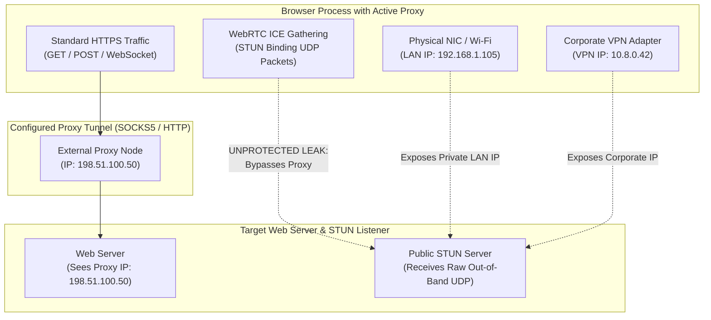
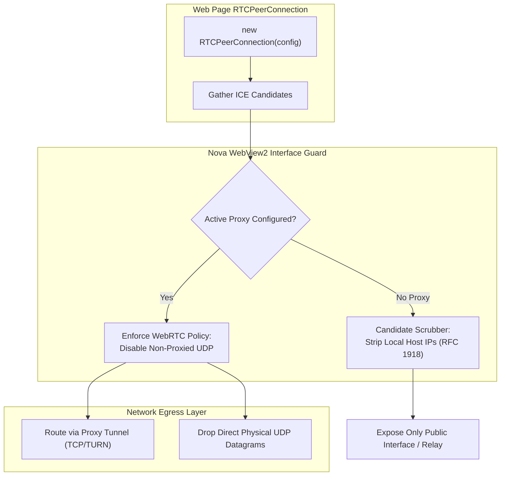

# WebRTC IP Shielding & Peripheral Device Isolation

Modern browser automation that operates through encrypted proxy tunnels or isolated profile sandboxes remains vulnerable to identity leakage through low-level browser network protocols and peripheral enumeration APIs. Among these, **WebRTC (Web Real-Time Communication)** represents the primary side-channel leak vector: interactive WebRTC STUN queries bypass proxy routing to expose the user's real private local LAN IP and external public IP.

In parallel, **peripheral device enumeration** APIs expose unique hardware GUIDs, allowing websites to fingerprint physical devices across browsing sessions.

Nova AI Workspace neutralizes these vectors through kernel-level WebView2 network policies, local ICE candidate scrubbing, and peripheral device masking.

---

## 1. The WebRTC Side-Channel Vulnerability

WebRTC establishes peer-to-peer audio, video, and data streams using the **Interactive Connectivity Establishment (ICE)** protocol alongside STUN (Session Traversal Utilities for NAT) and TURN (Traversal Using Relays around NAT) servers:



### The Three Leak Modes
1. **Private LAN IP Disclosure:** WebRTC queries enumerate all local network interfaces, exposing internal IP ranges (`192.168.x.x`, `10.x.x.x`, `172.16.x.x`). These internal addresses reveal corporate network topologies and home subnet structures.
2. **Public WAN IP Bypass:** Standard proxies route TCP traffic. STUN queries send UDP datagrams directly through physical network interfaces, allowing the target origin to discover the user's real ISP-assigned public IP address even while an active proxy is connected.
3. **Multi-Homed Interface Profiling:** Systems with multiple active adapters (e.g., simultaneous Wi-Fi and corporate VPN tunnels) leak the topology of both connections.

---

## 2. Nova's WebRTC Shielding Architecture

Nova enforces strict Chromium network policies to close the WebRTC leak path:



### Defensive Guarantees
1. **Disable Non-Proxied UDP:** When a proxy is assigned to a tab or sandbox via [`nova.proxy_switch`](../../../../mcp-reference/tools/proxy-and-network/nova-proxy-switch.md), Nova configures Chromium's WebRTC policy to disable direct, non-proxied UDP transmission. WebRTC is restricted to routing traffic through the proxy tunnel or using TCP relay. Direct UDP packets on physical network adapters are dropped at the engine boundary.
2. **Local Candidate Stripping:** Host ICE candidates containing private IP subnets (`192.168.0.0/16`, `10.0.0.0/8`, `172.16.0.0/12`, `fc00::/7`) are stripped before being delivered to JavaScript `onicecandidate` event handlers.
3. **Zero IP Leak Verification:** WebRTC leak test endpoints (e.g., BrowserLeaks, IPLeak) observe only the proxy's IP address or receive no ICE candidates, confirming complete shielding.

---

## 3. Peripheral Hardware Device Isolation

Websites utilize `navigator.mediaDevices.enumerateDevices()` to inspect connected multimedia hardware:

```javascript
// Fingerprinting probe query:
const devices = await navigator.mediaDevices.enumerateDevices();
const deviceSignature = devices.map(d => `${d.kind}:${d.label}:${d.deviceId}`).join(';');
```

Even without camera or microphone permissions, unshielded browsers expose persistent device GUIDs and hardware counts (e.g., number of input microphones, external USB webcams, virtual audio cables).

### Nova Peripheral Shielding Policy
* **Generic Device Virtualization:** In default and strict privacy modes, Nova intercepts `enumerateDevices()` to return a standardized, static device list with generic, randomized IDs.
* **Label Scrubbing:** Device labels (e.g., `"Logitech BRIO 4K Webcam"`, `"Blue Yeti USB Microphone"`) are completely withheld until explicit, user-authorized permission is granted.
* **Cross-Origin Sanitization:** The randomized device IDs are partitioned per origin; origin $A$ and origin $B$ observe completely uncorrelated device hashes for the same physical microphone.

---

## 4. Integration with Network Proxies & Sandboxes

WebRTC shielding is tightly coupled with Nova's network and sandbox architecture:

```
+-----------------------------------------------------------------------------------+
| ISOLATION LAYER       | SHIELDING BEHAVIOR & INTERACTION                          |
+-----------------------+-----------------------------------------------------------+
| Sandbox Profiles      | Each sandbox profile maintains isolated proxy and network |
|                       | routing states. WebRTC policies apply per-profile.        |
+-----------------------+-----------------------------------------------------------+
| Proxy Tunnels         | Switching proxies via nova.proxy_switch immediately       |
|                       | updates WebRTC interface binding for active tabs.         |
+-----------------------+-----------------------------------------------------------+
| Direct Connections    | In non-proxied browsing, local IP candidate stripping     |
|                       | remains active to prevent internal network mapping.       |
+-----------------------------------------------------------------------------------+
```

---

## 5. Related Documentation

* [Capture-Time Redaction & Tracker Scrubbing](../capture-redaction-and-tracker-scrubbing/README.md): In-flight credential redaction and URL tracker stripping.
* [Anti-Tracking & Leak Protection Hub](../README.md): Overview of side-channel defenses.
* [Network Proxy Routing](../../../network/proxy/README.md): SOCKS5, HTTP(S), and PAC proxy tunnel architecture.
* [Multi-Sandbox Profile Isolation](../../../sandbox-isolation/README.md): Profile separation and storage anchors.
* [Proxy Switch Tool Reference](../../../../mcp-reference/tools/proxy-and-network/nova-proxy-switch.md) · [Proxy Status Tool Reference](../../../../mcp-reference/tools/proxy-and-network/nova-proxy-status.md)
