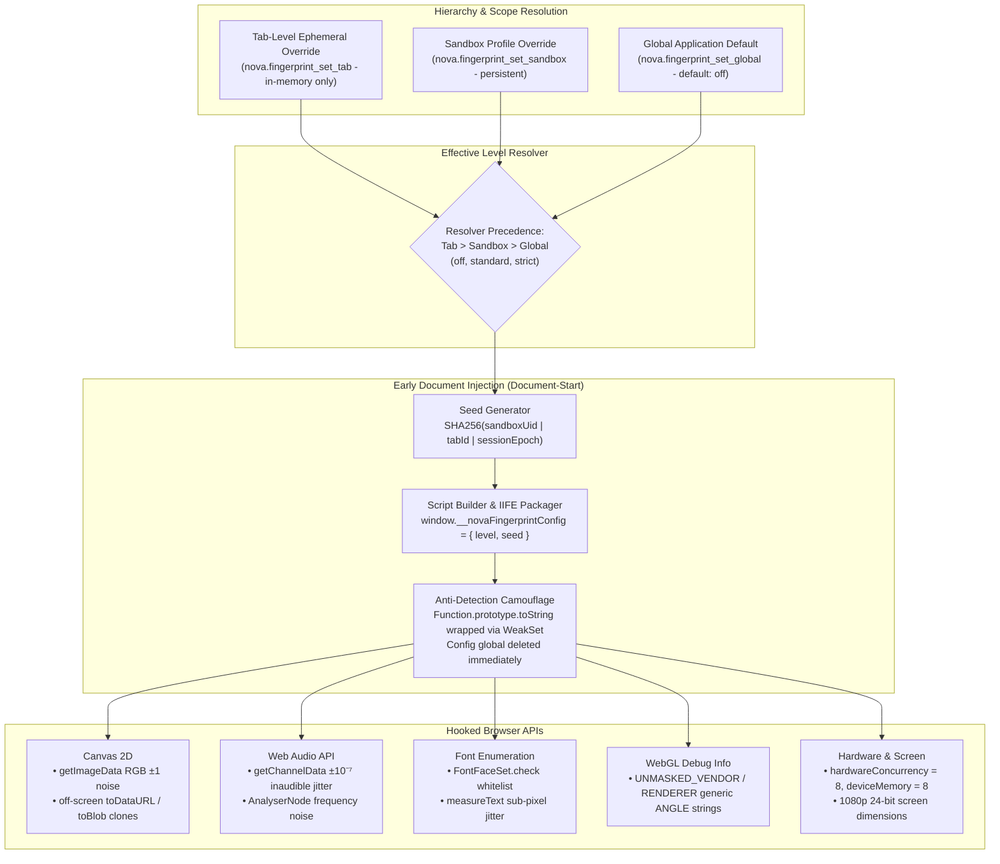

# Fingerprint Protection & Browser Identity

Websites routinely gather minute hardware and rendering characteristics to construct persistent device identifiers. By measuring HTML5 Canvas pixel rendering, Web Audio synthesis variations, installed system fonts, GPU vendor strings, and hardware metrics, tracking scripts can identify and correlate users and autonomous agents across sessions—even after all cookies and local storage are deleted.

Nova AI Workspace provides a multi-tiered **Fingerprint Protection Engine** alongside a **Browser Identity System**. These systems alter identifiable device signals using deterministic, stable noise while maintaining rendering stability and evading bot detection.

---

## 1. Domain Architecture & Subguides

The Fingerprint Protection & Browser Identity subsystem is divided into two specialized technical guides:

```
+-----------------------------------------------------------------------------------+
|                   FINGERPRINT PROTECTION & BROWSER IDENTITY                       |
+-----------------------------------------------------------------------------------+
| 1. Hardware Noise & Canvas Protection   | Canvas 2D, Web Audio, Font whitelist,   |
|                                         | WebGL ANGLE, PRNG seed stability.       |
+-----------------------------------------+-----------------------------------------+
| 2. Browser Identity & Client Hints      | User-Agent, Sec-CH-UA Client Hints,     |
|                                         | navigator.userAgentData, Chrome preset. |
+-----------------------------------------------------------------------------------+
```

| Guide | Focus Area | Core Architectural Concepts |
| :--- | :--- | :--- |
| **[Hardware Noise & Canvas Protection](hardware-noise-and-canvas-protection/README.md)** | Hardware Signature Obfuscation | Multi-tiered protection levels (`off`, `standard`, `strict`), deterministic PRNG seeding (`Mulberry32`), $\pm 1$ RGB Canvas jitter, $\pm 10^{-7}$ Web Audio noise, font enumeration whitelisting, generic WebGL GPU strings, early document injection, and `Function.prototype.toString` camouflage via `WeakSet`. |
| **[Browser Identity & Client Hints](browser-identity-and-client-hints/README.md)** | Protocol Persona Emulation | Outbound `User-Agent` and RFC 8941 `Sec-CH-UA` Client Hints synthesis, in-page `navigator.userAgentData` synchronization, identity presets (`chrome`, `firefox`, `safari`, `default`), and engine coherence boundaries on Chromium WebView2. |

---

## 2. Ingestion & Injection Topology

Fingerprint protection operates at the document-start lifecycle phase, executing before any web page scripts load:



---

## 3. Protection Levels Summary

Nova implements three distinct protection tiers:

| Protection Level | Settings Label | Included Techniques | Impact & Compatibility |
| :---: | :--- | :--- | :--- |
| **`off`** *(Default)* | Off | None | Native WebView2 behavior. No spoofing or noise injection. |
| **`standard`** | Standard | `canvas`, `audio` | Injects subtle, non-disruptive noise into Canvas and Web Audio readouts. Completely imperceptible to human users and stable for web applications. |
| **`strict`** | Strict | `canvas`, `audio`, `font`, `webgl`, `hardware`, `screen` | Standard protections plus font whitelisting, generic WebGL vendor/renderer strings, standardized CPU/RAM metrics, and fixed 1080p screen resolution. |

---

## 4. MCP Tool Capability Matrix

Agents manage fingerprinting and identity through the `site-data-and-identity` bundle:

| Tool Name | Scope | Primary Function |
| :--- | :--- | :--- |
| [`nova.fingerprint_get`](../../../mcp-reference/tools/site-data-and-identity/nova-fingerprint-get.md) | Tab | Queries the effective fingerprint level, seed, and active techniques. |
| [`nova.fingerprint_set_tab`](../../../mcp-reference/tools/site-data-and-identity/nova-fingerprint-set-tab.md) | Tab (Ephemeral) | Overrides fingerprint protection level for a specific tab in memory. |
| [`nova.fingerprint_set_sandbox`](../../../mcp-reference/tools/site-data-and-identity/nova-fingerprint-set-sandbox.md) | Sandbox (Persistent) | Configures the default fingerprint protection level for a sandbox profile. |
| [`nova.fingerprint_set_global`](../../../mcp-reference/tools/site-data-and-identity/nova-fingerprint-set-global.md) | Global Application | Sets the global default protection level across all new tabs. |
| [`nova.identity_get`](../../../mcp-reference/tools/site-data-and-identity/nova-identity-get.md) | Tab | Returns the active browser persona, User-Agent, and Client Hints. |
| [`nova.identity_set`](../../../mcp-reference/tools/site-data-and-identity/nova-identity-set.md) | Tab | Sets the browser identity preset (`chrome`, `firefox`, `safari`, `default`). |
| [`nova.identity_presets`](../../../mcp-reference/tools/site-data-and-identity/nova-identity-presets.md) | Catalog | Lists all supported identity presets and their metadata. |

---

## 5. Related Architecture Guides

* [Hardware Noise & Canvas Protection](hardware-noise-and-canvas-protection/README.md): Detailed noise specifications, PRNG stability, and camouflage.
* [Browser Identity & Client Hints](browser-identity-and-client-hints/README.md): Structured Client Hints and identity preset mechanics.
* [Privacy Architecture Hub](../README.md): High-level privacy overview, threat modeling, and defense layers.
* [Password Vault & Scoped Secrets](../vault-and-secrets/README.md): DPAPI storage and single-use `SecretRef` tokens.
* [Anti-Tracking & Leak Protection](../anti-tracking-and-leak-protection/README.md): WebRTC IP shielding and capture-time credential redaction.
* [Fingerprint Get Reference](../../../mcp-reference/tools/site-data-and-identity/nova-fingerprint-get.md) · [Identity Set Reference](../../../mcp-reference/tools/site-data-and-identity/nova-identity-set.md)
