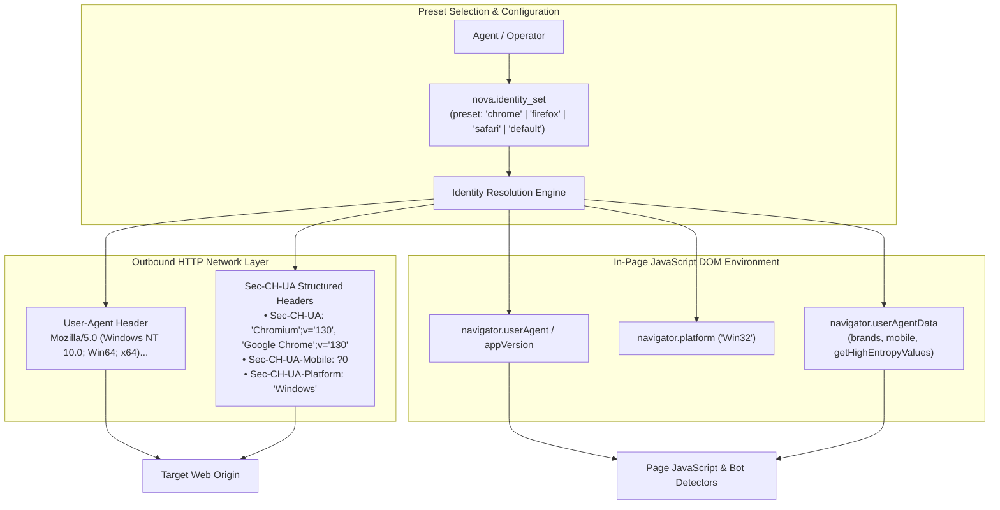

# Browser Identity Emulation & Client Hints Architecture

When web servers evaluate incoming HTTP requests, they analyze browser identity headers to tailor content delivery, enforce security policies, or apply bot mitigation rules. In modern web standards, browser identity is no longer communicated solely through the legacy `User-Agent` string; modern browsers rely on **User-Agent Client Hints (UA-CH)**—a structured, multi-header protocol that advertises brand lists, major/minor engine versions, platform architecture, and mobile status.

Naive automation tools that modify only the `User-Agent` string without synchronizing Client Hints produce glaring structural anomalies, causing anti-bot engines to immediately flag the session.

Nova AI Workspace provides a coherent **Browser Identity System** that synchronizes outbound HTTP headers with in-page DOM properties (`navigator.userAgentData`, `navigator.userAgent`, `navigator.platform`), providing consistent browser profiles.

---

## 1. The Dual Identity Architecture: Headers & DOM

To prevent detection, browser identity must be synchronized across both the network wire and the JavaScript execution environment:



---

## 2. The Four Browser Identity Presets

Nova provides four pre-configured identity archetypes:

| Preset Name | Target Browser Persona | Injected User-Agent | Client Hints Policy | Best Use Case |
| :--- | :--- | :--- | :--- | :--- |
| **`default`** | Native Nova / WebView2 | Unmodified Microsoft Edge / WebView2 string. | Native Chromium `Sec-CH-UA` headers with Edge/Chromium brands. | Normal web browsing where native browser behavior is expected. |
| **`chrome`** *(Recommended)* | Google Chrome on Windows | Standard Google Chrome Windows 10/11 User-Agent. | Fully coherent Chrome `Sec-CH-UA` brand lists and platform versions. | Maximum compatibility and anti-bot stealth on Chromium WebView2. |
| **`firefox`** | Mozilla Firefox on Windows | Standard Mozilla Firefox Windows User-Agent. | `Sec-CH-UA` headers **suppressed** (Firefox does not support Client Hints). | Emulating Firefox personas for cross-browser testing or rendering checks. |
| **`safari`** | Apple Safari on macOS | Standard Apple Safari macOS User-Agent. | `Sec-CH-UA` headers **suppressed** (Safari does not support Client Hints). | Mobile/macOS persona testing on desktop environments. |

---

## 3. User-Agent Client Hints (UA-CH) Specification

When the `chrome` or `default` preset is active, Nova generates RFC 8941 structured header fields:

### Low-Entropy Hints (Sent by Default)
* **`Sec-CH-UA`:** Advertises brand lists and major engine versions:
  ```http
  Sec-CH-UA: "Chromium";v="130", "Google Chrome";v="130", "Not?A_Brand";v="99"
  ```
* **`Sec-CH-UA-Mobile`:** Indicates whether the browser operates on a mobile device:
  ```http
  Sec-CH-UA-Mobile: ?0
  ```
* **`Sec-CH-UA-Platform`:** Advertises the operating system platform:
  ```http
  Sec-CH-UA-Platform: "Windows"
  ```

### High-Entropy Hints (Sent upon Server Opt-In via `Accept-CH`)
If a target web server responds with an `Accept-CH` header requesting detailed client hints, Nova synthesizes matching high-entropy headers:
* **`Sec-CH-UA-Platform-Version`:** Windows major/minor kernel build (e.g., `"15.0.0"` for Windows 11).
* **`Sec-CH-UA-Arch`:** Processor architecture (`"x86"`).
* **`Sec-CH-UA-Bitness`:** CPU bitness (`"64"`).
* **`Sec-CH-UA-Full-Version-List`:** Complete release versions (e.g., `"130.0.6723.69"`).

---

## 4. In-Page `navigator.userAgentData` Synchronization

Modern bot detection scripts query `navigator.userAgentData` rather than parsing `navigator.userAgent`:

```javascript
// Verification executed by anti-bot scripts:
const uaData = navigator.userAgentData;
const highEntropy = await uaData.getHighEntropyValues(['platformVersion', 'architecture']);
```

Nova injects a synchronized `NavigatorUAData` polyfill when emulating personas:
1. **`brands` Property:** Exposes an immutable array of brand and major version objects matching the outbound `Sec-CH-UA` header.
2. **`mobile` Property:** Returns boolean `false` (desktop) or `true` (mobile emulation).
3. **`getHighEntropyValues()` Promise:** Resolves high-entropy dictionaries asynchronously, strictly matching the server-side headers.
4. **Firefox / Safari Suppression:** When the `firefox` or `safari` preset is selected, `navigator.userAgentData` is set to `undefined`, accurately mimicking the native absence of the Client Hints API in Gecko and WebKit engines.

---

## 5. Architectural Coherence Boundaries & Detection Limits

Understanding the technical boundaries of browser identity emulation is essential for avoiding false security assumptions:

> [!WARNING]
> Selecting the `firefox` or `safari` preset modifies HTTP headers and DOM navigator properties, but **does not rewrite the underlying Chromium rendering engine into Gecko or WebKit**.

### Why the `chrome` Preset Provides Highest Stealth
* **Engine Divergence Checks:** Sophisticated bot mitigation suites (e.g., Cloudflare Turnstile, DataDome) execute deep engine tests: checking WebKit-specific CSS pseudo-selectors, Chromium-specific error stack formatting (`at function (file:line:col)` vs Firefox `function@file:line:col`), and `Object.getOwnPropertyDescriptor` quirks.
* **Coherence Advantage:** Because Nova's runtime engine is Chromium (WebView2), emulating **Google Chrome** produces 100% coherence between advertised headers, DOM properties, and underlying JavaScript engine behaviors.

---

## 6. Explicit Agent Identification (`identifyAsAgent`)

Where web origins require or encourage automated agents to declare themselves transparently, Nova supports explicit identification via [`nova.emulation_set_user_agent`](../../../../mcp-reference/tools/device-emulation/nova-emulation-set-user-agent.md):

* **Transparent Token:** Setting `identifyAsAgent=true` appends `Agent/NovaAIWorkspace` to the browser's native User-Agent string, preserving genuine Chromium engine signatures while advertising autonomous operation.
* **Operator Whitelist:** Explicit identification is restricted to domains enumerated by the human user in `agentIdentificationSites` (read-only for agents via `nova.app_settings_get`). Calls on unlisted sites are refused.
* **Tab-Scoped Lifetime:** The override remains active only on the targeted tab. It automatically clears (`identifyAsAgent=false`) upon navigating away from the whitelisted site or closing the tab.
* **Humanized Input Guard:** While agent identification is active, synthetic humanization tools (such as `nova.input_drag_humanized`) are strictly rejected (`agent_identified`) to maintain compliance and avoid mimicking human motor jitter.
* **Service Worker Concurrency (`sharedSessionTabs`):** Chromium routes background service worker requests at the origin level across all tabs in the session. Because service workers inherit the identified tab's user-agent token, Nova returns `sharedSessionTabs` naming other open tabs of that origin, allowing the agent to move to an isolated tab if clean separation is required.

---

## 7. Granular Identity API

Agents manage identity profiles through the `site-data-and-identity` tool suite:

| MCP Tool | Purpose | Typical Use Case |
| :--- | :--- | :--- |
| [`nova.identity_presets`](../../../../mcp-reference/tools/site-data-and-identity/nova-identity-presets.md) | Lists available identity presets and their metadata. | Discovering supported browser profiles before starting a task. |
| [`nova.identity_set`](../../../../mcp-reference/tools/site-data-and-identity/nova-identity-set.md) | Applies an identity preset to a tab or sandbox. | Switching the active profile to `chrome` for autonomous web scraping. |
| [`nova.identity_get`](../../../../mcp-reference/tools/site-data-and-identity/nova-identity-get.md) | Reads the current identity configuration of a tab. | Verifying that active User-Agent and Client Hints match expected personas. |
| [`nova.emulation_set_user_agent`](../../../../mcp-reference/tools/device-emulation/nova-emulation-set-user-agent.md) | Configures custom User-Agent strings or enables explicit agent identification. | Declaring agent identity on whitelisted corporate or research endpoints. |

---

## 8. Related Documentation

* [Hardware Noise & Canvas Fingerprint Protection](../hardware-noise-and-canvas-protection/README.md): Canvas 2D, Web Audio, and WebGL noise injection.
* [Fingerprint Protection & Identity Hub](../README.md): High-level taxonomy and threat model.
* [Device Emulation Architecture](../../../device-emulation/README.md): Viewport metrics, touch simulation, and mobile presets.
* [Identity Set Reference](../../../../mcp-reference/tools/site-data-and-identity/nova-identity-set.md) · [Identity Presets Reference](../../../../mcp-reference/tools/site-data-and-identity/nova-identity-presets.md)
