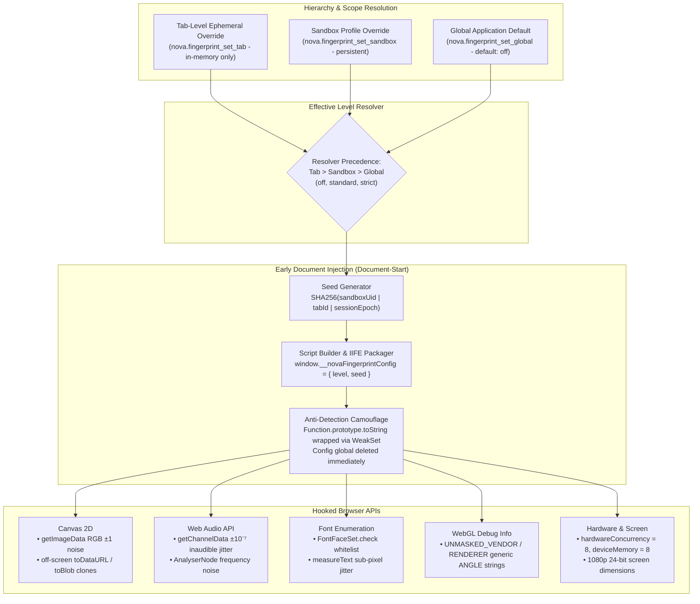

# Hardware Noise & Canvas Fingerprint Protection

Modern commercial tracking scripts gather subtle hardware and rendering characteristics to construct persistent, cross-session device identifiers. By measuring HTML5 Canvas pixel rendering, Web Audio synthesis variances, installed font bounding boxes, GPU vendor strings, and hardware metrics, tracking engines can identify and correlate autonomous agents across sessions—even when cookies, local storage, and browser caches are completely cleared.

Nova AI Workspace provides a multi-tiered **Fingerprint Protection Engine** that injects deterministic, stable noise into identifiable browser APIs, neutralizing fingerprinting while maintaining application stability and evading bot detection defenses.

---

## 1. The Multi-Tier Ingestion & Injection Topology

Fingerprint protection operates at the document-start lifecycle phase, executing before any web page scripts load:



---

## 2. Threat Analysis: The Five Fingerprinting Vectors

| Threat Vector | Mechanism | Fingerprint Exploitation |
| :--- | :--- | :--- |
| **HTML5 Canvas 2D** | Rasterizes 2D text, gradients, and emojis into an off-screen `<canvas>`. | GPU architecture, driver version, and sub-pixel antialiasing differences yield slightly different pixel RGB values, producing a persistent device hash. |
| **Web Audio API** | Synthesizes an audio oscillator signal and processes it through a dynamics compressor. | Floating-point rounding variances in audio processing hardware produce subtle, measurable frequency response signatures. |
| **Font Probing** | Measures string widths via `measureText` or checks `document.fonts.check()` across hundreds of fonts. | Identifies exact installed fonts (e.g., custom enterprise fonts, specialized design software fonts), isolating specific corporate machines. |
| **WebGL GPU Unmasking** | Queries `WEBGL_debug_renderer_info` extension parameters (`UNMASKED_VENDOR_WEBGL`, `UNMASKED_RENDERER_WEBGL`). | Exposes exact graphics card model, driver branch, and vendor (e.g., `NVIDIA GeForce RTX 4090 / D3D11`). |
| **Hardware Metrics** | Reads `navigator.hardwareConcurrency`, `navigator.deviceMemory`, `screen.width`, `screen.colorDepth`. | Isolates hardware tier (e.g., 32 CPU cores, 64 GB RAM, dual-monitor 4K display geometry). |

---

## 3. Protection Levels & Technique Matrix

Nova implements three distinct protection tiers:

| Protection Level | Enabled Techniques | Primary Utility & Compatibility Profile |
| :---: | :--- | :--- |
| **`off`** *(Default)* | None | Native WebView2 behavior. Unmodified hardware readouts. Recommended for trusted internal corporate apps with strict SSO hardware attestations. |
| **`standard`** | `canvas`, `audio` | Injects subtle, non-disruptive noise into Canvas and Web Audio readouts. Completely imperceptible to human users and 100% stable for web applications. |
| **`strict`** | `canvas`, `audio`, `font`, `webgl`, `hardware`, `screen` | Full defense suite: standard protections plus font whitelisting, generic WebGL vendor/renderer strings, standardized CPU/RAM metrics, and fixed 1080p screen resolution. |

### Technique Implementation Details

```
+-----------------------------------------------------------------------------------+
| TECHNIQUE      | LEVEL    | INJECTED PROTECTION SPECIFICATION                     |
+----------------+----------+-------------------------------------------------------+
| Canvas 2D      | Standard | Adds deterministic ±1 RGB noise to getImageData.      |
|                | & Strict | Clones toDataURL/toBlob to off-screen noisy canvas.   |
+----------------+----------+-------------------------------------------------------+
| Web Audio      | Standard | Injects ±10⁻⁷ inaudible jitter into getChannelData.   |
|                | & Strict | Modifies AnalyserNode frequency byte frequencies.     |
+----------------+----------+-------------------------------------------------------+
| Font Whitelist | Strict   | Intercepts FontFaceSet.check to allow only core web   |
|                | Only     | fonts (Arial, Times New Roman, Courier New, Georgia). |
|                |          | Adds sub-pixel jitter to CanvasRenderingContext2D     |
|                |          | measureText width/height metrics.                     |
+----------------+----------+-------------------------------------------------------+
| WebGL ANGLE    | Strict   | Replaces unmasked GPU vendor with 'Google Inc.        |
| Generic        | Only     | (Google)' and renderer with 'ANGLE (Google, Vulkan    |
|                |          | 1.3.0 (SwiftShader Device (Subzero)), SwiftShader)'.  |
+----------------+----------+-------------------------------------------------------+
| Standard       | Strict   | Overrides navigator.hardwareConcurrency = 8 and       |
| Hardware       | Only     | navigator.deviceMemory = 8. Standardizes screen to    |
|                |          | 1920x1080, 24-bit color depth, 1.0 devicePixelRatio.  |
+-----------------------------------------------------------------------------------+
```

---

## 4. Deterministic Seed Generation & Stability

A major failure mode in crude anti-fingerprinting browser extensions is **random noise churn**: if every call to `toDataURL` returns completely random, changing noise, tracking scripts instantly flag the browser as an active spoofing bot.

Nova eliminates this vulnerability through **session-stable deterministic seeding**:
1. **The Seed Derivation:**
   $$\text{Seed} = \text{SHA-256}(\text{SandboxPersistentUid} \mathbin{\Vert} \text{TabId} \mathbin{\Vert} \text{SessionEpoch})$$
2. **Deterministic Pseudo-Random Generator (PRNG):** Nova's injected script initializes a lightweight Mulberry32 PRNG keyed with the derived seed.
3. **Internal Reproducibility:** Repeated canvas or audio measurements within the same browsing session produce identical noisy values. Fingerprinting scripts see a coherent, stable device rather than an anomalous, fluctuating signature.
4. **Cross-Session Uncorrelation:** When a new tab is created or a new session epoch begins, a fresh seed is derived, breaking long-term cross-session tracking graphs.

---

## 5. Early Document Injection & Anti-Detection Camouflage

Sophisticated anti-bot engines (e.g., Cloudflare Turnstile, DataDome, Akamai Bot Manager) inspect JavaScript prototypes to detect proxy hooks:

```javascript
// Bot detector audit check:
if (HTMLCanvasElement.prototype.toDataURL.toString() !== "function toDataURL() { [native code] }") {
    flagSuspiciousBot();
}
```

Nova deploys comprehensive anti-tamper camouflage:
1. **Document-Start Injection:** The protection script is registered via `CoreWebView2.AddScriptToExecuteOnDocumentCreatedAsync`. It runs in the top-level execution frame before any page HTML is parsed or external scripts execute.
2. **`toString` Preservation via `WeakSet`:** Patched methods (`toDataURL`, `getImageData`, `getChannelData`, `getParameter`) are registered in an internal `WeakSet`. A patched `Function.prototype.toString` intercepts queries on these functions, returning native browser string representations:
   ```javascript
   "function toDataURL() { [native code] }"
   ```
3. **Immediate Memory Sanitization:** As soon as the IIFE executes, `window.__novaFingerprintConfig` is deleted from the global scope, leaving zero telltale configuration objects in memory.

---

## 6. Granular Configuration API

Agents and operators configure fingerprint protection across three operational scopes:

| MCP Tool | Target Scope | Persistence | Typical Use Case |
| :--- | :--- | :--- | :--- |
| [`nova.fingerprint_set_tab`](../../../../mcp-reference/tools/site-data-and-identity/nova-fingerprint-set-tab.md) | Single Tab | In-Memory (Ephemeral) | Elevating a specific tab to `strict` for a high-risk security audit. |
| [`nova.fingerprint_set_sandbox`](../../../../mcp-reference/tools/site-data-and-identity/nova-fingerprint-set-sandbox.md) | Sandbox Profile | Persistent (`settings.json`) | Enforcing `standard` noise across an entire research profile. |
| [`nova.fingerprint_set_global`](../../../../mcp-reference/tools/site-data-and-identity/nova-fingerprint-set-global.md) | Application-Wide | Persistent (`settings.json`) | Establishing the default baseline for all newly created tabs. |
| [`nova.fingerprint_get`](../../../../mcp-reference/tools/site-data-and-identity/nova-fingerprint-get.md) | Active Tab | Read-Only | Inspecting the effective level and active technique list. |

---

## 7. Related Documentation

* [Browser Identity & Client Hints](../browser-identity-and-client-hints/README.md): User-Agent emulation and `Sec-CH-UA` Client Hints synthesis.
* [Fingerprint Protection & Identity Hub](../README.md): High-level taxonomy and threat model.
* [Multi-Sandbox Profile Isolation](../../../sandbox-isolation/README.md): Sandbox storage isolation and disk anchors.
* [Fingerprint Get Reference](../../../../mcp-reference/tools/site-data-and-identity/nova-fingerprint-get.md) · [Fingerprint Set Sandbox Reference](../../../../mcp-reference/tools/site-data-and-identity/nova-fingerprint-set-sandbox.md)
