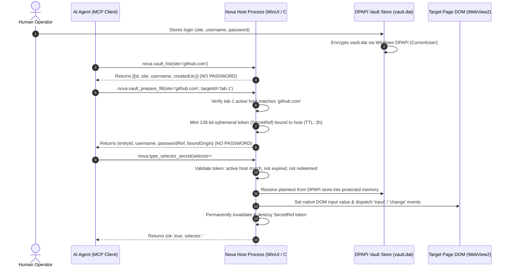

# Password Vault, SecretRef Tokens & Scoped Secret Delivery

In conventional browser automation and AI assistant workflows, managing credentials poses severe security risks: operators paste cleartext passwords into prompts, scripts echo tokens into logs, and models see plaintexts in their context windows. If an agent encounters a malicious web page, a prompt-injection attack can induce the model to repeat or exfiltrate credentials it has seen.

Nova AI Workspace completely eliminates this vulnerability through an **Assistant Password Vault** built on a zero-knowledge delivery model:
1. Credentials are encrypted on disk with **Windows DPAPI** (`DataProtectionScope.CurrentUser`).
2. Neither vault discovery tools nor secret injection tools ever return the plaintext password to the agent or context window.
3. Password delivery uses an ephemeral, single-use, host-bound **`SecretRef` token**, redeemed directly into the browser DOM by the host process.
4. A complementary **Scoped Secret Store** delivers API tokens and keys to terminal sessions and scheduled tasks as environment variables without exposing them in transcripts.

---

## 1. Domain Architecture & Subguides

The Password Vault & Scoped Secrets subsystem is divided into two specialized technical guides:

```
+-----------------------------------------------------------------------------------+
|                     PASSWORD VAULT & SCOPED SECRETS DOMAIN                        |
+-----------------------------------------------------------------------------------+
| 1. DPAPI Vault & SecretRef Tokens       | Zero-knowledge fill flow, DPAPI storage,|
|                                         | 128-bit SecretRef tokens, DOM injection.|
+-----------------------------------------+-----------------------------------------+
| 2. Scoped Environment Secrets & Audit   | Scoped secret store, ConPTY environment |
|                                         | injection, scheduled tasks, audit trail.|
+-----------------------------------------------------------------------------------+
```

| Guide | Focus Area | Core Architectural Concepts |
| :--- | :--- | :--- |
| **[DPAPI Vault & SecretRef Tokens](dpapi-vault-and-secretref-tokens/README.md)** | Browser Credential Autofill | Windows DPAPI encryption (`vault.dat`), zero-knowledge delivery sequence, ephemeral 128-bit `SecretRef` token minting, strict origin binding, 2-hour TTL, native property setter DOM injection (`HTMLInputElement.prototype.value`), and instant token destruction. |
| **[Scoped Environment Secrets & Audit](scoped-environment-secrets-and-audit/README.md)** | CLI & Background Task Credentials | Scoped secret store (`nova.secret_*`), process environment variable delivery into ConPTY terminal runners and scheduled tasks, zero command-line/shell history leaks, task-scoped workspace isolation, and tamper-resistant audit logs. |

---

## 2. System Architecture & The Zero-Knowledge Fill Flow

The vault decouples credential authorization from credential exposure:



---

## 3. Threat Modeling: Eliminating Credential Exfiltration

| Threat Vector | Conventional Automation | Nova Zero-Knowledge Architecture |
| :--- | :--- | :--- |
| **Model Context Exposure** | Passwords appear in prompts and model outputs; logged by LLM provider APIs. | **Eliminated.** Plaintext passwords never enter prompts, completions, or transcripts. |
| **Prompt Injection Exfiltration** | Malicious site tricks agent into summarizing or printing credentials. | **Eliminated.** The agent has only an opaque `passwordRef` handle, not the password itself. |
| **Credential Phishing on Redirects** | Automation scripts fill passwords blindly into rogue forms on redirect. | **Blocked.** Tokens are strictly bound to the target host; domain mismatches reject fills. |
| **Disk Inspection & Theft** | Plaintext config files or cleartext SQLite databases. | **Encrypted.** Protected by Windows DPAPI; unreadable by other Windows users or offline disks. |
| **Session Recording Leaks** | Passwords captured in HTTP debugging logs or timeline replays. | **Redacted.** Multi-encoding HMAC-SHA-256 redaction masks passwords at capture time. |

---

## 4. MCP Tool Capability Matrix

Agents interact with the vault and secret stores through the `vault-and-security` bundle:

| Tool Name | Scope | Primary Function | Sensitive Output Guard |
| :--- | :--- | :--- | :--- |
| [`nova.vault_list`](../../../mcp-reference/tools/vault-and-security/nova-vault-list.md) | Browser Vault | Discovers saved logins matching a target site domain. | Returns site and username metadata only; **zero passwords**. |
| [`nova.vault_prepare_fill`](../../../mcp-reference/tools/vault-and-security/nova-vault-prepare-fill.md) | Browser Vault | Mints an ephemeral, origin-bound `SecretRef` token. | Returns opaque UUID handle; **zero passwords**. |
| [`nova.type_selector_secret`](../../../mcp-reference/tools/vault-and-security/nova-type-selector-secret.md) | Browser Vault | Injects password into DOM field using native setter. | Redeems token directly inside host; returns `{ ok: true }`. |
| [`nova.secret_set`](../../../mcp-reference/tools/vault-and-security/nova-secret-set.md) | Scoped Store | Registers or updates a scoped API key or secret. | Accepts value over local IPC and encrypts via DPAPI immediately. |
| [`nova.secret_list`](../../../mcp-reference/tools/vault-and-security/nova-secret-list.md) | Scoped Store | Enumerates registered secret keys and metadata. | Returns key names and descriptions only; **zero secret values**. |
| [`nova.secret_delete`](../../../mcp-reference/tools/vault-and-security/nova-secret-delete.md) | Scoped Store | Purges a secret key from DPAPI storage. | Destroys secret bytes and updates store atomically. |

---

## 5. Related Architecture Guides

* [DPAPI Assistant Vault & SecretRef Tokens](dpapi-vault-and-secretref-tokens/README.md): Detailed autofill mechanics, native setter injection, and phishing guards.
* [Scoped Environment Secrets & Audit](scoped-environment-secrets-and-audit/README.md): Terminal runner environment injection and scheduled task integration.
* [Privacy Architecture Hub](../README.md): High-level privacy overview, threat modeling, and defense layers.
* [Fingerprint Protection & Identity](../fingerprint-and-identity/README.md): Canvas/audio noise injection and User-Agent spoofing.
* [Anti-Tracking & Leak Protection](../anti-tracking-and-leak-protection/README.md): WebRTC IP shielding and capture-time credential redaction.
* [Vault Prepare Fill Reference](../../../mcp-reference/tools/vault-and-security/nova-vault-prepare-fill.md) · [Type Selector Secret Reference](../../../mcp-reference/tools/vault-and-security/nova-type-selector-secret.md)
