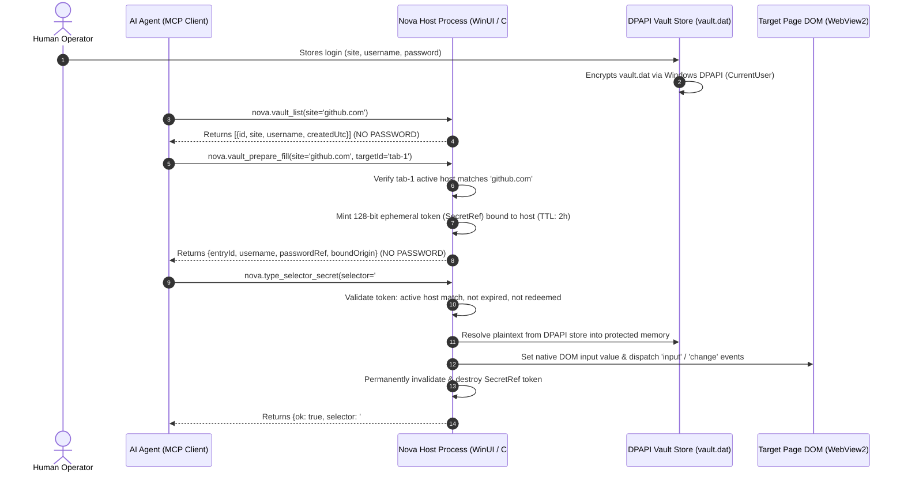
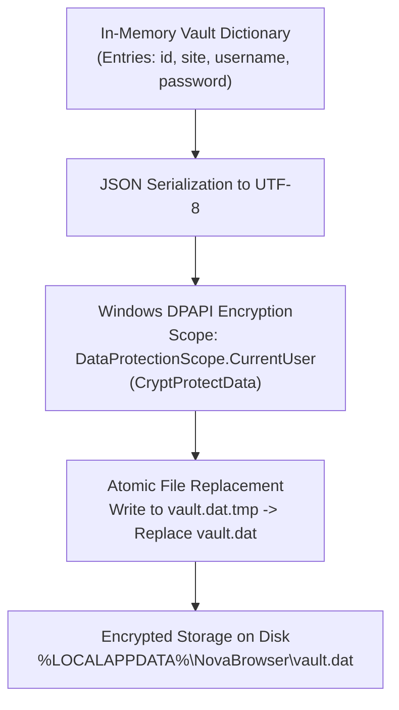

# DPAPI Assistant Vault & SecretRef Token Architecture

In conventional browser automation and AI assistant workflows, credential management presents critical security vulnerabilities: operators paste cleartext passwords into system prompts, automation scripts echo tokens into debugging logs, and large language models retain credentials in volatile context windows. If an autonomous agent encounters a malicious web page, a prompt injection attack can trick the model into repeating or exfiltrating the credentials it has seen.

Nova AI Workspace eliminates this vulnerability through an **Assistant Password Vault** built on a zero-knowledge delivery model:
1. Credentials are encrypted on disk with **Windows DPAPI** (`DataProtectionScope.CurrentUser`).
2. Vault discovery and preparation tools never disclose plaintext passwords to the agent or context window.
3. Password delivery uses an ephemeral, host-bound, single-use **`SecretRef` token**, redeemed directly into the browser DOM by the host process.
4. Once redeemed or expired, the token is permanently destroyed in memory.

---

## 1. The Zero-Knowledge Credential Delivery Flow

The Assistant Password Vault completely decouples credential authorization from credential disclosure:



---

## 2. Threat Modeling: Eliminating Credential Exfiltration

| Threat Vector | Conventional Automation | Nova Zero-Knowledge Architecture |
| :--- | :--- | :--- |
| **Model Context Exposure** | Passwords appear in prompts and model outputs; logged by LLM provider APIs. | **Eliminated.** Plaintext passwords never enter prompts, completions, or transcripts. |
| **Prompt Injection Exfiltration** | Malicious site tricks agent into summarizing or printing credentials. | **Eliminated.** The agent possesses only an opaque `passwordRef` UUID handle, not the password itself. |
| **Credential Phishing on Redirects** | Automation scripts fill passwords blindly into rogue forms on redirect. | **Blocked.** Tokens are strictly bound to the target host; domain mismatches reject fills. |
| **Disk Inspection & Theft** | Plaintext config files or cleartext SQLite databases. | **Encrypted.** Protected by Windows DPAPI; unreadable by other Windows users or offline disks. |
| **Session Recording Leaks** | Passwords captured in HTTP debugging logs or timeline replays. | **Redacted.** Multi-encoding HMAC-SHA-256 redaction masks passwords at capture time. |

---

## 3. Storage Architecture & Windows DPAPI Encryption

Nova's password vault store (`vault.dat`) is protected by operating-system-level encryption:



### Cryptographic Guarantees
* **Machine & User Binding:** DPAPI keys are derived from the active Windows user's logon security identifier (SID) and machine-specific master keys.
* **Cold Storage Security:** If `vault.dat` is copied to another machine, accessed by a different local user account, or extracted from an offline drive image, the file cannot be decrypted.
* **Atomic File Swaps:** Vault updates write encrypted bytes to a temporary sibling file (`vault.dat.tmp`) before invoking an atomic Win32 file replace. A sudden system crash or power interruption never results in a corrupted, half-written database.

---

## 4. Pre-Flight Credential Discovery (`nova.vault_list`)

When an agent navigates to a login page, it queries available credentials using [`nova.vault_list`](../../../../mcp-reference/tools/vault-and-security/nova-vault-list.md):

```json
{
  "site": "github.com"
}
```

### Result Schema
```json
{
  "entries": [
    {
      "id": "vault_entry_88a10",
      "site": "github.com",
      "username": "automation-service-account",
      "createdUtc": "2026-10-15T08:30:00Z"
    }
  ]
}
```

The discovery response returns strictly identity metadata: entry IDs, matching site patterns, usernames, and creation timestamps. Under no circumstances is the password field returned across the wire.

---

## 5. Ephemeral `SecretRef` Token Minting (`nova.vault_prepare_fill`)

To prepare for filling, the agent invokes [`nova.vault_prepare_fill`](../../../../mcp-reference/tools/vault-and-security/nova-vault-prepare-fill.md), binding the credential to a specific browser tab:

```json
{
  "site": "github.com",
  "targetId": "tab_work_1",
  "username": "automation-service-account"
}
```

### The Minting Contract
1. **Target Host Verification:** Nova inspects the active document URL inside `tab_work_1`. If the top-level origin is not `github.com` (e.g., if the page navigated to `phishing-login.com`), the tool immediately aborts with an origin mismatch error.
2. **Cryptographic Token Minting:** Nova generates a 128-bit cryptographically secure random token (`passwordRef`), formatted as a UUID string (e.g., `sec_9a1f28b4-0e7d-4a11-b01c-6d9124a9e521`).
3. **In-Memory Registry:** The token is registered in an internal host registry with the following metadata:
   * Bound Tab ID (`tab_work_1`)
   * Bound Origin (`https://github.com`)
   * Expiration Timestamp (Fixed 2-hour TTL)
   * Redemption State (`unredeemed`)
4. **Token Returned to Agent:** The agent receives `{ entryId, username, passwordRef, boundOrigin }`.

---

## 6. Native DOM Redemption (`nova.type_selector_secret`)

Once the agent has filled the username field using standard interaction tools, it dispatches the password using [`nova.type_selector_secret`](../../../../mcp-reference/tools/vault-and-security/nova-type-selector-secret.md):

```json
{
  "selector": "input#password",
  "secretRef": "sec_9a1f28b4-0e7d-4a11-b01c-6d9124a9e521"
}
```

### Redemption Mechanics
1. **Pre-Redemption Verification:**
   * Token exists in the active registry.
   * Token has not expired (current time $< \text{createdAt} + 2\text{ hours}$).
   * Token has not been redeemed previously.
   * Current top-level document URL in the tab strictly matches `boundOrigin`.
2. **Protected Memory Resolution:** The host resolves the vault entry from `vault.dat` directly into a temporary, pinned memory buffer.
3. **Native Property Setter Execution:**
   * Standard JavaScript input setting (`input.value = "..."`) is often intercepted or ignored by modern frameworks (React, Angular, Vue).
   * Nova invokes the native HTML prototype descriptor setter:
     ```javascript
     Object.getOwnPropertyDescriptor(window.HTMLInputElement.prototype, 'value').set.call(targetElement, decryptedSecret);
     ```
   * Nova immediately dispatches synthetic `input` and `change` events with `bubbles: true` to trigger framework state synchronizers.
4. **Immediate Token Destruction:** The `SecretRef` token is permanently deleted from the host registry. Subsequent attempts to use the same token fail with an invalid token error.
5. **Memory Sanitization:** The plaintext buffer is cleared immediately. The tool returns `{ ok: true, selector: "input#password" }` with zero credential bytes logged.

---

## 7. Related Documentation

* [Scoped Environment Secrets & Task Delivery](../scoped-environment-secrets-and-audit/README.md): Environment variable injection for ConPTY terminals and scheduled tasks.
* [Password Vault & Secrets Hub](../README.md): Overview of credential management and threat models.
* [Anti-Tracking & Leak Protection](../../anti-tracking-and-leak-protection/README.md): WebRTC IP leak prevention and capture-time redaction.
* [Vault Prepare Fill Tool Reference](../../../../mcp-reference/tools/vault-and-security/nova-vault-prepare-fill.md) · [Type Selector Secret Reference](../../../../mcp-reference/tools/vault-and-security/nova-type-selector-secret.md)
