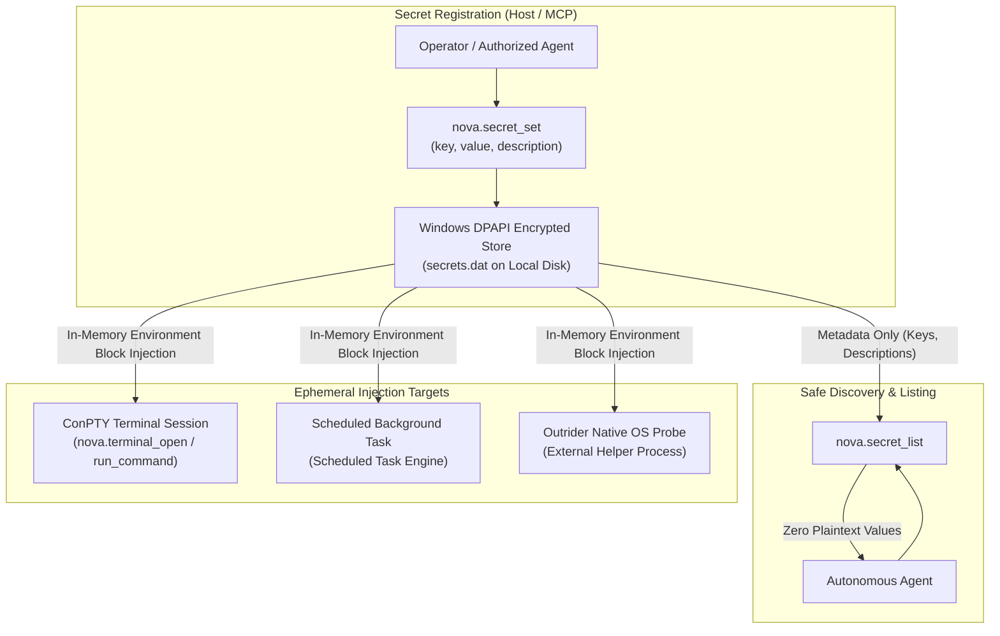
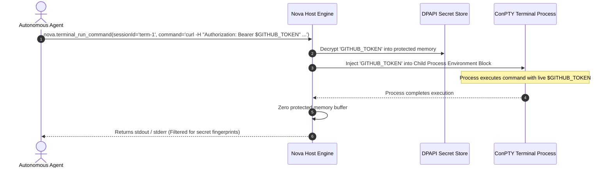

# Scoped Environment Secrets & Execution Audit

While the Assistant Password Vault specializes in interactive browser form filling via `SecretRef` tokens, autonomous workflows frequently require access to non-interactive credentials: API keys for external services, database connection strings, deployment tokens, and private SSH passphrases. In standard CLI automation, embedding secrets into shell commands or script files risks exposing them in process tables (`Get-Process`), shell history files (`.bash_history`, `ConsoleHost_history.txt`), and agent transcripts.

Nova AI Workspace resolves this challenge through the **Scoped Secret Store**: an encrypted repository that delivers credentials directly into target child execution contexts (ConPTY terminal sessions, background tasks, and containerized jobs) as ephemeral environment variables.

---

## 1. Scoped Secret Architecture & Delivery Model

The Scoped Secret Store acts as a controlled intermediary between Windows DPAPI storage and child execution processes:



---

## 2. Secret Lifecycle Management API

Agents and operators manage scoped credentials using the `vault-and-security` tool suite:

| MCP Tool | Purpose | Data Returned | Security Invariant |
| :--- | :--- | :--- | :--- |
| [`nova.secret_set`](../../../../mcp-reference/tools/vault-and-security/nova-secret-set.md) | Encrypts and stores a new scoped secret or updates an existing one. | `{ ok: true, key: "GITHUB_TOKEN" }` | Value is accepted over secure local IPC and encrypted immediately via DPAPI. |
| [`nova.secret_list`](../../../../mcp-reference/tools/vault-and-security/nova-secret-list.md) | Enumerates all registered secret keys. | Array of `{ key, description, createdAt, lastUsedAt }` | **Zero secret values.** Lists only metadata for workflow orchestration. |
| [`nova.secret_delete`](../../../../mcp-reference/tools/vault-and-security/nova-secret-delete.md) | Destructively purges a secret from disk. | `{ ok: true, deletedKey: "AWS_SECRET_KEY" }` | Overwrites memory buffers and updates `secrets.dat` atomically. |

---

## 3. Dynamic Environment Variable Injection

When an agent launches a terminal session via [`nova.terminal_open`](../../../../mcp-reference/tools/terminal-ops/nova-terminal-open.md) or initiates a scheduled task, secrets are delivered strictly as **process environment variables**:



### Defense-in-Depth Invariants
1. **No Command-Line Parameter Leaks:** Secrets are never passed as command-line arguments (e.g., `--api-key="secret"`). External system auditing utilities (`Get-CimInstance Win32_Process`) see only references to environment variable names (`$API_KEY`).
2. **No Shell History Exposure:** Commands executed in ConPTY sessions reference the environment variable name, preventing plaintext keys from being recorded in PowerShell or Bash history logs.
3. **No File Footprint:** Secrets do not reside in `.env` files or temporary workspace scripts, eliminating unversioned file commits.

---

## 4. Scheduled Task Secret Chaining

Autonomous background routines and recurring maintenance tasks managed by Nova's [Scheduled Tasks](../../../scheduled-tasks/README.md) subsystem often require ongoing credential access:

* **Task-Scoped Bindings:** Using [`nova.scheduled_task_secret_set`](../../../../mcp-reference/tools/scheduled-tasks/nova-scheduled-task-secret-set.md), operators can bind specific secrets to individual scheduled task definitions.
* **Workspace Isolation:** Tasks running in isolated sandbox directories receive only the secrets explicitly mapped to their profile. A task configured to perform website health checks cannot access deployment credentials bound to a production release task.
* **Zero Transcript Exposure:** When tasks generate execution summaries or error logs, Nova's capture redactor cross-references active secret fingerprints, replacing any accidentally printed tokens with `[redacted:secret]`.

---

## 5. Audit Logging & Compliance Guarantees

Every interaction with the Scoped Secret Store is recorded in Nova's local diagnostic audit trail:

```json
{
  "ts": "2026-10-18T10:31:00.104Z",
  "eventType": "secret_accessed",
  "secretKey": "STRIPE_TEST_KEY",
  "requestingTool": "nova.terminal_open",
  "contextId": "term_session_441",
  "caller": "mcp_client",
  "outcome": "success"
}
```

### Governance Invariants
* **Key-Only Logging:** Audit logs record only the key name, timestamp, and target context. Credential values are cryptographically blocked from appearing in host logs.
* **Tamper-Resistant Storage:** Secret files (`secrets.dat`) are guarded by Windows DPAPI tied to the active Windows user account, preventing offline data theft.
* **Enterprise Key Rotation:** Updating a secret key via `nova.secret_set` immediately updates all subsequent terminal launches and scheduled task executions without requiring an application restart.

---

## 6. Related Documentation

* [DPAPI Assistant Vault & SecretRef Tokens](../dpapi-vault-and-secretref-tokens/README.md): Interactive browser form filling and single-use token mechanics.
* [Password Vault & Secrets Hub](../README.md): Overview of credential management and threat models.
* [Terminal Workspaces](../../../terminal-workspaces/README.md): ConPTY architecture and agent command execution.
* [Scheduled Tasks Architecture](../../../scheduled-tasks/README.md): Headless background workers and task chaining.
* [Secret Set Tool Reference](../../../../mcp-reference/tools/vault-and-security/nova-secret-set.md) · [Secret List Tool Reference](../../../../mcp-reference/tools/vault-and-security/nova-secret-list.md)
